# Graph-Tez V7 — Model Mimarileri, Veri Yapıları ve GNN Teknik Öğrenme Rehberi

**Sürüm 1.0 · 15.11.2026**

> Bu doküman **akademik final rapordan ayrı**, bağımsız bir teknik öğrenme
> rehberidir. Amacı, projede gerçekten eğitilmiş modellerin iç yapısını —
> hangi veriyi aldıklarını, o verinin Python tarafında nasıl durduğunu,
> katmanlarda matematiksel olarak ne olduğunu ve skorun nasıl oluştuğunu —
> savunmada adım adım anlatılabilecek düzeyde öğretmektir.
>
> `EMT2_Teslim_v1/EMT2_FINAL_REPORT.*`, eğitim çıktıları, model ağırlıkları
> ve QA dosyalarının **hiçbiri değiştirilmemiştir**.

---

## 1. Bu rehber ne, ne değil

**Ne:** Gerçek koda dayalı bir mimari ve veri yapısı rehberi. Her boyut, her
katman, her parametre sayısı `scripts/` altındaki çalışan Python dosyalarından
ve `reports/qa/` altındaki dondurulmuş çıktılardan doğrulanmıştır. Kaynak
verilmeyen tek bir sayı yoktur.

**Ne değil:**

- Klinik bir doküman değildir. Hiçbir skor "bu ilaç bu yan etkiyi %X olasılıkla
  yapar" anlamına gelmez.
- Sonuçların yeniden yorumu değildir. Final raporun bulguları aynen geçerlidir.
- Genel bir GNN ders kitabı değildir. Projede **kullanılmamış** hiçbir katman
  (GCNConv, GATConv, GraphSAGE, CNN, Transformer) anlatılmamıştır.

### 1.1 Baştan bilinmesi gereken altı şey

Aşağıdaki altı madde, rehberin geri kalanını okurken yanlış bir zihinsel model
kurmanızı engeller. Hepsi koddan doğrulanmıştır.

**(1) Projede hazır bir GNN katmanı kullanılmamıştır.**
PyTorch Geometric kütüphanesi yalnız üç şey için kullanılır: `Data` (tek
molekülün kabı), `Batch` (molekülleri tek bir büyük graf hâline getirme) ve
`global_mean_pool` (atomdan moleküle ortalama). Mesajlaşmanın kendisi
`torch.Tensor.index_add` ile **elle** yazılmıştır
(`wp09_encoder.py:36-39`, `wp10_molecular_encoder.py:42-45`). Savunmada
"GCN kullandık" demek yanlış olur; "mesaj geçiren bir katmanı elle yazdık"
doğrudur.

**(2) Her iki grafta da TEK mesajlaşma katmanı vardır.**
Bir protein yalnız doğrudan komşularından, bir atom yalnız doğrudan bağlı
olduğu atomlardan bilgi alır. **2 adım uzaktaki bilgi bu mimaride
erişilemez.** Bu bir eksiklik değil, 50 ilaçlık eğitim bölmelerinde bilinçli
bir kapasite sınırıdır.

**(3) STRING `combined_score` modelin içinde bir sayı değildir.**
700 eşiği yalnızca "bu kenar grafa girsin mi?" kararını verir. Grafa giren
kenarın ağırlığı yoktur; komşu ortalaması **ağırlıksızdır**. Kodda
`edge_weight` diye bir alan hiç yoktur.

**(4) Yan etki bir graf düğümü değildir.**
Yan etki, son katman olan `nn.Linear(150, K)`'nın **çıkış boyutudur**. Yan
etki düğümleri mesajlaşmaya katılmaz, çünkü böyle düğümler yoktur. Bu,
"heterojen graf" beklentisinin bu projede nasıl karşılandığının (ve
karşılanmadığının) anahtarıdır — §12.4'te ayrıntılı.

**(5) A1/P1 isimleri bir model DALINI açıp kapatır.**
Bu, tek bir ilacın atom maskesinin 0/1 olmasıyla aynı şey değildir. A1P1'de
bile 8 ilacın atom maskesi kapalıdır; A0 kolunda ise maske herkes için
kapatılır. Ayrıntı §11.6'da.

**(6) Negatif bulgular gerçek bulgulardır.**
PPI ekleme −0,000142; atom dalı +0,002894; ilaç→protein mesajı −0,003536.
Bu rehber bu sayıları saklamaz, açıklar.

---

## 2. Okuma haritası

| Sorunuz | Bölüm |
|---|---|
| "Veri nereden geliyor?" | §4 |
| "AP nedir, neden bu metrik?" | §21 |
| "Lojistik regresyon nasıl çalışıyor?" | §8 |
| "GNN gerçekten ne yapıyor?" | §10.D, §16 |
| "A1P1'i kendim nasıl kodlarım?" | §11, Ek C |
| "Graph-in-Graph gerçekten uygulandı mı?" | §12 |
| "edge_index ile edge_attr farkı ne?" | §14.3 |
| "Neden GNN'ler kazanamadı?" | §22 |
| "Hoca şunu sorarsa?" | Ek D |

**Savunma öncesi 2 saatlik okuma yolu:**
§1.1 → §3 → §14 → §15 → §16 → §11 → §12 → §20 → §22 → Ek D.

---

## 3. Sözlük — her terim projenin kendi sayılarıyla

Bir terimi kullanmadan önce burada tanımlıyoruz. Soyut tanım + bu projedeki
somut karşılığı.

**Düğüm (node).** Grafın bir öğesi. Bu projede **iki ayrı graf** ve dolayısıyla
iki tür düğüm var: *atomlar* (moleküler grafta) ve *proteinler* (PPI grafında).
İlaçlar düğüm değildir; ilaç, kendi moleküler grafına ve kendi protein
komşuluğuna sahip bir **satırdır**.
*Somut:* Metronidazole'ün moleküler grafında 12 atom düğümü var;
`primary_o03_final` eğitim grafında 133 protein düğümü var.

**Kenar (edge).** İki düğüm arasındaki ilişki. Moleküler grafta kimyasal bağ;
PPI grafında STRING ilişkisi; ilaç–protein grafında DrugBank rolü.
*Somut:* Metronidazole'ün 12 bağı var, model bunları **24 yönlü kenar**
olarak görür (her bağ iki yöne açılır).

**Özellik vektörü (feature vector).** Bir düğümü tarif eden sayı listesi.
*Somut:* Her atom 44 sayı, her protein 56 sayı, her bağ 14 sayı.

**`x`.** Düğüm özellik matrisi. Satır = düğüm, sütun = özellik.
*Somut:* Metronidazole için `x.shape == (12, 44)`.

**`edge_index`.** Kenarların **kim-kime** listesi. Şekli daima `(2, E)`:
üst satır kaynak düğüm indeksi, alt satır hedef düğüm indeksi.
*Somut:* Metronidazole için `edge_index.shape == (2, 24)`.

**`edge_attr`.** Kenarların **özellikleri**. Şekli `(E, özellik)`. `edge_index`
bağlantının *varlığını*, `edge_attr` o bağlantının *nasıl bir şey olduğunu*
söyler.
*Somut:* `edge_attr.shape == (24, 14)`.

**Mesajlaşma (message passing).** Bir düğümün komşularından bilgi toplaması.
Üç adımdır: (a) her komşu bir **mesaj** üretir, (b) mesajlar **toplanır**
(burada: ortalama alınır), (c) düğüm kendi durumunu bu toplamla **günceller**.

**Embedding (gömme).** Bir nesnenin öğrenilmiş sayısal temsili. Ham özellikten
farkı: embedding eğitim sırasında değişir, ham özellik sabittir.
*Somut:* Protein ham özelliği 56 boyut (sabit); protein embedding'i 32 boyut
(öğrenilir).

**Pooling (havuzlama).** Değişken sayıda düğümü sabit boyutlu tek bir vektöre
indirme. Bu projede daima **ortalama** (mean).
*Somut:* 12 atomlu Metronidazole ve 51 atomlu Erythromycin, pooling'den sonra
ikisi de 16 boyutlu tek bir vektör olur. Model bu sayede farklı büyüklükteki
molekülleri aynı başlıkla işleyebilir.

**Maskeleme (masking).** "Bu bilgi bu ilaç için yok" durumunu modele açıkça
söylemek. Eksik modalite için nötr 0 yazılır **ve ayrıca bir maske biti 0
yapılır**, böylece model "0 değeri" ile "bilgi yok" arasındaki farkı görebilir.
*Somut:* 5 maske biti var: kimya, target, enzyme, transporter, carrier.

**Füzyon (fusion).** Farklı kaynaklardan gelen vektörleri birleştirme. Bu
projede **geç füzyon**: her kol kendi temsilini üretir, sonunda yan yana
eklenir (`torch.cat`).
*Somut:* 8 + 128 + 5 + 8 + 1 = 150.

**Logit.** Sigmoid'den **önceki** ham skor. (−∞, +∞) aralığındadır.

**Sigmoid.** `σ(z) = 1 / (1 + e^(−z))`. Logiti (0, 1) aralığına taşır.
σ(0) = 0,5; σ(2) ≈ 0,88; σ(−2) ≈ 0,12. **Bu bir olasılık değildir** — modeli
olasılık verecek şekilde kalibre etmedik; yalnız sıralama için kullanıyoruz.

**Residual bağlantı.** `h = z + (yeni bilgi)` biçimi. Düğümün kendi bilgisini
kaybetmemesini sağlar. Bu projede hem protein hem atom kolunda var.

**Gözlenen kayıt (observed record) / `s`.** Etiketimiz.
`s = 1`: SIDER'da bu ilaç–yan etki kaydı **var**.
`s = 0`: **kayıt yok**. Bu "yan etki yok" DEĞİLDİR. Rehber boyunca bu ayrım
`unknown` kelimesiyle korunur.

---

## 4. Veri zinciri: ham kaynaktan model girdisine

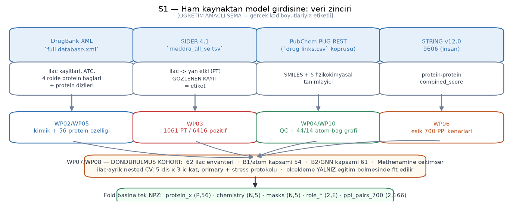

### 4.1 Dört kaynak ve ne sağladıkları

| Kaynak | Ne verir | Modelde nereye gider |
|---|---|---|
| DrugBank XML (`full database.xml`) | İlaç kayıtları, ATC kodları, 4 rolde protein bağlantıları, protein dizileri | İlaç–protein kenarları + protein dizi özellikleri |
| SIDER 4.1 (`meddra_all_se.tsv`) | İlaç → yan etki (MedDRA PT) kayıtları | **Yalnız etiket.** Hiçbir encoder'a girmez |
| PubChem PUG REST (`drug links.csv` köprüsüyle) | Doğrulanmış SMILES + 5 fizikokimyasal tanımlayıcı | Moleküler graf + kimya bloğu |
| STRING v12.0 (taxon 9606) | Protein–protein `combined_score` | Yalnız kenar **seçimi** (eşik 700) |

### 4.2 Dondurulmuş kohort sayıları

| Büyüklük | Değer | Anlamı |
|---|---:|---|
| İlaç envanteri | **62** | Hiçbir aşamada küçültülmez |
| Kaynak PT sayısı | **1.061** | SIDER'da bu 62 ilaçla ilişkilendirilmiş farklı yan etki |
| Kaynak pozitif ilişki | **6.416** | (ilaç, PT) çifti |
| B1 / atom dalı kapsamı | **54** | QC'den geçmiş yapısı olan ilaçlar |
| B2 / GNN kapsamı | **61** | En az bir modalitesi olan ilaçlar |
| Tam çekimser | **1** | Methenamine: ne QC'li kimya ne protein |

### 4.3 Kritik yapısal gerçek: 54 = 54 = 54

Bu, rehberin en önemli tek tablosudur ve çoğu kişinin gözünden kaçar:

| Küme | Büyüklük | Tanım |
|---|---:|---|
| B1'in skorlayabildiği ilaçlar | 54 | `prediction_eligibility.csv :: model=B1 & eligible` |
| Atom dalının açık olduğu ilaçlar | 54 | `molecule_registry.json :: atom_eligible` |
| `paired54` değerlendirme kapsamı | 54 | `comparison_keys.csv :: scope=paired54` |

**Bu üç küme birbirinin AYNISIDIR** (Python'da `==` ile doğrulandı). Nedeni:
üçü de aynı QC kararına dayanır — "bu molekülün stereokimyası belirtilmiş mi?"
Belirtilmemişse hem PubChem tanımlayıcıları QC'den geçmez, hem atom grafı
maskelenir.

QC'den geçmeyen 8 ilaç ve nedenleri:

| İlaç | QC bayrağı |
|---|---|
| Carbenicillin | `unspecified_atom_stereo` |
| Gentamicin | `multiple_components` + `unspecified_atom_stereo` |
| Lomefloxacin | `unspecified_atom_stereo` |
| Gatifloxacin | `unspecified_atom_stereo` |
| Cefprozil | `unspecified_double_bond_stereo` |
| Gemifloxacin | `unspecified_atom_stereo` |
| Ofloxacin | `unspecified_atom_stereo` |
| Methenamine | `unspecified_atom_stereo` |

**Pratik sonucu:** A1P1'in atom dalını B1 ile karşılaştırmak adildir, çünkü
ikisi tam olarak aynı 54 ilacı görür. Bu bir tesadüf değil, tasarım gereğidir.

---

## 5. Ortak değerlendirme iskeleti

Bütün modeller aynı bölmeleri, aynı hedef sözlüklerini ve aynı metrikleri
kullanır. Bu olmadan "A modeli B'den iyi" cümlesi anlamsız olurdu.

### 5.1 İç içe çapraz doğrulama (nested CV)

```
5 DIŞ KAT (outer)                   ← performans buradan ölçülür
 └── her dış katın içinde 3 İÇ KAT  ← hiperparametre/epoch buradan seçilir
```

- **Dış kat:** ilaçların ~1/5'i test, kalanı eğitim. Test ilaçları eğitimde
  hiç görünmez (**drug-disjoint**).
- **İç kat:** dış eğitim kümesi tekrar bölünür; `C` değeri (B1/B2) veya epoch
  sayısı (GNN'ler) **yalnız burada** seçilir.
- Bu ayrım şunu garantiler: hiçbir tasarım kararı test sonucuna bakılarak
  alınmamıştır.

### 5.2 İki protokol

| Protokol | Gruplama ölçütü | Ne sorar |
|---|---|---|
| **primary** | Bağlantılılık (connectivity) | Normal koşulda ne kadar iyi? |
| **stress** | İskelet (scaffold) **veya** Tanimoto ≥ 0,8 | Kimyasal olarak benzer ilaçlar ayrıldığında ne kadar iyi? |

Stres protokolü, "model aslında eğitimdeki benzer bir ilacı kopyalıyor mu?"
sorusunun cevabıdır. §13'te T1/B1 karşılaştırmasında bu çok çarpıcı biçimde
ortaya çıkar.

### 5.3 İki kapsam

| Kapsam | İlaç | Çift (primary) | Ne zaman kullanılır |
|---|---:|---:|---|
| `paired54` | 54 | 13.964 | **Modeller karşılaştırılırken** (herkesin skorladığı ortak küme) |
| `own61` | 61 | 18.004 | Bir modelin kendi tam kapsamı raporlanırken |

### 5.4 Metrikler

| Metrik | Yön | Rol |
|---|---|---|
| `drug_macro_AP` | Bir **ilaç** için PT'leri sırala | **BİRİNCİL** |
| `micro_AP` | Tüm çiftleri tek havuzda sırala | İkincil |
| `within_fold_class_macro_AUROC` | Bir **PT** için ilaçları sırala (kat içi) | İkincil |
| `class_macro_AP` | Bir **PT** için ilaçları sırala (havuzlanmış) | Yalnız tanısal |
| `class_macro_AUROC` | aynı | Yalnız tanısal |

Birincil ölçüt **sonuçlar görülmeden önce** kilitlenmiştir. §21.4'te bu
seçimin sonuçları nasıl etkilediği ayrıntılı tartışılır.

### 5.5 Güven aralıkları

1.000 yinelemeli **eşleştirilmiş grup bootstrap**. "Grup" = kilitli yapısal
grup (örn. Levofloxacin ve Ofloxacin aynı grupta çekilir). Bütün modeller
**aynı çekimleri** kullanır, bu yüzden farklar eşleştirilmiştir.

**GA'nın kapsamadıkları** (bu cümle savunmada mutlaka söylenmeli):

- Yeniden eğitim varyansı (tek seed ile eğitildi)
- Seed varyansı
- Kaynak kayıt yanlılığı (SIDER'ın raporlama yanlılığı)
- Dış kohort belirsizliği

Yani GA "bu sabit modellerin bu sabit tahminleri üzerinde, ilaç grupları
yeniden çekilseydi" sorusunun cevabıdır. **Dış doğrulama değildir.**

---

## 6. Sızıntı kuralları — modelin kopya çekmesi nasıl engellendi

| Kural | Nasıl uygulandı | Kodda nerede |
|---|---|---|
| Test ilacı eğitimde görünmez | Drug-disjoint bölmeler | `nested_partitions_v1.csv` |
| Ölçekleme sadece train'de fit edilir | Dondurulmuş train-only istatistikler | `transform_fit_sources_and_statistics.json` |
| Etiket API'si yalnız istenen ID'leri kabul eder | `proxy_matrix` set eşitliği kontrolü | `wp10_train.py:122-124` |
| Test etiketi encoder'a giremez | Encoder zaten etiket almaz | `MolecularProteinFusion.forward` imzası |
| Sorgu ilacı eğitim önbelleğini değiştiremez | Önbellek salt okunur, hash karşılaştırması | `wp10_train.py:348` |
| Epoch seçimi test skoruna bakmaz | İç kat → commit → sonra outer fit | `selections/*.json`, sonra `scoring()` |
| Seçim dondurulduktan sonra skorlama | Seçim dosyalarının SHA-256'sı bağlanır | `selection_complete_before_test_scoring.json` |

**`proxy_matrix`'teki kritik satır** (`wp10_train.py:123`):

```python
if set(labels) != set(ids):
    raise ValueError('Label API requires exactly requested train/validation IDs, no heldout IDs')
```

Bu satır, eğitim fonksiyonuna yanlışlıkla bir test ilacının etiketi
geçirilirse programı **durdurur**. Sessizce yoksaymaz. AGENTS.md'deki
"sessizce `fillna(0)` veya `except: pass` yapma" kuralının somut hâlidir.

Ayrıca gerçek bir **mutasyon testi** yapılmıştır: dış test ilaçlarının
etiket/kimya/molekül değerleri bilerek değiştirilmiş, eğitilen modelin
checkpoint ve parametreleri **aynı kalmıştır** (`WP10_TRAINING_RESULTS.md` §4).
Yani sızıntı olmadığı iddia edilmemiş, **test edilmiştir**.

---

## KISIM II — MODELLER

Bu kısımda her model aynı yedi alt başlıkla anlatılır:
**A** amaç · **B** giriş verileri · **C** gerçek Python temsili · **D** mimari ·
**E** tek ilaç üzerinden çalışma örneği · **F** çıktı yapısı · **G** metrikler.

Örnek ilaç tüm bölümlerde aynıdır: **DB00199 Erythromycin**. Bu seçim
*sonuçlar görülmeden önce* yapılmıştır (alfabetik olarak en küçük primary
paired54 ilaç kimliği) ve `example_drug_inputs.json` içinde kayıtlıdır.
Erythromycin, `primary` protokolünün **3. dış katında bir TEST ilacıdır** —
yani hiçbir modelin eğitiminde görünmemiştir.

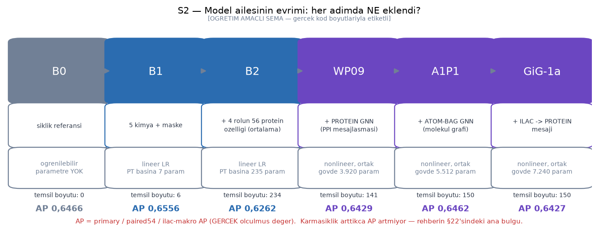

---

## 7. B0 — Sıklık referansı (üç popülasyon varyantı)

### A. Modelin amacı

B0 şunu sorar: **"Hiçbir şey öğrenmeden, sadece 'eğitimdeki ilaçların kaçında
bu yan etki kaydı vardı?' diyerek ne kadar iyi sıralama yapabilirim?"**

Bu bir model değil, bir **zemin çizgisidir**. Eğer karmaşık bir GNN bunu
geçemiyorsa, o GNN ilaca özgü hiçbir şey öğrenmemiş demektir.

B0, B1/B2 sonuçları **görüldükten sonra** keşifsel olarak eklenmiştir ve bu
dürüstçe kayda geçirilmiştir (`policy_before_B0_results.json` içinde
`exploratory_after_B1_B2_results: true`). Politika, B0 sonuçları hesaplanmadan
önce dondurulmuştur.

Üç varyant vardır, çünkü "eğitim popülasyonu" tanımı karşılaştırmayı etkiler:

| Varyant | Eğitim popülasyonu |
|---|---|
| `B0_all_train` | O katın bütün eğitim ilaçları |
| `B0_like_B1` | Eğitim ilaçları ∩ B1'in uygun 54'ü |
| `B0_like_B2` | Eğitim ilaçları ∩ B2'nin uygun 61'i |

Doğru karşılaştırma eşleşen varyantladır: B1 ↔ `B0_like_B1`.

### B. Kullanılan giriş verileri

**Hiçbir biyolojik girdi yoktur.** Kod yalnız iki sütun okur:

```python
if set(observed.columns) != {'drug_id','pt_cui'}:
    raise ValueError('B0 accepts only record identity columns')
```
<small>`wp08_b0_frequency.py:69`</small>

Kimya, dizi, PPI, ATC değerlerinin **hiçbiri açılmaz** — bu, konfigürasyonda
`PPI_ATC_chemistry_sequence_values_read: False` olarak kayıtlıdır.

| Alan | Değer |
|---|---|
| Girdi | Sadece (ilaç kimliği, PT kimliği) eşleşme kayıtları |
| Özellik sayısı | **0** |
| Kapsanan ilaç | 62'nin tamamı (girdi gerekmediği için Methenamine bile) |
| Eksik veri politikası | Konu dışı — girdi yok |

### C. Gerçek Python temsili

Tensör yok, model nesnesi yok. Tek yapı bir `pandas.DataFrame`:

```python
counts = local.groupby('pt_cui').drug_id.nunique().reindex(classes, fill_value=0)
return pd.DataFrame({'pt_cui': classes,
                     'observed_train_drugs': counts.to_numpy(dtype=int),
                     'train_drugs': len(ids),
                     'frequency_score': counts.to_numpy(dtype=float) / len(ids)})
```
<small>`wp08_b0_frequency.py:74-76`</small>

### D. "Mimari"

| Özellik | Değer |
|---|---|
| Öğrenilebilir parametre | **0** |
| Formül | `skor(PT) = (o PT'yi taşıyan eğitim ilacı sayısı) / (eğitim ilacı sayısı)` |
| Yumuşatma (smoothing) | **Yok** |
| Dönüşüm | Kimlik (identity) |
| Hiperparametre araması | **Yok** |

Dikkat edilmesi gereken yapısal özellik: **skor ilaca bağlı değildir.**
Bir katın bütün test ilaçları **tamamen aynı sıralamayı** alır.

### E. Çalışma örneği — Erythromycin, primary outer 3

`B0_like_B1` popülasyonunda bu katta 43 eğitim ilacı var. Gerçek değerler
(`B0_outer_query_scores.csv`):

| PT | Kayıt taşıyan eğitim ilacı | Eğitim ilacı | `frequency_score` |
|---|---:|---:|---:|
| Nausea (C0027497) | 43 | 43 | **1,000000** |
| Rash (C0015230) | 42 | 43 | 0,976744 |
| Vomiting (C0042963) | 41 | 43 | 0,953488 |
| Anaphylactic shock (C0002792) | 40 | 43 | 0,930233 |
| Dermatitis (C0011603) | 40 | 43 | 0,930233 |
| Diarrhoea (C0011991) | 39 | 43 | 0,906977 |

İlk satır B0'ın ne yaptığını tek başına anlatır: Nausea, 43 eğitim ilacının
**43'ünde de** kayıtlıdır. Yani "bulantı" bu kohortta neredeyse evrenseldir.
Bir modelin bunu üste koyması için ilaç hakkında hiçbir şey bilmesi gerekmez.

### F. Çıktı yapısı

`B0_outer_query_scores.csv` — satır başına (ilaç, PT), ama skor sütunu ilaçtan
bağımsız. Durum sütunu açıkça şunu yazar:

```
POPULATION_FREQUENCY_REFERENCE_NOT_PERSONALIZED
```

### G. Metrikler

| Varyant | primary / paired54 drug-macro AP | %95 GA |
|---|---:|---|
| `B0_like_B2` | **0,646604** | [0,604371; 0,685339] |
| `B0_all_train` | 0,646507 | [0,603990; 0,685192] |
| `B0_like_B1` | 0,643787 | [0,602130; 0,681983] |

Sınıf yönündeki metrikleri de görmek şarttır:

| Varyant | `class_macro_AP` | `class_macro_AUROC` |
|---|---:|---:|
| `B0_like_B2` | 0,238163 | 0,328135 |
| `B0_like_B1` | 0,238897 | 0,318814 |

**Bu iki tablonun birlikte okunması rehberin en önemli öğretisidir:**
B0, ilaç yönünde 0,6466 ile neredeyse bütün öğrenen modelleri yakalar; ama
sınıf yönünde 0,238'de kalır ve her öğrenen model onu açık farkla geçer.
`class_macro_AUROC = 0,328` ise 0,5'in **altındadır** — B0 bir PT için
ilaçları sıralarken rastgeleden kötüdür, çünkü bütün ilaçlara aynı skoru
verdiği için sıralama tamamen keyfîdir. §21.4'te ayrıntılı.

---

## 8. B1 — Beş fizikokimyasal özellikle lojistik regresyon

### A. Modelin amacı

**"Bir antibakteriyelin sadece beş temel kimyasal özelliğini bilsem, yan etki
kayıtlarını rastgeleden daha iyi sıralayabilir miyim?"**

B0'dan farkı: B0 hiçbir şey öğrenmez, B1 ilacın kendi özelliklerini kullanır,
yani **ilaca özgüdür**. Mümkün olan en basit öğrenen modeldir ve bu
kasıtlıdır: grafik mimarilerin bedelini ödemeye değip değmediği ancak böyle
bir zemine karşı ölçülebilir.

Sonucu baştan söylemek gerekir, çünkü rehberin geri kalanını anlamlandırır:
**B1, birincil ölçütte bütün GNN'lerden yüksek AP aldı (0,655642).**

### B. Kullanılan giriş verileri

| Alan | Değer |
|---|---|
| Kaynak | PubChem PUG REST (WP04), DrugBank `drug links.csv` köprüsüyle |
| Özellik sayısı | **6** |
| Kapsanan ilaç | **54** (QC'den geçmiş yapıya sahip olanlar) |
| Çekimser | 8 ilaç — `abstain_no_QC_approved_chemistry` |
| Eksik veri politikası | Kimyası QC'den geçmeyen ilaç hiç skorlanmaz |
| Standardizasyon | Train-only fit edilen dönüşüm, `transform_fit_sources_and_statistics.json` |
| Hedef sözlüğü | O katın train vokabüleri (o03'te **267** PT) |

Özellik listesi, `feature_schema_v1.json` içinden birebir:

```
chem__MW, chem__LogP, chem__HBD, chem__HBA, chem__TPSA, mask__chemistry
```

**Örnek giriş tablosu** — Erythromycin'in gerçek kaynak değerleri
(`example_drug_inputs.json`), diğer satırlar biçim göstermek için:

| drug_id | chem__MW | chem__LogP | chem__HBD | chem__HBA | chem__TPSA | mask__chemistry |
|---|---:|---:|---:|---:|---:|---:|
| DB00199 Erythromycin | 733,937 | 1,7856 | 5 | 14 | 193,91 | 1 |
| DB00916 Metronidazole | *(gerçek değer NPZ'de)* | | | | | 1 |
| DB01165 Ofloxacin | — | — | — | — | — | **0 → skorlanmaz** |

Son satır önemlidir: maske 0 olduğunda model bir sayı üretmez, **çekimser
kalır**. "0 tahmin etti" ile "tahmin etmedi" aynı şey değildir.

### C. Gerçek Python temsili

B1'de **tensör, graf, `edge_index` yoktur.** Üç gösterim:

**1. İnsan okunabilir tablo** — yukarıdaki.

**2. NumPy dizisi** — her fold bağlamı için tek NPZ dosyası:

```python
with np.load(PREP/'features'/(context+'.npz'), allow_pickle=False) as arr:
    params, traces, metrics, common = tune_fold(arr[model], arr['drug_ids'], ...)
```
<small>`wp08_baseline_train.py:185-186`</small>

| NPZ anahtarı | Şekil | Anlamı |
|---|---|---|
| `drug_ids` | `(N,)` string | Satır sırası = ilaç kimliği |
| `B1` | `(N, 6)` float | B1'in özellik matrisi |
| `B2` | `(N, 234)` float | B2'nin matrisi (aynı dosyada) |

Dikkat: **kimlikler ayrı bir dizidedir, özellik matrisinin içinde değildir.**
Bu kasıtlıdır — ilaç kimliğinin modele özellik olarak sızmasını engeller.

**3. Matematiksel gösterim**

$$X^{\text{B1}} \in \mathbb{R}^{N \times 6}$$

`primary_o03_final` bağlamında B1'in eğitim kümesi 43 ilaçtır →
`X.shape == (43, 6)`.

### D. Model mimarisi

| Özellik | Değer (koddan) |
|---|---|
| Model türü | L2 düzenlileştirilmiş **ikili lojistik regresyon**, her PT için ayrı |
| Kütüphane | `scikit-learn` (`LogisticRegression`), `scipy.special.expit` |
| Katman | Tek doğrusal katman + sigmoid; gizli katman **yok** |
| Giriş → çıkış | 6 → 1 (PT başına ayrı model) |
| Öğrenilebilir parametre | PT başına 6 ağırlık + 1 kesme = **7** |
| Çözücü | `liblinear`, `tol=1e-8`, `max_iter=10000` |
| `C` ızgarası | `(0,1 · 1,0 · 10,0)` — yalnız iç katlarda seçilir |
| Sınıf ağırlığı | **Yok** (`class_weight=None`) |
| Kayıp | L2 cezalı lojistik kayıp |
| Seed | 20261106 |

```python
model = LogisticRegression(C=C, solver='liblinear', class_weight=None,
                           tol=1e-8, max_iter=10000, random_state=SEED)
model.fit(X, s)
fitted[target] = (model.coef_[0].copy(), float(model.intercept_[0]))
```
<small>`wp08_baseline_train.py:84-92`</small>

Tahmin, ağırlıklar elle uygulanarak yapılır:

```python
out[:, j] = expit(X @ coef + intercept)
```
<small>`wp08_baseline_train.py:104`</small>

**`X @ coef + intercept` işleminin tablo karşılığı** (katsayılar temsilî,
işlemin yapısı gerçek):

| Terim | Hesap | Katkı |
|---|---|---:|
| MW × w₁ | 733,937 × 0,0004 | +0,294 |
| LogP × w₂ | 1,7856 × (−0,21) | −0,375 |
| HBD × w₃ | 5 × 0,06 | +0,300 |
| HBA × w₄ | 14 × 0,02 | +0,280 |
| TPSA × w₅ | 193,91 × 0,001 | +0,194 |
| maske × w₆ | 1 × 0,15 | +0,150 |
| kesme (b) | | −0,463 |
| **logit** | | **+0,380** |
| **sigmoid(0,380)** | | **0,594** |

**Kritik mimari detay:** PT başına **bağımsız** bir model vardır. o03'te 267
PT için 267 ayrı ağırlık vektörü. PT'ler arasında bilgi paylaşımı **yoktur**.
GNN'lerde bu değişir: orada 150 boyutlu tek temsil, `Linear(150, K)` ile
bütün PT'lere aynı anda bakar — yani GNN'ler PT'ler arası ortak yapı
öğrenebilir, B1 öğrenemez. Buna rağmen B1'in kazanması, §22'nin konusudur.

Eğitim bölmesinde bir PT ya hep 0 ya hep 1 ise model kurulmaz:
`status='NA_single_proxy_outcome'`. **Yedek/varsayılan değer atanmaz.**

### E. Çalışma örneği — Erythromycin

| Adım | Ne oluyor | Boyut |
|---|---|---|
| 1 | WP04 PubChem değerleri okunur | 5 sayı |
| 2 | Train-only dönüşüm uygulanır (`transform`, **fit değil**) | `(1, 6)` |
| 3 | Maske kontrolü: `mask__chemistry = 1` → skorlanabilir | — |
| 4 | 267 PT'nin her biri için `X @ coefⱼ + bⱼ` | 267 logit |
| 5 | `expit` her logiti (0, 1) aralığına taşır | 267 skor |
| 6 | Skorlar bu ilaç için büyükten küçüğe sıralanır | sıralı liste |

### F. Çıktı yapısı — GERÇEK skorlar

`oof_predictions.csv`'den Erythromycin'in B1 ilk 8'i (seçilen `C = 1,0`):

| Sıra | PT | `observed_record_s` | B1 skoru |
|---:|---|:---:|---:|
| 1 | Neutropenia | 0 | 0,988139 |
| 2 | Dermatitis | 0 | 0,982160 |
| 3 | Hypersensitivity | **1** | 0,979117 |
| 4 | Vomiting | **1** | 0,971151 |
| 5 | Rash | **1** | 0,969006 |
| 6 | Urticaria | **1** | 0,965507 |
| 7 | Abdominal pain | **1** | 0,961942 |
| 8 | Gastrointestinal pain | **1** | 0,961942 |

Bu ilaç için 267 PT'nin **44'ü** `s = 1`'dir.

**Bu sayılar klinik yan etki görülme yüzdesi değildir.** İlk iki satırdaki
`s = 0`, "Erythromycin nötropeni yapmaz" demek değildir; "SIDER'ın bu
tutucu tanımında bu kayıt yok" demektir.

İnsan okuması için aynı veri geniş biçime çevrilebilir (biçim örneği):

| İlaç | Yan etki A | Yan etki B | Yan etki C |
|---|---:|---:|---:|
| İlaç 1 | 0,82 | 0,43 | 0,71 |
| İlaç 2 | 0,21 | 0,65 | 0,34 |

### G. Metrikler

| Metrik (primary / paired54) | Değer | %95 GA |
|---|---:|---|
| **drug_macro_AP** (birincil) | **0,655642** | [0,613111; 0,692041] |
| micro_AP | 0,542199 | [bkz. `metrics_with_group_CI.csv`] |
| micro_AUROC | 0,726914 | |
| class_macro_AP | 0,315224 | GA yok (tanısal) |
| within_fold_class_macro_AUROC | 0,551275 | GA yok (tanısal) |
| Referans: `B0_like_B1` | 0,643787 | [0,602130; 0,681983] |

B1 − `B0_like_B1` ≈ +0,0119; aralık sıfırı içerir. Yani B1 sıklık
referansından **ayırt edilebilir biçimde** iyi değildir, ama sınıf yönünde
(0,3152 vs 0,2389) açık farkla iyidir.

**Hesaplanmayan metrikler:** Precision ve Recall, karar eşiği tanımlanmadığı
için hesaplanmamıştır. Bu rehber onlar için sayı uydurmaz.

---

## 9. B2 — Kimya + protein özellikleriyle lojistik regresyon

### A. Modelin amacı

**"İlacın kimyasına, bağlandığı proteinlerin amino asit kompozisyonunu da
eklersem daha iyi olur mu?"**

B1'den farkı: aynı öğrenme yöntemi, **çok daha geniş özellik vektörü**. Bu
yüzden B1↔B2 farkı saf bir **bilgi** farkıdır, yöntem farkı değildir.

B2 ayrıca "protein bilgisini graf kullanmadan nasıl katarız?" sorusunun en
basit cevabıdır: her rol için bağlı proteinlerin özelliklerinin
**ortalamasını** al. Mesajlaşma yok, komşuluk yok, sadece ortalama.

### B. Kullanılan giriş verileri

| Alan | Değer |
|---|---|
| Kaynak | PubChem (kimya) + DrugBank XML'den çıkarılmış protein dizileri (WP05) |
| Özellik sayısı | **234** |
| Kapsanan ilaç | **61** (en az bir modalitesi olan) |
| Çekimser | 1 — Methenamine, `abstain_no_personalized_input` |
| Eksik modalite | Blok nötr 0 + ilgili maske biti 0 |

234'ün dökümü:

| Blok | Boyut | Açıklama |
|---|---:|---|
| Kimya | 5 | MW, LogP, HBD, HBA, TPSA |
| `target__*` | 56 | O ilacın target proteinlerinin özellik ortalaması |
| `enzyme__*` | 56 | aynı, enzyme rolü |
| `transporter__*` | 56 | aynı |
| `carrier__*` | 56 | aynı |
| Maskeler | 5 | chemistry, target, enzyme, transporter, carrier |
| **Toplam** | **234** | |

56 protein özelliğinin tam dökümü §15.2'dedir.

### C. Gerçek Python temsili

B1 ile birebir aynı: aynı NPZ dosyası, farklı anahtar.

$$X^{\text{B2}} \in \mathbb{R}^{N \times 234}$$

### D. Model mimarisi

B1 ile **aynı sınıf, aynı çözücü, aynı ızgara**. Tek fark giriş genişliği:

| Özellik | B1 | B2 |
|---|---:|---:|
| Giriş boyutu | 6 | 234 |
| PT başına parametre | 7 | **235** |
| o03'te hedef sayısı | 267 | **318** |

o03'te B2 daha çok PT'ye uyar, çünkü eğitim popülasyonu daha büyüktür
(61 kapsamı) ve dolayısıyla daha çok PT'de hem pozitif hem unknown bulunur.

### E. Çalışma örneği — Erythromycin

Erythromycin'in gerçek rolleri (`example_drug_inputs.json`):

| Rol | UniProt accession'ları | Sayı |
|---|---|---:|
| target | O43193, Q12809 | 2 |
| enzyme | P08684, P20815, P24462 | 3 |
| transporter | O95342, P08183, P46721, Q92887, Q9NPD5, Q9Y6L6 | 6 |
| carrier | — | **0** |

Dolayısıyla B2 girdi vektörü şöyle kurulur:

| Blok | Nasıl dolduruldu |
|---|---|
| Kimya (5) | Gerçek değerler |
| target (56) | O43193 ve Q12809'un 56'şar özelliğinin **ortalaması** |
| enzyme (56) | 3 proteinin ortalaması |
| transporter (56) | 6 proteinin ortalaması |
| carrier (56) | **Tamamı 0** (carrier yok) |
| Maskeler (5) | `[1, 1, 1, 1, 0]` ← son bit carrier yokluğunu bildirir |

Carrier bloğundaki sıfırlar "bu proteinlerin özellikleri sıfırdır" demek
değildir; maske biti modele bunu söyler.

### F. Çıktı yapısı — GERÇEK skorlar

Erythromycin'in B2 ilk 8'i (seçilen `C = 0,1`):

| Sıra | PT | `s` | B2 skoru |
|---:|---|:---:|---:|
| 1 | Gastrointestinal disorder | 0 | 0,972603 |
| 2 | Anaemia | 0 | 0,960591 |
| 3 | Leukopenia | 0 | 0,954305 |
| 4 | Hypersensitivity | **1** | 0,943824 |
| 5 | Headache | 0 | 0,941626 |
| 6 | Stomatitis | 0 | 0,939743 |
| 7 | Dry mouth | 0 | 0,939311 |
| 8 | Fungal infection | 0 | 0,937666 |

B1 ile karşılaştırın: B1'in ilk 8'inde 6 doğru vardı, B2'nin ilk 8'inde 1.
Bu tek ilaç tek başına kanıt değildir ama genel eğilimi yansıtır.

### G. Metrikler

| Metrik (primary / paired54) | B2 | B1 | Fark |
|---|---:|---:|---:|
| **drug_macro_AP** | **0,626239** | 0,655642 | −0,0294 |
| micro_AP | 0,532335 | 0,542199 | −0,0099 |
| micro_AUROC | 0,714505 | 0,726914 | −0,0124 |
| **class_macro_AP** | **0,348909** | 0,315224 | **+0,0337** |
| class_macro_AUROC | **0,543061** | 0,481439 | +0,0616 |
| within_fold_class_macro_AUROC | **0,571560** | 0,551275 | +0,0203 |

**B2'nin bulgusu iki yönlüdür ve bu çok öğreticidir:**

- İlaç yönünde B2, bütün modellerin **en kötüsüdür** (0,6262). 234 özellik,
  43–50 ilaçlık eğitim bölmelerinde doğrusal modeli zorlar.
- Sınıf yönünde B2, bütün modellerin **en iyisidir** (0,3489). Protein
  bilgisi, "hangi ilaçlar bu yan etkiyi yapar?" sorusunda gerçekten işe
  yarıyor.

Yani "protein bilgisi işe yaramadı" demek yanlış olur. Doğrusu: **protein
bilgisi birincil ölçütün ölçtüğü yönde işe yaramadı.**

---

## 10. WP09 — Protein/PPI mesajlaşmalı GNN

### A. Modelin amacı

**"Proteinleri yalnız kendi özellikleriyle değil, PPI ağındaki komşularıyla
birlikte temsil edersem yan etki sıralaması iyileşir mi?"**

B2'den iki temel farkı var:

1. **Mesajlaşma.** B2 protein özelliklerinin ham ortalamasını alır. WP09 önce
   her proteini PPI komşularıyla günceller, **sonra** ortalamayı alır.
2. **Nonlineer ve ortak gövde.** B2'de her PT'nin ayrı bir lineer modeli var.
   WP09'da bütün PT'ler **tek bir 141 boyutlu temsili** paylaşır; yalnız son
   başlık PT'ye özeldir.

Ayrıca WP09, V6'nın somut bir hatasını düzeltmek için tasarlanmıştır: eski
kodda PPI tensörü mevcuttu ama `forward` içinde **kullanılmıyordu**. WP09'da
bu teknik olarak kanıtlanır (§10.G'deki gradient tablosu).

Üç varyant eğitilmiştir:

| Varyant | PPI kenarları |
|---|---|
| `G_noPPI` | Kenar listesi boşaltılır (`edges[:, :0]`) |
| `G_realPPI` | Gerçek STRING-700 insan kenarları |
| `G_shuffledPPI` (R0/R1/R2) | Aynı sayıda, karıştırılmış kenarlar — **null** |

Shuffled kol, "iyileşme PPI'nin *topolojisinden* mi, yoksa sadece *ek
parametre/gürültüden* mi geliyor?" sorusunu ayırır.

### B. Kullanılan giriş verileri

| Alan | Değer |
|---|---|
| Protein düğümü | O katın bütün dizi-doğrulanmış proteinleri (o03'te **133**) |
| Protein özelliği | **56** (ayrıntı §15.2) |
| PPI kenarı | STRING v12.0, taxon 9606, `combined_score ≥ 700` (o03'te **166 yönsüz çift**) |
| İlaç–protein kenarı | 4 ayrı rol; o03'te target 212, enzyme 57, transporter 110, carrier 19 |
| Kimya | 5 fizikokimyasal değer |
| Maskeler | 5 bit |
| Kapsanan ilaç | **61** |
| **Yasaklı girdi** | `kalite_skoru`, STRING `combined_score` değeri, PT sıklıkları, ilaç kimlikleri |

`kalite_skoru`'nun neden yasak olduğu §15.5'te ayrıca anlatılır.

### C. Gerçek Python temsili

Bu modelden itibaren veri artık düz bir matris değildir. Her fold bağlamı tek
bir NPZ dosyasıdır ve içinde **yapısal diziler** vardır.

`primary_o03_final_train.npz`'nin gerçek içeriği:

| Anahtar | Şekil | Tip | Anlamı |
|---|---|---|---|
| `protein_ids` | `(133,)` | `<U10` | UniProt accession'ları, satır sırası = düğüm indeksi |
| `protein_x` | `(133, 56)` | float64 | Protein düğüm özellikleri |
| `drug_ids` | `(50,)` | `<U7` | DrugBank ID'leri |
| `chemistry` | `(50, 5)` | float64 | Kimya bloğu |
| `masks` | `(50, 5)` | bool | Modalite maskeleri |
| `eligible` | `(50,)` | bool | `masks.any(axis=1)` |
| `role_target` | `(2, 212)` | int64 | `[ilaç indeksi; protein indeksi]` |
| `role_enzyme` | `(2, 57)` | int64 | aynı |
| `role_transporter` | `(2, 110)` | int64 | aynı |
| `role_carrier` | `(2, 19)` | int64 | aynı |
| `ppi_pairs_700` | `(2, 166)` | int64 | Kanonik yönsüz çiftler (`u < v`) |

Sorgu dosyası `primary_o03_final_query.npz`:

| Anahtar | Şekil | Anlamı |
|---|---|---|
| `drug_ids` | `(12,)` | Bu kattaki sorgu ilaçları |
| `split` | `(12,)` | `'validation'` veya `'test'` |
| `unseen_protein_ids` | `(8,)` | Eğitim grafında **hiç olmayan** proteinler |
| `unseen_protein_x` | `(8, 56)` | Onların özellikleri |
| `role_*` | `(2, E)` | Sorgu ilaçlarının rol kenarları |

**`ppi_pairs_700` nasıl okunur?** Örneğin ilk sütun `[3, 47]` ise: 3 indeksli
protein ile 47 indeksli protein arasında STRING skoru ≥ 700 olan bir ilişki
var. **Skorun kendisi dosyada yoktur** — yalnız çiftin varlığı.

Modelin içinde bu yönsüz çiftler iki yöne açılır:

```python
def directed_edges(pairs):
    pairs = torch.as_tensor(raw, dtype=torch.long)
    if pairs.numel() and not bool((pairs[0] < pairs[1]).all()):
        raise ValueError('Canonical unique undirected pairs required')
    return torch.cat([pairs, pairs.flip(0)], dim=1)
```
<small>`wp09_encoder.py:10-18`</small>

Yani `(2, 166)` → `(2, 332)`. **Self-loop otomatik eklenmez** ve açıkça
yasaklanır — çünkü düğümün kendi bilgisi zaten residual bağlantıyla taşınır.

**Tablo karşılığı** (ilk üç sütun, biçim örneği):

| kaynak indeksi | hedef indeksi | nereden geldi |
|---:|---:|---|
| 3 | 47 | orijinal çift |
| 12 | 88 | orijinal çift |
| 47 | 3 | ters kenar (otomatik) |

### D. Model mimarisi

İki sınıf: `ResidualMeanProtein` (mesajlaşma) ve `RoleMaskedPPI` (okuma +
birleştirme).

#### D.1 `ResidualMeanProtein` — tek mesajlaşma katmanı

```python
class ResidualMeanProtein(nn.Module):
    def __init__(self, inputs=56, hidden=32):
        self.projection = nn.Linear(inputs, hidden)         # 56 -> 32, bias VAR
        self.self_update = nn.Linear(hidden, hidden, bias=False)
        self.message = nn.Linear(hidden, hidden, bias=False)

    def forward(self, x, ppi_edge_index):
        z = torch.relu(self.projection(x))
        source, destination = edges
        total = torch.zeros_like(z).index_add(0, destination, z[source])
        degree = ... .index_add(0, destination, torch.ones(...))
        neighbor_mean = total / degree.clamp_min(1)
        return z + torch.relu(self.self_update(z) + self.message(neighbor_mean))
```
<small>`wp09_encoder.py:21-41`</small>

Denklemler, her sembol açıklanmış hâliyle:

$$z_i = \mathrm{ReLU}(P\,x_i + b)$$

- $x_i$: $i$ proteininin 56 boyutlu ham özelliği
- $P$: öğrenilen $32\times56$ projeksiyon matrisi, $b$: 32 boyutlu bias
- $z_i$: proteinin **komşusuz** başlangıç gömmesi, 32 boyut

$$m_i = \frac{1}{\max(d_i,\,1)}\sum_{j \in N(i)} z_j$$

- $N(i)$: $i$'nin PPI komşuları
- $d_i$: komşu sayısı (derece)
- $m_i$: komşuların **ağırlıksız ortalaması**. STRING skoru burada ağırlık
  olarak kullanılmaz.
- $d_i = 0$ ise $m_i = 0$. Bu bir varsayım değil, gerçekten boş komşuluktur.
  Kod yorumu bunu açıkça yazar: *"Boş komşuluk gerçekten sıfır mesajdır;
  message katmanında bias yok."* Bias olsaydı, komşusu olmayan protein bile
  sahte bir mesaj alırdı.

$$h_i = z_i + \mathrm{ReLU}(S\,z_i + M\,m_i)$$

- $S$: $32\times32$ kendi-güncelleme matrisi (bias yok)
- $M$: $32\times32$ mesaj matrisi (bias yok)
- $z_i +$ : **residual** — protein kendi bilgisini kaybetmez
- $h_i$: güncellenmiş protein gömmesi, 32 boyut

**`index_add` ne yapıyor?** Bu, "gather–scatter" toplamasının verimli hâlidir.
`total.index_add(0, destination, z[source])`: her kenar için kaynak düğümün
gömmesini alır ve hedef düğümün satırına **ekler**. Kenar listesi üzerinde
tek geçişte bütün komşu toplamları hesaplanır.

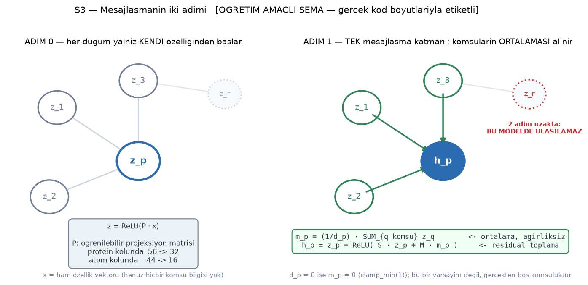

> **Mesajlaşma katmanı sayısı: 1.** `forward` içinde bu blok bir kez çalışır,
> döngü yoktur. Yani bir protein yalnız **doğrudan komşularından** bilgi alır.
> İki adım uzaktaki protein bu mimaride erişilemez. Savunmada "iki katmanlı
> GNN" demeyin.

#### D.2 `RoleMaskedPPI` — rol okuması ve birleştirme

Protein gömmelerinden ilaç temsiline geçiş:

```python
blocks = [torch.relu(self.chemistry(chemistry)) * masks[:, 0:1]]
for j, role in enumerate(ROLES):
    sums = zeros.index_add(0, edges[0], protein_h[edges[1]])
    counts = zeros.index_add(0, edges[0], ones)
    if not torch.equal(counts[:,0] > 0, masks[:, j+1]):
        raise ValueError('Role mask contradicts typed edges')
    blocks.append((sums / counts.clamp_min(1)) * masks[:, j+1:j+2])
blocks.append(masks.to(chemistry.dtype))
representation = torch.cat(blocks, dim=1)
```
<small>`wp09_encoder.py:65-78`</small>

Her rol için **ayrı** bir maskeli ortalama alınır:

$$r_{d,\text{rol}} = \mathrm{mask}_{d,\text{rol}} \cdot \frac{1}{n_{d,\text{rol}}}\sum_{p \in \text{rol}(d)} h_p$$

Dört rol ayrı tutulur çünkü bir proteinin ilaç için **ne anlama geldiği**
roldür: hedef olmak ile taşıyıcı olmak farklı şeylerdir. Aynı protein birden
çok rolde görünebilir ve o zaman **iki ayrı blokta sayılır** (GiG bölümünde
bu önem kazanır).

Satırdaki `if not torch.equal(...)` kontrolü, maske bitinin gerçek kenarlarla
tutarlı olmasını zorunlu kılar — yani "maskede var diyor ama kenar yok"
durumunda program durur.

**141 boyutun dökümü:**

| Blok | Boyut |
|---|---:|
| Kimya (`Linear(5,8)` + ReLU + maske) | 8 |
| target rolü ortalaması | 32 |
| enzyme rolü ortalaması | 32 |
| transporter rolü ortalaması | 32 |
| carrier rolü ortalaması | 32 |
| Maske bitleri | 5 |
| **Toplam** | **141** |

Sonra `head = nn.Linear(141, K)` ve logitler:

```python
logits = self.head(representation).masked_fill(~eligible[:, None], float('nan'))
```

`eligible = masks.any(dim=1)` — hiçbir modalitesi olmayan ilacın logiti
**NaN** yapılır. Bu "0 tahmin et" demek değildir; "bu ilaç hakkında
söyleyecek sözüm yok" demektir.

**Parametre sayısı** (başlıksız gövde):

| Katman | Hesap | Parametre |
|---|---|---:|
| `protein.projection` | 56×32 + 32 | 1.824 |
| `protein.self_update` | 32×32 | 1.024 |
| `protein.message` | 32×32 | 1.024 |
| `chemistry` | 5×8 + 8 | 48 |
| **Gövde toplamı** | | **3.920** |
| `head` | 141·K + K = 142·K | — |

o03'te K = 318 → 3.920 + 142×318 = **49.076** (model JSON'undan doğrulandı).

#### D.3 Sorgu yolu — sızıntının teknik olarak nasıl engellendiği

```python
def query_readout(self, query, train_protein_h):
    """Cache salt okunur; yeni query proteinleri self-only; query -> train geri mesajı yok."""
    new_h = self.protein(new_x, empty)          # empty = (2,0) kenar
    pool = torch.cat([train_protein_h, new_h], dim=0)
    return self.readout(pool, ...)
```
<small>`wp09_encoder.py:94-102`</small>

Üç şey aynı anda sağlanır:

1. Eğitim proteinlerinin gömmeleri **önbellekten okunur**, yeniden
   hesaplanmaz.
2. Sorguda ilk kez görülen protein **kenarsız** işlenir — yani yalnız kendi
   özelliğinden bir gömme alır.
3. Sorgu ilacından eğitim grafına **geri mesaj yoktur**.

Erythromycin bunun canlı örneğidir: 11 proteininin 10'u eğitim
önbelleğindedir, **O43193 ise `unseen_protein_ids` listesindedir** ve boş
komşulukla işlenir.

### E. Çalışma örneği — Erythromycin, primary outer 3

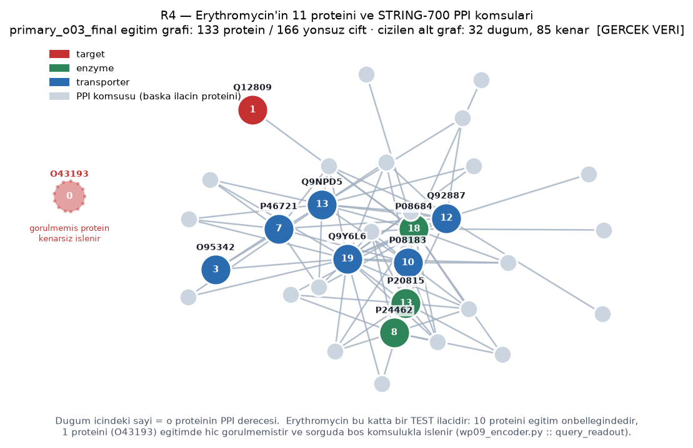

| Adım | İşlem | Boyut |
|---|---|---|
| 1 | 133 proteinin `protein_x`'i yüklenir | (133, 56) |
| 2 | `z = ReLU(P x)` | (133, 32) |
| 3 | 166 çift → 332 yönlü kenar; komşu ortalaması | (133, 32) |
| 4 | `h = z + ReLU(Sz + Mm)` → **eğitim önbelleği** | (133, 32) |
| 5 | O43193 ayrıca kenarsız işlenir, havuza eklenir | (134, 32) |
| 6 | Erythromycin'in target rolü: O43193, Q12809'un h'lerinin ortalaması | (1, 32) |
| 7 | enzyme (3 protein), transporter (6 protein) aynı şekilde | (1, 32) ×2 |
| 8 | carrier: kenar yok → blok 0, maske biti 0 | (1, 32) |
| 9 | Kimya `Linear(5,8)` + ReLU | (1, 8) |
| 10 | Birleştir: 8 + 32×4 + 5 | **(1, 141)** |
| 11 | `head` → 318 logit → sigmoid | (1, 318) |

Grafikteki düğüm içi sayılar gerçek PPI dereceleridir: Q9Y6L6 19 komşuya
sahipken Q12809'un yalnız 1 komşusu var. Yani mesajlaşmanın bu iki protein
üzerindeki etkisi çok farklıdır.

### F. Çıktı yapısı

B1/B2 ile aynı uzun biçim; `model` sütunu `G_noPPI` / `G_realPPI` /
`G_shuffledPPI_R0..R2` değerlerini alır.

### G. Metrikler ve teknik öğrenme kanıtı

**Önce teknik soru: PPI gerçekten kullanıldı mı?**

| model | fit | optimizer adımı | min ağırlık L2 değişimi | min max mesaj gradyanı | max mesaj gradyanı |
|---|---:|---:|---:|---:|---:|
| G_noPPI | 38 | 2.239 | 4,1907 | **0,0000** | **0,0000** |
| G_realPPI | 38 | 2.158 | 3,6889 | 0,0091 | 0,0185 |
| G_shuffledPPI_R0 | 38 | 2.149 | 3,8628 | 0,0074 | 0,0193 |
| G_shuffledPPI_R1 | 38 | 2.168 | 3,9658 | 0,0078 | 0,0174 |
| G_shuffledPPI_R2 | 38 | 2.153 | 3,8541 | 0,0073 | 0,0171 |

`G_noPPI`'da mesaj gradyanı **tam olarak sıfır**, diğerlerinde pozitif. Bu,
V6'nın "tensör var ama kullanılmıyor" hatasının giderildiğinin kanıtıdır.
Toplam **190/190 fit OK, 10.867 gerçek AdamW adımı**.

> **Önemli uyarı (kodda ve raporda açıkça yazılı):** `G_noPPI`'da kullanılmayan
> `message` ağırlığı AdamW'nin `weight_decay`'i yüzünden yine de küçülür.
> Bu **komşuluk kullanıldığının kanıtı sayılamaz**. Kanıt gradyandır, ağırlık
> kayması değil.

**Sonra bilimsel soru: işe yaradı mı?**

| Karşılaştırma (primary, paired54) | Fark | %95 GA |
|---|---:|---|
| G_realPPI − G_noPPI | **−0,000142** | [−0,003611; +0,003248] |
| G_realPPI − shuffled ortalaması | −0,000379 | [−0,002039; +0,001310] |
| G_realPPI − B1 | −0,012762 | [−0,031658; +0,004782] |
| G_realPPI − B0_like_B2 | −0,003724 | [−0,016303; +0,007884] |

**Ek katkı gösterilemedi.** Gerçek PPI, karıştırılmış PPI'den de ayırt
edilemez. Bu bir *eşdeğerlik kanıtı* değildir (aralıklar geniş), ama "PPI
topolojisi bu kohortta yan etki sıralamasını iyileştirdi" **denemez**.

Mutlak değerler:

| model | drug_macro_AP | micro_AP | class_macro_AP |
|---|---:|---:|---:|
| WP09_G_noPPI | 0,643021 | 0,566156 | 0,321482 |
| WP09_G_realPPI | 0,642880 | 0,567786 | 0,319017 |

Stres protokolünde `real − B2 = +0,046908` gibi büyük bir fark görülür; ama
rapor bunu dürüstçe şöyle not eder: `noPPI − B2 = +0,047929` da neredeyse
aynıdır, yani fark **nonlineer encoder'dan** gelir, PPI'den değil.

---

## 11. WP10 faktöriyel — A0P0 / A0P1 / A1P0 / A1P1

Bu rehberin en ayrıntılı iki bölümünden biri. A1P1 projenin **ana graf
araştırma mimarisidir**.

### A. Modelin amacı

İki ayrı soru vardır ve faktöriyel tasarım bunları **ayırır**:

1. **Atom sorusu:** Molekülü 5 özet sayı yerine atom–bağ grafı olarak
   verirsem ne değişir?
2. **PPI sorusu:** Protein komşuluğunu açmak ne değiştirir?

Dört kol bu iki anahtarın 2×2 kombinasyonudur:

| Kol | Atom dalı | PPI mesajı |
|---|:---:|:---:|
| **A0P0** | kapalı | kapalı |
| **A0P1** | kapalı | **açık** |
| **A1P0** | **açık** | kapalı |
| **A1P1** | **açık** | **açık** |

**Neden dört kol?** Çünkü A1P1'i tek başına B2 ile karşılaştırsaydınız,
farkın atomdan mı, PPI'den mi, yoksa sadece nonlineer mimariden mi geldiğini
asla bilemezdiniz. Dördü **aynı mimariyi, aynı başlangıç ağırlıklarını, aynı
hedefleri ve aynı uygun ilaçları** kullanır; tek fark hangi anahtarın açık
olduğudur. Bu, bir ablation değil, **kontrollü bir faktöriyel deneydir**.

> **Kritik:** A0P0 bile 150 boyutlu temsili kullanır. Molekül bloğu ve atom
> maskesi orada *durur*, sadece içleri 0'dır. Böylece dört kol arasında
> parametre sayısı ve mimari **birebir aynıdır**.

### B. Kullanılan giriş verileri

WP09'un bütün girdileri + moleküler graf.

| Alan | Değer |
|---|---|
| Moleküler graf | 62 ilacın hepsi için üretildi; **54'ünde maske açık** |
| Atom özelliği | **44** (ayrıntı §14.2) |
| Bağ özelliği | **14** (ayrıntı §14.3) |
| Protein özelliği | 56, aynı |
| PPI | STRING-700, aynı |
| Kimya | 5, aynı |
| Maske | 5 + **1 atom maskesi** |
| Kapsanan ilaç | **61** (atom dalı bunların 54'ünde aktif) |
| SMILES kaynağı | WP04'te PubChem CID ile doğrulanmış; **tahmin edilmemiş** |

Toplam moleküler envanter: 62 molekülde **2.061 atom, 2.219 bağ**.

### C. Gerçek Python temsili

Bu, rehberin en çok sorulan kısmıdır: *"dosyada gördüğüm veri modelde nasıl
duruyor?"*

#### C.1 Tek molekül: PyG `Data`

Diskte her molekül bir NPZ dosyasıdır
(`reports/qa/WP10/encoder_v1/graphs/DB00916.npz`):

```python
Data(x=torch.tensor(x, dtype=torch.float32).reshape(-1, 44),
     edge_index=torch.tensor(edges, dtype=torch.long).reshape(-1, 2).T.contiguous(),
     edge_attr=torch.tensor(attrs, dtype=torch.float32).reshape(-1, 14),
     num_nodes=mol.GetNumAtoms())
```
<small>`wp10_molecular_graph.py:71-73`</small>

Metronidazole için somut şekiller:

| Alan | Şekil | Tip |
|---|---|---|
| `x` | `(12, 44)` | float32 |
| `edge_index` | `(2, 24)` | int64 |
| `edge_attr` | `(24, 14)` | float32 |
| `num_nodes` | `12` | int |

`Data` içinde **kimlik ve etiket yoktur** ve bu zorlanır:

```python
if set(data.keys()) != {'x','edge_index','edge_attr','num_nodes'}:
    raise ValueError('Molecule Data forbids IDs/labels/extra attributes')
```
<small>`wp10_molecular_graph.py:79`</small>

Yani `y` alanı hiç yoktur. Denetim (supervision) tamamen ayrı yoldan,
dondurulmuş train PT sözlüğünden gelir. Bu, "etiket girdiye sızamaz"
kuralının yapısal garantisidir.

#### C.2 Çok molekül: PyG `Batch`

Farklı molekülleri tek bir forward'da işlemek için `Batch` kullanılır:

```python
batch = Batch.from_data_list(graphs)
```

`Batch`, molekülleri **tek bir büyük, kopuk (disconnected) graf** hâline
getirir ve atom indekslerini kaydırır. Ek olarak bir `batch` vektörü tutar:
her atomun hangi moleküle ait olduğunu söyler.

Örnek: Metronidazole (12 atom) + Sulfanilamide (11 atom) birleştirilirse

| Alan | Şekil | Açıklama |
|---|---|---|
| `batch.x` | `(23, 44)` | 12 + 11 atom alt alta |
| `batch.edge_index` | `(2, 46)` | 24 + 22; ikinci molekülün indeksleri +12 kaydırılmış |
| `batch.batch` | `(23,)` | `[0,0,...,0, 1,1,...,1]` |
| `batch.ptr` | `(3,)` | `[0, 12, 23]` — molekül sınırları |

Moleküller arası kenar oluşmadığı **test edilir**:

```python
if batch.edge_index.numel() and not torch.equal(
        batch.batch[batch.edge_index[0]], batch.batch[batch.edge_index[1]]):
    raise ValueError('Cross-molecule bond')
```
<small>`wp10_molecular_graph.py:141`</small>

#### C.3 `MolecularInput` — kimlik ve maskenin taşındığı kap

```python
@dataclass(frozen=True)
class MolecularInput:
    ids: tuple          # ilaç kimlikleri, SIRA ÖNEMLİ
    batch: Batch        # sayısal graf
    atom_mask: torch.Tensor   # bool, (N,)
```
<small>`wp10_molecular_graph.py:120-124`</small>

Bu ayrım kasıtlıdır: **kimlik ve QC maskesi tensörün dışındadır**, `Batch`'in
içinde değildir. Böylece kimlik bir özellik olarak modele giremez.

#### C.4 JSON metadata ile sayısal girdi birbirine karıştırılmaz

`molecule_registry.json` her molekül için şunları tutar:

```json
"DB00916": {
  "id": "DB00916", "name": "Metronidazole", "cid": 4173,
  "source_SMILES": "CC1=NC=C(N1CCO)[N+]([O-])=O",
  "source_InChIKey": "VAOCPAMSLUNLGC-UHFFFAOYSA-N",
  "atom_eligible": true,
  "graph_file": "reports/qa/WP10/encoder_v1/graphs/DB00916.npz",
  "graph_file_sha256": "...", "graph_tensor_sha256": "...",
  "raw_stereo_metadata": { "atoms": [...], "bonds": [...] }
}
```

**Bu JSON'daki hiçbir alan modele girmez.** SMILES metni, isim, CID, hash'ler
— hepsi *provenans*tır. Modele giren tek şey `graph_file`'ın içindeki üç
sayısal dizidir. Yükleme sırasında hem dosya hash'i hem tensör hash'i
doğrulanır (`wp10_molecular_graph.py:151-155`); uyuşmazlıkta program durur.

### D. Model mimarisi

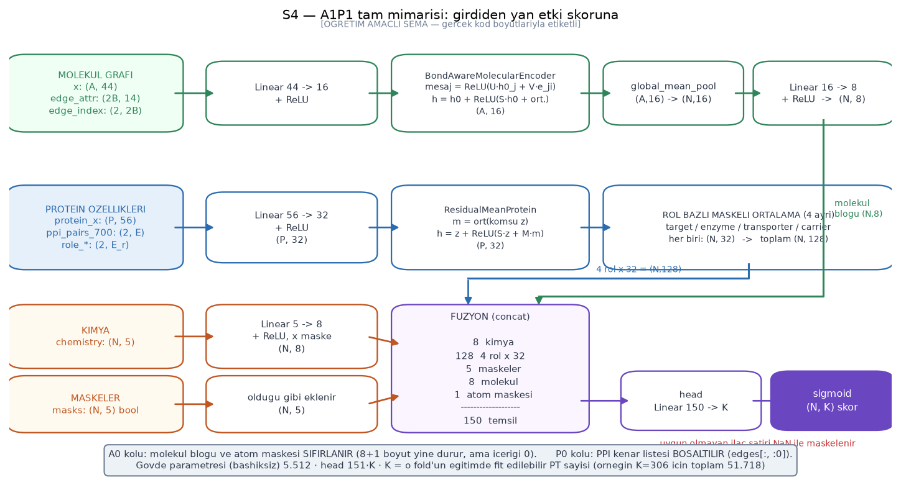

#### D.1 `BondAwareMolecularEncoder`

```python
class BondAwareMolecularEncoder(nn.Module):
    """44→16; h1=h0+relu(S h0+mean relu(U h0_j+V e_ji)); mean→8."""
    def __init__(self):
        self.projection  = nn.Linear(44, 16)             # bias VAR
        self.self_update = nn.Linear(16, 16, bias=False)
        self.atom_message= nn.Linear(16, 16, bias=False)
        self.bond_message= nn.Linear(14, 16, bias=False)
        self.readout     = nn.Linear(16, 8)

    def forward(self, batch):
        h0 = torch.relu(self.projection(x))
        src, dst = edges
        messages = torch.relu(self.atom_message(h0[src]) + self.bond_message(edge_attr))
        sums  = torch.zeros_like(h0).index_add(0, dst, messages)
        counts= ... .index_add(0, dst, ones)
        mean  = sums / counts.clamp_min(1)
        h = h0 + torch.relu(self.self_update(h0) + mean)
        pooled = global_mean_pool(h, batch.batch, size=batch.num_graphs)
        return {'molecular_h': torch.relu(self.readout(pooled)), ...}
```
<small>`wp10_molecular_encoder.py:27-49`</small>

Denklemler:

$$h^{(0)}_a = \mathrm{ReLU}(P_{\text{atom}}\, x_a + b)$$

$$\mu_{j \to a} = \mathrm{ReLU}\!\left(U\,h^{(0)}_j + V\,e_{j\to a}\right)$$

$$h_a = h^{(0)}_a + \mathrm{ReLU}\!\left(S\,h^{(0)}_a + \frac{1}{\deg(a)}\sum_{j\in N(a)} \mu_{j\to a}\right)$$

$$g_{\text{ilaç}} = \mathrm{ReLU}\!\left(R \cdot \frac{1}{|A|}\sum_{a \in A} h_a + b_R\right)$$

- $x_a$: atomun 44 boyutlu özelliği
- $e_{j\to a}$: **bağın** 14 boyutlu özelliği
- $U$ (16×16): komşu atomun katkısı
- $V$ (**14×16**): bağın katkısı — bu katman protein kolunda **yoktur**
- $\deg(a)$: atomun bağ sayısı
- $R$ (16×8): okuma katmanı
- $|A|$: molekülün atom sayısı; bu bölme `global_mean_pool`'un yaptığı iştir

**Protein kolundan iki farkı:**

1. Mesaj, komşunun durumu *ve* kenarın özelliği birlikte kullanılarak
   üretilir: `ReLU(U·h0_j + V·e_ji)`. Protein kolunda mesaj doğrudan `z_j`'dir
   çünkü PPI kenarının özelliği yoktur.
2. Sonunda bir **pooling** vardır, çünkü moleküller farklı boyuttadır.

> **Yine tek katman.** Metronidazole'ün 0 numaralı metil karbonu yalnız 1
> numaralı atomu "görür". 4 numaralı atoma asla ulaşamaz. 51 atomlu
> Erythromycin'de bu sınır daha da belirgindir.

#### D.2 Füzyon — `MolecularProteinFusion._fuse`

```python
mask = molecules.atom_mask.to(...) & (variant[1] == '1')
if bool((mask & ~base['eligible']).any()):
    raise ValueError('Atom branch cannot expand frozen61 eligibility')
if variant[1] == '1':
    raw = self.molecular(molecules.batch)['molecular_h']
    block = raw * mask[:, None]
else:
    block = base['representation'].new_zeros((len(mask), 8))
representation = torch.cat([base['representation'], block, mask[:, None].to(block.dtype)], dim=1)
if representation.shape[1] != 150:
    raise ValueError('150-dimensional fusion required')
logits = self.head(representation).masked_fill(~base['eligible'][:, None], float('nan'))
```
<small>`wp10_molecular_encoder.py:77-88`</small>

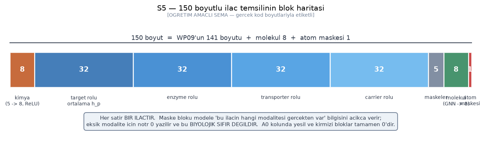

Üç satır özellikle dikkat çekicidir:

- `mask & (variant[1]=='1')`: A0 kolunda maske **herkeste** kapanır.
- `if bool((mask & ~base['eligible']).any()): raise`: atom dalı, 61 kişilik
  uygunluk kümesini **genişletemez**. Yani atom grafı olan ama hiç modalitesi
  olmayan bir ilaç yine de skorlanmaz. Bu, kapsamın deney boyunca sabit
  kalmasını garanti eder.
- `if self.base.head is not None: raise`: WP09'un kendi PT başlığının
  gövdeye karışması engellenir. Eski ağırlıklar **yüklenmez**; A1P1 sıfırdan
  eğitilir.

#### D.3 Parametre sayısı

| Bileşen | Hesap | Parametre |
|---|---|---:|
| WP09 gövdesi | (bkz. §10.D.2) | 3.920 |
| `molecular.projection` | 44×16 + 16 | 720 |
| `molecular.self_update` | 16×16 | 256 |
| `molecular.atom_message` | 16×16 | 256 |
| `molecular.bond_message` | 14×16 | 224 |
| `molecular.readout` | 16×8 + 8 | 136 |
| **Gövde toplamı** | | **5.512** |
| `head` | 150·K + K = 151·K | — |

`actual_parameter_counts.csv`'den doğrulanmış: K=0 → 5.512; K=3 → 5.965;
K=158 → 29.370; K=326 → 54.738.

o03 A1P1'in gerçek değeri: K = 318 → 5.512 + 151×318 = **53.530** (model
JSON'undan doğrulandı).

#### D.4 Eğitim kurulumu

| Ayar | Değer | Nerede |
|---|---|---|
| Kayıp | `BCEWithLogitsLoss`, `reduction='none'` → `.mean(1).mean()` | `wp10_train.py:183` |
| Sınıf/pozitif ağırlığı | **Yok** | `run_config.json` |
| Optimizer | `AdamW`, `lr=0.001`, `weight_decay=0.001` | `wp10_train.py:174` |
| Batch | **Full-batch** (bütün eğitim ilaçları tek adımda) | |
| Maks. epoch | 200, `patience=20`, `min_delta=0.0001` | |
| Epoch seçimi | İç katların `best_epoch` medyanı, `floor(med + 0.5)` | `wp10_train.py:312` |
| dtype | float32 | |
| Belirlenimcilik | `torch.use_deterministic_algorithms(True)`, 1 CPU thread | `wp10_train.py:103` |
| Seed tabanı | 20261106 | |

**Kayıp fonksiyonunun iki aşamalı ortalaması önemlidir:**
`.mean(1)` önce her ilacın PT'leri üzerinde ortalar, `.mean()` sonra ilaçlar
üzerinde. Böylece çok PT'si olan bir ilaç kaybı domine etmez — bu, birincil
metriğin (drug-macro AP) mantığıyla uyumludur.

Eğitim döngüsünde her epoch şu kanıtlar kaydedilir: train BCE (güncelleme
**öncesi**), validation BCE ve AP (güncelleme **sonrası**), PPI mesaj
ağırlığının gradyan normu, atom ve bağ mesaj gradyan normları. Nonfinite
bir değer görülürse `FloatingPointError` atılır — sessizce devam edilmez.

### E. Çalışma örneği — Erythromycin, baştan sona

Fold: `primary_o03_final`. Erythromycin bir **test** ilacıdır.

| # | Aşama | İşlem | Çıkan boyut |
|---:|---|---|---|
| 1 | Molekül | SMILES → RDKit `Mol` → `Data` | x (51, 44), edge_index (2, 106), edge_attr (106, 14) |
| 2 | Batch | 12 sorgu ilacı birlikte | x (Σ atom, 44) |
| 3 | Atom projeksiyon | `ReLU(P x)` | (51, 16) |
| 4 | Bağ-duyarlı mesaj | `ReLU(U h0_j + V e_ji)`, hedefte ortalama | (51, 16) |
| 5 | Residual | `h = h0 + ReLU(S h0 + ort.)` | (51, 16) |
| 6 | Pooling | 51 atomun ortalaması | (1, 16) |
| 7 | Okuma | `ReLU(Linear(16,8))` | **(1, 8)** |
| 8 | Atom maskesi | QC açık → blok korunur (×1) | (1, 8) |
| 9 | Protein | 133 proteinin PPI'li gömmesi (önbellek) | (133, 32) |
| 10 | Görülmemiş protein | O43193 kenarsız işlenir | (1, 32) |
| 11 | Rol okuması | target 2 / enzyme 3 / transporter 6 / carrier 0 | (1, 128) |
| 12 | Kimya | `ReLU(Linear(5,8))` × maske | (1, 8) |
| 13 | Maskeler | `[1,1,1,1,0]` | (1, 5) |
| 14 | **Füzyon** | `cat([141, 8, 1])` | **(1, 150)** |
| 15 | Başlık | `Linear(150, 318)` | (1, 318) logit |
| 16 | Sigmoid | | (1, 318) skor |

150 boyutun bu ilaç için somut dolumu:

| Boyut aralığı | İçerik | Erythromycin'de |
|---|---|---|
| 0–7 | kimya | gerçek değerler (maske 1) |
| 8–39 | target ortalaması | O43193 + Q12809 |
| 40–71 | enzyme ortalaması | P08684, P20815, P24462 |
| 72–103 | transporter ortalaması | 6 protein |
| 104–135 | carrier ortalaması | **tamamı 0** |
| 136–140 | maskeler | `[1, 1, 1, 1, 0]` |
| 141–148 | molekül gömmesi | 51 atomdan pooling |
| 149 | atom maskesi | `1` |

### F. Çıktı — GERÇEK A1P1 skorları

`example_drug_PT_ranking.csv`'den Erythromycin'in A1P1 ilk 12'si:

| Sıra | PT | `s` | A1P1 skoru |
|---:|---|:---:|---:|
| 1 | Vomiting | **1** | 0,932433 |
| 2 | Rash | **1** | 0,926896 |
| 3 | Diarrhoea | **1** | 0,922435 |
| 4 | Dermatitis | 0 | 0,920268 |
| 5 | Anaphylactic shock | **1** | 0,906503 |
| 6 | Thrombocytopenia | 0 | 0,903854 |
| 7 | Hypersensitivity | **1** | 0,901444 |
| 8 | Pruritus | **1** | 0,876964 |
| 9 | Headache | 0 | 0,840329 |
| 10 | Urticaria | **1** | 0,839565 |
| 11 | Body temperature increased | 0 | 0,838617 |
| 12 | Eosinophilia | 0 | 0,795546 |

Aynı ilaçta A0P0'ın ilk 3'ü: Vomiting (0,929109), Diarrhoea (0,922717),
Rash (0,919779). Dört kol **aynı PT'leri üste koyar**; farklar üçüncü
ondalıktadır. Bu, §11.G'deki küçük kontrast değerlerinin tek-ilaç
düzeyindeki görünümüdür.

> Yüksek skor alan `s = 0` satırları (Dermatitis, Thrombocytopenia) **yanlış
> pozitif ilan edilemez.** SIDER kaydının yokluğu, yan etkinin yokluğu
> değildir.

### G. Metrikler ve faktöriyel kontrastlar

**Teknik kanıt: her dal gerçekten çalıştı mı?**

| model | fit | optimizer adımı | min max PPI gradyanı | min max atom gradyanı | min max bağ gradyanı |
|---|---:|---:|---:|---:|---:|
| A0P0 | 38 | 2.174 | **0,00000000** | **0,00000000** | **0,00000000** |
| A0P1 | 38 | 2.134 | 0,00841110 | **0,00000000** | **0,00000000** |
| A1P0 | 38 | 2.186 | **0,00000000** | 0,00020752 | 0,00075696 |
| A1P1 | 38 | 2.117 | 0,00801992 | 0,00018692 | 0,00070522 |

Sıfırlar tam olarak beklenen yerdedir: A0'da atom ve bağ gradyanı yok, P0'da
PPI gradyanı yok. **152/152 fit OK, 8.611 optimizer adımı.**

**Ana sonuçlar (primary / paired54 / drug_macro_AP):**

| Kol | AP | %95 GA |
|---|---:|---|
| A0P0 | 0,642740 | [0,599338; 0,684775] |
| A0P1 | 0,643636 | [0,600493; 0,685583] |
| A1P0 | 0,645930 | [0,602034; 0,686449] |
| **A1P1** | **0,646234** | [0,602210; 0,687649] |

**Önceden tanımlanmış kontrastlar:**

| Kontrast | Tanım | Tahmin | %95 GA | Yorum |
|---|---|---:|---|---|
| `atom_P0` | A1P0 − A0P0 | +0,003189 | [+0,000398; +0,006675] | pozitif |
| `atom_P1` | A1P1 − A0P1 | +0,002598 | [+0,000717; +0,004763] | pozitif |
| `PPI_A0` | A0P1 − A0P0 | +0,000896 | [−0,001048; +0,002651] | sıfırı içeriyor |
| `PPI_A1` | A1P1 − A1P0 | +0,000305 | [−0,002156; +0,002497] | sıfırı içeriyor |
| `interaction` | atom farklarının farkı | −0,000591 | [−0,003102; +0,001541] | sıfırı içeriyor |
| **`marginal_atom`** | iki atom farkının ortalaması | **+0,002894** | **[+0,000773; +0,005470]** | **pozitif** |
| `marginal_PPI` | iki PPI farkının ortalaması | +0,000600 | [−0,001133; +0,002316] | sıfırı içeriyor |

Stres protokolünde koşullu atom farklarının aralıkları **sıfırı içerir**;
marjinal atom farkının alt sınırı +0,000006 ile sıfıra çok yakındır.
Rapor bunu güçlü bir sağlamlık kanıtı olarak sunmaz.

**Nasıl okunmalı:**

- **Atom dalı küçük ama tutarlı bir kazanç sağladı** (+0,0029). Bu, sabit OOF
  tahminlerine koşullu, keşifsel bir kazançtır.
- **PPI için ek katkı gösterilemedi.** Negatif etkileşim nokta tahmini de
  antagonizma kanıtı değildir.
- Referanslara karşı: A1P1 − B1 = −0,009408 ([−0,025901; +0,005600]);
  A1P1 − B0_like_B2 = −0,000370 ([−0,011528; +0,010018]). **Belirgin
  üstünlük yok.**
- B2'ye karşı +0,019995 farkın aralığı pozitiftir, ama mimari, nonlineerlik
  ve kapasite de değiştiği için bu fark **yalnız atoma veya PPI'ye
  atfedilemez**.

Kapsam tablosu (dürüstlük için zorunlu):

| protokol | kapsam | skorlanan ilaç | çift | gözlenen pozitif | unknown | kapsam dışı pozitif |
|---|---|---:|---:|---:|---:|---:|
| primary | paired54 | 54 | 13.964 | 3.820 | 10.144 | 1.685 |
| primary | own61 | 61 | 18.004 | 4.576 | 13.428 | 1.829 |

**1.685 "kapsam dışı pozitif"** şu demektir: aynı ilaçların SIDER'da kayıtlı
5.505 pozitifinden 1.685'i, o katın eğitiminde fit edilebilir hedef
sözlüğünde yer almadığı için hiç skorlanmamıştır. Bu, "model 1.685 yan
etkiyi kaçırdı" demek **değildir**; o PT'ler değerlendirmeye hiç girmemiştir.

### 11.6 A1/P1 ile maske 0/1 aynı şey değildir

Bu ayrım savunmada sık karıştırılır. Açıkça:

| Kavram | Neyi kontrol eder | Değeri kim belirler |
|---|---|---|
| **A1 / A0** | Model kolunun **tamamı** açık mı? | Deney tasarımı (`variant` argümanı) |
| **P1 / P0** | PPI kenar listesi dolu mu, boş mu? | Deney tasarımı |
| `atom_mask[i]` | **i'nci ilacın** atom grafı güvenilir mi? | WP04 QC kararı |

Kodda tek satırda birleşirler:

```python
mask = molecules.atom_mask & (variant[1] == '1')
```

Sonuç tablosu:

| Kol | `atom_mask` QC'de 1 olan ilaç | QC'de 0 olan ilaç |
|---|---|---|
| **A1** | blok hesaplanır, maske biti 1 | blok 0, maske biti 0 |
| **A0** | blok 0, maske biti 0 | blok 0, maske biti 0 |

Yani A1 kolunda bile 8 ilaç molekül bilgisinden yararlanmaz. "A1P1 54 ilaç
üzerinde çalıştı" demek yanlıştır: **A1P1 61 ilacı skorlar, bunların 54'ünde
atom dalı etkindir.**

### 11.7 Açıklanabilirlik — WP11 Δz duyarlılığı

A1P1 eğitildikten sonra WP11'de **graf açıklaması** yapılmıştır. Yöntem:

$$\Delta z = (\text{orijinal logit}) - (\text{müdahale sonrası logit})$$

Bir kanonik yönsüz PPI çiftinin **iki yönlü mesajı birlikte** sıfırlanır,
self/residual yol ve düğüm özellikleri sabit tutulur; payda orijinal derece
olarak **sabit bırakılır**. Rol için ise tek bir (sorgu, protein, rol) terimi
sıfırlanır.

**Bu SHAP değildir, Shapley değeri değildir, nedensel etki değildir.** Çoklu
yolların, rol maskelerinin ve ReLU'nun etkisi yüzünden tekil katkılar
toplanıp "genel biyolojik katkı" olarak sunulamaz. Ayrıca yöntem, gerçek
attribution değerleri **görülmeden** dondurulmuştur
(`policy_commit_before_attribution.json`).

B1 için ayrıca gerçek SHAP hesaplanmıştır (lineer model, WP11); ikisi farklı
katmanlardır ve karıştırılmamalıdır.

---

## 12. GiG-1a — Graph-in-Graph

Rehberin en ayrıntılı ikinci bölümü. Burada önce **terminolojiyi dürüstçe
yerine oturtuyoruz**, sonra gerçekten uygulanan modeli anlatıyoruz.

### 12.1 Önce terminoloji: EMT1'in GiG'si ile V7'nin GiG-1a'sı aynı şey değildir

#### EMT1'in (V6) Graph-in-Graph'ı

EMT1 §4.3'te GiG şöyle biçimselleştirilmişti (Denklem 4.8–4.13):

| Adım | Denklem | Anlamı |
|---|---|---|
| 1 | `h_p = MLP_P(x_p)` | Protein gömmesi |
| 2 | `h_d⁽⁰⁾ = MLP_D(x_d)` | İlaç temel gömmesi |
| 3 | `μ_d = (1/\|N(d)\|)·Σ_{p∈N(d)} h_p` | Hedef proteinlerin ortalaması |
| 4 | `h_d = ReLU(W_agg·[h_d⁽⁰⁾ ∥ μ_d])` | Birleştirme |
| 5 | `h_s = MLP_S(x_s)` | **Yan etki gömmesi** (30 boyutlu one-hot) |
| 6 | `ŷ_ds = σ(MLP_pred([h_d ∥ h_s]))` | Ortak tahmin başlığı |

Metinde protein–protein kenar kümesi `E_PP` (|E_PP| = 70) tanımlanmıştı.
**Ancak Denklem (4.8)–(4.13) dizisinin hiçbir adımında `E_PP` geçmez.**
`h_p`, yalnızca `x_p`'nin bir MLP dönüşümüdür. İç ağ üzerinde tanımlı bir
yayılım denklemi yoktur.

Bunun iki sonucu:

1. **V6 kodu EMT1 tasarımından sapmamıştır.** `MASTER_KOD.py`'deki
   `forward(..., dp_ei, pred_drug_idx, pred_se_idx)` imzasında PPI
   parametresi bulunmaması bir uygulama hatası değil, biçimselleştirmenin
   birebir karşılığıdır.
2. **EMT1'in "Graph-in-Graph" adlandırması, gerçek bir iç içe graf öğrenme
   mimarisini değil, kavramsal bir heterojen graf şemasını tanımlar.**
   "İç ağ", üzerinde mesaj geçirilmeyen bir düğüm kümesidir.

Mesaj geçişi çıkarıldığında EMT1'den geriye kalan:

```
ilaç özellikleri ──MLP──┐
                        ├─ concat ─ ReLU(W_agg·) ─┐
hedef proteinlerin      │                         ├─ MLP_pred ─ σ ─ ŷ
ortalama MLP gömmesi ───┘                         │
yan etki kimliği ──embedding───────────────────────┘
```

Literatürdeki adıyla: **drug–target mean aggregation + link predictor.**

> **Savunmada:** "EMT1'de atom–bağ kolu vardı" demeyin. Yoktu. Atom–bağ
> grafı V7'de (WP10) eklenmiştir.

#### V7'nin GiG-1a'sı

GiG-1a, EMT1'in *fikrini* — "iç graf ile dış graf arasında bilgi aksın" —
A1P1 üzerinde **gerçekten uygulanabilir** bir biçime indirger ve ölçer.

### 12.2 GiG-1a'da iç graf ve dış graf nedir?

| | İç graf | Dış graf |
|---|---|---|
| **Düğümler** | Atomlar | Proteinler |
| **Kenarlar** | Kimyasal bağlar (14 özellikli) | STRING-700 PPI ilişkileri (özelliksiz) |
| **Kapsam** | Her ilacın kendi molekülü, ayrı graf | Katın tamamı için tek graf |
| **Mesajlaşma** | Var, 1 katman (bağ-duyarlı) | Var, 1 katman (ağırlıksız ortalama) |
| **Çıkış** | `global_mean_pool` → 8 boyut | rol bazlı maskeli ortalama → 4×32 |
| **Boyut (o03)** | ilaç başına 12–51 atom | 133 protein, 166 yönsüz çift |

İki grafı **bağlayan** şey ilaç–protein rolleridir. A1P1'de bu bağlantı tek
yönlüdür: protein → ilaç (rol okuması). **GiG-1a'nın tek yeniliği, ters
yöndeki oku da açmaktır: ilaç → protein.**

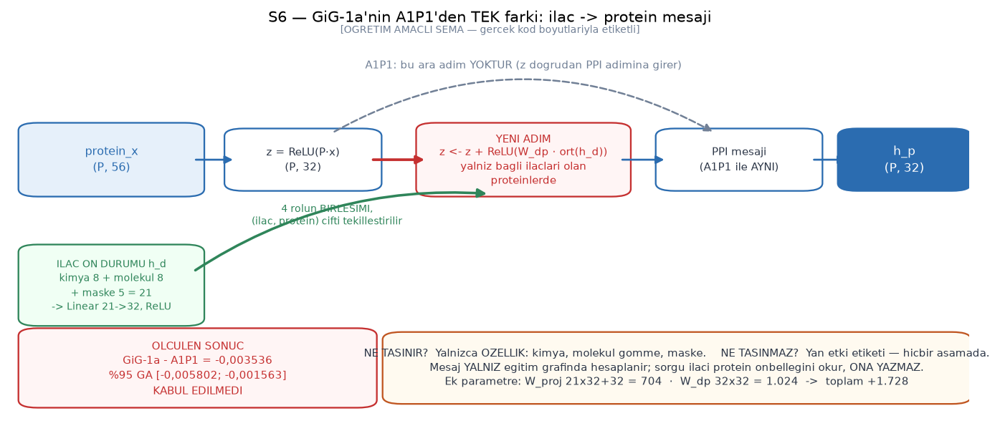

### 12.3 Tam mimari — A1P1 artı tek bir adım

```python
class GiG1Encoder(nn.Module):
    def __init__(self, num_targets=None):
        self.base = RoleMaskedPPI(num_targets=None)       # A1P1 ile AYNI
        self.molecular = BondAwareMolecularEncoder()      # A1P1 ile AYNI
        self.drug_projection = nn.Linear(21, 32)          # YENİ
        self.drug_message    = nn.Linear(32, 32, bias=False)  # YENİ
        self.head = nn.Linear(150, num_targets)           # A1P1 ile AYNI
```
<small>`wp14_gig1_encoder.py:62-72`</small>

Denklem dizisi (modül docstring'inden birebir):

$$h_d^{(0)} = \mathrm{ReLU}\!\left(W_{\text{proj}} \cdot [\text{kimya}(8) \oplus \text{molekül}(8) \oplus \text{maskeler}(5)]\right) \quad 21 \to 32$$

$$z_p = \mathrm{ReLU}(P\,x_p)$$

$$z_p^{(1)} = z_p + \mathrm{ReLU}\!\left(W_{dp} \cdot \operatorname*{mean}_{d \in N(p)} h_d^{(0)}\right)\cdot \mathbb{1}[N(p) \neq \varnothing] \qquad \textbf{← YENİ}$$

$$h_p = z_p^{(1)} + \mathrm{ReLU}\!\left(S\,z_p^{(1)} + M\cdot \operatorname{mean}_{\text{komşu}}(z_p^{(1)})\right) \quad \text{A1P1 ile aynı}$$

Gerçek kod:

```python
pairs = unique_drug_protein_pairs(role_edges, z.device)
if pairs.numel():
    sums = torch.zeros_like(z).index_add(0, pairs[1], drug_h[pairs[0]])
    counts = torch.zeros((len(z),1), ...).index_add(0, pairs[1], ones)
    # Bağlı ilacı olmayan protein gerçekten sıfır mesaj alır.
    z = z + torch.relu(self.drug_message(sums / counts.clamp_min(1))) * (counts > 0).to(z.dtype)
```
<small>`wp14_gig1_encoder.py:110-119`</small>

**İki ince ayrıntı:**

**(a) Rol birleşimi tekilleştirilir.**

```python
stacked = torch.cat(columns, dim=1)
pairs = torch.unique(stacked.t(), dim=0).t().contiguous()
```
<small>`wp14_gig1_encoder.py:57-58`</small>

Bir protein birden çok rolde görünebilir (örn. P02768 hem carrier hem
target). Tekilleştirme olmasa o (ilaç, protein) çifti ortalamada iki kez
sayılırdı. Dikkat: **rol okumasında** (A1P1 tarafı) aynı protein hâlâ iki
ayrı blokta sayılır; tekilleştirme yalnız yeni ilaç→protein mesajına
özgüdür.

**(b) `(counts > 0)` çarpanı.** Protein kolundaki `clamp_min(1)` ile
yetinilmez; bağlı ilacı olmayan protein **kesin olarak** sıfır mesaj alır.
ReLU'nun bias'sız olması zaten bunu sağlar, ama çarpan açık bir garantidir.

**Başlangıç ağırlıkları A1P1 ile özdeştir:**

```python
reference = a1p1_initialized_model(seed=seed, num_targets=num_targets, dtype=dtype)
model.base.load_state_dict(reference.base.state_dict())
model.molecular.load_state_dict(reference.molecular.state_dict())
model.head.load_state_dict(reference.head.state_dict())
```
<small>`wp14_gig1_encoder.py:151-158`</small>

Yeni katmanlar ayrı bir tohum akışından (`seed + 14`) başlar. Böylece
GiG-1a ile A1P1 arasındaki fark başlangıçta **yalnızca eklenen yoldan**
ibarettir. Nitekim sentetik kapı 05'te, `W_dp = 0` yapıldığında GiG-1a'nın
A1P1 ile **bit düzeyinde aynı** protein gömmesi ürettiği doğrulanmıştır.

**Ek parametre:**

| Katman | Hesap | Parametre |
|---|---|---:|
| `drug_projection` | 21×32 + 32 | 704 |
| `drug_message` | 32×32 | 1.024 |
| **Toplam ek** | | **+1.728** |

Gövde: 5.512 + 1.728 = **7.240**. Toplam parametre aralığı (K'ye göre):
31.098 – 56.466.

### 12.4 Sorularınızın doğrudan cevapları

**"GiG gerçekten bir GNN mi?"**
Evet. İki ayrı grafta gerçek mesaj geçişi yapar (atom–bağ ve PPI) ve buna
üçüncü bir mesaj tipi ekler (ilaç→protein). Hepsi `index_add` tabanlı
gather–scatter'dır.

**"A1P1'de de GNN var mı?"**
Evet. A1P1 zaten iki grafta mesaj geçirir. Fark şudur: A1P1'de iki graf
**ayrı ayrı** kodlanıp sonunda birleştirilir (geç füzyon); GiG-1a'da moleküler
koldan çıkan bilgi **protein kodlayıcısının içine** girer.

**"Heterojen mesajlaşma hangi aşamada gerçekleşiyor?"**
Tek bir yerde: protein projeksiyonundan **sonra**, PPI mesajından **önce**.
Kod sırası `encode_proteins` içinde açıkça budur. Bu yüzden protein, PPI
komşularına kendi güncellenmiş (ilaç bilgisi taşıyan) durumunu aktarır.

**"Model hangi komşuluk uzaklığındaki bilgiyi öğreniyor?"**
Protein kolunda etkin derinlik **2 adımdır**, ama türleri farklıdır:
ilaç → protein (1 adım) → PPI komşusu protein (1 adım). Yani bir protein
artık "bana bağlanan ilaçların kimyası" ve "komşumun bağlandığı ilaçların
kimyası" bilgisini taşıyabilir. **Aynı türden iki PPI adımı hâlâ yoktur.**

**"Yan etki düğümleri mesajlaşmaya katılıyor mu?"**
**Hayır — çünkü yan etki düğümü yoktur.** Yan etki, `nn.Linear(150, K)`'nın
çıkış boyutudur. EMT1'de bir `h_s` gömmesi vardı; V7'de yoktur. Bu bilinçli
bir sadeleştirmedir: `h_s` embedding'i, eğitim sırasında PT'nin sıklığını
ezberlemenin kolay bir yoludur ve B0'ın zaten yaptığı şeyi modelin içine
gizler.

**"Eğitim hedefi olan ilaç–yan etki bağlantıları encoder'a giriyor mu?"**
Hayır. Kanıt tek bir sütundur:
`fold_train_validation_test_scope.csv :: side_effect_edges` — **152 işin
tamamında `False`**. Etiketler yalnız kayıp fonksiyonunda görünür.

**"Atom–bağ grafı GiG'de gerçekten kullanıldı mı?"**
Evet, iki yerde: (a) A1P1'deki gibi füzyon bloğunda, (b) **yeni olarak**
ilaç ön durumu `h_d⁽⁰⁾`'ın içinde. Yani moleküler gömme artık protein
temsillerini de etkiler.

**"Test verisinden etiket sızıntısı nasıl engelleniyor?"**

| Risk | Engel |
|---|---|
| Etiket encoder'a girer | Encoder etiket argümanı almaz; `side_effect_edges` 152/152 `False` |
| Test ilacı protein gömmesini değiştirir | İlaç→protein mesajı **yalnız eğitim grafında** hesaplanır |
| Sorgu önbelleği bozar | `query_forward` önbelleği yalnız **okur**; sentetik kapı 06 ile doğrulandı |
| Görülmemiş protein kaçağı | Kenarsız işlenir |
| Epoch seçimi test skoruna bakar | Yalnız iç kat; `selection_complete_before_test_scoring.json` hash'leri |

```python
def query_forward(model, prepared, train_protein_h, variant=VARIANT):
    """Sorgu ilacı protein önbelleğini YALNIZ okur; ona yazmaz."""
    base = model.base.query_readout(query, train_protein_h)
    return model.fuse(base, block, prepared.molecules.atom_mask)
```
<small>`wp14_gig1_encoder.py:215-220`</small>

Dikkat: `query_forward` içinde `encode_proteins` **çağrılmaz**. Yani sorgu
ilacının ön durumu hiçbir proteine mesaj göndermez.

**"Çıktı yapısı nedir?"**
A1P1 ile birebir aynı: `(N, K)` logit → sigmoid → `oof_predictions.csv`'de
(ilaç, PT, skor) satırları. **35.974 çift** skorlanmıştır.

### 12.5 Çalışma örneği

| # | Aşama | A1P1 | GiG-1a |
|---:|---|---|---|
| 1 | Moleküler GNN | (N, 8) | (N, 8) — **aynı** |
| 2 | Kimya `Linear(5,8)` | (N, 8) | (N, 8) — **aynı** |
| 3 | **İlaç ön durumu** | — | `cat([8, 8, 5]) = 21` → `Linear(21,32)` → **(N, 32)** |
| 4 | Protein projeksiyon | (P, 32) | (P, 32) |
| 5 | **İlaç → protein mesajı** | — | her proteine bağlı ilaçların `h_d` ortalaması → **(P, 32)** |
| 6 | PPI mesajı | (P, 32) | (P, 32) — aynı denklem, farklı girdi |
| 7 | Rol okuması | (N, 128) | (N, 128) |
| 8 | Füzyon | (N, 150) | (N, 150) |
| 9 | Başlık + sigmoid | (N, K) | (N, K) |

Erythromycin'in P08684 (CYP3A4) enzimini düşünün: o03 katında 18 PPI
komşusu var. A1P1'de bu proteinin gömmesi yalnız kendi 56 amino asit
özelliğinden ve komşularından gelir. GiG-1a'da ek olarak, **eğitim
kümesindeki CYP3A4'e bağlanan bütün ilaçların kimyasal/moleküler
ortalaması** da gömmeye katılır. Fikir budur.

### 12.6 Ölçülen sonuç

Kabul ölçütü sonuçlardan **önce** kilitlenmişti:

> `GiG1a − A1P1` farkının koşullu %95 grup bootstrap GA'sı tamamen sıfırın
> üzerinde olmalı **ve** stres protokolünde nokta tahmini negatif olmamalı.

| Koşul | Sonuç |
|---|---|
| Birincil fark | **−0,003536** |
| Birincil %95 GA | **[−0,005802; −0,001563]** |
| GA tamamen sıfırın üzerinde mi? | **Hayır** — tamamen **altında** |
| Stres farkı | −0,001204 |
| Stres nokta tahmini negatif değil mi? | Hayır, negatif |
| **Kabul** | **EDİLMEDİ** |

Sonuç yalnızca "fark gösterilemedi" değildir: GiG-1a, birincil protokolde
A1P1'den **güvenilir biçimde bir miktar daha kötüdür**.

**Ama her metrik kötüleşmedi:**

| Metrik (primary, paired54) | GiG-1a | A1P1 | Fark |
|---|---:|---:|---:|
| İlaç-makro AP (**birincil**) | 0,642699 | 0,646234 | **−0,003536** |
| Micro AP | **0,574911** | 0,572040 | +0,002871 |
| Micro AUROC | **0,729083** | 0,727243 | +0,001840 |
| class_macro_AP | **0,3205** | 0,3173 | +0,0032 |

Kötüleşme **ilaç başına sıralamaya** özgüdür. Birincil ölçüt önceden
kilitlendiği için karar değişmez, ama bu ayrıntı gizlenmemelidir.

**En dikkat çekici bulgu:** GiG-1a ≈ A0P0 (fark −0,000041, GA
[−0,0029; +0,0027]). A0P0, atom dalı ve PPI'nin **ikisinin de kapalı**
olduğu koldur. İlaç→protein mesajı eklendiğinde A1P1'in atom dalından gelen
ölçülmüş kazanç (+0,002894) pratikte ortadan kalkmıştır. Bu bir
**eşzamanlılık gözlemidir**; nedensel mekanizma bu deneyle ayrıştırılmamıştır.

### 12.7 Neden? — Önceden kaydedilmiş dejenerasyon kontrolü

Protokolün §7.3(5) maddesi, mesajın hub proteinlerde neredeyse sabit çıkması
hâlinde bunun **sonuçla birlikte** raporlanmasını şart koşuyordu. Beş birincil
dış modelde ölçüldü:

| Ölçüm | Değer | Yorum |
|---|---:|---|
| Mesaj normu / taban normu | **0,380** | Mesaj, protein gömmesinin ~%38'i kadar **büyük** bir müdahale |
| Mesajın merkezden yayılımı / merkez normu | **0,290** | Mesaj proteinler arasında büyük ölçüde **sabit** |
| Hub proteinlerde mesaj normu (derece ≥ 10) | 1,082 | |
| Düşük dereceli proteinlerde (derece 1–2) | 1,150 | **neredeyse aynı** |

**Okunuşu:** İlaç→protein mesajı, protein temsillerine *büyük ama büyük
ölçüde ayırt edici olmayan* bir bileşen ekliyor. Her proteini benzer yönde
kaydırıyor; hub ile spesifik proteini ayırt etmiyor. Bu, fizibilite
raporunda öngörülen **oversmoothing** desenidir ve ölçülmüş AP kaybıyla
tutarlıdır.

Bir düzeltme de kayda geçmiştir: fizibilitede "proteinlerin %59'u hiç 2-adım
yolu taşımaz" denmişti; bu 62 ilaçlık **tüm kohort** için doğrudur. Kat içi
eğitim graflarında bağlantısız protein **sıfırdır** (125/121/133/119/123
proteinin tamamı en az bir ilaca bağlı). Yani sonuç, yolun **yokluğundan**
değil, yolun **ayırt edici olmamasından** kaynaklanıyor.

### 12.8 Güvenlik denetimi

| Kontrol | Sonuç |
|---|---|
| Yan etki kenarı encoder'da | **Yok** — mesajlar yalnız kimya/molekül/maske taşır |
| Test etiketleri encoder'da | **Yok** |
| İlaç→protein mesajı kaynağı | Yalnız eğitim grafı |
| Önbellek izolasyonu | Sentetik kapı 06 ile doğrulandı |
| Yeni yol gerçekten öğrenildi mi? | **Evet** — 38/38 fitte `W_dp` gradyan normu > 0 **ve** ağırlık L2 değişimi > 0 |
| Sentetik kapı | **8/8 PASS**, analitik fark max 8,3×10⁻¹⁷ |
| Dondurulmuş modeller | Yeniden eğitilmedi; manifestler sabit (1567/1711/2487) |

### 12.9 Güçlü ve zayıf yönleri

**Güçlü:**

- A1P1'in **kontrollü** bir genişletmesidir: `W_dp = 0` iken bit düzeyinde
  A1P1'dir. Karşılaştırma bu yönüyle denetlenmiştir.
- Modaliteler arası gerçek etkileşim sağlar: protein bloğu artık kimya
  türevi bilgi taşır.
- Bağlama uyarlanan protein temsili üretir: aynı protein, hangi ilaçlarla
  ilişkili olduğuna göre farklı gömme alır.
- Sızıntı yüzeyi genişlemeden uygulanmıştır (yalnız özellik taşır).
- EMT1'in sınanmamış fikrini **ölçülmüş bir sonuca** çevirmiştir.

**Zayıf:**

- Ölçülen etki **negatiftir** (−0,003536).
- Dejenerasyon ölçümü oversmoothing gösteriyor: mesaj büyük ama ayırt edici
  değil.
- 50 ilaçlık eğitim bölmelerinde 1.728 ek parametre karşılıksız kalmıştır.
- İlaç→protein mesajı yalnız eğitim grafında hesaplandığı için, sorgu ilacı
  protein temsillerini zenginleştiremez — yani indüktif senaryoda yeni
  yolun katkısı yapısal olarak sınırlıdır.
- `class_macro_AP`'de iyileşme var ama bunun bağımsız-fold GA'sı yoktur,
  dolayısıyla kalibre edilmiş bir üstünlük iddiası yapılamaz.

---

## 13. WP15 — Ağaç tabanlı karşılaştırma modelleri (T1, T2)

Bu bölüm plandaki "ek" maddesidir, ama bulgusu önemlidir.

### A. Amaç

B1 (doğrusal, 6 özellik) birincil ölçütte en yüksek noktaydı. Soru: **aynı
bilgiyi farklı bir fonksiyon sınıfıyla okursak ne olur?** Yani eksen hizalı
etkileşimler var mı?

Deneyde **tek bir şey değişir: kestirici.** Özellikler, bölmeler, uygunluk
(54 ilaç), hedef sözlüğü, etiket ve tohum B1 ile birebir aynıdır.

### B–D. Girdi ve mimari

| Kol | Model | Yapılandırma |
|---|---|---|
| **T1** | Rastgele orman | 300 ağaç |
| **T2** | Histogram tabanlı gradyan artırma | 100 yineleme, lr 0,1 |

Hiperparametre ızgarası sonuçlar görülmeden kilitlendi; seçim **yalnız iç
kat** ortalamasına göre yapıldı. İki kolda da **en sığ adaylar** seçildi
(T1: `max_depth=3`, T2: `max_depth=2`) — 29–43 ilaçlık eğitim bölmelerinde
derinliğin karşılığı yok.

**Eğitimden önce kapatılan iki kapı** (yöntem dürüstlüğü açısından kayda
değer):

1. Gradyan artırmada `early_stopping=True` iken, kütüphanenin dahili
   tabakalı doğrulama bölmesi seyrek hedeflerde tek üyeli sınıf yüzünden
   hata veriyordu → `early_stopping=False, max_iter=100`.
2. Rastgele ormanda `n_jobs=-1` ile `n_jobs=1` **aynı `random_state` ile
   birebir aynı olasılıkları üretmedi** → determinizm kapısı başarısız oldu,
   `n_jobs=1`'e dönüldü. Kayıttaki gerekçe: *"Tekrar üretilebilirlik hızdan
   öncedir."* Toplam iç seçim süresi 8.578 saniyeye çıktı.

### G. Sonuçlar

**Birincil protokol, paired54, ilaç-makro AP:**

| Model | Tahmin | %95 GA |
|---|---:|---|
| **T1 Rastgele orman** | **0,657339** | [0,6155; 0,6958] |
| B1 Kimya + lojistik | 0,655642 | [0,6131; 0,6920] |
| B0 sıklık (B2 kapsamı) | 0,646604 | [0,6044; 0,6853] |
| A1P1 | 0,646234 | [0,6022; 0,6876] |
| GiG-1a | 0,642699 | [0,5982; 0,6848] |
| T2 Gradyan artırma | 0,632483 | [0,5904; 0,6734] |
| B2 | 0,626239 | [0,5792; 0,6701] |

| Karşılaştırma | Fark | %95 GA | Ayırt edilebilir? |
|---|---:|---|---|
| T1 − B1 | +0,001697 | [−0,013428; +0,018248] | **Hayır** |
| T1 − B2 | +0,031100 | [+0,010025; +0,052217] | Evet |
| T2 − B1 | −0,023159 | [−0,039580; −0,009189] | **Evet (daha kötü)** |

**Karar: T1 ana model olmaz.** "Rastgele orman lojistik regresyonu geçti"
denemez.

### 13.1 Stres protokolündeki beklenmeyen bulgu

| Model | Birincil | Stres | Değişim |
|---|---:|---:|---:|
| **T1 Rastgele orman** | 0,657339 | **0,656584** | **−0,0008** |
| A1P1 | 0,646234 | 0,647141 | +0,0009 |
| GiG-1a | 0,642699 | 0,645937 | +0,0032 |
| **B1 Kimya + lojistik** | 0,655642 | **0,631871** | **−0,0238** |
| B2 | 0,626239 | 0,599696 | −0,0265 |

Stres protokolünde **T1 − B1 = +0,024713**, %95 GA [+0,002413; +0,048397] —
aralık tümüyle sıfırın üstündedir.

**Okunuşu:** Kimyasal olarak ayrık bölmelere geçildiğinde B1 düşer (−0,0238),
T1 düşmez (−0,0008). Doğrusal model, eğitim ilaçlarına kimyasal olarak
benzeyen test ilaçlarından yararlanıyordu; bu destek kaldırıldığında
başarımı geriler.

**Bu, GNN'ler için de önemli bir bağlamdır:** A1P1 ve GiG-1a stres
protokolünde **düşmez** (hatta hafif yükselir). Yani graf modellerinin
birincil protokoldeki dezavantajı, kısmen "benzer ilaç kopyalama"
avantajından yararlanmamalarından kaynaklanıyor olabilir. Bu bir hipotezdir,
test edilmiş bir iddia değildir.

---

## KISIM III — GRAFLARIN ANATOMİSİ

Bu kısım, Kısım II'deki model bölümlerinin dayandığı veri yapılarını
ayrıntılandırır. Buraya kadar "44 boyutlu atom özelliği" dendi; burada o 44
sayının ne olduğunu tek tek görüyoruz.

---

## 14. Atom–bağ moleküler grafı

### 14.1 SMILES'ten `Data`'ya: zincirin tamamı

```
PubChem CID ──doğrulanmış──> SMILES metni
    │  Chem.MolFromSmiles(...)                        [RDKit]
    ▼
RDKit Mol nesnesi
    │  AssignStereochemistry + FindPotentialStereo    [RDKit]
    ▼
atom listesi + bağ listesi (ham değerler)
    │  vector('atom', ...) / vector('bond', ...)      [proje kodu]
    ▼
44 ve 14 boyutlu one-hot vektörler
    │  torch.tensor(...)                              [PyTorch]
    ▼
Data(x, edge_index, edge_attr, num_nodes)             [PyTorch Geometric]
```

**Kütüphanelerin görev dağılımı:**

| Kütüphane | Bu projedeki görevi |
|---|---|
| **RDKit** | SMILES ayrıştırma, stereokimya ataması, atom/bağ özelliklerinin okunması. Model hesabı yapmaz. |
| **NumPy** | Diske yazma/okuma (NPZ), hash alma |
| **PyTorch** | Bütün öğrenme: `nn.Linear`, ReLU, `index_add`, autograd, AdamW |
| **PyTorch Geometric** | Yalnız `Data`, `Batch`, `global_mean_pool`. **Hiçbir konvolüsyon katmanı kullanılmaz.** |
| **NetworkX** | Yalnız keşif/görselleştirme (WP01, WP06). Model yolunda değil. |
| **scikit-learn** | B1/B2 (lojistik regresyon), WP15 (ağaçlar), AP hesapları |

SMILES PDF'den veya tahminle **üretilmez**; PubChem CID ile doğrulanmış
kaynaktan gelir ve InChIKey karşılaştırmasıyla kontrol edilir
(`wp10_molecular_graph.py:174`).

### 14.2 Atomun 44 özelliği

`configs/WP10_design_PROPOSED_v1.json` içindeki şemadan:

| # | Alan | Kategoriler | Boyut |
|---:|---|---|---:|
| 1 | `element` | C, N, O, F, P, S, Cl, Br, I, OTHER | 10 |
| 2 | `total_degree` | 0, 1, 2, 3, 4, 5, 6, OTHER | 8 |
| 3 | `formal_charge` | −2, −1, 0, +1, +2, OTHER | 6 |
| 4 | `total_H` | 0, 1, 2, 3, 4, OTHER | 6 |
| 5 | `hybridization` | SP, SP2, SP3, SP3D, SP3D2, OTHER | 6 |
| 6 | `aromatic` | bool | 1 |
| 7 | `in_ring` | bool | 1 |
| 8 | `CIP_state` | R, S, UNASSIGNED_POTENTIAL, NONE, OTHER | 5 |
| 9 | `isotope_specified` | bool | 1 |
| | **Toplam** | | **44** |

**Hepsi 0/1'dir** — sürekli değer yoktur. Doğrulama bunu zorlar:

```python
if not ((block == 0) | (block == 1)).all():
    raise ValueError('Binary/one-hot features required')
if SCHEMA[kind][field] != ['bool'] and not (block.sum(1) == 1).all():
    raise ValueError('One-hot category missing/ambiguous')
```
<small>`wp10_molecular_graph.py:88-89`</small>

Yani her kategorik alanda **tam olarak bir tane 1** olmak zorundadır.
Beklenmeyen bir değer (örn. 7 bağlı bir atom) `OTHER` kutusuna düşer ve bu
bilgi kaybolmaz, ama belirsizleşir.

**`OTHER` neden var?** Model, eğitimde hiç görmediği bir elementle
karşılaşırsa çökmesin diye. Sessiz bir `fillna(0)` değildir: `OTHER`
sütunu açıkça 1 olur ve model "bilmediğim bir şey" bilgisini alır.

**Gerçek atom tablosu — Metronidazole (DB00916), 12 atomun tamamı:**

| atom | element | derece | yük | H | hibrit. | aromatik | halka | CIP | izotop |
|---:|---|---:|---:|---:|---|:---:|:---:|---|:---:|
| 0 | C | 4 | 0 | 3 | SP3 | – | – | NONE | – |
| 1 | C | 3 | 0 | 0 | SP2 | **✓** | **✓** | NONE | – |
| 2 | N | 2 | 0 | 0 | SP2 | **✓** | **✓** | NONE | – |
| 3 | C | 3 | 0 | 1 | SP2 | **✓** | **✓** | NONE | – |
| 4 | C | 3 | 0 | 0 | SP2 | **✓** | **✓** | NONE | – |
| 5 | N | 3 | 0 | 0 | SP2 | **✓** | **✓** | NONE | – |
| 6 | C | 4 | 0 | 2 | SP3 | – | – | NONE | – |
| 7 | C | 4 | 0 | 2 | SP3 | – | – | NONE | – |
| 8 | O | 2 | 0 | 1 | SP3 | – | – | NONE | – |
| 9 | N | 3 | **+1** | 0 | SP2 | – | – | NONE | – |
| 10 | O | 1 | **−1** | 0 | SP2 | – | – | NONE | – |
| 11 | O | 1 | 0 | 0 | SP2 | – | – | NONE | – |

Kaynak: `reports/qa/WP10/encoder_v1/atom_fields_all62.csv`.

Atom 9, 10, 11 nitro grubudur ve formal yük sütununun neden gerektiğini
gösterir: N atomu +1, bir O atomu −1 yüklüdür.

**Aynı atomların gerçek 44 boyutlu vektörleri:**

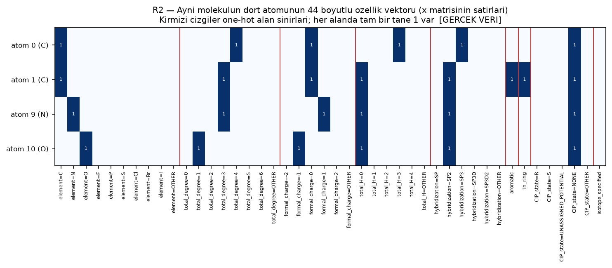

Bu görsel, "tabloda gördüğüm satır modelde nasıl duruyor?" sorusunun
doğrudan cevabıdır. Kırmızı çizgiler one-hot alan sınırlarıdır.

### 14.3 Bağın 14 özelliği ve `edge_index` / `edge_attr` ayrımı

| # | Alan | Kategoriler | Boyut |
|---:|---|---|---:|
| 1 | `bond_type` | SINGLE, DOUBLE, TRIPLE, AROMATIC, OTHER | 5 |
| 2 | `stereo` | STEREONONE, STEREOANY, STEREOZ, STEREOE, STEREOCIS, STEREOTRANS, OTHER | 7 |
| 3 | `conjugated` | bool | 1 |
| 4 | `in_ring` | bool | 1 |
| | **Toplam** | | **14** |

**`edge_index` ve `edge_attr` arasındaki fark:**

| | `edge_index` | `edge_attr` |
|---|---|---|
| Şekil | `(2, E)` | `(E, 14)` |
| Tip | int64 | float32 |
| Söylediği | **Kim kime bağlı** | **O bağlantı nasıl bir şey** |
| Olmadan ne olur | Graf yapısı kaybolur | Bütün bağlar aynı sayılır |

Sütunlar hizalıdır: `edge_index[:, k]` ile `edge_attr[k]` aynı kenarı
tarif eder.

**Gerçek bağ tablosu — Metronidazole'ün 12 bağı:**

| bağ | başlangıç | bitiş | tür | stereo | konjüge | halka | ileri sütun | geri sütun |
|---:|---:|---:|---|---|:---:|:---:|---:|---:|
| 0 | 0 | 1 | SINGLE | STEREONONE | – | – | 0 | 1 |
| 1 | 1 | 2 | AROMATIC | STEREONONE | ✓ | ✓ | 2 | 3 |
| 2 | 2 | 3 | AROMATIC | STEREONONE | ✓ | ✓ | 4 | 5 |
| 3 | 3 | 4 | AROMATIC | STEREONONE | ✓ | ✓ | 6 | 7 |
| 4 | 4 | 5 | AROMATIC | STEREONONE | ✓ | ✓ | 8 | 9 |
| 5 | 5 | 6 | SINGLE | STEREONONE | – | – | 10 | 11 |
| 6 | 6 | 7 | SINGLE | STEREONONE | – | – | 12 | 13 |
| 7 | 7 | 8 | SINGLE | STEREONONE | – | – | 14 | 15 |
| 8 | 4 | 9 | SINGLE | STEREONONE | ✓ | – | 16 | 17 |
| 9 | 9 | 10 | SINGLE | STEREONONE | ✓ | – | 18 | 19 |
| 10 | 9 | 11 | **DOUBLE** | STEREONONE | ✓ | – | 20 | 21 |
| 11 | 5 | 1 | AROMATIC | STEREONONE | ✓ | ✓ | 22 | 23 |

12 kimyasal bağ → **24 yönlü kenar** (ileri + geri sütunlar).

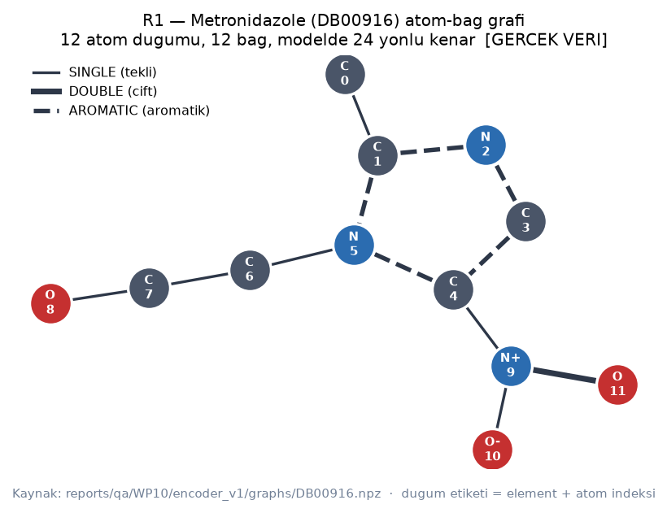
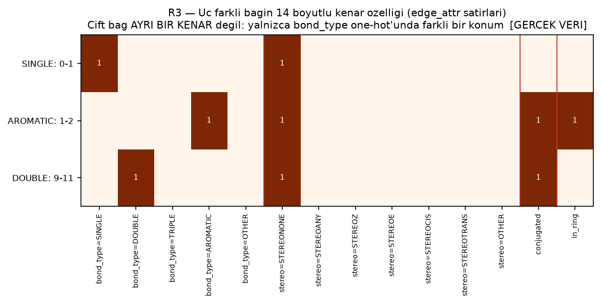

### 14.4 "Çift bağ neden iki ayrı 14 özellikli kenar değil?"

Bu, en sık karıştırılan noktadır. İki ayrı şey var:

**(a) Bağın derecesi (tekli/çiftli/üçlü/aromatik)** → `bond_type` one-hot'ta
**bir sütun** farkıdır. Çift bağ, `[0,1,0,0,0]`; tekli bağ `[1,0,0,0,0]`.
Tek bir kenar özelliği, tek bir 14'lük vektör.

**(b) Yön** → Her kimyasal bağ, `edge_index`'te **iki sütuna** açılır:
`(i→j)` ve `(j→i)`. Bu, mesajın iki yönde de akabilmesi içindir; kimyasal
bir anlamı yoktur.

Yani Metronidazole'ün 10 numaralı bağı (N9=O11, DOUBLE) için:

| | değer |
|---|---|
| Kimyasal bağ sayısı | 1 |
| `edge_index` sütunu | 2 (20. ve 21.) |
| `edge_attr` satırı | 2, ama **içerikleri birebir aynı** |
| `bond_type` one-hot'unda DOUBLE | 1 |

Ters kenarın özelliklerinin aynı olduğu **test edilir**:

```python
for (i,j), column in index.items():
    other = index.get((j,i))
    if other is None or not torch.equal(data.edge_attr[column], data.edge_attr[other]):
        raise ValueError('Reverse bond feature mismatch')
```
<small>`wp10_molecular_graph.py:95-97`</small>

Neden aynı? Çünkü özellik şemasında yöne bağlı hiçbir alan yoktur. RDKit'in
`BondDir` ve `stereo_atoms` gibi yön bağımlı bilgileri **metadata olarak
saklanır, özelliğe kopyalanmaz** (`feature_schema.json :: direction_policy`).

### 14.5 Değişken boyut: 12 atom da 51 atom da aynı başlığa nasıl giriyor?

İki mekanizma:

**(1) `Batch`** farklı molekülleri tek bir kopuk grafta birleştirir, indeksleri
kaydırır, `batch` vektörüyle kimin kime ait olduğunu takip eder.

**(2) `global_mean_pool`** her molekülün atomlarının ortalamasını alır:

$$g_m = \frac{1}{|A_m|}\sum_{a \in A_m} h_a$$

| Molekül | Atom | `h` şekli | Pooling sonrası |
|---|---:|---|---|
| Metronidazole | 12 | (12, 16) | **(1, 16)** |
| Erythromycin | 51 | (51, 16) | **(1, 16)** |

Pooling'den sonra boyut **daima 16**'dır, atom sayısından bağımsız. Sonra
`Linear(16,8)` ile 8'e iner. Başlık bu yüzden sabit boyutlu çalışabilir.

**Ortalamanın bir maliyeti vardır:** Büyük bir molekülde tek bir reaktif
grubun sinyali 51'e bölünür. Toplama (sum) kullanılsaydı molekül büyüklüğü
baskın olurdu. Bu bir tasarım tercihidir, en iyi seçim olduğu test
edilmemiştir.

### 14.6 QC'den geçmeyen moleküllerde atom maskesi

62 molekülün **hepsi** için graf üretilir ve diske yazılır. Fark, maskededir:

```python
@lru_cache(maxsize=1)
def approved_atom_ids():
    frame = pd.read_csv(ROOT/'reports/qa/WP04/structure_validation.csv')
    return frozenset(frame[frame.strict_qc_pass].id), frozenset(frame.id)
```
<small>`wp10_molecular_graph.py:114-117`</small>

Maske, modelin kendi içinde **doğrulanır**:

```python
expected = torch.tensor([d in approved for d in ids], dtype=torch.bool, ...)
if ... or not torch.equal(expected, molecules.atom_mask):
    raise ValueError('Frozen QC54/8 masks required')
```
<small>`wp10_molecular_encoder.py:72-73`</small>

Yani maske çalışma zamanında hesaplanmaz; dondurulmuş QC kararıyla
karşılaştırılır ve uymazsa program durur.

Maskeli bir ilaç için füzyonda ne olur:

| Boyut | A1 kolunda QC açık ilaç | A1 kolunda QC kapalı ilaç |
|---|---|---|
| 141–148 (molekül) | GNN çıktısı | **0, 0, 0, 0, 0, 0, 0, 0** |
| 149 (atom maskesi) | **1** | **0** |

Son bit kritiktir: molekül bloğu sıfır olduğunda, model bunun "gerçekten
sıfır bir molekül" mü yoksa "bilgi yok" mu olduğunu ancak bu bitten anlar.

**Stereokimya tamamlanmaz.** `unspecified_atom_stereo` bayrağı taşıyan bir
molekül için R/S ataması **tahmin edilmez**; `CIP_state` alanı
`UNASSIGNED_POTENTIAL` kategorisine düşer ve molekül maskelenir. Gentamicin
ayrıca çok bileşenlidir (`multiple_components`) ve parça seçimi yapılmaz.

---

## 15. Protein ve PPI grafı

### 15.1 Protein düğümleri nereden geliyor?

**DrugBank XML'den.** Bağımsız bir UniProt indirmesi yoktur. XML içindeki
`polypeptide` kayıtlarından accession ve dizi çıkarılır; eski dizilerdeki
`>lcl|...|AminoAcidSequence` gibi FASTA başlıkları **ayrıştırılarak
temizlenir** (V6'nın hatalarından biri buydu — başlık metni dizinin parçası
sayılıyordu).

| Büyüklük | Değer |
|---|---:|
| Kohorttaki benzersiz protein | **141** |
| Doğrulanmış özellik üretilen protein | 141 |
| Benzersiz tipli ilaç–protein kenarı | 476 |
| Protein kaydı olmayan ilaç | 2 (Methenamine, Tobramycin) |

Organizma dağılımı — **bu tablo bir sonraki sorunun cevabıdır**:

| Grup | Benzersiz protein |
|---|---:|
| Bakteri | 75 |
| **İnsan** | **63** |
| Mantar | 1 |
| Diğer ökaryot | 2 |

Rol dağılımı:

| Rol | Kenar | İlaç | Benzersiz protein |
|---|---:|---:|---:|
| target | 241 | 55 | 89 |
| enzyme | 78 | 38 | 30 |
| transporter | 135 | 43 | 28 |
| carrier | 22 | 19 | 4 |

Toplam benzersiz protein (141), rol sütunlarının toplamından (151) küçüktür
çünkü **aynı protein birden çok rolde görünebilir** — örneğin bir protein
hem carrier hem target olabilir. Bu, GiG-1a'nın tekilleştirme yapmasının
nedenidir (§12.3).

### 15.2 "Toplam protein sayısı ile PPI alt grafındaki protein sayısı neden farklı?"

Bu sorunun cevabı üç kademelidir ve `primary_o03_final` katında somut
sayılarla:

| Kademe | Sayı | Neden eleniyor |
|---|---:|---|
| Katın bütün dizi-doğrulanmış proteinleri | **133** | — (hepsi `protein_x` satırı olur) |
| Bunların katı insan (taxid 9606) olanları | **59** | Kalan 74 bakteri/mantar/diğer; STRING insan ağında yok |
| 700 eşiğinde en az bir kenarı olanlar | **48** | 11 insan proteini bu eşikte izole kalıyor |

Yani **133 düğümün 48'i mesaj alır/verir; 85'i yalnız self/residual yolda
kalır.** Bu bir hata değil, kohortun gerçeğidir: antibakteriyellerin
hedefleri çoğunlukla **bakteri** proteinleridir ve bakteri PPI ağı bu
çalışmanın kapsamına alınmamıştır.

Eşiğin etkisi (aynı kat):

| Eşik | Mesaj alan insan düğümü | İzole | Yönsüz çift | Yönlü sütun | Bileşen | En büyük bileşen | Yoğunluk |
|---:|---:|---:|---:|---:|---:|---:|---:|
| 400 | 58 | 1 | 542 | 1.084 | 2 | 58 | 0,3168 |
| **700** | **48** | **11** | **166** | **332** | **13** | **46** | **0,0970** |
| 900 | 33 | 26 | 62 | 124 | 31 | 23 | 0,0362 |

700 kullanılmıştır. Bu seçim sonuçlardan önce sabitlenmiştir.

### 15.3 STRING 700 eşiği ne anlama gelir?

STRING'in `combined_score`'u 0–1000 arasında bir **kanıt güven ölçüsüdür**;
deneysel, hesaplamalı, metin madenciliği ve veritabanı kanıtlarını birleştirir.
700, STRING'in kendi terminolojisinde "yüksek güven" eşiğidir.

**Kritik:** `combined_score` modelin içinde **hiçbir yerde sayı olarak
kullanılmaz.**

| Soru | Cevap |
|---|---|
| Kenar seçiminde kullanılıyor mu? | **Evet** — `score ≥ 700` ise kenar grafa girer |
| Kenar ağırlığı olarak kullanılıyor mu? | **Hayır** |
| Kenar özelliği (`edge_attr`) olarak? | **Hayır** — PPI kenarlarının özelliği yoktur |
| Düğüm özelliği olarak? | **Hayır** — kesinlikle yasak |

Neden yasak? Çünkü `combined_score` bir **kanıt birikimi** ölçüsüdür, bir
etkileşim kuvveti değil. Çok çalışılmış proteinler yüksek skor alır — bu
literatür yanlılığıdır, biyolojik gerçek değil. Modelde ağırlık olarak
kullanılsaydı, model "popüler protein" sinyalini öğrenirdi.

**Modelde kullanılan PPI kenar gösterimi:**

| Kaynak protein indeksi | Hedef protein indeksi | Kullanılan özellik/ağırlık |
|---:|---:|---|
| 3 | 47 | **yok** — ağırlıksız, mesaj doğrudan `z_47` |
| 47 | 3 | **yok** (ters kenar) |
| 12 | 88 | **yok** |

Mesaj formülünde kenar için hiçbir terim yoktur:
`total.index_add(0, destination, z[source])`. Karşılaştırın: moleküler kolda
`ReLU(U·h0_j + V·e_ji)` — orada `V·e_ji` terimi kenar özelliğidir.

### 15.4 Yönlü/yönsüz semantiği

STRING ilişkisi **yönsüzdür**. Model yönlü kenar listesiyle çalıştığı için
her yönsüz çift iki yöne açılır. Kanonik biçim (`u < v`) zorlanır, kopya
çift reddedilir, self-loop açıkça yasaklanır:

```python
if pairs.numel() and not bool((pairs[0] < pairs[1]).all()):
    raise ValueError('Canonical unique undirected pairs required')
if pairs.shape[1] != len(set(map(tuple, pairs.T.tolist()))):
    raise ValueError('Duplicate pair')
...
if edges.numel() and bool((edges[0] == edges[1]).any()):
    raise ValueError('Explicit PPI self-loop forbidden')
```
<small>`wp09_encoder.py:16-17, 33`</small>

İlaç–protein rol kenarları ise **tek yönlüdür**: protein → ilaç. İlaçtan
proteine mesaj A1P1'de yoktur; GiG-1a'nın eklediği tam olarak budur.

### 15.5 56 protein özelliğinin tam dökümü

| Blok | Alanlar | Boyut |
|---|---|---:|
| Global | `length_aa`, `molecular_weight_Da`, `isoelectric_point`, `aromaticity_fraction`, `gravy_kyte_doolittle`, `net_charge_pH7` | 6 |
| AAC (amino asit kompozisyonu) | `AAC_A` … `AAC_Y`, 20 standart amino asit | 20 |
| Grup oranları | `group_nonpolar_nonaromatic`, `group_aromatic`, `group_polar_uncharged`, `group_basic`, `group_acidic` | 5 |
| DC (dipeptit grup frekansı) | `DC_<grup>__<grup>`, 5×5 | 25 |
| | **Toplam** | **56** |

**V6'dan düzeltilen üç şey:**

1. **`kalite_skoru` tamamen çıkarıldı.** V6'daki bu sütun, UniProt
   accession'ının **ilk harfinden** (P/Q/O) türetilmiş keyfi bir koddu.
   UniProt ID prefix'i bir kalite derecesi **değildir**; bu bilimsel bir
   olgu gibi sunulamaz. Yeni `protein_x` içinde yoktur.
2. **Dizi metadata'sı ayrıştırılıyor.** FASTA başlığı artık dizinin parçası
   sayılmıyor; 20 standart amino asit doğrulaması yapılıyor.
3. **5'li grup tanımı düzeltildi.** V6'nın grup tanımında F çakışması vardı
   ve C ile G kapsam dışıydı. Yeni tanım `amino_acid_group_audit.csv`'de
   açıkça belgelenmiştir ve testi vardır.

**Protein özellik tablosu** (biçim; gerçek değerler
`reports/qa/WP05/protein_features.csv`):

| Protein ID (UniProt) | length_aa | MW_Da | pI | ... | DC_acidic__acidic |
|---|---:|---:|---:|---|---:|
| P08684 | … | … | … | … | … |
| Q9Y6L6 | … | … | … | … | … |

**İlaç–protein rol tablosu** (biçim; gerçek: `drug_protein_edges.csv`):

| DrugBank ID | Protein ID | İlişki türü |
|---|---|---|
| DB00199 | O43193 | target |
| DB00199 | P08684 | enzyme |
| DB00199 | Q9Y6L6 | transporter |

**STRING protein–protein tablosu** (biçim):

| Protein 1 | Protein 2 | STRING skoru | Grafa alındı mı? |
|---|---|---:|---|
| P08684 | Q9Y6L6 | ≥ 700 | **Evet** (skor saklanmaz) |
| … | … | < 700 | Hayır |

Son sütun vurgulanmalı: **skorun kendisi `ppi_pairs_700` dizisinde yoktur.**
Dizide yalnız indeks çiftleri vardır.

---

## 16. Mesajlaşmanın adım adım anatomisi

Bu bölüm, §10.D ve §11.D'deki denklemleri bir düğüm üzerinden somutlaştırır.

### 16.1 Düğüm özellikleri katmana nasıl giriyor?

Ham özellik vektörü (protein: 56, atom: 44) önce bir **projeksiyon**
katmanından geçer:

```
x (56 boyut, sabit, veriden)  →  Linear(56,32) + ReLU  →  z (32 boyut, öğrenilmiş)
```

Bu adım neden var? Üç nedeni:

1. **Boyut indirgeme:** 56 → 32, parametre sayısını kontrol eder.
2. **Öğrenilebilirlik:** Ham özellikler sabittir; `z` eğitimle değişir.
3. **Ortak uzay:** Komşuların toplanabilmesi için hepsinin aynı uzayda
   olması gerekir.

ReLU, negatifleri sıfırlar: `ReLU(t) = max(0, t)`. Bu, modele
doğrusal-olmayanlık kazandırır — ReLU olmadan üst üste konmuş lineer
katmanlar tek bir lineer katmana eşdeğer olurdu.

### 16.2 Bir düğüm hangi komşularından bilgi topluyor?


Somut: Q9Y6L6 proteini, o03 katında **19 PPI komşusuna** sahiptir. Bu 19
komşunun `z` vektörlerinin ortalaması alınır. Q12809 ise yalnız **1**
komşuya sahiptir — onun "ortalaması" tek komşunun kendisidir.

`index_add` adım adım (3 komşulu bir düğüm için):

| Adım | İşlem | Sonuç |
|---|---|---|
| 1 | `total = zeros(P, 32)` | hepsi 0 |
| 2 | her kenar için `total[hedef] += z[kaynak]` | komşu toplamları |
| 3 | `degree = zeros(P, 1)`; her kenar için `degree[hedef] += 1` | dereceler |
| 4 | `mean = total / degree.clamp_min(1)` | komşu ortalaması |

`clamp_min(1)`: derece 0 ise 0/0 yerine 0/1 = 0 olur. Yani **komşusuz düğüm
sıfır mesaj alır** — NaN üretmez, ama sahte bir değer de almaz.

### 16.3 "Toplanıyor mu, ortalanıyor mu, ağırlıklandırılıyor mu?"

| Yöntem | Bu projede |
|---|---|
| Toplama (sum) | **Hayır** |
| **Ortalama (mean)** | **Evet** — her iki grafta da |
| Dereceye göre normalize (GCN tarzı 1/√(dᵢdⱼ)) | Hayır |
| Dikkat (attention, GAT tarzı) | Hayır |
| Kenar skoruyla ağırlıklandırma | Hayır |

Ortalama seçilmesinin nedeni: hub proteinler (19 komşulu) ile az komşulu
proteinler arasında ölçek farkı oluşmasın. Toplama kullanılsaydı, Q9Y6L6'nın
mesajı Q12809'unkinin 19 katı büyüklükte olurdu ve model derece bilgisini
dolaylı olarak öğrenirdi.

### 16.4 Kenar özellikleri mesaj fonksiyonuna nasıl katılıyor?

**Yalnız moleküler kolda:**

$$\mu_{j \to a} = \mathrm{ReLU}(U\,h^{(0)}_j + V\,e_{j\to a})$$

İki terim toplanır, sonra ReLU uygulanır:

| Terim | Boyut | Anlamı |
|---|---|---|
| `U · h0_j` | 16 | "Komşu atom nasıl bir atom?" |
| `V · e_ji` | 16 | "Onu bana bağlayan bağ nasıl bir bağ?" |

Böylece aynı komşu atomdan gelen mesaj, bağ aromatikse farklı, tekliyse
farklı olur. "Bond-aware" (bağ-duyarlı) adı buradan gelir.

**Protein kolunda kenar özelliği yoktur**, çünkü PPI kenarının bir özellik
vektörü yoktur (STRING skoru bilinçli olarak kullanılmıyor). Orada mesaj
doğrudan `z_j`'dir.

### 16.5 "Birinci katmandan sonra ne değişiyor? İkinci katmanda ne olurdu?"

**Birinci katmandan sonra:** Her düğümün vektörü artık kendi özelliği **ve**
doğrudan komşularının özelliklerinin bir karışımıdır. Protein P'nin `h_p`'si
artık "P nasıl bir proteindir" + "P'nin komşuları nasıl proteinlerdir"
bilgisini taşır.

**İkinci katman olsaydı:** `h` vektörleri tekrar mesaj alır; komşunun
komşusuna ulaşılırdı (2-hop).

**Bizim modelimizde ikinci katman YOKTUR.** `forward` içinde blok bir kez
çalışır. Erişim uzaklığı tablosu:

| Model | Protein kolunda erişim | Atom kolunda erişim |
|---|---|---|
| WP09 | 1 adım (PPI) | — |
| A1P1 | 1 adım (PPI) | 1 adım (bağ) |
| **GiG-1a** | **2 adım, ama karma tür:** ilaç → protein → PPI komşusu | 1 adım (bağ) |

GiG-1a'nın 2 adımı **aynı türden iki PPI adımı değildir**. Bir protein hâlâ
"komşumun komşusu" bilgisine ulaşamaz; ulaştığı yeni bilgi "komşuma bağlanan
ilaçların kimyası"dır.

**Neden tek katman?** 43–50 ilaçlık eğitim bölmelerinde kapasite artışının
karşılığı yoktur. GiG-1a deneyi bunu ampirik olarak da gösterdi: 1.728 ek
parametre AP'yi düşürdü.

### 16.6 Öğrenilebilir ağırlıklar nasıl güncelleniyor?

| Aşama | İşlem |
|---|---|
| 1 | Forward: `logits = head(representation)` |
| 2 | `loss = BCEWithLogits(logits[uygun], y).mean(1).mean()` |
| 3 | `loss.backward()` — PyTorch autograd bütün ağırlıklar için gradyan hesaplar |
| 4 | `optimizer.step()` — AdamW ağırlıkları günceller |
| 5 | Kanıt kaydı: `message.weight`, `atom_message.weight`, `bond_message.weight` gradyan normları |

Full-batch olduğu için **bir epoch = bir optimizer adımı**. o03 A1P1'in
43 epoch'u = 43 adım. 152 fit toplam 8.611 adım.

Gradyan akışının kanıtı §11.G'deki tablodur: A0 kolunda atom gradyanı tam
olarak 0, A1'de pozitif.

### 16.7 Residual bağlantı ne işe yarıyor?

$$h_i = \underbrace{z_i}_{\text{residual}} + \mathrm{ReLU}(S z_i + M m_i)$$

Residual olmasaydı `h_i = ReLU(S z_i + M m_i)` olurdu ve ReLU bütün negatif
bileşenleri sıfırlayınca düğümün kendi bilgisinin bir kısmı kalıcı olarak
kaybolabilirdi. Residual, "kötü durumda hiç değilse kendi bilgini koru"
garantisidir. Her iki kolda da vardır.

---

## 17. Pooling ve füzyon

| Aşama | Nereden | Nereye | Yöntem |
|---|---|---|---|
| Atom → molekül | (A, 16) | (N, 16) | `global_mean_pool` |
| Molekül → blok | (N, 16) | (N, 8) | `ReLU(Linear(16,8))`, sonra × atom maskesi |
| Protein → ilaç (rol başına) | (P, 32) | (N, 32) | maskeli ortalama, `index_add` |
| Kimya | (N, 5) | (N, 8) | `ReLU(Linear(5,8))` × maske |
| **Füzyon** | — | **(N, 150)** | `torch.cat` |


**Geç füzyon (late fusion) nedir?** Her modalite kendi kodlayıcısında
bağımsız işlenir, temsiller en sonda yan yana eklenir. Alternatifi erken
füzyondur (ham özellikleri baştan birleştirmek) veya GiG-1a'nın yaptığı
gibi **ara füzyon**dur (bir kolun çıktısı diğerinin içine girer).

A1P1 = geç füzyon. GiG-1a = geç füzyon **+** bir ara füzyon adımı. Deneyin
sonucu, bu kohortta ara füzyonun yardımcı olmadığıdır.

---

## 18. Başlık, logit ve sigmoid

```python
logits = self.head(representation).masked_fill(~base['eligible'][:, None], float('nan'))
```

| Kavram | Tanım | Bu projede |
|---|---|---|
| **Başlık (head)** | Temsili çıktıya çeviren son katman | `nn.Linear(150, K)` |
| **Logit** | Sigmoid'den önceki ham skor, (−∞, +∞) | Eğitimde kullanılan değer |
| **Sigmoid** | `σ(z) = 1/(1+e^(−z))` | Yalnız raporlamada uygulanır |

**Neden kayıp fonksiyonu `BCEWithLogitsLoss`?** Çünkü sigmoid + BCE'yi tek
bir sayısal olarak kararlı işlemde birleştirir. Ayrı ayrı yapılsaydı, çok
büyük veya çok küçük logitlerde `log(0)` taşması olurdu.

**K neden sabit değil?** Her fold'un eğitim bölmesi farklı PT'leri "fit
edilebilir" kılar (bir PT'de hem pozitif hem unknown bulunmalı). o03'te
A1P1 için K = 318, B1 için K = 267.

**NaN maskeleme.** Hiçbir modalitesi olmayan ilacın logiti NaN yapılır. Bu
bir hata değil, kasıtlı bir **çekimserlik** mekanizmasıdır. Değerlendirmede
bu satırlar `ABSTAIN_no_input` olarak raporlanır, 0 skorla doldurulmaz.

**Sigmoid çıktısı olasılık mıdır?** **Hayır.** Model kalibre edilmemiştir
(Brier/ECE raporlanmamıştır) ve etiket "gözlenen kayıt"tır, "yan etki
oluşma olayı" değildir. 0,93 skor "Erythromycin %93 ihtimalle kusma yapar"
demek değildir; "bu modelin sıralamasında kusma çok üstte" demektir.

---

## 19. Kod okuma rehberi — hangi dosya ne yapıyor

### 19.1 Dosya haritası

| Dosya | Sorumluluk | İçindeki anahtar isim |
|---|---|---|
| `wp08_b0_frequency.py` | B0 sıklık referansı | `frequency_estimate` |
| `wp08_baseline_train.py` | B1/B2 eğitim + seçim + skorlama | `fit_binary_models`, `tune_fold`, `choose_C` |
| `wp08_baseline_metrics.py` | AP/AUROC ve bootstrap | `MetricPanel`, `RankingCache` |
| `wp09_encoder.py` | **Protein GNN ve rol okuması** | `ResidualMeanProtein`, `RoleMaskedPPI`, `directed_edges` |
| `wp09_data.py` | Fold paketi doğrulama | `validate_bundle` |
| `wp09_train.py` | WP09 eğitim döngüsü | — |
| `wp10_molecular_graph.py` | **SMILES → PyG `Data`** | `build_graph`, `validate_graph`, `MolecularStore` |
| `wp10_molecular_encoder.py` | **Moleküler GNN + füzyon** | `BondAwareMolecularEncoder`, `MolecularProteinFusion` |
| `wp10_training_forward.py` | Hızlandırılmış ileri geçiş | `prepare`, `train_forward`, `query_forward` |
| `wp10_train.py` | WP10 dört kollu eğitim | `fit_model`, `training`, `scoring` |
| `wp11_graph_forward.py` | A1P1 Δz graf açıklaması | — |
| `wp11_linear_shap.py` | B1 SHAP | — |
| `wp14_gig1_encoder.py` | **GiG-1a modeli** | `GiG1Encoder`, `unique_drug_protein_pairs` |
| `wp14_gig1_train.py` | GiG eğitim + dondurulmuş skorlama | — |
| `wp14_gig1_degeneracy.py` | Dejenerasyon kontrolü | — |
| `wp15_tree_models.py` | T1/T2 ağaç modelleri | — |

### 19.2 `x`, `edge_index`, `edge_attr` gerçekte nasıl oluşuyor?

Rehber boyunca bu üç alan geçti. Üretildikleri tek yer:

```python
graph = Data(
    x=torch.tensor(x, dtype=torch.float32).reshape(-1, 44),
    edge_index=torch.tensor(edges, dtype=torch.long).reshape(-1, 2).T.contiguous(),
    edge_attr=torch.tensor(attrs, dtype=torch.float32).reshape(-1, 14),
    num_nodes=mol.GetNumAtoms())
```
<small>`wp10_molecular_graph.py:71-73`</small>

`x`, `edges`, `attrs` listelerinin doldurulduğu döngü:

```python
for a in mol.GetAtoms():
    values = {'element': a.GetSymbol(), 'total_degree': a.GetTotalDegree(),
              'formal_charge': a.GetFormalCharge(), 'total_H': a.GetTotalNumHs(),
              'hybridization': str(a.GetHybridization()), 'aromatic': a.GetIsAromatic(),
              'in_ring': a.IsInRing(), 'CIP_state': stereo,
              'isotope_specified': a.GetIsotope() != 0}
    x.append(vector('atom', values))

for b in mol.GetBonds():
    values = {'bond_type': str(b.GetBondType()), 'stereo': feature_stereo,
              'conjugated': b.GetIsConjugated(), 'in_ring': b.IsInRing()}
    i, j = b.GetBeginAtomIdx(), b.GetEndAtomIdx()
    attribute = vector('bond', values)
    edges.extend([(i, j), (j, i)])
    attrs.extend([attribute, attribute.copy()])
```
<small>`wp10_molecular_graph.py:52-70`</small>

Son iki satır, §14.4'teki "iki yön, aynı özellik" kuralının kaynağıdır.

`vector()` fonksiyonu bir sözlüğü one-hot'a çevirir:

```python
def vector(kind, values):
    output = []
    for field, categories in SCHEMA[kind].items():
        value = values[field]
        if categories == ['bool']:
            output.append(float(bool(value)))
        else:
            selected = value if value in categories else 'OTHER'
            output.extend(float(category == selected) for category in categories)
    return output
```
<small>`wp10_molecular_graph.py:32-41`</small>

`selected = value if value in categories else 'OTHER'` satırı, bilinmeyen
kategorilerin sessizce 0 olmasını değil, açıkça `OTHER` olmasını sağlar.

### 19.3 Dosya biçimleri: JSON mu NPZ mi?

| Biçim | Ne tutar | Modele girer mi |
|---|---|---|
| **NPZ** (`.npz`) | Sayısal diziler: `x`, `edge_index`, `edge_attr`, `protein_x`, `chemistry`, `masks`, `role_*`, `ppi_pairs_700`; eğitilmiş ağırlıklar | **Evet** (ağırlıklar hariç girdi tarafı) |
| **JSON** | Kimlikler, isimler, CID, SMILES metni, hash'ler, QC bayrakları, seed, epoch kararları, semantik notlar | **Hayır — provenans** |
| **CSV** | Tahminler, metrikler, denetim tabloları | Hayır — çıktı |

Kural: **JSON'daki hiçbir alan sayısal girdi değildir.** Bir modelin
`primary_o03_final_A1P1.json` dosyası modelin nasıl eğitildiğini anlatır;
`.npz` dosyası ağırlıkları tutar.

NPZ hep `allow_pickle=False` ile açılır — bu bir güvenlik tercihidir
(pickle keyfi kod çalıştırabilir).

---

## KISIM IV — KARŞILAŞTIRMA VE SONUÇ OKUMA

## 20. Bütün modeller tek tabloda

Sayılar `primary` protokolü ve `paired54` kapsamıdır. Parametre sayıları
`primary_o03_final` katı içindir (K = 318, B1 için K = 267).

### 20.1 Kimlik ve girdi

| Model | Tür | Araştırma amacı | Giriş kaynakları | Giriş boyutu |
|---|---|---|---|---:|
| **B0** | Sıklık referansı | Öğrenmeden ne kadar iyi sıralanır? | Yalnız (ilaç, PT) kayıt kimlikleri | 0 |
| **B1** | L2 lojistik regresyon | 5 kimyasal sayı yeter mi? | PubChem | 6 |
| **B2** | L2 lojistik regresyon | Protein özeti ekleyince? | PubChem + DrugBank dizileri | 234 |
| **WP09** | GNN (protein) | PPI komşuluğu katkı sağlar mı? | + STRING-700 | 141 (temsil) |
| **A0P0** | GNN kontrol | Faktöriyel taban | Aynı mimari, iki dal kapalı | 150 |
| **A0P1** | GNN | Yalnız PPI açık | + STRING-700 | 150 |
| **A1P0** | GNN | Yalnız atom açık | + atom–bağ grafı | 150 |
| **A1P1** | GNN (ana mimari) | İkisi birlikte? | Hepsi | 150 |
| **GiG-1a** | GNN + ara füzyon | İlaç→protein mesajı katkı sağlar mı? | Hepsi | 150 |
| **T1** | Rastgele orman | Eksen hizalı etkileşim var mı? | B1 ile aynı | 6 |
| **T2** | Gradyan artırma | aynı | B1 ile aynı | 6 |

### 20.2 Mimari

| Model | Graf kullanımı | GNN katmanı | Parametre (o03) | Kapsam | Çıkış |
|---|---|---|---:|---:|---|
| B0 | yok | — | **0** | 62 | PT sıklığı |
| B1 | yok | — | 267 × 7 = 1.869 | **54** | K=267 skor |
| B2 | yok (rol ortalaması) | — | 318 × 235 = 74.730 | 61 | K=318 |
| WP09 | PPI | **1** (protein) | 3.920 + 142·318 = **49.076** | 61 | K=318 |
| A0P0 | yok (iki dal kapalı) | 0 etkin | 5.512 + 151·318 = **53.530** | 61 | K=318 |
| A0P1 | PPI | 1 (protein) | 53.530 | 61 | K=318 |
| A1P0 | molekül | 1 (atom) | 53.530 | 61 | K=318 |
| **A1P1** | molekül + PPI | **2** (ayrı graflarda 1'er) | **53.530** | 61 | K=318 |
| **GiG-1a** | molekül + PPI + ilaç→protein | 2 + 1 ara adım | 7.240 + 151·318 = **55.258** | 61 | K=318 |
| T1 | yok | — | 300 ağaç × K (parametrik değil) | 54 | K=267 |
| T2 | yok | — | 100 yineleme × K | 54 | K=267 |

> A0P0'ın 53.530 parametresi "boşa" değildir: dört kolun **birebir aynı
> mimariye** sahip olması için molekül katmanları durur, yalnız gradyan
> almaz ve değişmez. Bu kontrollü deneyin gereğidir.

### 20.3 Eğitim ve sonuç

| Model | Eğitim yöntemi | Kayıp | **drug-macro AP** | micro AP | class-macro AP |
|---|---|---|---:|---:|---:|
| B0_like_B1 | — | — | 0,643787 | 0,580367 | 0,238897 |
| B0_like_B2 | — | — | 0,646604 | **0,586681** | 0,238163 |
| B1 | sklearn liblinear | L2 lojistik | **0,655642** | 0,542199 | 0,315224 |
| B2 | sklearn liblinear | L2 lojistik | 0,626239 | 0,532335 | **0,348909** |
| WP09 G_noPPI | AdamW full-batch | BCEWithLogits | 0,643021 | 0,566156 | 0,321482 |
| WP09 G_realPPI | AdamW full-batch | BCEWithLogits | 0,642880 | 0,567786 | 0,319017 |
| A0P0 | AdamW full-batch | BCEWithLogits | 0,642740 | 0,564197 | 0,316531 |
| A0P1 | AdamW full-batch | BCEWithLogits | 0,643636 | 0,569012 | 0,320466 |
| A1P0 | AdamW full-batch | BCEWithLogits | 0,645930 | 0,567252 | 0,313556 |
| **A1P1** | AdamW full-batch | BCEWithLogits | **0,646234** | 0,572040 | 0,317288 |
| **GiG-1a** | AdamW full-batch | BCEWithLogits | 0,642699 | 0,574911 | 0,320500 |
| **T1** | sklearn RF | Gini | **0,657339** | — | — |
| T2 | sklearn HGB | lojistik | 0,632483 | — | — |

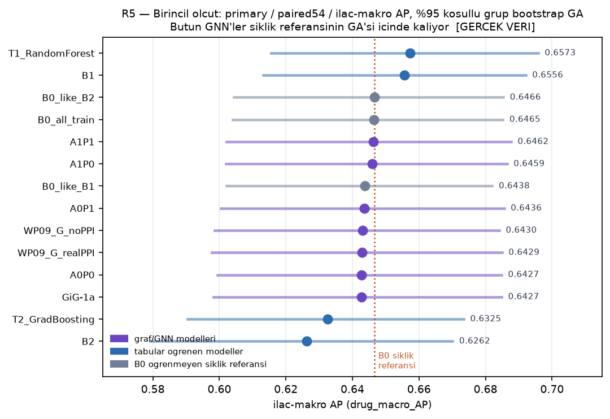

### 20.4 Ana bulgu ve sınırlama

| Model | En önemli bilimsel bulgu | Sınırlaması |
|---|---|---|
| B0 | İlaç yönünde neredeyse her şeye yetişir; sınıf yönünde en kötü | Kişiselleştirilmiş tahmin değil |
| B1 | Birincil ölçütte en yüksek doğrusal model | Stres protokolünde −0,0238 düşer (kimyasal benzerliğe dayanıyor) |
| B2 | Sınıf yönünde en iyi, ilaç yönünde en kötü | 234 özellik küçük bölmelerde zorluyor |
| WP09 | PPI gerçekten çalıştı ama katkı vermedi (−0,000142) | Gerçek ve karıştırılmış PPI ayırt edilemiyor |
| A1P0/A1P1 | Atom dalı küçük pozitif katkı (+0,002894) | Stres aralıkları sıfırı içeriyor |
| A0P1/A1P1 | PPI katkısı yine gösterilemedi (+0,000600) | — |
| **A1P1** | **Ana graf araştırma mimarisi** | Referanslara karşı belirgin üstünlük yok |
| **GiG-1a** | İlaç→protein mesajı **zarar verdi** (−0,003536) | Oversmoothing ölçüldü |
| T1 | Stres protokolünde B1'i ayırt edilebilir biçimde geçiyor | Birincilde geçemiyor; ana model olmadı |

> **Karşılaştırma uyarısı:** B1 ve T1, K = 267 hedefle; diğerleri K = 318
> hedefle skorlanmıştır. `paired54` anahtarları ortak olduğu için AP
> karşılaştırılabilir, ama hedef sözlükleri birebir aynı değildir. Aynı ilaç
> ve yan etki kapsamına dayanmayan metrikleri doğrudan karşılaştırmayın.

---

## 21. Metrikler: ne ölçüyorlar, neden seçildiler

### 21.1 Average Precision (AP) elle hesaplanmış örnek

AP, *tek bir ilaç için* PT'leri skora göre sıraladığımızda gerçek kayıtların
ne kadar üste geldiğini ölçer.

Beş PT'lik örnek:

| Sıra | PT | Skor | Kayıt var mı? | O noktadaki precision |
|---:|---|---:|---|---:|
| 1 | PT-a | 0,91 | **Evet** | 1/1 = 1,000 |
| 2 | PT-b | 0,77 | Hayır | — |
| 3 | PT-c | 0,66 | **Evet** | 2/3 = 0,667 |
| 4 | PT-d | 0,40 | Hayır | — |
| 5 | PT-e | 0,12 | **Evet** | 3/5 = 0,600 |

$$\mathrm{AP} = \frac{1{,}000 + 0{,}667 + 0{,}600}{3} = \mathbf{0{,}756}$$

Yalnız **pozitiflerin bulunduğu** sıralarda precision ölçülür ve ortalanır.
Yani AP, "doğruları ne kadar yukarı koydun?" sorusunun cevabıdır.

Aynı pozitifler en üstte olsaydı (1., 2., 3. sıra): AP = (1 + 1 + 1)/3 = 1,0.
En altta olsaydı (3., 4., 5.): AP = (1/3 + 2/4 + 3/5)/3 = 0,478.

**AP, trapez PR-AUC değildir.** Rapor bunu ayrıca belirtir — interpolasyon
yapılmaz.

### 21.2 Neden AP, neden accuracy değil?

| Neden | Açıklama |
|---|---|
| Seyreklik | 13.964 çiftin 3.820'si pozitif (%27). Accuracy, "hepsine 0 de" diyerek %73 alırdı. |
| Eşik yok | Model bir karar eşiği üretmez; soru "önce neye bakılmalı?" |
| Sıralama işi | Klinik kullanım senaryosu bir **öncelik listesi**dir |

### 21.3 drug-macro vs micro vs class-macro

Aynı skor matrisini üç farklı şekilde okumanın üç adı:

| Metrik | Nasıl hesaplanır | Neyi ödüllendirir |
|---|---|---|
| **drug_macro_AP** | Her ilaç için AP hesapla, ilaçlar üzerinde ortala | İlaç içi sıralama |
| **micro_AP** | Bütün (ilaç, PT) çiftlerini tek havuzda sırala | Global sıralama |
| **class_macro_AP** | Her PT için AP hesapla, PT'ler üzerinde ortala | Sınıf içi (ilaçlar arası) sıralama |

**drug_macro neden birincil?** Çünkü kullanım senaryosu "elimde bir ilaç var,
hangi yan etkilere öncelik vermeliyim?"dir. Ayrıca makro ortalama, çok
kayıtlı bir ilacın sonucu domine etmesini engeller.

### 21.4 Birincil ölçütün yönü sonucu nasıl belirledi

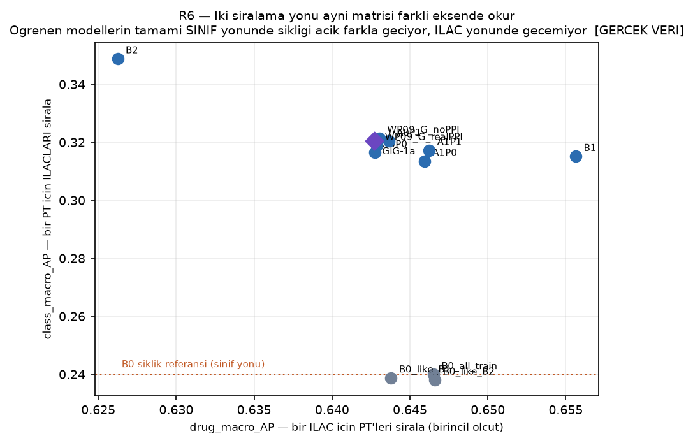

Bu grafik rehberin en önemli tek bulgusudur:

| Model | class_macro_AP | drug_macro_AP |
|---|---:|---:|
| B2 | **0,3489** | 0,6262 |
| GiG-1a | 0,3205 | 0,6427 |
| WP09 G_realPPI | 0,3190 | 0,6429 |
| A1P1 | 0,3173 | 0,6462 |
| A0P0 | 0,3165 | 0,6427 |
| B1 | 0,3152 | **0,6556** |
| B0_like_B2 (sıklık) | **0,2382** | 0,6466 |
| B0_like_B1 (sıklık) | 0,2389 | 0,6438 |

**Üç okuma:**

1. **Sınıf yönünde öğrenen modellerin tamamı sıklık referansını açık farkla
   geçer** (~0,32'ye karşı ~0,238; bağıl olarak ≈ +%33). Yani modeller
   ilaca özgü **gerçek bir sinyal** öğreniyor.
2. **İlaç yönünde (birincil ölçüt) hiçbiri sıklığı anlamlı biçimde geçemez.**
   Bir ilacın PT sıralaması, PT'lerin kayıt yaygınlığı tarafından baskılanır
   — ve sıklık referansı bunu zaten yakalar.
3. **GiG-1a bu iki yön arasında yer değiştirmiştir:** sınıf yönünde A1P1'in
   üstüne çıkmış (0,3205 > 0,3173), ilaç yönünde altına düşmüştür.

Ek bir kontrol: sınıf başına gözlenen pozitif sayısına göre bakıldığında
A1P1, sıklık referansını **her** yoğunluk bandında geçer — tek pozitifli 59
sınıfta bile (0,0751'e karşı 0,0310). 306 sınıfın **278'inde** A1P1 daha
iyidir. "Başlık seyrek sınıflarda ezberliyor" hipotezi bu veriyle
**desteklenmemektedir**.

> **Sonuç:** Bu kohortta darboğaz ne kodlayıcı zenginliği ne de başlık
> kapasitesidir; birincil ölçütün **yönüdür**.

`class_macro_AP` WP10 tarafından *"pooled diagnostic only; bağımsız fold CI
yok"* olarak etiketlenmiştir. Yukarıdaki yorum, on bir modelde tutarlı olan
nokta tahmini farkına dayanır ve kalibre edilmiş bir üstünlük iddiası
değildir.

### 21.5 Güven aralıkları ve kapsam/abstention

| Kavram | Değer |
|---|---|
| Bootstrap tekrarı | 1.000 |
| Minimum geçerli tekrar | 800 |
| Birim | Kilitli yapısal grup |
| Eşleştirme | Bütün modeller aynı çekimleri kullanır |
| Seed | 20261106 + 9000 + protokol indeksi |

**Kapsam ve abstention:**

| Model | Skorlanan | Çekimser | Neden |
|---|---:|---:|---|
| B1, T1, T2 | 54 | 8 | QC'li kimya yok |
| B2, WP09, A*, GiG | 61 | 1 | Methenamine: hiç modalite yok |
| B0 | 62 | 0 | Girdi gerekmiyor |

**Hesaplanmayan metrikler:** Precision, Recall, F1 (eşik tanımlanmadı);
Brier, ECE (kalibrasyon yapılmadı). Bu rehber onlar için sayı uydurmaz.

---

## 22. Üç tutarlı negatif bulgu ve ne anlattıkları

| Deney | Ne eklendi | Ölçülen fark | %95 GA | Sonuç |
|---|---|---:|---|---|
| **WP09** | PPI mesaj geçişi | **−0,000142** | [−0,003611; +0,003248] | katkı yok |
| **WP10** | Atom–bağ grafı | **+0,002894** | [+0,000773; +0,005470] | küçük pozitif |
| **WP14** | İlaç→protein mesajı | **−0,003536** | [−0,005802; −0,001563] | **zarar** |


**Örüntü:** 54–62 ilaçlık bu kohortta temsil zenginleştirmenin getirisi
**sistematik olarak sıfır civarındadır** ve kapasite artışı zarar
verebilmektedir.

**Neden böyle olabilir? (hipotezler, test edilmiş iddialar değil)**

1. **Kohort küçük.** 43–50 ilaçlık eğitim bölmeleri, 53.530 parametreli bir
   modeli beslemek için az. Sığ ağaçların seçilmesi (WP15) de aynı yöne
   işaret ediyor.
2. **Birincil ölçütün yönü.** §21.4: ilaç içi sıralamada PT yaygınlığı
   baskın; mimari iyileştirmeleri bu etkiyi aşamıyor.
3. **PPI grafı seyrek ve ilgisiz.** 133 proteinin yalnız 48'i mesaj alıyor;
   antibakteriyellerin asıl hedefleri bakteri proteinleri ve onlar insan
   STRING ağında yok.
4. **Oversmoothing.** GiG-1a'nın dejenerasyon ölçümü, eklenen mesajın büyük
   ama ayırt edici olmadığını gösteriyor.

**Bunlar ne DEĞİL:**

- "Graf yöntemleri yan etki tahmininde işe yaramaz" **değil**. Bu kohortta,
  bu ölçütle, bu kapsamda işe yaramadı.
- "PPI biyolojik olarak alakasız" **değil**. Sıfırı içeren aralık
  eşdeğerlik kanıtı değildir.
- "A1P1 başarısız" **değil**. A1P1 teknik olarak doğru çalışan, sızıntısız,
  tekrar üretilebilir bir mimaridir ve ana graf araştırma mimarisi olarak
  korunmuştur.

**Tez için anlamı:** EMT1'in "iç ve dış graf arasında bilgi aktarımı" fikri
artık "denenmedi" boşluğu değildir; **ölçülmüş bir sonuçtur**. Negatif
sonucun, yöntemin doğru uygulandığının kanıtı olan sentetik kapı (8/8 PASS),
gradyan kanıtı (38/38 fitte `W_dp` gradyanı > 0) ve dejenerasyon ölçümüyle
birlikte sunulması gerekir.

---

## 23. Kapsam dürüstlüğü

| Söylenebilecek | Söylenemeyecek |
|---|---|
| "54 ilaçta, o katların eğitiminde fit edilebilir PT'ler üzerinde" | "62 ilaç ve 1.061 PT'de" |
| "Gözlenen SIDER kaydı sıralaması" | "Klinik yan etki olasılığı" |
| "unknown = kayıt yok" | "unknown = yan etki yok" |
| "Sabit OOF'ye koşullu GA" | "Dış doğrulama güven aralığı" |
| "Keşifsel kazanım" | "Genel üstünlük" |

Sayılarla:

| Büyüklük | primary / paired54 |
|---|---:|
| Skorlanan ilaç | 54 |
| Skorlanan çift | 13.964 |
| Gözlenen pozitif | 3.820 |
| Unknown (doğrulanmış negatif DEĞİL) | 10.144 |
| **Hedef kapsamı dışında kalan pozitif** | **1.685** |
| Havuzlanmış sınıf-AUROC NA | 50 |

**1.685 sayısı ne demek?** Bu 54 ilacın SIDER'da 5.505 kaydı var; bunların
1.685'i o katın hedef sözlüğünde olmadığı için hiç skorlanmadı. Bu, modelin
"kaçırdığı" yan etkiler değildir — değerlendirmeye hiç girmemişlerdir.
Tüm 1.061 PT uzayında başarı iddiası **yoktur**.

---

## 24. Sınırlamalar ve bir sonraki adımlar

### 24.1 Bu çalışmanın sınırları

1. **Kohort büyüklüğü.** 62 ilaç, modern graf öğrenme için çok küçüktür.
2. **Tek tohum.** Bütün modeller tek init seed ile eğitildi; seed varyansı
   ölçülmedi, GA bunu kapsamaz.
3. **Dış doğrulama yok.** Bütün sonuçlar aynı 62 ilaçlık kohortun içindedir.
4. **Kalibrasyon yok.** Skorlar olasılık olarak yorumlanamaz.
5. **Negatif sınıf yok.** `verified_negative` kaydı olmadığı için unknown
   çiftler proxy olarak kullanıldı.
6. **Bakteri PPI ağı yok.** Antibakteriyellerin asıl hedefleri kapsam dışı.
7. **Tek mesajlaşma katmanı.** Daha derin mimariler denenmedi (ve GiG-1a
   deneyi derinleşmenin bu kohortta zarar verebileceğini gösterdi).
8. **Çoklu keşifsel karşılaştırma.** Çok sayıda kontrast hesaplandı; genel
   istatistiksel üstünlük iddiası yapılmıyor.

### 24.2 Bu rehberin kapsamadıkları

- WP12 (yerel/uzak LLM ile PDF okuma) ve WP13 (demo arayüzü) ayrı
  katmanlardır; model mimarisi değildirler.
- WP11'in SHAP ve Δz çıktıları özet olarak anıldı; tam yorumları kendi
  raporlarındadır.

---

## Ek A — Dosya haritası: hangi sayı nereden geliyor

| İhtiyacınız | Dosya |
|---|---|
| Atom/bağ şeması | `configs/WP10_design_PROPOSED_v1.json` |
| Her molekülün grafı | `reports/qa/WP10/encoder_v1/graphs/<DBID>.npz` |
| Atom/bağ ham değerleri | `reports/qa/WP10/encoder_v1/atom_fields_all62.csv`, `bond_fields_all62.csv` |
| Molekül kimliği, QC, hash | `reports/qa/WP10/encoder_v1/molecule_registry.json` |
| 56 protein özelliği | `reports/qa/WP05/protein_features.csv` |
| İlaç–protein rolleri | `reports/qa/WP05/drug_protein_edges.csv` |
| PPI topolojisi (eşik bazında) | `reports/qa/WP09/design_v1/fold_ppi_topology.csv` |
| Fold girdi paketleri | `reports/qa/WP09/design_v1/folds/<context>_{train,query}.npz` |
| B1/B2 özellik matrisleri | `reports/qa/WP08/experimental_preparation/features/<context>.npz` |
| Özellik şeması (B1/B2) | `.../experimental_preparation/feature_schema_v1.json` |
| Uygunluk ve çekimserlik | `.../experimental_preparation/prediction_eligibility.csv` |
| Bölmeler | `.../experimental_preparation/nested_partitions_v1.csv` |
| Eğitilmiş ağırlıklar | `models/WP08_baseline_v1/`, `WP09_PPI_v3_training_v1/`, `WP10_factorial_training_v1/`, `WP14_gig1_v1/`, `WP15_tree_v1/` |
| Tahminler | `reports/qa/<WP>/.../oof_predictions.csv` |
| Metrikler + GA | `reports/qa/WP10/training_v1/metrics_with_group_CI.csv` |
| Faktöriyel kontrastlar | `.../factorial_contrasts_group_CI.csv` |
| Karşılaştırma anahtarları | `.../comparison_keys.csv` |
| Örnek ilaç girdisi | `.../example_drug_inputs.json` |
| Örnek ilaç sıralaması | `.../example_drug_PT_ranking.csv` |
| GiG sonuçları | `reports/qa/WP14/gig1_v1/`, `reports/WP14_GIG1A_RESULTS.md` |
| Ağaç modelleri | `reports/WP15_AGAC_MODELLERI_SONUCLARI.md` |

---

## Ek B — Tensör ve dosya biçimi hızlı başvuru

**Moleküler graf (tek ilaç)**

```
x           float32  (A, 44)    A = atom sayısı
edge_index  int64    (2, 2B)    B = bağ sayısı
edge_attr   float32  (2B, 14)
num_nodes   int      A
```

**Batch (N ilaç)**

```
batch.x           (ΣA, 44)
batch.edge_index  (2, Σ2B)
batch.edge_attr   (Σ2B, 14)
batch.batch       (ΣA,)   hangi atom hangi moleküle ait
batch.ptr         (N+1,)  molekül sınırları
```

**Fold eğitim paketi** (`primary_o03_final_train.npz` gerçek değerleri)

```
protein_ids      <U10   (133,)
protein_x        f8     (133, 56)
drug_ids         <U7    (50,)
chemistry        f8     (50, 5)
masks            bool   (50, 5)
eligible         bool   (50,)
role_target      i8     (2, 212)
role_enzyme      i8     (2, 57)
role_transporter i8     (2, 110)
role_carrier     i8     (2, 19)
ppi_pairs_700    i8     (2, 166)
```

**Fold sorgu paketi** (`primary_o03_final_query.npz`)

```
drug_ids            <U7   (12,)
split               <U4   (12,)   'validation' | 'test'
unseen_protein_ids  <U6   (8,)
unseen_protein_x    f8    (8, 56)
chemistry, masks, eligible, role_*
```

**Model içi boyutlar (A1P1)**

```
atom     (A,44) → (A,16) → pool → (N,16) → (N,8)
protein  (P,56) → (P,32) → PPI → (P,32) → rol → (N,128)
kimya    (N,5)  → (N,8)
maske    (N,5)
füzyon   (N,150)
başlık   (N,150) → (N,K) → sigmoid
```

---

## Ek C — "A1P1'i kendim kodlasam" kontrol listesi

12 adım. Her adımın yanında rehberin ilgili bölümü var.

1. **Veri sözleşmesini sabitle.** 44/14/56 şemalarını JSON'a yaz. (§14.2, §15.5)
2. **Bölmeleri dondur.** İlaç-ayrık 5×3 nested CV; dosyaya yaz ve hash'le. (§5.1)
3. **SMILES → `Data`.** RDKit ile oku, one-hot'a çevir, `validate_graph`
   yaz: şekil, ikili değer, one-hot tekliği, ters kenar eşitliği. (§14.1–14.4)
4. **QC maskesini ayrı tut.** Grafın içine koyma; `MolecularInput`
   benzeri bir kap kullan. (§14.6)
5. **Protein özelliklerini üret.** Dizi metadata'sını ayrıştır; `kalite_skoru`
   benzeri hiçbir vekil ekleme. (§15.5)
6. **PPI kenarlarını kanonik yönsüz çift olarak sakla.** Skoru saklama.
   Yükleme sırasında iki yöne aç. (§15.3, §15.4)
7. **`ResidualMeanProtein` yaz.** `Linear(56,32)` + ReLU; `index_add` ile
   komşu ortalaması; bias'sız `self_update` ve `message`; residual. (§10.D.1)
8. **`BondAwareMolecularEncoder` yaz.** `Linear(44,16)`; mesaj
   `ReLU(U h0_j + V e_ji)`; residual; `global_mean_pool`; `Linear(16,8)`. (§11.D.1)
9. **Rol okumasını yaz.** Dört rol için ayrı maskeli ortalama; maske ile
   kenarların tutarlılığını `assert` et. (§10.D.2)
10. **Füzyon + başlık.** `cat([141, 8, 1]) = 150`; `Linear(150,K)`; uygun
    olmayan satırı NaN'la. (§11.D.2, §18)
11. **Eğitim döngüsü.** Full-batch, `BCEWithLogitsLoss` iki aşamalı ortalama,
    AdamW(1e-3, 1e-3), patience 20, epoch'u **yalnız iç kattan** seç. (§11.D.4)
12. **Sızıntı testlerini yaz.** Etiket API'si set eşitliği; mutasyon testi;
    önbellek değişmezliği; gradyan kanıtı. **Bunlar olmadan model bitmiş
    sayılmaz.** (§6)

---

## Ek D — Danışman sorularına hazır cevap kartları

**1. "Hangi GNN mimarisini kullandınız?"**
Hazır bir mimari kullanmadık. Her iki grafta da tek katmanlı, residual,
ortalama tabanlı bir mesaj geçişi elle yazıldı. Moleküler kolda mesaj
bağ-duyarlıdır. PyG'den yalnız `Data`, `Batch` ve `global_mean_pool`
kullanıldı.

**2. "Kaç mesajlaşma katmanınız var?"**
Her grafta bir. Bir atom yalnız komşu atomlarını, bir protein yalnız doğrudan
PPI komşularını görür. GiG-1a'da ek olarak karma türde ikinci bir adım var
(ilaç → protein → PPI komşusu).

**3. "STRING skorunu nasıl kullandınız?"**
Yalnız kenar seçiminde, 700 eşiğiyle. Ağırlık veya düğüm özelliği olarak
kullanmadık; `combined_score` bir kanıt birikimi ölçüsüdür, etkileşim
kuvveti değil.

**4. "Yan etki düğümleriniz var mı?"**
Yok. Yan etki, `Linear(150, K)` başlığının çıkış boyutudur. EMT1'de bir yan
etki gömmesi vardı; V7'de kaldırıldı çünkü sıklık ezberlemeyi modelin içine
gizliyordu.

**5. "Etiket sızıntısı olmadığını nasıl biliyorsunuz?"**
Dört kanıt: (a) encoder etiket argümanı almıyor; (b) `side_effect_edges`
sütunu 152/152 işte `False`; (c) etiket API'si yanlış ID geldiğinde hata
atıyor; (d) mutasyon testinde dış test etiketleri değiştirildiğinde model
parametreleri değişmedi.

**6. "B1 neden GNN'leri geçti?"**
Birincil ölçüt ilaç içi sıralamadır ve bu yönde PT yaygınlığı baskındır;
sıklık referansı bile 0,6466 alıyor. Sınıf yönünde bütün öğrenen modeller
sıklığı açık farkla geçiyor. Ayrıca B1 stres protokolünde −0,0238 düşüyor,
yani avantajının bir kısmı kimyasal benzerlikten geliyor.

**7. "Graph-in-Graph gerçekten uygulandı mı?"**
Evet, GiG-1a olarak. A1P1'in kontrollü bir genişletmesidir; `W_dp = 0` iken
bit düzeyinde A1P1'dir. 38/38 fit çalıştı, sentetik kapı 8/8 geçti. Sonuç
negatif çıktı (−0,003536) ve kabul edilmedi.

**8. "Neden negatif sonucu yayınlıyorsunuz?"**
Çünkü protokol sonuçlardan önce kilitlenmişti ve kabul ölçütü karşılanmadı.
Negatif sonucu gizlemek, sonuç gördükten sonra ölçüt değiştirmek demek
olurdu.

**9. "A1P1 kaç ilacı tahmin edebiliyor?"**
61 ilacı skorluyor. Bunların 54'ünde atom dalı etkin; 7'sinde QC nedeniyle
molekül bloğu maskeli. Methenamine hiç skorlanmıyor.

**10. "`kalite_skoru` neden yok?"**
Çünkü V6'daki o sütun UniProt accession'ının ilk harfinden türetilmiş keyfi
bir koddu. UniProt ID prefix'i bir kalite derecesi değildir.

**11. "Skorlar olasılık mı?"**
Hayır. Kalibrasyon yapılmadı, Brier/ECE raporlanmadı. Etiket "gözlenen
SIDER kaydı"dır, "yan etki oluşma olayı" değil.

**12. "0 ne demek?"**
"SIDER'da kayıt yok." "Yan etki yok" demek değil. Bu yüzden `unknown`
terimini kullanıyoruz ve doğrulanmış negatif iddiasında bulunmuyoruz.

**13. "Neden ortalama, neden toplam değil?"**
Hub proteinler (19 komşulu) ile az komşulu proteinler arasında ölçek farkı
oluşmasın diye. Toplamla model derece bilgisini dolaylı öğrenirdi.

**14. "Dört kolu neden eğittiniz, A1P1 yetmez miydi?"**
A1P1'i tek başına B2 ile karşılaştırsaydık, farkın atomdan mı, PPI'den mi,
yoksa nonlineer mimariden mi geldiğini ayıramazdık. Dört kol aynı mimariyi,
aynı başlangıç ağırlıklarını ve aynı hedefleri kullanır.

**15. "Erythromycin örneğini neden seçtiniz?"**
Sonuçlar görülmeden önce belirlenmiş kuralla: alfabetik olarak en küçük
primary paired54 ilaç kimliği. Sonuca bakarak örnek seçilmedi.

**16. "GiG-1a neden kötüleşti?"**
Dejenerasyon ölçümü oversmoothing gösteriyor: mesaj protein gömmesinin
~%38'i kadar büyük ama proteinler arasında neredeyse sabit. Hub ile spesifik
proteini ayırt etmiyor.

**17. "Güven aralıklarınız neyi kapsamıyor?"**
Yeniden eğitim varyansını, seed varyansını, kaynak kayıt yanlılığını ve dış
kohort belirsizliğini. Sabit OOF tahminlerine koşulludurlar.

**18. "Rastgele orman B1'i geçti mi?"**
Birincil protokolde hayır (fark +0,001697, GA sıfırı içeriyor). Stres
protokolünde evet (+0,024713, GA tamamen pozitif). Ana model olmadı.

**19. "Neden 1.685 pozitif skorlanmadı?"**
O PT'ler ilgili katın eğitiminde fit edilebilir hedef sözlüğünde değildi
(hem pozitif hem unknown örnek gerekiyor). Değerlendirmeye hiç girmediler;
"kaçırılmış" değiller.

**20. "Bu modelle hasta tedavi kararı verilebilir mi?"**
Hayır. Bu bir araştırma karar destek prototipidir. Kalibrasyon, dış
doğrulama ve klinik değerlendirme yapılmamıştır.

---

*Rehber sonu. Bu dokümandaki her sayı, yanında belirtilen kaynak dosyadan
alınmıştır. Hesaplanmamış hiçbir metrik için değer verilmemiştir.*
