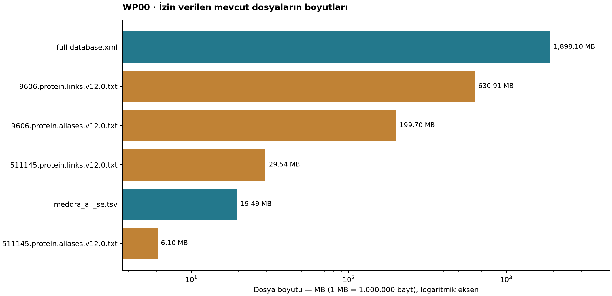
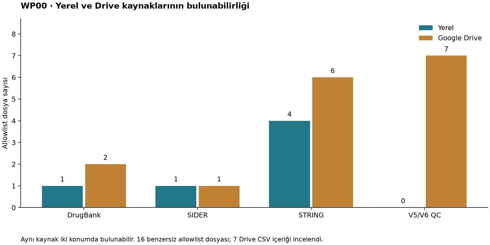
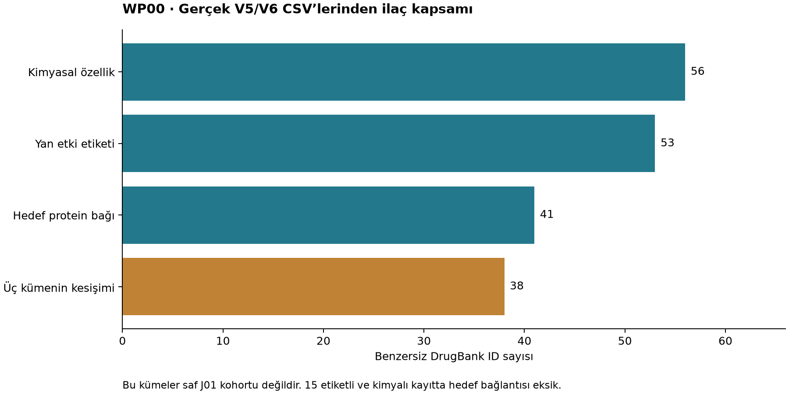

# WP00 yerel veri altyapısı incelemesi

05.11.2026 — **WP00 tamamlandı; kullanıcı onayı bekleniyor.** Yerel erişim, şema denetimi, Drive CSV karşılaştırması, başlangıç görselleri ve testler tamamlandı. Model kurulmadı veya eğitilmedi; WP01'e geçilmedi.

## Ne öğrendik

Envanter, “hangi kaynak nerede ve hangi durumda?” sorusunu cevaplar. Şema incelemesi, “hangi alan ne anlama geliyor?” sorusunu cevaplar. Kalite kontrolü ise boş hücre, geçersiz kimlik ve tekrarın birbirinden farklı problemler olduğunu gösterir. Örneğin aynı yan etkinin birden fazla kaynak kavramıyla görünmesi, tamamen aynı satırın tekrar etmesiyle aynı şey değildir.

## Erişim ve yöntem

`C:\Users\emrey\OneDrive\Masaüstü\Tez Dosyalar\Dataset` erişilebilir. Dosyalar kaynak konumlarından salt okunur açıldı. Altı izinli dosyanın örnekleri başarıyla okundu; bu örneklerde OneDrive çevrimdışı erişim hatası yaşanmadı. Dosyaların tamamının çevrimdışı kullanılabilirliği bu testle kanıtlanmaz.

Yalnız açıkça listelenmiş DrugBank/SIDER/insan/E. coli klasörlerine girildi. CARD, MIMIC-IV, UniProt Dataset ve diğer organizma klasörlerinin içeriği okunmadı. Arşivler açılmadı; alternatif veri/ara çıktı dosyaları analiz edilmedi. `out_of_scope` girdileri yalnız ad envanteridir. Ham kaynaklar kopyalanmadı veya değiştirilmedi.

XML'in ilk üç üst düzey ilaç bloğu akış halinde okundu: parser tamponu dahil 442.368 bayt. Her TSV/STRING tablosundan ilk 1000 kayıt şema profiline alındı. Bunlar sıralı başlangıç örnekleridir; evreni temsil ettikleri varsayılmadı. Ek olarak eski 865 ADR kaydının kaynağını doğrulamak için SIDER'ın 309.849 satırı akış halinde tarandı; yeni etiket tablosu oluşturulmadı. Kaynakların boyut ve son değiştirilme zamanları okumadan önce/sonra aynı kaldı. Bu metadata kontrolüdür; hash tabanlı bütünlük kanıtı değildir.

## Gerçek yerel kaynaklar

| Kaynak | Bayt | MB (10⁶ bayt) | Sürüm kanıtı | İnceleme |
|---|---:|---:|---|---|
| full database.xml | 1.898.100.846 | 1.898,10 | XML kökü 5.1, exported-on 2026-01-04 | 3 ilaç |
| meddra_all_se.tsv | 19.486.644 | 19,49 | 4.1 tarihsel belgede; dosya başlığı yok | 1000 kayıt |
| 9606.protein.links.v12.0.txt | 630.908.617 | 630,91 | Dosya adı v12.0 | 1000 kayıt |
| 9606.protein.aliases.v12.0.txt | 199.702.624 | 199,70 | Dosya adı v12.0 | 1000 kayıt |
| 511145.protein.links.v12.0.txt | 29.542.833 | 29,54 | Dosya adı v12.0 | 1000 kayıt |
| 511145.protein.aliases.v12.0.txt | 6.095.750 | 6,10 | Dosya adı v12.0 | 1000 kayıt |

`drug links.csv`, beş V5/V6 CSV, aday CSV, eski `.pt` ve iki işlenmiş PPI CSV **Drive'da bulundu**. Yedi küçük/orta CSV bağlantıdan bellekte tamamen okundu; ham CSV kopyası yerel diske kaydedilmedi. `.pt` deserialize edilmedi; işlenmiş PPI metadata düzeyinde bırakıldı. 16 benzersiz allowlist dosyasının tamamı yerelde veya Drive'da mevcut. İlk yerel arama `local_inventory.csv`, birleşik durum `data_inventory.csv` içinde ayrı korunur.

| Drive CSV | Gerçek boyut | Satır × sütun | İnceleme |
|---|---:|---:|---|
| drug links.csv | 2.147.523 bayt | 19.842×23 | Tam içerik, kimlik köprüsü QC |
| ilac_feature_v5_atc.csv | 9.499 bayt | 56×33 | Tam içerik |
| ilac_yan_etki_v5.csv | 53.807 bayt | 865×6 | Tam içerik ve yerel SIDER kaynak izi |
| ilac_protein_eslesmesi_v6.csv | 9.996 bayt | 153×5 | Tam içerik |
| protein_dizileri_v6.csv | 52.208 bayt | 70×4 | Tam içerik, başlık QC |
| protein_feature_v6.csv | 27.630 bayt | 70×54 | Tam içerik, yasak skor QC |
| sadece_antibiyotikler.csv | 6.603 bayt | 209×3 | Tam içerik, DB/DBSALT ayrımı |

Yedi yanıtın UTF-8 bayt uzunluğu Drive metadata boyutuyla eşleşti; okuma öncesi/sonrası size ve modified_time değişmedi. Drive'da yalnız klasör listeleme, içerik okuma ve metadata okuma işlemleri kullanıldı. OAuth kapsamının kendisinin salt okunur olduğuna dair teknik doğrulama yok; fiilen yazma işlemi yapılmadı.

## Üç gerçek örnek ve kimliklerin anlamı

| Kaynak | Örnek | Öğrettiği nokta |
|---|---|---|
| DrugBank | DB00001, Lepirudin, ATC B01AE02; hedef P00734/F2/Humans | İlaç ID ve hedef protein ID farklı varlıkları gösterir; bu kayıt antibiyotik kohortu örneği değildir |
| SIDER | CID100000085 / CID000010917 / C0000729 / PT / C0000737 / Abdominal pain | Kaynak kavram ile PT kavramı farklı olabilir; flat/stereo kimliği ayrı korunur |
| STRING E. coli | 511145.b0001 → 511145.b1715, combined_score=520 | İki protein arasındaki skor kenara aittir; protein özelliği olarak eklenmez |

Her incelenen kaynak için ilk üç kayıt `schema_summary.md` içinde ayrıca sunuldu. XML'in diğer iki örneği DB00002/Cetuximab ve DB00003/Dornase alfa; üçü de J01 dışıdır. Bu aşamada antibiyotik sayısı veya yeni kohort hesaplanmadı.

## Ölçülen veri kalitesi

- **Yeni şema bulgusu:** XML örneğinde protein dizisi `amino-acid-sequence` alanında. Eski kod `sequence` arıyor. İlk üç ilacın 10 hedef polipeptidinde amino asit dizisi ve FASTA satır sınırı var; QC ayrıştırması sonrası 10/10 standart alfabe kontrolünü geçti. AAC/DC hesaplanmadı.
- **SIDER örneği:** 527 PT, 469 LLT, 4 boş tür; `meddra_type` ve `umls_cui` alanlarında ayrı ayrı %0,4 boşluk. Diğer dört sütunda boşluk yok. Tam satır tekrarı 0; `(stereo_id, meddra_type, umls_cui)` anahtarında 31 tekrar fazlası var. Bu bütün dosyanın tekrar sayısı değildir.
- **STRING örnekleri:** Dört dosyada boş hücre ve hatalı sütun sayısı gözlenmedi. Links örneklerinde kendine kenar ve yönlü çift tekrar fazlası 0; insan skor aralığı 150–952, E. coli 150–999. Bunlar dosya geneli aralık değildir.
- **Aliases:** Tam satır tekrar fazlası 0; `(protein, alias)` tekrar fazlası insan örneğinde 277, E. coli'de 180. Farklı kaynak açıklamaları korunmalı; alias metni otomatik UniProt sayılmamalı.
- **Eski kod:** `kalite_skoru` keyfi ID ön ekinden üretiliyor; PPI `forward` içinde kullanılmıyor; ilaç düzeyinde ayrık split yok; normalizasyon tüm kümede; unknown örneklemede tekrar engeli yok. Kod “35 hedef” dese de sözlük 40 terim ve 33 kategori içeriyor.

**Drive dosyalarından yeniden doğrulanan sonuçlar:**

| Kontrol | Gerçek sonuç | Yorum |
|---|---:|---|
| Kimya / ADR / hedef bağlantılı ilaç | 56 / 53 / 41 | Farklı kümeler; üçlü kesişim 38 |
| Tüm ADR satır / benzersiz ilaç–kategori | 865 / 844 | 21 ilişki tekrar fazlası; tamamen aynı CSV satırı tekrarı yok |
| 38 ilaçta satır / benzersiz pozitif | 605 / 590 | 15 ilişki tekrar fazlası |
| Olası / etiketsiz çift | 1140 / 550 | 38×30−590; etiketsiz klinik negatif değildir |
| Tüm ATC bayrakları sıfır | 12/56 | Erythromycin, Azithromycin, Doxycycline dahil; mapping/kapsama sorunu |
| Başlık ve dizisi aynı satıra birleşmiş protein | 70/70 | Kaynağa dönerek ayrıştırılmalı; AAC/DC üretilmedi |
| Keyfi ID ön eki skoruyla eşleşme | 70/70 | `kalite_skoru` yeni model girdisinde yasak |
| Aday DB / DBSALT | 84 / 125 | 209 benzersiz ID, 209 benzersiz etkin madde değildir |
| Köprüde boş Compound ID | 11120/19842 (%56,04) | İlk 1000'de %10,7; başlangıç örneği yanıltıcı olabilir |
| Feature DB/CID ile köprü uyumu | 56/56 | Bu dosyada dolu CID çakışması yok |
| Eski ADR kayıtlarının yerel SIDER'da bulunması | 865/865 | CID + PT adı + UMLS üçlüsüyle kaynak izi doğrulandı |

İlaç feature ve ADR alanlarında boş hücre yok. Protein dizi/feature tablolarında gen adı 2/70, ilişki tablosunda 2/153 boş. Gen adı boşluğu protein kimliği yokluğu demek değildir. 15 kayıtta kimya + ADR bulunmasına rağmen hedef tablosunda bağlantı yok; geri kazanım için adaydır, doğrulanmış ek J01 sayısı değildir. Organizmalarda 17 Humans yanında maya ve Plasmodium da var; eski “53 bakteri” ifadesi doğru değil. Ayrıntılar, eksik modalite ilaç listeleri ve belge çelişkileri `source_comparison.md` / `drive_findings.json` içinde.

## Görseller nasıl okunmalı



Boyut grafiği büyük XML ve insan PPI dosyasının neden akış halinde okunması gerektiğini gösterir. Eksen logaritmiktir; MB ondalık birimdir. Dosya boyutu veri kalitesi veya örneklem sayısı değildir.



Sayı grafiği yalnız allowlist dosyalarını sayar; klasörler, arşiv kopyaları ve dışlanan kaynaklar sayılmaz. Aynı kaynak hem yerelde hem Drive'da görünebilir; iki çubuğun toplamı benzersiz dosya sayısı değildir. PubChem API dosya olmadığı için ayrıca sayılmaz; bağımsız UniProt kaynağı zorunlu girdi değildir.



Bu kapsam grafiği gerçek CSV'lerden ölçülmüştür. Dört çubuk farklı kümeleri gösterir; saf J01 kohortu değildir. Eski ATC bayraklarından J01 sonucu çıkarmak güvenli değildir: örneğin Fluconazole satırında J01R bayrağı da açık.

## Kod ve testler

`scripts/wp00_audit.py`: izinli yol keşfi → sınırlı XML/tablo örnekleme → sütun tip/boşluk/tekrar profili → JSON/CSV/Markdown → PNG. Kimlikler korunur, model matrisi üretilmez. `parse_sequence` yalnız QC için ayrıştırır; satır sınırı kaybolmuş başlığı ve standart dışı amino asitleri reddeder. `gene-sequence` protein kontrolüne alınmaz.

`scripts/wp00_extract_legacy.py`: PDF sayfa metni, DOCX paragraf/tablo metni, notebook kaynak hücreleri ve Markdown/Python metnini çıkarır. Eski kod import edilmez veya çalıştırılmaz. Mevcut paketli PDF okuyucu kullanıldı; yeni kütüphane kurulmadı. Metin incelemesi gömülü şekillerin görsel doğrulaması değildir.

`scripts/wp00_drive_qc.cjs`: bağlantıdan gelen CSV metnini bellekte ayrıştırır, şema ve kesişim istatistiklerini üretir. `scripts/wp00_source_trace.cjs`: mevcut ADR anahtarlarının yerel SIDER'daki kaynak izini akış halinde denetler. `scripts/wp00_finalize.py`: türetilmiş JSON özetlerinden birleşik envanter, Drive şema raporu ve görselleri oluşturur. Bu scriptler Drive kimlik bilgisi içermez veya uzaktaki dosyalara yazmaz.

Çalıştırma:

```powershell
python scripts/wp00_audit.py
python -m unittest discover -s tests -v
```

Yerel keşif scripti mevcut Drive QC JSON'larını kullanarak raporları birleştirir; Drive'dan otomatik yeniden fetch yapmaz. Uzak dosyalar değişirse bağlantıdan yeniden okunmalı, aynı QC modülüyle özetler yenilenmelidir. Ham CSV saklanmadığı için yalnız yerel raporlardan tam uzak CSV analizi yeniden çalıştırılamaz; kaynak URL/ID ve değiştirilme tarihleri kayıtlıdır.

**16 Python testi ve Node CSV ayrıştırıcı kontrolleri geçti.** Dışlanan klasörlere girmeme, nested XML, FASTA sınırı, 20 AA, örnekleme sınırı, bozuk satır, envanter/şema, metadata korunması, Drive yanıt uzunluğu, gerçek tablo boyutları, pozitif/unknown aritmetiği, SIDER kaynak izi ve yasak özellik kanıtı sınandı. Node kontrolleri tırnaklı virgül/satır sonu/çift tırnak, BOM, UTF-8 ve bozuk CSV koşullarını içeriyor. Sonuçlar `reports/qa/test_results.txt` ve `reports/qa/node_test_results.txt` içinde. Test başarısı tüm XML/PPI dosyalarını veya eski model metriklerini doğrulamaz.

## Çıktıların amacı

| Çıktı | Ne işe yarar? |
|---|---|
| reports/qa/data_inventory.csv | Yol, kaynak, yerel erişim durumu, boyut, sürüm, inceleme kapsamı |
| reports/qa/source_inventory.csv | Aktif yol haritasının beklediği adla aynı envanter |
| reports/qa/schema_summary.md | Gerçek örnekler, alan tipleri, ilk 1000 kaydın boşluk/tekrar kontrolleri |
| reports/qa/drive_schema_summary.md | Yedi gerçek Drive CSV'sinin tam şemaları, boşluk oranları ve üçer örneği |
| docs/data_dictionary.md | Alanların anlamı, kimlik ilişkileri ve yanlış kullanım uyarıları |
| reports/qa/source_comparison.md | Belge/kod/veri karşılaştırması ve doğrulanamayan tarihsel sayılar |
| reports/figures/source_sizes.png | Dosya büyüklüklerini karşılaştırır |
| reports/figures/source_counts.png | İzinli kaynakların yerel ve Drive bulunabilirliğini gösterir |
| reports/figures/legacy_coverage.png | Eski CSV'lerdeki 56/53/41/38 ilaç kümelerini gösterir |
| reports/qa/profiles.json | Raporların makinece okunur gözlem kaynağı |
| reports/qa/read_integrity.json | Okuma öncesi/sonrası boyut-zaman kontrolü |
| reports/qa/drive_profiles.json / drive_findings.json | Uzak ham veriyi saklamadan türetilmiş QC sonuçları |
| reports/qa/source_trace.json | 865 eski ADR kaydının yerel SIDER ile uyumu |
| run_status.md | WP00 tamamlanma durumu ve kullanıcı onayı kapısı |

## İlaç sayısını artırmak için çözülmesi gerekenler

Sonraki onaylı paketlerde primary/secondary/DBSALT ayrımı, J01 kapsamı ve flat/stereo→CID eşlemesi incelenecek. 125 DBSALT köprüde doğrudan yok; tuz/ana ilaç ilişkisi kaynak XML'de doğrulanmalı. 12 sıfır ATC satırı ve 15 hedef bağlantısı eksik kayıt, geri kazanım adaylarını somutlaştırıyor. Protein dizisinin doğru XML alanından alınması ve nested drug ayrımı veri kaybını azaltabilir; kazanım henüz ölçülmedi. Protein hedefi eksik ilaçların kimya baseline'ından otomatik dışlanmaması ayrıca değerlendirilecek. Eksik SIDER kaydı negatif etikete dönüştürülmeyecek. Yeni ilaç sayısı garanti edilmez; J01 kapsamının temizlenmesi toplam sayıyı azaltabilir.

## Devam koşulu

Google Drive bağlantısı kuruldu ve gerçek okuma ile doğrulandı. İstenen yerel ve uzak WP00 kontrolleri tamamlandı. Büyük XML/PPI genel kalite taraması, tam antibakteriyel kohort, tuz eşlemesi ve temiz protein özellikleri sonraki paketlerin işidir. Kullanıcı bu raporu değerlendirmeden WP01'e geçilmez. Bu noktada çalışma durur.
