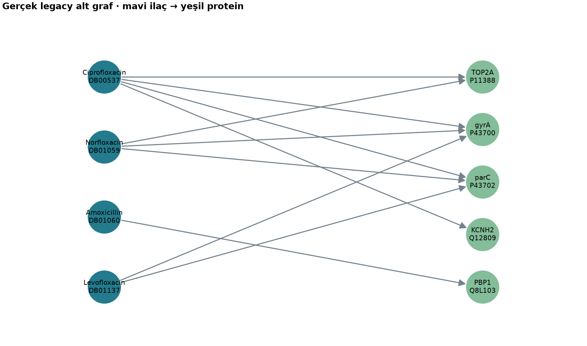

# WP01 Graf temelleri ve küçük ilaç–protein alt grafı

05.11.2026. **Tamamlandı; kullanıcı onayı bekleniyor.** WP00 kullanıcı tarafından onaylandı. Kullanıcının her pakette çalıştırılmış Jupyter Notebook kuralı AGENTS.md dosyasına eklendi. Bu aşamada yalnız WP01 yapıldı.

## Öğrenme akışı

Ana çıktı [açıklamalı notebook](../notebooks/WP01_graf_temelleri.ipynb): 30 hücre, 13 çalıştırılmış kod hücresi. Kodun hemen altında gerçek tablolar ve gömülü PNG çıktıları var. Sıra: düğüm/kenar → yön → komşuluk/derece/hop → ağırlık → merkezilik → alt graf/bileşen → gerçek veri → doğrulama. NetworkX 3.6.1 ve ortamda mevcut paketler kullanıldı; yeni paket kurulmadı.

Notebook aynı süreçte IPython InteractiveShell ile gerçekten yürütülerek çıktılarına kaydedildi. Ayrı kernel başlatma yöntemi bu ortamda tamamlanmadığı için aynı süreçte yürütme kullanıldı; kod çıktıları elle üretilmedi. Normal Jupyter'da “Restart Kernel and Run All” ile tekrar çalıştırılabilir. Yeniden yürütme yalnız proje içindeki WP01 türetilmiş tablolarını/görsellerini günceller; kaynak verilere yazmaz. `python scripts/build_wp01_notebook.py` notebook'u yeniden oluşturup çalıştırır.

## Kavramların tezdeki karşılığı

| Kavram | Küçük örnek | Biyolojik karşılık / sınır |
|---|---|---|
| Düğüm | A, B, C, D, E | İlaç ve protein ayrı tür ve kimlik uzayları |
| Kenar | A–B | Kaynakta bildirilen ilaç–hedef ilişkisi; fiziksel çizgi uzunluğu veri değil |
| Yön | A→B→C | İlaç→protein ilişki şeması; ters ilişki kendiliğinden oluşmaz |
| Komşuluk | A'nın B ve C komşuları | İlacın bu veri örneğinde hedef ilişkisi bulunan proteinleri |
| Derece | C'nin üç komşusu | İlaç için hedef bağlantısı, protein için ilişkili ilaç sayısı |
| Ağırlık | Mesafe 1+1 < 5 | Sentetik mesafe örneği; gerçek ilişkilere güven/güç uydurulmadı |
| Merkezilik | Derece, aradalık, yakınlık | Alt grafın bağlantı düzeni; biyolojik önem veya klinik risk ölçümü değil |
| Alt graf | A–B–C indüklenmiş üçgeni | Filtrelenmiş varlık ve ilişkiler; seçim metrikleri değiştirir |
| Bileşen | E'nin ayrı bileşeni | Bu gösterimde yol bulunmayan kümeler; biyolojik ilişkisizlik kanıtı değil |
| 1-hop / 2-hop | Tam uzaklık ve en çok uzaklık farkı | İlaç–protein–ilaç yolu ortak hedef paylaşımıdır; PPI değildir |
| Heterojen temsil | Tür metadata'sı ve indeks tablosu | Gelecekteki HeteroData depolarının fikri; PyG grafı/modeli oluşturulmadı |

## Gerçek kaynak şeması ve seçim

Salt okunur [Drive kaynağı](https://drive.google.com/file/d/1SkXYX0w4k76yxwHZbLydz6Q5Aj9gA7cz/view): `ilac_protein_eslesmesi_v6.csv`, 9996 UTF-8 bayt, 153 satır × 5 sütun. Dosya adı V6; ayrı biyolojik yayın sürümü beyanı yok. Drive değiştirilme zamanı 2026-05-14T05:37:21.845Z; okunan içerik uzunluğu WP00 metadata'sıyla uyumlu. Bu tarih DrugBank sürümü veya biyolojik doğrulama tarihi değildir.

Şema: DrugBank_ID, Drug_Name, UniProt_ID, Gene_Name, Organizma. Seçilen 10 satırda tüm bu alanların boşluk oranı %0. WP00'da tam kaynakta 2/153 gen adı boş bulunmuştu; seçim bütün dosyanın kalitesini temsil etmez.

Dört ilaç seçildi: DB00537 Ciprofloxacin, DB01059 Norfloxacin, DB01137 Levofloxacin ve DB01060 Amoxicillin. Organizma filtresi kaynak metniyle tam eşitlik kullanır: Humans; Haemophilus influenzae (strain ATCC 51907 / DSM 11121 / KW20 / Rd); Helicobacter pylori. Seçim ortak hedefleri ve ayrı bileşeni öğretmek içindir. Sistemik antibakteriyel kohort oluşturulmadı; ATC veya tuz eşlemesi yapılmadı.

Yalnız bu 10 ilişkinin provenanslı örneği [wp01_graph_sample.json](qa/wp01_graph_sample.json) içinde saklandı; Drive CSV'sinin tamamı dosya olarak indirilmedi. Kaynak satır numaraları başlık dahil 1 tabanlıdır. Örneğin Ciprofloxacin → P43700/gyrA/H. influenzae, Norfloxacin → P11388/TOP2A/Humans ve Amoxicillin → Q8L103/PBP1/H. pylori kayıtları gösterilir. Bu ilişkiler tarihsel tablodaki kayıtlardır; XML'den yeniden doğrulanmış hedefler olduğu iddia edilmez.

## Gerçek graf sonuçları

4 ilaç + 5 protein = **9 düğüm, 10 yönlü kenar**. Yönsüz izdüşümde 7 ve 2 düğümlü iki bileşen var; izole düğüm yok. Yön, ilaç→protein şemasıdır. İlaç ve protein ID'leri `drug:` / `protein:` önekleriyle ayrılır. Gen adı birleştirme anahtarı olarak kullanılmadı.

Merkezilikler **yönsüz, ağırlıksız izdüşümde**, tüm N−1 üzerinden derece ve NetworkX normalize aradalık tanımıyla hesaplandı. Yakınlık kopuk bileşenlerde Wasserman–Faust düzeltmesi içerir. Derece toplamı 20=2×10; ortalama derece 20/9=2,2222. Yönlü yoğunluk 0,1389, yönsüz yoğunluk 0,2778, yalnız 4×5 ilaç–protein çiftleriyle yoğunluk 0,5. Üçgen/clustering sıfır olması iki parçalı yapının sonucudur; tek başına biyolojik çıkarım sağlamaz.

| Düğüm | Tür | Derece | Derece merkeziliği | Aradalık | Yakınlık WF |
|---|---|---:|---:|---:|---:|
| Ciprofloxacin | İlaç | 4 | 0,5000 | 0,2440 | 0,5625 |
| Norfloxacin | İlaç | 3 | 0,3750 | 0,0655 | 0,4500 |
| gyrA / P43700 | Protein | 3 | 0,3750 | 0,0952 | 0,5000 |
| parC / P43702 | Protein | 3 | 0,3750 | 0,0952 | 0,5000 |
| Levofloxacin | İlaç | 2 | 0,2500 | 0,0119 | 0,3750 |
| TOP2A / P11388 | Protein | 2 | 0,2500 | 0,0238 | 0,4091 |
| Amoxicillin | İlaç | 1 | 0,1250 | 0 | 0,1250 |
| KCNH2 / Q12809 | Protein | 1 | 0,1250 | 0 | 0,3462 |
| PBP1 / Q8L103 | Protein | 1 | 0,1250 | 0 | 0,1250 |

Ciprofloxacin en yüksek derece/aradalığa sahip ilaç; gyrA ve parC en çok seçili ilaçla ilişkili proteinler. Bu sıralama yalnız gösterilen alt grafa aittir. Gerçek etki büyüklüğü, güvenilirlik, yan etki tahmini veya nedensellik sonucu değildir. Amoxicillin'in ayrı bileşeni seçim kapsamıyla ilişkilidir.

Ciprofloxacin merkezli yönlü en çok 2-hop grafında merkez dahil 5, yönsüz izdüşümde 7 düğüm bulunuyor. Yönsüz tam 2-hop diğer iki ilacı içerir; aradaki ortak protein ilişkileri PPI'ya çevrilmez.

## Görselleri okuma rehberi

Tüm PNG'ler [reports/figures/WP01](figures/WP01/) altında, karşılık gelen kod hücresinin altında da gömülüdür.

| Grafik | Gösterdiği | Tez açısından önemi |
|---|---|---|
| 01_nodes_edges.png | Üçgen, uzantı ve izole E | Varlık/ilişki ayrımı ve eksik kenar yorumu |
| 02_direction.png | A→B→C | Giriş/çıkış komşuluğunu karıştırmamak |
| 03_hops.png | A merkezi ve iki adımlık D | Tam hop ile ego yarıçapını ayırmak |
| 04_weights.png | Sentetik mesafe ağırlıkları | Güven skoru ile mesafeyi karıştırmamak |
| 05_centrality.png | Üç merkezilik ölçüsü | Farklı topolojik soruların farklı sonuçları |
| 06_subgraph.png | İndüklenmiş üçgen | Filtrenin derece/yoğunluğu değiştirmesi |
| 07_real_graph.png | Gerçek 4 ilaç→5 protein | Düğüm türü, kimlik, ortak hedefler ve ayrı bileşen |
| 08_real_metrics.png | Gerçek alt graf merkezilikleri | Seçim kapsamı belirtilmiş nicel karşılaştırma |
| 09_real_ego.png | Ciprofloxacin yönsüz 2-hop | Ortak hedef paylaşımının doğru anlamı |



[İnteraktif HTML](figures/WP01/real_graph_interactive.html): yakınlaştırma, kaydırma, fareyle kimlik/organizma bilgisi ve PNG kaydetme. Plotly paketi HTML içine gömülü; internet istemez. Yön başlıkta soldan sağa tanımlıdır. HTML içerik/üretim kontrolü yapıldı; tarayıcıda etkileşim testi yapılmadı. PNG'ler görsel olarak gözden geçirildi.

## Doğrulama ve tekrar çalıştırma

8 küçük test geçti: yönlü/yönsüz erişim farkı, mesafe ağırlıklı yol, bilinen aradalık ve kopuk yakınlık, hop/indüklenmiş alt graf, provenans/seçim, gerçek graf yapısı, yinelenen çift reddi ve çalıştırılmış notebook çıktıları. Notebook içindeki ek assert kontrolleri de geçti. Sonuç: [test_results.txt](qa/WP01/test_results.txt).

```powershell
python scripts/build_wp01_notebook.py
python -m unittest discover -s tests -p test_wp01.py -v
```

Kod: `scripts/wp01_graphs.py` graf oluşturma/metrik/çizim yardımcıları; `scripts/build_wp01_notebook.py` açıklamalı notebook üretimi ve yürütme. Tablolar: `reports/qa/WP01/node_metrics.csv`, `components.csv`; özet: `graph_summary.json`. Yeniden üretim eğitim örneği JSON'undan yapılır; Drive veya yeni kütüphane kurulumu gerektirmez. Uzak kaynağın yeni revizyonunu incelemek için ayrıca izinli bağlantıdan tekrar okuma gerekir.

## Durma noktası

Ham yerel veriler ve Drive dosyaları değiştirilmedi. GNN/GiG, PPI entegrasyonu, yeni kaynak, kohort veya temiz protein özelliği üretilmedi. WP02 başlatılmadı. **WP01 kullanıcı değerlendirmesine sunuldu; onay bekleniyor.**
