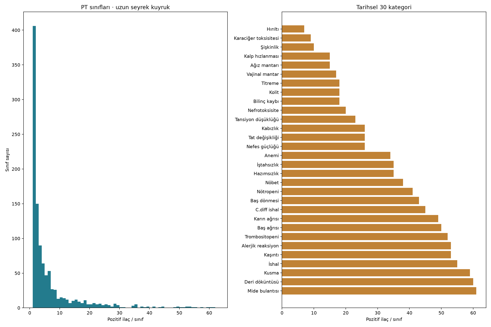
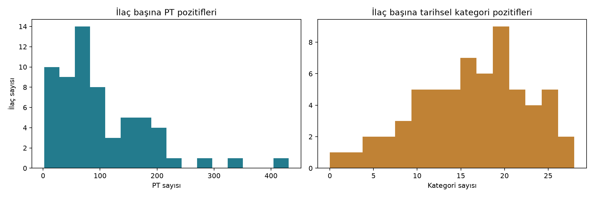

# WP03 — etiket stratejisi karar dosyası

05.11.2026 — **Karar önerisi; nihai kategori seti değiştirilmedi.**

## Ölçüm tanımı ve aynı paydada karşılaştırma

Payda, muhafazakâr J01 kohortunda kesin stereo-CID ve geçerli PT ilişkisi bulunan **62 DrugBank ana ID**. Pozitif anahtarı PT için `(id, meddra_cui)`, kategori için `(id, category)`; tekrarlar tekilleştirildi. Sıklık, pozitif kaydı bulunan **ilaç sayısıdır**. Hasta sayısı, bildirim olay sayısı, yan etki görülme oranı veya klinik risk değildir. PT CUI, burada kullanılan UMLS kimliğidir; sayısal MedDRA koduyla karıştırılmamalı.

| Ölçüm | Kaynak PT CUI | Tarihsel 30 kategori | MASTER kod sözlüğü projeksiyonu — yalnız denetim |
|---|---:|---:|---:|
| Bu kohortta gözlenen sınıf | 1.061 | 30 | 30 |
| En az bir pozitifli ilaç | 62 | 61 | 61 |
| Benzersiz pozitif çift | 6.416 | 1.011 | 977 |
| Sınıf başına pozitif ilaç min–maks | 1–61 | 7–61 | 7–61 |
| Yalnız bir ilaçta görülen sınıf | 406 | 0 | 0 |
| En çok iki ilaçta görülen sınıf | 556 | 0 | 0 |
| Beşten az ilaçta görülen sınıf | 710 | 0 | 0 |
| 31'den fazla ilaçta görülen sınıf | 33 | 16 | 15 |
| En sık / en seyrek destek oranı | 61,00 | 8,71 | 8,71 |
| İlaç başına pozitif min / medyan / maks | 2 / 79,5 / 431 | 0 / 16,5 / 28 | 0 / 16 / 28 |
| Gözlenen sözlükte olası çift | 65.782 | 1.860 | 1.860 |
| Gözlenmeyen, etiketsiz çift | 59.366 | 849 | 883 |

Kaynaklar: [ölçümler](qa/WP03/final_review/label_strategy_metrics.csv), [ilaç başına sayımlar](qa/WP03/final_review/per_drug_positive_counts.csv), [PT sıklıkları](qa/WP03/final_review/class_frequency_PT_CUI.csv), [kategori sıklıkları](qa/WP03/final_review/class_frequency_historical_30.csv). Kod sözlüğü tasarımda 40 terim → 33 kategori içeriyor; bu 62 ilaçta gözlenen sayının 30 olması tasarımın 30 olduğu anlamına gelmiyor. Bu alternatif yeni hedef seti olarak benimsenmedi.

Sulfanilamide (DB00259) iki PT taşırken tarihsel seçilmiş kategorilerde sıfır pozitif taşıyor. Bu, 30 kesin negatif veya ilacın yan etkisiz olduğu anlamına gelmez. 1.061→30 dönüşümü salt eşanlamlı tekilleştirmesi değildir: kavram seçimi, kapsam dışı bırakma ve bazı PT'leri birleştirme içerir. 6.416 ile 1.011 farklı kavram uzaylarının çift sayılarıdır; fark doğrudan kayıp oranı veya klinik bilgi kaybı yüzdesi olarak sunulmaz.

## Grafiklerle ne öğreniyoruz?

Sol panel PT sınıf desteğinin uzun seyrek kuyruğunu, sağ panel tarihsel 30 kategorinin her birinin desteğini gösteriyor. PT sınıflarının 406/1.061'i (%38,3) tek ilaçta; 710/1.061'i (%66,9) beşten az ilaçta. Tarihsel kategoride Hırıltı 7, Karaciğer toksisitesi 9, Şişkinlik 10; Mide bulantısı 61, Deri döküntüsü 60 ilaçta. Birleştirme sınıfları daha sık yapabilir; bu sonuç kategori anlamını veya klinik geçerliliğini doğrulamaz. Tez açısından sınıf düzeyinde öğrenilebilirlik ve belirsizlik sınırını görünür kılar.

PT pozitif sayısı 2–431, kategori sayısı 0–28 arasında. İlaçlar arasındaki etiket yoğunluğu değişiyor; kapsam ve kayıt süreçleri buna katkıda bulunabilir. Buradan nedensel açıklama, raporlama hızı veya biyolojik risk sıralaması çıkarılamaz. Tez açısından çok etiketli değerlendirmede bazı ilaçların çok daha fazla gözlenen pozitif taşıdığını gösterir. Bu sayılar QA'da kalmalı, ilaç özelliklerine eklenmemeli.

## Seçenekler ve karar kapısı

| Strateji | Güçlü taraf | Sorun / gerekli karar | Şimdiki durum |
|---|---|---|---|
| Tarihsel 30'u sabit karşılaştırma olarak koru | V6 ile izlenebilir karşılaştırma, görece yoğun sınıflar | Semantik sorunlar, seçilmemiş PT'lerin kapsam kaybı, 61 pozitifli ilaç | Mevcut tanım korunuyor; klinik doğrulanmış hedef iddiası yok |
| Kaynak PT CUI düzeyi | Kimlik izi ve kavramsal ayrıntı korunur, 62 ilaç | 1.061 sınıfa karşı 62 ilaç; 406 singleton, sınıf bazında güvenilir ölçüm güç | Keşif alternatifi; yeni nihai hedef seti yapılmadı |
| Semantik olarak gözden geçirilmiş kategori eşlemesi | Yanlış neden/yerleşim eklemelerini ve birleşmeleri ele alır | Her kural için PT/CUI kanıtı, kapsam gerekçesi ve kullanıcı onayı gerekir | Önce 30 satırlık inceleme kararı; otomatik merge/drop yok |
| Önceden tanımlanan destek eşiğiyle PT alt kümesi | Çok seyrek hedefleri ayrı raporlama olanağı | Eşik keyfi olmamalı; tüm kohorta bakarak test odaklı sınıf seçimi sızıntı yaratır | Eşik seçilmedi, sınıf elenmedi |

Öneri: Tarihsel 30 karşılaştırmasını koru, kaynak PT ilişkilerini kayıpsız QA/provenans olarak sakla; aşağıdaki semantik bayrakları karara bağlamadan nihai hedef sayısını değiştirme. Destek eşiği, yeniden adlandırma veya birleştirme burada onaylanmış değil.

## Seyreklik, dengesizlik ve gelecekteki değerlendirme

1. Tek ilaçta pozitif bulunan bir PT'nin bağımsız ilaç gruplarında hem eğitim hem değerlendirme pozitifi bulunması sağlanamaz. Sınıf başına sıfır eğitim/değerlendirme desteği açıkça “hesaplanamaz” raporlanmalı; bu bir başarım sıfırı değildir. Eğitim yapılmadan stratifikasyonun sorunu çözdüğü söylenemez.
2. Micro ölçümler sık sınıflarca baskılanabilir; macro ölçümler seyrek sınıflarda kararsızlaşabilir. İleride her sınıfın desteği, değerlendirmeye uygun sınıf sayısı ve belirsizlik birlikte raporlanmalı. Dengeleme/ağırlık hesapları yalnız eğitim ilaçlarından yapılmalı; bu rapordaki 62 ilaç sıklıkları model ayarı değildir.
3. 59.366 ve 849 gözlenmeyen çift **unknown**. Hepsini 0 yapmak, gerçek negatif kabulüne dayalı ölçümleri yanıltır. Positive–unlabeled varsayımları ve değerlendirme protokolü daha sonraki ilgili pakette önceden kararlaştırılmalı; burada negatif oluşturulmadı. Gözlenen kayıt varlığını öngören skor, bireysel klinik risk olarak sunulamaz.
4. Gelecekte drug-disjoint ayrım yapılınca ölçekleyici, veriyle öğrenilen sözlük/özellik seçimi, destek eşiği uygulaması ve sınıf ağırlıkları yalnız train üzerinde öğrenilmeli. Sabit uzman hedef sözlüğü önceden dondurulabilir; test etiketleri karar seçmek için kullanılmamalı. Bu aşamada ayrım veya eğitim yapılmadı.

## Tarihsel 30'un PT/CUI karşılaştırması

Bu inceleme, mevcut kaynak kayıtları ile tarihsel adların karşılaştırılmasıdır. “Daralma/genişleme” notları terminoloji açısından inceleme gerekçeleridir; yeni bir dış ontoloji veya klinik değerlendirmeyle eşdeğerlik doğrulanmadı. PT adları ve CUI listeleri ayrı kümeler olarak sıralanmıştır; çoklu listelerin konumsal sırası bire bir eşleme değildir. Tam terim–CUI izi orijinal projeksiyon dosyasında tutulur.

| kategori | kaynak_PT | CUI | pozitif_ilac_62 | inceleme | not |
|---|---|---|---|---|---|
| Alerjik reaksiyon | Hypersensitivity | C0020517 | 53 | yorumlayıcı çeviri | Hypersensitivity ile kategori adının tam kapsam eşitliği veriyle ispatlanmadı. |
| Anemi | Anaemia | C0002871 | 34 | yüzeysel karşılık; klinik onay değil | Bu dosyada açık çok-CUI birleşmesi yok; tam kavramsal eşdeğerlik ayrıca gözden geçirilmeli. |
| Ağız mantarı | Oral candidiasis | C0006849 | 15 | anlam genişletme riski | Kaynak Oral candidiasis; genel mantar adı kaynak özgüllüğünü kaybedebilir. |
| Baş ağrısı | Headache | C0018681 | 50 | yüzeysel karşılık; klinik onay değil | Bu dosyada açık çok-CUI birleşmesi yok; tam kavramsal eşdeğerlik ayrıca gözden geçirilmeli. |
| Baş dönmesi | Dizziness | C0012833 | 43 | yüzeysel karşılık; klinik onay değil | Bu dosyada açık çok-CUI birleşmesi yok; tam kavramsal eşdeğerlik ayrıca gözden geçirilmeli. |
| Bilinç kaybı | Loss of consciousness / Syncope | C0039070 / C0041657 | 18 | birleştirme / ayrıntı kaybı | Loss of consciousness ve Syncope iki ayrı CUI; aynı kategori. Klinik eşdeğerlik onaylanmadı. |
| C.diff ishal | Clostridium difficile colitis / Pseudomembranous colitis | C0238106 / C1257843 | 45 | birleştirme + neden özgüllüğü riski | Clostridium difficile colitis ve Pseudomembranous colitis birleşiyor; ikinci terime C.diff nedeni otomatik yüklenmemeli. |
| Deri döküntüsü | Rash | C0015230 | 60 | yüzeysel karşılık; klinik onay değil | Bu dosyada açık çok-CUI birleşmesi yok; tam kavramsal eşdeğerlik ayrıca gözden geçirilmeli. |
| Hazımsızlık | Dyspepsia | C0013395 | 35 | yüzeysel karşılık; klinik onay değil | Bu dosyada açık çok-CUI birleşmesi yok; tam kavramsal eşdeğerlik ayrıca gözden geçirilmeli. |
| Hırıltı | Wheezing | C0043144 | 7 | yüzeysel karşılık; klinik onay değil | Bu dosyada açık çok-CUI birleşmesi yok; tam kavramsal eşdeğerlik ayrıca gözden geçirilmeli. |
| Kabızlık | Constipation | C0009806 | 26 | yüzeysel karşılık; klinik onay değil | Bu dosyada açık çok-CUI birleşmesi yok; tam kavramsal eşdeğerlik ayrıca gözden geçirilmeli. |
| Kalp hızlanması | Tachycardia | C0039231 | 15 | yüzeysel karşılık; klinik onay değil | Bu dosyada açık çok-CUI birleşmesi yok; tam kavramsal eşdeğerlik ayrıca gözden geçirilmeli. |
| Karaciğer toksisitesi | Hepatotoxicity | C0235378 | 9 | yüzeysel karşılık; klinik onay değil | Bu dosyada açık çok-CUI birleşmesi yok; tam kavramsal eşdeğerlik ayrıca gözden geçirilmeli. |
| Karın ağrısı | Abdominal pain | C0000737 | 49 | yüzeysel karşılık; klinik onay değil | Bu dosyada açık çok-CUI birleşmesi yok; tam kavramsal eşdeğerlik ayrıca gözden geçirilmeli. |
| Kaşıntı | Pruritus | C0033774 | 53 | yüzeysel karşılık; klinik onay değil | Bu dosyada açık çok-CUI birleşmesi yok; tam kavramsal eşdeğerlik ayrıca gözden geçirilmeli. |
| Kolit | Colitis | C0009319 | 18 | kod/file revizyonu + daraltma riski | Gerçek dosya Kolit, kaynak Colitis; MASTER kodu Antibiyotikle ilişkili kolit diyerek neden ekliyor. |
| Kusma | Vomiting | C0042963 | 59 | yüzeysel karşılık; klinik onay değil | Bu dosyada açık çok-CUI birleşmesi yok; tam kavramsal eşdeğerlik ayrıca gözden geçirilmeli. |
| Mide bulantısı | Nausea | C0027497 | 61 | yüzeysel karşılık; klinik onay değil | Bu dosyada açık çok-CUI birleşmesi yok; tam kavramsal eşdeğerlik ayrıca gözden geçirilmeli. |
| Nefes güçlüğü | Dyspnoea | C0013404 | 26 | yüzeysel karşılık; klinik onay değil | Bu dosyada açık çok-CUI birleşmesi yok; tam kavramsal eşdeğerlik ayrıca gözden geçirilmeli. |
| Nefrotoksisite | Renal impairment | C1565489 | 20 | anlam daraltma / neden ekleme riski | Gerçek PT Renal impairment; nefrotoksisite adı toksik neden izlenimi ekliyor. |
| Nöbet | Convulsion | C0036572 | 38 | kapsam genişleme olasılığı | Gerçek dosyada Convulsion tek PT; kod sözlüğünde Seizure da var. Gerçek veri ve tasarım sözlüğü ayrılmalı. |
| Nötropeni | Neutropenia | C0027947 | 41 | yüzeysel karşılık; klinik onay değil | Bu dosyada açık çok-CUI birleşmesi yok; tam kavramsal eşdeğerlik ayrıca gözden geçirilmeli. |
| Tansiyon düşüklüğü | Hypotension | C0020649 | 23 | yüzeysel karşılık; klinik onay değil | Bu dosyada açık çok-CUI birleşmesi yok; tam kavramsal eşdeğerlik ayrıca gözden geçirilmeli. |
| Tat değişikliği | Dysgeusia | C0013378 | 26 | yüzeysel karşılık; klinik onay değil | Bu dosyada açık çok-CUI birleşmesi yok; tam kavramsal eşdeğerlik ayrıca gözden geçirilmeli. |
| Titreme | Tremor | C0040822 | 18 | yüzeysel karşılık; klinik onay değil | Bu dosyada açık çok-CUI birleşmesi yok; tam kavramsal eşdeğerlik ayrıca gözden geçirilmeli. |
| Trombositopeni | Thrombocytopenia | C0040034 | 52 | yüzeysel karşılık; klinik onay değil | Bu dosyada açık çok-CUI birleşmesi yok; tam kavramsal eşdeğerlik ayrıca gözden geçirilmeli. |
| Vajinal mantar | Vulvovaginal candidiasis | C0700345 | 17 | anlam genişletme / yerleşim kaybı riski | Kaynak Vulvovaginal candidiasis; genel ad Candida ve vulvovajinal kapsamı eksiltebilir. |
| İshal | Diarrhoea | C0011991 | 55 | yüzeysel karşılık; klinik onay değil | Bu dosyada açık çok-CUI birleşmesi yok; tam kavramsal eşdeğerlik ayrıca gözden geçirilmeli. |
| İştahsızlık | Decreased appetite | C0232462 | 35 | yüzeysel karşılık; klinik onay değil | Bu dosyada açık çok-CUI birleşmesi yok; tam kavramsal eşdeğerlik ayrıca gözden geçirilmeli. |
| Şişkinlik | Abdominal distension | C0000731 | 10 | yüzeysel karşılık; klinik onay değil | Bu dosyada açık çok-CUI birleşmesi yok; tam kavramsal eşdeğerlik ayrıca gözden geçirilmeli. |

Özellikle **Bilinç kaybı** iki ayrı CUI'yi (Syncope / Loss of consciousness), **C.diff ishal** iki ayrı kolit PT'sini birleştiriyor. **Nefrotoksisite** adına Renal impairment'ta bulunmayan toksik neden yüklenebilir. Gerçek tarihsel **Kolit** kategorisinin kaynağı Colitis; “Antibiyotikle ilişkili kolit” adı gerçek dosyaya değil MASTER kod sözlüğüne ait. Bu iki sürümü karıştırmamak gerekir. Genel mantar adları Candida özgüllüğünü kaybediyor. Convulsion/Seizure için de gerçek dosya ile kodun tasarım kapsamı ayrıdır. Birleştirmeden kaynaklanan tekrarlar kategori düzeyinde `(id, category)` anahtarıyla kaldırılmıştır; iki farklı PT'nin aynı kategoriye gitmesi iki ayrı kategori pozitifi sayılmaz.

Karar dosyası, WP03 kapanışına ek öneridir. **30 kategori korunuyor; nihai hedef stratejisi kullanıcı onayı gerektiriyor.**
