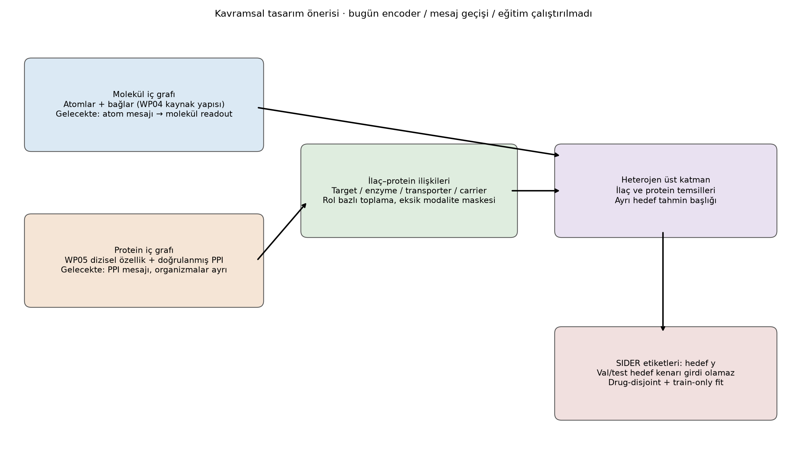

# WP06 — STRING protein ilişki ağları ve GiG topoloji incelemesi

06.11.2026 — **Tamamlandı; kullanıcı onayı bekleniyor.** WP05 onaylandı. Yalnız WP06 yapıldı. WP05 kimlik/dizileri, WP04 QC kararları ve 62 ilaçlık kohort korunmuştur.

## Altı sorunun net yanıtı

| Soru | Gerçek kaynaklardan hesaplanan yanıt |
|---|---|
| 1. 141 protein kaç kesin STRING eşlemesi veriyor? | **63 accession aynı-taxID + tek UniProt_AC alias** ile kesin eşleşiyor. **86 accession tek, açık accession-alias eşlemesi** taşıyor; bunun **23'ü** K-12 ebeveyn/ MG1655 alt suş kapsamı nedeniyle ayrı inceleme senaryosu. Bu iki kesinlik düzeyi birleştirilmedi. |
| 2. Kaçı insan / E. coli? | İnsan **63/63** aynı taksonomi eşlemesi. E. coli K-12 **23** tek alias eşlemesi var; DrugBank taxID **83333**, STRING **511145**. Aynı alt suş taxID'siyle kesin doğrulanmış E. coli sayısı **0**; 23, katı ana analize sessizce eklenmeyen ayrı keşif ağı. Genel E. coli taxID 562'li altı accession'da alias yok. |
| 3. Doğrudan eşlenmiş proteinler arasında kaç kenar? | Yerel dosyanın 150 alt sınırında insan **1.200** tekil yönsüz çift; 400/700/900'de **583/184/79**. Ayrı K-12 alias senaryosunda 150'de **130**, 400/700/900'de **84/68/56**. Bu 130 kenar strict-taxID insan sonucuna katılmaz. |
| 4. Eşik bağlantılılığı nasıl değiştiriyor? | İnsan 400→700→900'de izole sayısı **2→12→27**, bileşen **3→14→32**; seed düğüm sayısı 63 sabit. K-12 keşif senaryosunda izole **0→2→2**, bileşen **1→4→5**. Tam tablo aşağıda. |
| 5. Gelecekte GiG'ye nasıl katılabilir? | Önceden sabitlenmiş kapsam/eşik/kenar politikasıyla ayrı organizma PPI encoder'ı, ardından DrugBank rol bazlı ilaç–protein toplaması ve ayrı molekül/üst katman temsili; bugün yalnız tasarım diyagramı. Topoloji varlığı öğrenme faydası kanıtı değil. |
| 6. Eski V6 eksikliği nasıl giderilmeli? | PPI edge_index'i kaydetmek yetmez; gelecekte forward gerçekten PPI komşularını protein temsiline taşımalı. PPI kaldırma/karıştırma ve aynı değerlendirme ayrımında ablation ile etkisi test edilmeli. Şu an mimari kodlanmadı veya eğitim yapılmadı. |

141'in partition'ı: **63 aynı-taxon kesin + 23 alias kesin/alt suş incelemesi + 6 alias yok + 49 diğer organizma = 141**. Çok-STRING aday belirsizliği **0**, gen adı benzerliğiyle kullanılan eşleme **0**. Katı aynı-taxID kapsamı dışında 78 accession var; bu proteinlerin biyolojik olarak izole veya önemsiz olduğu sonucu çıkarılmaz.

## Kaynak şeması ve boyutları

Yalnız yerel `Dataset/string-db/Homo Sapiens/` ve `Dataset/string-db/Escherichia coli/` altında izinli **v12.0 links ve aliases** dosyaları açıldı. Dosya adıyla aynı isimli açılmış alt klasörlerdeki gerçek TXT'ler kullanıldı. Başka organizma, protein.info, STRING sequences, fiziksel links veya ayrıntılı kanal dosyası okunmadı/indirilmedi. Sürüm kanıtı v12.0 dosya adlarıdır; içerikte ayrı yayın tarihi/sürüm satırı yok.

| kaynak_taxID | tip | bayt | veri_satırı | sütunlar | skor_min | skor_max |
|---|---|---|---|---|---|---|
| 9606 | aliases | 199702624 | 3889207 | string_protein_id / alias / source | uygulanmaz | uygulanmaz |
| 511145 | aliases | 6095750 | 154577 | string_protein_id / alias / source | uygulanmaz | uygulanmaz |
| 9606 | links | 630908617 | 13715404 | protein1 / protein2 / combined_score | 150 | 999 |
| 511145 | links | 29542833 | 984760 | protein1 / protein2 / combined_score | 150 | 999 |

Links alanları boşlukla ayrılmış protein1/protein2 kimlik metinleri ve tamsayı combined_score. Aliases TAB ile STRING ID/alias/source; source aynı alias'ın hangi kaynak türünden geldiğini gösterir. Başlık hariç sayımlar gerçek akıştan üretildi. Links skor aralığı iki kaynakta da **150–999**, düğüm ID önekleri kaynak taxID'siyle uyumlu. İnsan kaynakta **19.622**, E. coli kaynakta **4.140** farklı görülen STRING düğümü var; bunlar WP05'e eşlenen düğüm sayıları değildir.

13.715.404 insan links satırının 6.857.702'si A<B, 6.857.702'si B<A yönünde; E. coli 492.380 / 492.380. Bu eşitlik tek başına bütün kaynağın global tekil yönsüz sayısını kanıtlamaz. Global tüm çiftlerin duplicate kontrolü için büyük bir edge set'i RAM'de tutulmadı. **Kesin tekrar/karşı yön denetimi yalnız kaydedilen induced/expanded alt ağlarda** yapıldı. Kaynak düzeyinde bozuk sütun, boş alias alanı, yanlış taxID öneki, geçersiz skor ve self-loop gözlenmedi; testler bu hata yollarını sentetik kayıtlarda sınar.

İlk links akışı bütün satırlardan skor histogramı/şema QC, seed-induced kenarlar ve sınırlı komşu adayları çıkarır. Ardından seçilmiş yeni düğümler arasındaki tüm induced kenarları bulmak için **ikinci links akışı** gerekir; aksi halde context–context bağlantıları atlanırdı. Aliases kimlik akışına ek olarak seçilmiş context isimleri için dar alanlı ek okuma yapıldı. Hiçbir büyük kaynak tümüyle RAM'e yüklenmedi; yalnız kaynak düğüm seti, sayımlar, küçük seçili kenarlar ve seed başına en fazla üç komşu tutuldu. Links sürecinin OS tepe çalışma kümesi yaklaşık **99,1 MiB**; bu notebook/görsel süreçlerinin toplam bellek ölçümü değildir.

Salt okunur açma, boyut/mtime önce/sonra kontrolleri ve ilk tam akış sırasında ek IO gerektirmeyen SHA-256 ile provenans kaydedildi. İkinci links geçişinde yeniden hash hesaplanmadı; kaynak metadata kontrolü tekrarlandı. [aliases manifesti](qa/WP06/aliases_manifest.json), [links manifesti](qa/WP06/links_manifest.json). Büyük kaynak kopyası veya yeniden veri indirme yok; yeni kütüphane kurulmadı. Önceki **275 proje dosyası** içerik hash'iyle korundu.

## Kimlik ve taksonomi politikası

**Kesin alias kanıtı:** aliases.alias alanı WP05 accession'ına karakter karakter eşit, source alanında `UniProt_AC` var, STRING ID öneki doğru kaynak taxID'si; bu filtre sonunda aday STRING ID sayısı tam 1. Gen adı, isim benzerliği, yalnız UniProt benzeri biçim veya başka alias kaynağı tek başına kullanılmaz. Kaynak satır numarası ve dosya yolu [alias_evidence.csv](qa/WP06/alias_evidence.csv) içinde. Diğer alias kaynak satırları da denetim amacıyla korunur; eşlemeyi UniProt_AC kayıtları taşır.

Her iki ağda çoktan-bire STRING düğüm çakışması gözlenmedi: 63 insan accession→63 STRING ID; 23 K-12 accession→23 STRING ID. 141 WP05 accession ve dizileri yeniden adlandırılmadı/birleştirilmedi.

**83333/511145 farkı neden önemli?** NCBI belgelerinde 83333 E. coli K-12, 511145 onun MG1655 alt suşudur. Bu belgeler yalnız taksonomi anlamını doğrulamak için okundu; protein/taksonomi veri dökümü indirilmedi. Açık accession alias'ı STRING'in 23 kaydı MG1655 düğümüne bağladığını gösterir; DrugBank'taki daha genel K-12 kaydının bağımsız MG1655 dizi/strain doğrulamasını sağlamaz. Bu nedenle iki çıktı ayrıdır:

1. **Katı ana ağ:** yalnız aynı-taxID insan eşlemeleri. [strict_taxon_induced_edges.csv](qa/WP06/strict_taxon_induced_edges.csv).
2. **Açıkça koşullu E. coli keşif ağı:** 23 benzersiz accession alias'ı + `K12_parent_scope_review` bayrağı. Buradaki gerçek STRING kenarları kaynak kanıtı taşır; model/strain kapsamına kabul kararı verilmedi. Bu ağ katı ana ağa eklenmez.

E. coli genel tür taxID 562'li aşağıdaki kayıtlar için kesin alias bulunamadı. Aynı gen adı veya başka E. coli proteinine benzerlik ile tamamlanmadı:

| accession | protein_name | organism | taxid |
|---|---|---|---|
| C3T8E2 | Multidrug resistance protein MdtK | Escherichia coli | 562 |
| P00484 | Chloramphenicol acetyltransferase 3 | Escherichia coli | 562 |
| P00551 | Aminoglycoside 3'-phosphotransferase | Escherichia coli | 562 |
| P24093 | Dr hemagglutinin structural subunit | Escherichia coli | 562 |
| P62593 | Beta-lactamase TEM | Escherichia coli | 562 |
| Q47066 | Beta-lactamase Toho-1 | Escherichia coli | 562 |

49 diğer organizma accession'ı available ağ türlerinin dışındadır; Staphylococcus, Pseudomonas, Streptococcus vb. proteinleri E. coli diye etiketlenmedi. Mantar/diğer ökaryotlar insan ağına taşınmadı. Aynı gene ait dize benzerliğiyle organizmalar arası PPI kenarı **0**. [Tam 141 satırlık eşleme tablosu](qa/WP06/protein_string_mapping.csv), notebook'ta kodun hemen altında gösterilir.

## PPI ve confidence semantiği

Yerel `protein.links` genel işlevsel ilişki kaynağıdır; her kenarın doğrudan fiziksel bağlanma olduğunu söyleyemeyiz. STRING farklı kanıt kanallarını birleştirir; yerel üç sütunla deneysel kanal, text-mining etkisi veya aktarılmış ilişki ayrıştırılamaz. Bu kanalları incelemek için yeni dosya indirilmedi. Kullanılan yeni veri kaynağı yok.

Combined score **yan etki riski, bağlanma kuvveti, protein kalite puanı veya deneysel kesinlik** değildir. 150/400/700/900 eşikleri veri keşfi senaryoları olarak baştan sabitlendi; PT/kategori/etiket bulunurluğu/model başarımı görülerek seçilmedi. 700 yalnız örnek çizim eşiğidir; nihai eğitim eşiği değil.

Ağırlıksız derece, eşik üstü farklı komşu sayısıdır. Betimleyici ağırlıklı strength, incident kenarlardaki `score/1000` toplamıdır; basit sayısal ölçek dönüşümüdür, bireysel klinik olasılık değildir. Combined score protein düğüm özelliği yapılmadı. Degree/strength ve bileşen sayıları da QA tablolarıdır; yeni model girdisi üretilmedi.

## Gerçek alt ağlar ve eşik karşılaştırması

| network_taxid | mapping_scope | threshold | nodes | edges | isolates | components | largest_component |
|---|---|---|---|---|---|---|---|
| 9606 | exact_taxon | 150 | 63 | 1200 | 0 | 1 | 63 |
| 9606 | exact_taxon | 400 | 63 | 583 | 2 | 3 | 61 |
| 9606 | exact_taxon | 700 | 63 | 184 | 12 | 14 | 49 |
| 9606 | exact_taxon | 900 | 63 | 79 | 27 | 32 | 26 |
| 511145 | K12_parent_scope_review | 150 | 23 | 130 | 0 | 1 | 23 |
| 511145 | K12_parent_scope_review | 400 | 23 | 84 | 0 | 1 | 23 |
| 511145 | K12_parent_scope_review | 700 | 23 | 68 | 2 | 4 | 12 |
| 511145 | K12_parent_scope_review | 900 | 23 | 56 | 2 | 5 | 10 |

Düğüm sayısı her induced ağın seed kümesinde sabittir; filtre sonrası yalnız kenar kalan düğümleri saymak yerine **izole düğümler korunur**. İnsan 700'de 51/63 düğümün komşusu var; en büyük bileşen 49, toplam 14 bileşen (12 izole + iki bağlı bileşen). 900'e yükseltmek kenarları 79'a düşürür, 27 izole bırakır. Bu görünüm daha yüksek skorun daha iyi tahmin anlamına gelmediğini gösterir.

K-12 alias senaryosu 700'de 68 kenar, 2 izole, 4 bileşen, en büyük bileşen 12. Bu sayılar gerçek 511145 links alt ağından gelir; 23 seed'in WP05 kaynak taksonomisi kapsam incelemesindedir. Şekil/tablolar bu kapsamı isimlerinde taşır; sayılar 63 kesin insan sonucuna eklenmez.

Yönsüz kenar anahtarı `(min(protein1, protein2), max(...))`. Seçili seed alt ağlarında insan **2.400 satır→1.200**, E. coli **260→130** çift. Bütün bu seçili çiftlerde karşı yön gözlendi, aynı yön fazladan tekrarı **0**, skor çatışması **0**. Skor çelişirse kod max değeri doğrulanmış diye seçmez: `score_conflict=True` kaydı QA'da tutulur ve ağ hesabından çıkarılır. Self-loop kabul edilmez. İki kere sayılma/izole/organizmalar arası sızıntı testleri vardır.

## Bütçeli ve ayrı context genişletmesi

Politika: her seed için ≥700 skorlu en iyi üç farklı, seed olmayan komşu; puan eşitse STRING ID sırası; tüm adaylardan organizma başına en fazla 40 yeni düğüm. Böylece insan **63+40=103**, E. coli koşullu senaryo **23+40=63** düğümlü olur. Eklenme kararında ilaç yan etkisi veya model başarımı kullanılmadı. Bu bütün bir-hop komşuluğu değildir; bütçeli seçimin yanlılığı vardır. Düğümler sabitlendikten sonra links kaynağı ikinci kez akışla okunarak **seçilmiş tüm düğümler arası induced** kenarlar çıkarıldı.

| network_taxid | threshold | nodes | edges | isolates | components | largest_component |
|---|---|---|---|---|---|---|
| 9606 | 150 | 103 | 2270 | 0 | 1 | 103 |
| 9606 | 400 | 103 | 965 | 0 | 1 | 103 |
| 9606 | 700 | 103 | 372 | 7 | 10 | 85 |
| 9606 | 900 | 103 | 209 | 20 | 27 | 58 |
| 511145 | 150 | 63 | 755 | 0 | 1 | 63 |
| 511145 | 400 | 63 | 458 | 0 | 1 | 63 |
| 511145 | 700 | 63 | 307 | 0 | 2 | 59 |
| 511145 | 900 | 63 | 220 | 3 | 8 | 24 |

İnsan geniş ağ 700'de 372 kenar, 10 bileşen, 7 izole, en büyük bileşen 85; seed ağın 184 kenar/14 bileşen/12 izole/49 en büyük bileşeniyle karşılaştırılır. E. coli ayrı senaryo 700'de 307 kenar, 2 bileşen, 0 izole, en büyük bileşen 59. Artış seçilmiş context düğümlerinin doğal etkisi olabilir; biyolojik veya modelsel fayda ispatı değildir.

**80 yeni context düğümü DrugBank hedefi veya WP05 dizisi doğrulanmış protein sayılmadı.** Dört rolün hiçbirine yeni ilaç bağlantısı uydurulmadı; context düğümlerinde sequence_feature_available=False, accession boş. Tam STRING ID, organizma, seed seçim kanıtı ve links kaynak satırları saklanır. İsim/alias etiketi aynı yerel aliases dosyasındaki açık ad kayıtlarından gelir; ad olması UniProt veya DrugBank hedef doğrulaması değildir. Bu bağlam düğümlerinin protein özelliği politikası gelecekte ayrıca karar gerektirir; skor bu eksikliği doldurmaz.

[Context seçimi](qa/WP06/context_selection.csv), [düğüm tablosu](qa/WP06/ppi_nodes.csv), [isim kanıtı](qa/WP06/context_alias_evidence.csv), [geniş ağ kenarları](qa/WP06/ppi_expanded_edges.csv). Network_scope ve seed/context ayrımı tek düğüm listesine girerken kaybolmaz. E. coli strain bayrağı bütün keşif ağı yorumunda geçerlidir.

## Graf metrikleri ve ilaç katmanıyla bağlantı

| network_taxid | accessions | protein_name | degree_700 | weighted_strength_700 |
|---|---|---|---|---|
| 9606 | P08684 | Cytochrome P450 3A4 | 21 | 18.7400 |
| 9606 | Q9Y6L6 | Solute carrier organic anion transporter family member 1B1 | 19 | 16.0000 |
| 9606 | P11712 | Cytochrome P450 2C9 | 15 | 13.3500 |
| 9606 | P20815 | Cytochrome P450 3A5 | 14 | 12.7880 |
| 9606 | P22309 | UDP-glucuronosyltransferase 1A1 | 14 | 12.6320 |
| 9606 | P33261 | Cytochrome P450 2C19 | 14 | 12.4340 |
| 9606 | Q9NPD5 | Solute carrier organic anion transporter family member 1B3 | 13 | 10.4230 |
| 9606 | P05177 | Cytochrome P450 1A2 | 13 | 12.2240 |
| 9606 | Q9UNQ0 | Broad substrate specificity ATP-binding cassette transporter ABCG2 | 13 | 10.6000 |
| 9606 | Q96FL8 | Multidrug and toxin extrusion protein 1 | 12 | 9.3410 |
| 9606 | Q8TCC7 | Organic anion transporter 3 | 12 | 9.9030 |
| 9606 | P10635 | Cytochrome P450 2D6 | 12 | 10.8030 |

Derece/strength yalnız bu seçilmiş kaynak alt grafında merkezi görünen proteinleri gösterir; bireysel risk veya nedensellik çıkarmaz. İnsan ağındaki metabolizma, taşıma ve carrier proteinleri de WP05 rollerinden geldiği için PPI ağı yalnız ana antibakteriyel hedefler ağı değildir. Gelecekte rol bazlı kapsam ve ablation gerekir.

Öğretici ilaç–protein–protein çiziminde DrugBank rol kenarları gri, STRING PPI kenarları turuncu. Bunlar iki ayrı ilişkinin kaynak iziyle yan yana gösterimidir; PPI komşusu olmak bir ilacın yeni hedefi olmak demek değildir. [62 ilaçlık PPI kapsam tablosu](qa/WP06/drug_ppi_mapping_coverage.csv) **Tobramycin ve Methenamine'i** protein modalitesi eksik olarak korur. WP04 sekiz inceleme molekülü ve QC kararları değişmez.

## Eski V6 kodu: PPI gerçekten kullanılmış mı?

`legacy/MASTER_KOD.py:650–668`, iki işlenmiş PPI CSV'sini chunk'larla okuyor; uçları mevcut prot_ids içinde kalan kenarları tensor olarak `data['protein','interacts','protein'].edge_index` alanına yazıyor. Dolayısıyla PPI hazırlanmış; “STRING hiç kullanılmadı” demek doğru değil. Bu tarihsel kod metin/AST olarak incelendi, çalıştırılmadı; .pt nesnesi yüklenmedi veya yeni PyG nesnesi yaratılmadı.

**GiGModel.forward satır 733:** parametreler `(x_drug, x_prot, x_se, dp_ei, pred_drug_idx, pred_se_idx)`. PPI edge_index parametresi/erişimi yok. Satır 736 `h_prot = self.prot_enc(x_prot)` bağımsız MLP hesabı. Satır 746–751 yalnız DrugBank ilaç–protein komşularından index_add/count ile mean aggregation yapar. Model çağrıları da PPI kenarı aktarmıyor. Bu nedenle proteinler arasında PPI mesaj geçişi **yok**; eski model PPI encoder'lı GiG olarak doğrulanamaz. [Statik AST denetimi](qa/WP06/legacy_forward_audit.json).



**Dört yapı:** (1) ilaç iç atom/bağ grafı, (2) organizma içinde protein–protein grafı, (3) role ayrılmış ilaç–protein ilişkileri, (4) bunları bir araya getiren heterojen üst temsil ve ayrı hedef tahmin başlığı. Atom grafı mesajları molekül readout'unda, PPI mesajları protein encoder'ında, ilaç–protein aktarımı rol bazlı toplamada ele alınabilir. Bu bir tasarım önerisi, uygulanmış mimari değil. SIDER hedefleri encoder girdisi yapılmaz; gelecekte val/test hedef kenarları eğitim grafına girmez, ilaç ayrık değerlendirme ve train-only fit gerekir.

Eksikliği gidermenin gelecekteki kanıtı: PPI kenarlarını forward içinde gerçekten işleyen encoder; aynı protein özellikleri/DrugBank kenarları altında PPI kaldırma/karıştırmanın temsili ve çıktıyı etkilediğini gösteren anlamlı test; önceden sabitlenmiş drug-disjoint değerlendirmede PPI/no-PPI ablation. Bu test/encoder/eğitim **şimdi yapılmadı**.

## Topolojik yeterlilik ve henüz verilmeyen kararlar

Katı insan ağında 63 protein arasında yüksek skorda bile bağlantılı çekirdek bulunması, ileride **kontrollü PPI deneyi** için topolojik gerekçe sağlıyor. Bu, GiG'nin daha iyi olacağı veya bütün 141 proteinin PPI ile temsil edileceği garantisi değildir. 78 accession strict-taxID ağ dışında; E. coli 23 alias için kaynak kapsamı kabulü/ek doğrulama kararı gerekiyor. Context düğümlerinde dizi özellikleri yok ve diğer bakteriler için yeni ağ eklenmedi. Nihai eşik, context kullanımı ve model yolu bu WP'de seçilmedi.

Onaydan sonraki entegrasyon tartışması için: katı insan induced ağını kontrollü bir varyant olarak saklamak; K-12 alias ağını ayrı koşullu varyant tutmak; farklı organizmaları birleştirmemek; PPI'siz ve proteinsiz modaliteleri korumak; tahmin faydasını daha sonraki izinli değerlendirme paketinde sınamak. E. coli kapsamını kabul etmek gerekirse bu karar açıkça kaydedilmeli; mevcut bayraklar otomatik kaldırılmamalı.

## Notebook, PNG ve HTML rehberi

[WP06_string_ppi_exploration.ipynb](../notebooks/WP06_string_ppi_exploration.ipynb), **10 yürütülmüş kod hücresi**, gerçek tablolar ve **9 gömülü PNG** içerir. 141 eşleme ve 62 ilaç tablosu hücre altında tam görünür. Her grafik sonrası Türkçe bilimsel yorum var. Kaydedilmiş küçük QA'dan çalışır; büyük kaynağı yeniden taramaz.

| Şekil | Ne gösteriyor / sınırı |
|---|---|
| 01_mapping_scope.png | 63/23/6/49 kapsam ayrımı; 86 alias'ı 86 aynı-taxID protein sanmamak |
| 02_source_score_distribution.png | İki gerçek kaynağın ham satır skor dağılımı; tekil kenar histogramı değil |
| 03_threshold_topology.png | Eşiğe göre kenar/izole/bileşen; eşik model başarımıyla seçilmedi |
| 04_degree_distributions.png | Seed induced ağda 700 dereceleri; izoleler sıfırla gösterilir, negatif etkileşim değil |
| 05_human_ppi.png | 63 insan seed ve aynı-taxID kaynak kenarları; tüm izoleler korunur |
| 06_ecoli_scope_review_ppi.png | 23 accession-alias seed'in koşullu MG1655 kaynak ağı; strain onayı değil |
| 07_context_comparison.png | Sabit bütçeli ek komşuların bileşen etkisi; bütün bir-hop ağı değil |
| 08_drug_protein_ppi_example.png | İki kaynak/iki ilişki tipi; yeni ilaç hedefi uydurulmaz |
| 09_gig_design_concept.png | Atom/PPI/ilaç–protein/üst katman ayrımı; henüz model yok |

[İnsan etkileşimli HTML](figures/WP06/9606_ppi_interactive.html) ve [E. coli kapsam-inceleme HTML](figures/WP06/511145_ppi_interactive.html), seed/geniş ağ menüsü içerir. Düğümde STRING ID, accession, protein adı veya kaynak alias'ı, organizma ve kapsam görünür. Kenar orta noktasında combined_score ve kaynak dosya hover'ı var. Layout okunabilirlik için bileşenleri ayrı yerleştirir; görsel koordinat/uzaklık biyolojik ölçü değil. Plotly kodu gömülü; HTML üretim/içerik kontrolü var, canlı tarayıcı etkileşim testi yok.

## Testler, güvenlik ve tekrar üretim

**23/23 test geçti; 3,348 saniye.** [Tam test çıktısı](qa/WP06/test_results.txt). Kapsam: tam accession/UniProt_AC türü, gene-name reddi, çok aday, K12-parent ve species-level inceleme, diğer türlerin E. coli'ye sokulmaması, kaynak allowlist'i, alias satır izi; skor aralığı, tamsayı, self-loop, karşı yön/aynı-yön tekrar, sınırda ≥ eşik, skor çelişkisini bekletme, izole düğüm, ağırlık/derece ayrımı, organizmalar arası ve ilan edilmemiş düğüm reddi; 141/86/63 partition, gerçek 1.200/130/184/68 sayımları; context hedef/özellik iddiası yasağı, eski forward denetimi, 62 ilaç ve WP04 sekiz kaydı ve önceki 275 dosya hash koruması. Testlerde büyük kaynak tekrar taranmaz; küçük sentetik dosya ve mevcut QA + gerçek metadata kullanılır.

PT, kategori, ilaç başına yan etki sayısı, has_pt, raporlama sıklığı ve kalite_skoru PPI hesap girdisine alınmadı. Combined score yalnız kenar kanıtı/önceden tanımlı filtre ve ağırlıklı QA betimlemesidir. PPI node feature, eğitim tensörü, PyG nesnesi, GNN, train/test ayrımı, negatif örnek veya SHAP oluşturulmadı. Ham veri, önceki diziler/kimlikler ve moleküler QC değişmedi.

| Dosya / modül | Amaç |
|---|---|
| protein_string_mapping.csv, alias_evidence.csv | 141 protein kararları ve ham alias satır kanıtları |
| strict_taxon_induced_edges.csv | Yalnız 63 aynı-taxID insan proteininin kaynak induced kenarları |
| ppi_induced_edges.csv | İnsan + açıkça etiketli koşullu K12 senaryosu; canonical kenar/karşı yön/skor QC |
| context_selection.csv, ppi_nodes.csv, context_alias_evidence.csv | 80 ek düğümün seçim/isim/kapsam kanıtı; DrugBank hedefi değil |
| ppi_expanded_edges.csv | Seçilen seed/context düğümlerinin kaynak induced kenarları |
| score_histogram.csv, network_metrics.csv | Kaynak skorları, dört eşikte seed/geniş ağ ölçüleri |
| degree_metrics_700.csv, component_sizes_700.csv | 700 örneğinde düğüm dereceleri ve bileşen boyutları; öğrenme özelliği değil |
| drug_ppi_mapping_coverage.csv, coverage_summary.json | 62 ilaç ve 141 protein için paydası açık kapsam |
| aliases_manifest.json, links_manifest.json, network_policy.json | Kaynak boyut/sürüm/hash/bellek ve filtre/genişleme politikası |
| legacy_forward_audit.json | Eski PPI hazırlama/forward ayrımının çalıştırmadan denetimi |
| input_manifest.json, prior_outputs_hashes.json | Küçük kaynak QA girdileri ve önceki dosyaların korunması |
| scripts/wp06_mapping.py | Salt okunur alias akışı ve taksonomi ayrımlı kimlik kararı |
| scripts/wp06_ppi.py | Akış, canonical kenar QC, sınırlı context ve metrikler |
| scripts/wp06_analyze.py | Küçük çıktılardan özet ve korunma kontrolü |
| scripts/wp06_notebook.py, scripts/wp06_report.py | Yürütülmüş notebook/görsel ve rapor üretimi |
| scripts/wp06_validate_artifacts.py, artifact_validation.json | Notebook/PNG/HTML, kaynak metadata ve önceki çıktıların kapanış kontrolü; büyük dosya taramaz |
| tests/test_wp06.py, run_status.md | 23 test ve onay kapısı kaydı |

İlk iki büyük kaynak adımı tamamlandı. Normal tekrar üretimde **büyük dosyaları gereksiz yere tekrar tarama**:

```powershell
python scripts/wp06_analyze.py
python scripts/wp06_notebook.py
python -m unittest discover -s tests -p test_wp06.py -v
python scripts/wp06_report.py
python scripts/wp06_validate_artifacts.py
```

Ham revizyon veya kapsam bilinçli yenilenirse önce wp06_mapping.py, sonra wp06_ppi.py çalıştırılır. Bunlar `--dataset-root` / GRAPH_TEZ_DATA_ROOT override ve sabit iki organizma/dosya allowlist'i uygular. Yalnız isim açıklamalarını yenilemek için `wp06_ppi.py --annotate-only` links'i tekrar açmaz. Eski analiz dosyaları yeniden üretilmez.

## Resmi yöntem belgeleri

[STRING ağ ve skor açıklaması](https://string-db.org/help/scores/) genel işlevsel/fiziksel ilişki ayrımını ve skorun anlamını açıklar. [v12 indirme açıklaması](https://version-12-0.string-db.org/cgi/download) links/aliases türlerini, score×1000 gösterimini ve AB/BA simetrisini doğrular. [STRING FAQ](https://string-db.org/help/faq/) aliases ile kimlik bağını açıklar. [NCBI K-12](https://www.ncbi.nlm.nih.gov/Taxonomy/Browser/wwwtax.cgi?id=83333&mode=Info) ve [MG1655](https://www.ncbi.nlm.nih.gov/Taxonomy/Browser/wwwtax.cgi?id=511145&mode=Info) belgeleri farklı çözünürlükteki taxID'leri ve hiyerarşiyi gösterir. Bunlar yalnız yöntem/taksonomi dokümanı okumalarıdır; yeni biyolojik veri seti veya API tabanlı protein eşlemesi yapılmadı.

**WP06 tamamlandı; kullanıcı onayı bekleniyor. WP07'ye geçilmedi.**
