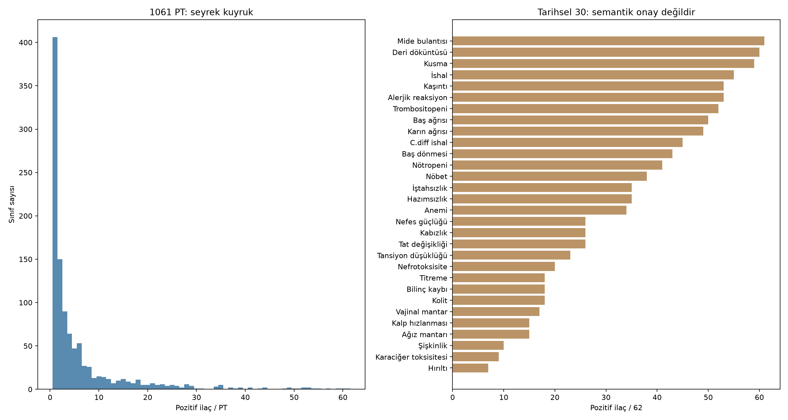
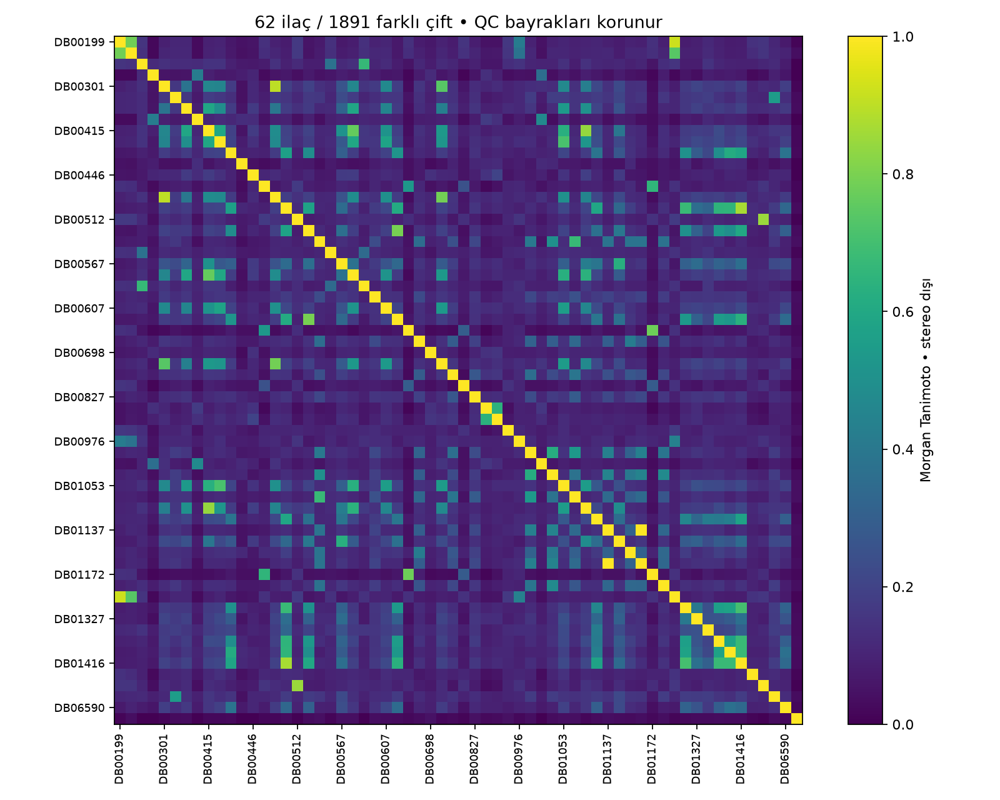
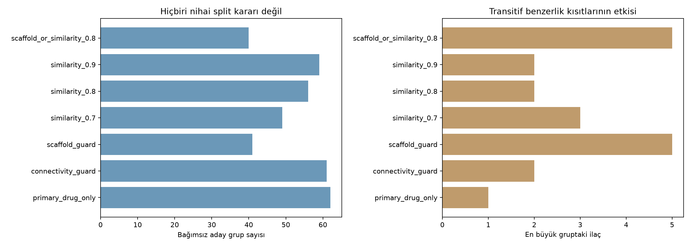
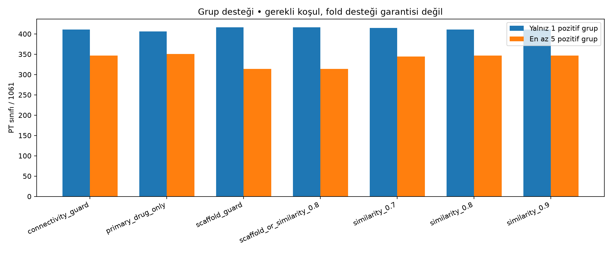
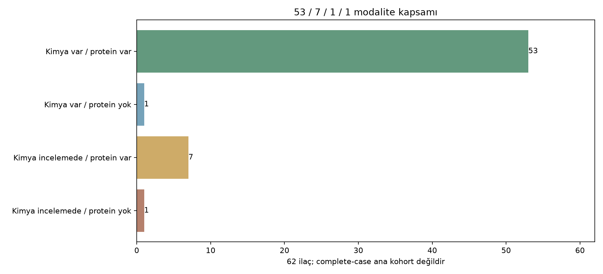
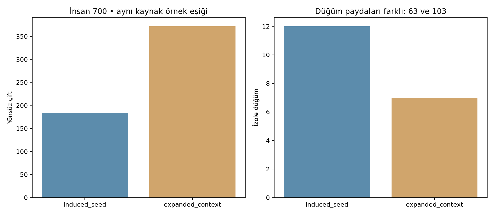
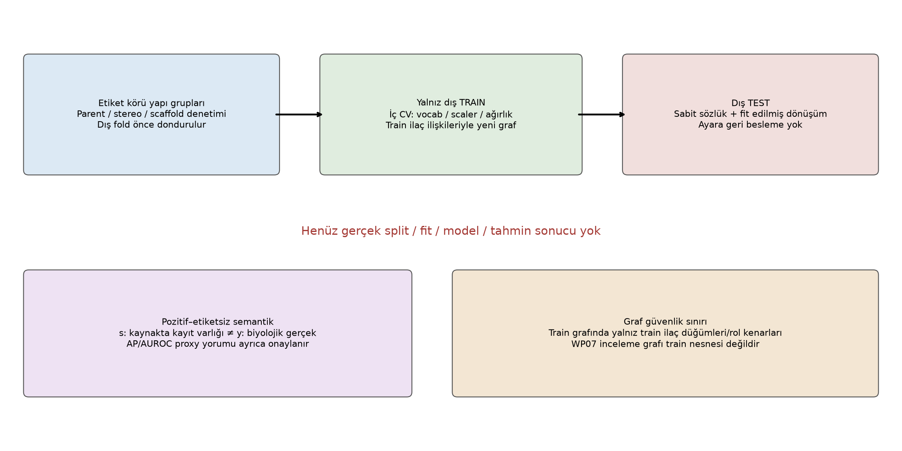

# WP08 — Protokol keşfi ve metodoloji karar incelemesi

06.11.2026 — **WP08'in istenen karar öncesi protokol incelemesi tamamlandı; metodoloji/eğitim onayı bekleniyor.** WP07 onaylandı. ROADMAP WP08'in gerçek split, baseline eğitim ve AUROC/AUPRC CI deneyleri bu incelemede yapılmadı; son kullanıcı talimatı doğrultusunda yöntem kararı önce onaya sunulur. WP09 başlamadı.

## Sonuç ve öneri

62 ilaçlık kohort korunarak hedef, gruplama, eksik modalite ve PU değerlendirme seçenekleri gerçek kayıtlardan incelendi. Birincil yaklaşım adayı **input modalite maskeleriyle kohortu korumak**, bağlanma/metabolizma/taşıma rollerini ayrı tutmak ve etiket körü yapısal gruplarla nested iç doğrulama çerçevesidir. Nihai hedef sınıfları, grup/eşik/CV/seed, fallback veya loss/metrik varsayımı sabitlenmedi. [Ayrıntılı karar kapısı](WP08_PROTOCOL_DECISION_GATE.md) uygulamaya geçmeden onaylanması gereken seçenekleri açıklar.

**Önemli sınır:** Tüm 62 ilacın etiketleri önceki keşiflerde incelendi. Sonradan ayrılacak test, temiz teknik fit sınırlarıyla korunabilir; hiç incelenmemiş bağımsız dış test gibi sunulamaz. Sonuçlar bu veriyle yapılacak iç doğrulama olarak adlandırılmalıdır.

## Bütünlük ve kullanılan kaynaklar

WP07'nin 317 önceki dosyalık manifesti başlangıçta doğrulandı. WP00–WP07'nin **356 dosyası** yeni başlangıç manifestine alındı; kapanışta tamamı aynı SHA-256 ile bulundu. Önceki kimlikler, testler, raporlar, notebook'lar ve QC kararları değiştirilmedi. Güncel `run_status.md` bu manifestin dışındadır. Sekiz önceki paket raporu mevcut; eski testler yeniden koşturulmuş sayılmaz.

Girdiler yalnız mevcut proje QA dosyaları: WP02 parent/tuz/ikincil ID; WP03 hamdan doğrulanmış pozitifler/tarihsel projeksiyon/semantik bayraklar; WP04 kaynak SMILES/kimlik/clean özellik/QC; WP05 registry/dizi özellik/rol kenarları; WP06 mapping/metrik/kenar; WP07 modalite envanteri. **16 küçük girdi hash'i** kaydedildi. XML/SIDER/STRING içerikleri veya kapsam dışı kaynaklar okunmadı. Altı ham kaynakta yalnız boyut/mtime aynı bulundu; bu içerik hash'inin yeniden doğrulanması değildir. Yeni indirme, API veya paket kurulumu yok.

Kaynak sürümleri WP02–WP06 provenansıyla korunur: DrugBank XML 5.1, export 2026-01-04; SIDER 4.1; STRING v12.0. RDKit **2026.09.1** mevcut `.deps/rdkit` kurulumundan kullanıldı. PyG yalnız sınır testinde mevcut `.deps/pyg` üzerinden yeni geçici nesne doğrulaması için kullanıldı; WP07 `.pt` yüklenmedi. Ne model encoder'ı ne mesaj geçişi çalıştı.

## D01 — Etiket seçeneklerinin gerçek kapsamı

| strategy | defined | classes | positive_pairs | positive_drugs | singleton_classes | classes_under5 | support_min | support_max | median_positive_per_drug | target_approved | scope |
|---|---|---|---|---|---|---|---|---|---|---|---|
| PT_CUI | True | 1061 | 6416 | 62 | 406 | 710 | 1 | 61 | 79.5 | False | Full-cohort descriptive QA; never a train-selection result |
| historical_30 | True | 30 | 1011 | 61 | 0 | 0 | 7 | 61 | 16.5 | False | Full-cohort descriptive QA; never a train-selection result |
| clinical_subset | False | not_defined | not_defined | not_defined | not_defined | not_defined | not_defined | not_defined | not_defined | False | No expert-approved target list; no post hoc subset invented |

Kaynak PT'de 406 singleton, 710 beşten az ilaç destekli sınıf; tarihsel 30'da 7–61 ilaç desteği var. Klinik anlamlı alt küme henüz uzman onaylı olmadığı için sınıf sayısı **tanımsız** bırakıldı. Mevcut 30 kavramın kaynak PT/CUI ve anlam incelemesi ayrı kuyruğa kopyalandı; bu bir klinik doğrulama veya yeni kategori tanımı değildir. Aynı PT'lerin kategoriye birleşmesi kapsam ve anlamı değiştirebilir.

**Yorum:** Daha yoğun tarihsel etiket uzayı daha kolay metrik verebilir; klinik doğruluğunu kanıtlamaz. PT'leri tüm 62'nin sıklığına bakarak seçmek gelecek test etiketlerini seçimde kullanır. Önerilen sözlük fonksiyonu train ID'leriyle filtreledikten sonra destek hesaplar. Heldout etiketleri değiştirildiğinde seçimin değişmediği mutasyon testi geçti. 3/5/10 ve >=2 grup yalnız onay bekleyen kural seçenekleridir; gerçek train vocab oluşturulmadı.

## D05 — Yapı, tuz ve grup sızıntısı

62 mevcut kaynak SMILES üzerinde **1891 farklı çift** incelendi. Fingerprint Morgan radius=2, 2048 bit, includeChirality=False; Tanimoto yalnız gruplama QA'sıdır. Yeni öğrenme özelliği değildir. Tam InChIKey ve CID tekrarı **0**; aynı bağlantı/nonisomeric yapıya ait çift **1**: **Levofloxacin–Ofloxacin**. Bu çiftin stereo dışı Tanimoto'su 1'dir; tam kimyasal veya klinik eşdeğerlik sonucu çıkarılmaz. Kimlik kilidi olmayan drug-disjoint ayrımda bu benzerlik test zorluğunu etkileyebilir.

WP02'de onaylı 62 parent'a bağlanan **99 tuz** ve **63 ikincil ID** kanıtı var; bunlar 162 ek ilaç değildir. Canonical ana ilaç ID'leri korunur. Tuz/parent ilişkisi kimyasal parent standardizasyonuyla otomatik aynı şey sayılmadı; nötralizasyon veya fragment/stereo değişikliği yapılmadı. Salt kayıtlarından başka ana ilaçların klinik eşdeğer olduğu sonucu çıkarılmaz.

| method | groups | largest_group | singleton_groups | constraint_pairs | cohort | approved_for_split |
|---|---|---|---|---|---|---|
| primary_drug_only | 62 | 1 | 62 | 0 | 62 | False |
| connectivity_guard | 61 | 2 | 60 | 1 | 62 | False |
| scaffold_guard | 41 | 5 | 29 | 34 | 62 | False |
| similarity_0.7 | 49 | 3 | 40 | 15 | 62 | False |
| similarity_0.8 | 56 | 2 | 50 | 6 | 62 | False |
| similarity_0.9 | 59 | 2 | 56 | 3 | 62 | False |
| scaffold_or_similarity_0.8 | 40 | 5 | 27 | 35 | 62 | False |

**Yorum:** İsimden veya yalnız ID farklılığından bağımsız yapı benzerliği görünür. Parmak izi bit çakışmaları, stereo dışı temsil, büyük/karışım yapıları ve sekiz QC incelemesi yorum sınırıdır. RDKit Murcko türevi kaynak molekülü ezmez; tam yapı model için basitleştirilmedi. Boş scaffold bu 62'de 0; kodda boş scaffold'lar tek gruba birleştirilmez ve sentetik testle doğrulanır.

**Yorum:** Connectivity 61, scaffold 41, scaffold veya >=0,8 benzerlik birleşimi 40 aday grup verir; en büyük birleşim grubu 5 ilaçtır. Benzerlik 0,7/0,8/0,9 sonuçları **49/56/59 grup**; eşik performansla seçilmedi. Scaffold eşitliği 34 çiftte görülür, basit fenil gibi ortak çekirdekler farklı aileleri birleştirebilir. Dolayısıyla yeni-ilaç ve yeni-scaffold değerlendirmeleri farklı genelleme sorularıdır; karar dosyasında ayrı ele alınır.

## Split fizibilitesi ve sınıf desteği

| method | hypothetical_k | fold_size_vector_only | largest_group |
|---|---|---|---|
| primary_drug_only | 3 | [21, 21, 20] | 1 |
| primary_drug_only | 5 | [13, 13, 12, 12, 12] | 1 |
| connectivity_guard | 3 | [21, 21, 20] | 2 |
| connectivity_guard | 5 | [13, 13, 12, 12, 12] | 2 |
| scaffold_guard | 3 | [21, 21, 20] | 5 |
| scaffold_guard | 5 | [13, 13, 12, 12, 12] | 5 |
| similarity_0.7 | 3 | [21, 21, 20] | 3 |
| similarity_0.7 | 5 | [13, 13, 12, 12, 12] | 3 |
| similarity_0.8 | 3 | [21, 21, 20] | 2 |
| similarity_0.8 | 5 | [13, 13, 12, 12, 12] | 2 |
| similarity_0.9 | 3 | [21, 21, 20] | 2 |
| similarity_0.9 | 5 | [13, 13, 12, 12, 12] | 2 |
| scaffold_or_similarity_0.8 | 3 | [21, 21, 20] | 5 |
| scaffold_or_similarity_0.8 | 5 | [13, 13, 12, 12, 12] | 5 |

Bu tablolar **yalnız grup büyüklüğü fizibilitesi**, gerçek split/fold ataması değildir. Üç fold daha büyük test (~20–21), beş fold daha büyük train (~49–50) sağlar. Kişisel seed/ID ataması yapılmadı; hedef desteğine bakarak seed arama yok. Sabit dış test+inner CV ile nested grup CV karşılaştırıldı; küçük örneklemde tek bölme varyansı ve sınıf desteği sınırlaması açıklanmıştır.

| strategy | method | classes | positive_in_one_group | at_least_3_positive_groups | at_least_5_positive_groups | interpretation |
|---|---|---|---|---|---|---|
| PT_CUI | connectivity_guard | 1061 | 411 | 500 | 347 | Necessary support for each outer fold positive; not sufficient, not fold assignment |
| PT_CUI | primary_drug_only | 1061 | 406 | 505 | 351 | Necessary support for each outer fold positive; not sufficient, not fold assignment |
| PT_CUI | scaffold_or_similarity_0.8 | 1061 | 416 | 485 | 314 | Necessary support for each outer fold positive; not sufficient, not fold assignment |
| historical_30 | connectivity_guard | 30 | 0 | 30 | 30 | Necessary support for each outer fold positive; not sufficient, not fold assignment |
| historical_30 | primary_drug_only | 30 | 0 | 30 | 30 | Necessary support for each outer fold positive; not sufficient, not fold assignment |
| historical_30 | scaffold_or_similarity_0.8 | 30 | 0 | 30 | 30 | Necessary support for each outer fold positive; not sufficient, not fold assignment |

**Yorum:** 1061 PT'nin 411'i connectivity, 416'sı scaffold+0,8 gruplamasında yalnız tek pozitif grupta kalır. Bu sınıflarda iki bağımsız grup tarafına pozitif dağıtılamaz. En az 5 pozitif gruba sahip olmak 5 foldun hepsinde pozitif garantisi değildir. Global QA destekleri train hedef seçiminin yerine geçmez; hesaplanamayan sınıflar NA/kapsam olarak raporlanmalıdır.

## D02 — 62 ilaç ve girdi modaliteleri

Kimya QC 54, inceleme 8; protein modalitesi 60, eksik 2. Kesişim **53**, yalnız duyarlılık alt grubudur. Dağılım: 53 iki modalite var; 7 yalnız protein; 1 yalnız kimya (Tobramycin); 1 ikisi de temkinli tabloda yok (Methenamine). Kohort 62 kalır. WP04 sekiz bayrak ve iki ilaçtaki protein eksiği kaynakla bire bir test edildi.

**Yorum:** Birincil aday maskeli yaklaşım, missing'i gerçek protein/kimya sıfırına çevirmez. Methenamine için abstention veya ortak train önseli gereklidir; bunun kişiselleştirilmiş biyolojik tahmin olmadığı açık kalır. Böylece örnek ID'sini korumakla tahmin kapsamını korumak ayrılır. Complete-case kıyası aynı alt grupta eşleştirilmiş duyarlılık olarak tasarlanmalı; ana kohorttan ilaç atılmaz.

## D03–D04 — Context ve PPI kapsamı

80 context proteininin doğrulanmış amino asit özellikleri yok; başlangıç modelinden ayrı tutulması önerilir. Sıfır dolgu, accession eşleme veya yeni DrugBank hedefi oluşturulmadı. PPI olmayan proteinler dizi dalında kalır. 63 aynı-taxID insan ve 23 K12/MG1655 inceleme kaydı birleşmez. WP08 B1/B2 adayı PPI'sızdır; gerçek PPI varyantı WP09'da kontrollü ayrı deneydir.

**Yorum:** İnsan 700 örneğinde 184 seed çiftine karşı 372 geniş ağ çifti ve 12'ye karşı 7 izole var; 63 ve 103 düğüm paydaları farklı. Context'siz ağın bağlantı maliyetini gösterir, model faydasını veya 700'ün en iyi eşik olduğunu kanıtlamaz. 150/400/700/900 seçenekleri korunur.

## D06 — Girdi ve graf güvenlik sınırı

Taslak **WP08-input-v0.1-DRAFT**: 5 kimya, 56 protein özelliği, dört ayrı rol ve input kaynaklı availability maskeleri; kimlik/provenans alanları X dışında. `input_fields_v0_1_DRAFT.csv` her alanın kaynağı, kimliği, fit kapsamı ve eksik anlamını listeler. Kimya clean alanlarının her birinde 8/62 (%12,90) bekletilmiş değer, protein alanlarının her birinde 0/141 eksik var; 80 context için hiçbir dizi vektörü yok. Maskeler bu eksikliği gözlemlenmiş sıfıra dönüştürmez.

İlaç ID/CID/UniProt/taxID sayısal ezberleme özelliği değildir. PT/kategori/has_pt/sıklık/raporlama skoru/kalite_skoru model girdisi olmaz. Kimya scaler'ı yalnız train drug; protein scaler'ı yalnız train-linked **benzersiz accession** üzerinde fit edilir. Fold feature seçimi/ATC vocabulary/weighting de train-only. AAC/grup/DC bağımlılığı ve küçük örneklemde boyut baskısı açıkça tartışıldı. ROADMAP'teki +ATC varyantı otomatik eklenmedi; kaynak seviye ve encoding onay bekler.

`new_partition_graph` WP07 `.pt` okumaz; train ID'lerinden **yeni** nesne kurar. Validation/test ilaçları ve dört rol bağlantıları eğitim grafına girmez; hedef/ters hedef SE veya ters drug kenarı kabul edilmez. Protein evreni `train_linked_only` veya `fixed_registry_review` olarak açık parametre ister. Sabit 141 registry tüm 62 ilaçtan elde edildiği için tam bağımsız dış evren gibi adlandırılmaz. Bu seçeneğin transdüktif etkisi ayrıca belirtilir; test bağlantıları üzerinden scaler fit edilmez.

Sınır testleri sentetik graf ve bir gerçek ilaçlık mekanik probe ile yapıldı; bunlar veri bölmesi/üretim train grafı değildir. Yeni eğitim `.pt`, x/y veya gerçek fit/scaler dosyası oluşturulmadı. İleride query ilaç etiketsiz girdisiyle ayrı inferans grafına eklenmeli; train'e geri mesaj ve query'ler arası transdüksiyon politikası açık yazılmalıdır.

**Yorum:** Hedefe göre seçim ve öğrenilen dönüşümler yalnız train tarafındadır. Heldout etiket mutasyonu, train-only fit-ID reddi, rol/ters kenar reddi ve kaynak taxID ile PPI doğrulaması test edildi. Bu kontroller henüz var olmayan gelecekteki trainer'ın uçtan uca sızıntısız olduğunu garanti etmez; sonraki eğitimde aynı sınırlar yeniden sınanmalıdır.

## D07 — Hangi metrik neyi ölçer?

| metric_or_goal | assumption | meaning | limitation |
|---|---|---|---|
| Observed-label AP (micro/macro) | s=1 kayıt, s=0 unknown vekil karşılaştırma; onay olmadan hesaplanmaz | Kayıt varlığını sıralama; biyolojik pozitif precision veya klinik AUPRC değil | AP adım ağırlıklı özet; trapez PR alanıyla aynı tanım değil |
| Observed-label AUROC | Aynı proxy s varsayımı ve iki gözlenen sınıf gerekli | Rastgele gözlenen pozitifin unknown üstünde sıralanması; gerçek negatif özgüllüğü değil | Pozitif/unknown hiç yoksa sınıf metriği NA; sıfır başarı sayılmaz |
| Known-positive Recall@k / ranking | Sabit k ve candidate sözlüğü, test pozitifleriyle tek son ölçüm | Bilinen pozitifleri yakalama; tüm gerçek yan etkilerin duyarlılığı değil | Eksik annotation recall ve ranking yorumunu sınırlar; k val içinde ayarlanır |
| PU-corrected ölçümler / nnPU loss | Pozitif etiket hatası, class prior ve SCAR/SAR/propensity varsayımları açık | Varsayımlar geçerliyse gizli y hakkında çıkarım; burada doğrulanmış değil | Class prior 62 ilacın kayıt oranı değildir; önsel duyarlılığı gerekir |
| Klinik kalibrasyon, özgüllük, bireysel risk | Temsili gerçek negatif ve olay/payda verisi gerektirir | Mevcut SIDER ilişkilerinden doğrulanamaz | Bu WP08 deneyi için hedeflenmez |
| CI / belirsizlik | Gelecekte ilaç veya yapısal grup düzeyinde örnekleme | Seçilmiş iç doğrulama örnekleminin belirsizliği | Çift düzeyi bootstrap bağımsızlık varsaymaz; CV fold skorları bağımsız örnek değildir |

Unknown hiçbir yerde gerçek negatif etiketlenmedi, negatif örnek oluşturulmadı. AP/AUROC/Recall@k/PU düzeltme/CI seçenekleri varsayım ve anlamlarıyla karşılaştırıldı; değerleri hesaplanmadı. Proxy kayıt sınıflaması onaylanırsa pozitif/unknown karşılaştırmasının klinik negatif doğrulaması olmadığı açık yazılmalıdır. SCAR/SAR ve gerçek sınıf önseli mevcut SIDER kaydından doğrulanmış sayılmaz.

Micro/macro yanında fold sınıf desteği ve hesaplanabilir sınıf kapsamı gerekir. AP, trapez PR-AUC ile aynı değildir. Gelecekte ilaç/grup bootstrap, ortak split üzerinde paired kıyas ve eğitim belirsizliğinin sınırları raporlanmalıdır; çiftler bağımsız sayılmaz. Fold başına değişen hedef sözlüğüyle kapsamı belirtmeden metrik kıyaslamak yanıltır. Karar dosyası bu protokol ayrıntılarını içerir.

## Testler ve çıktılar

**28/28 test geçti; 20,876 saniye.** Test çıktısında mevcut torch/PyG importundan `torch.jit.script` deprecation uyarısı var; başarısız test değildir. Büyük kaynak veya önceki testler yeniden çalıştırılmadı.

Test kapsamı: önceki/girdi hash'leri; 62 kimlik ve sekiz QC; 1891 pair tekilliği; stereo varyant kilidi; tuz/ikincil ID; transitif/boş scaffold politikası; aday grup kısıtları ve büyüklük toplamı; drug/group ayrıklığı; heldout etiket mutasyonuna dayanıklı train vocab; train-only scaler ve tamamen eksik alan reddi; heldout drug/rol/ters kenar reddi; gerçek kaynak taxID ile PPI koruması; 6416/1011 kaynak sayımı; context/K12/eksik modalite ve kapalı eğitim kararı; notebook/HTML doğrulaması. [Tam kayıt](qa/WP08/test_results.txt).

[Notebook](../notebooks/WP08_prediction_protocol.ipynb) **9 çalıştırılmış kod hücresi, 7 gömülü PNG ve tam 62 satırlık gerçek tablolar** içerir; hata/stderr yok. Yedi PNG görsel olarak kontrol edildi. [Çevrimdışı yapı benzerliği HTML](figures/WP08/structure_similarity_interactive.html), ilaç kimlik/ad/benzerlik hover sunar; canlı tarayıcı testi yok. Bunlar bilimsel QA görselleridir, tahmin sonuçları değildir.

| Çıktı | Amaç |
|---|---|
| reports/WP08_PROTOCOL_DECISION_GATE.md | D01–D07 önerileri, onay seçenekleri, fit/target/PPI/PU sınırı |
| notebooks/WP08_prediction_protocol.ipynb | Açıklamalar, kod altında tablolar ve yorumlu 7 görsel |
| structure_grouping_evidence.csv, pairwise_structure_similarity.csv | 62 yapı, QC ve 1891 benzerlik karşılaştırması |
| shared_structure_pairs.csv, group_candidates.csv, group_summary.csv | ID/stereo/scaffold ilişkileri ve onaysız grup seçenekleri |
| split_size_feasibility.csv | Sadece büyüklük fizibilitesi; gerçek split yok |
| cohort_salt_parent_evidence.csv, cohort_secondary_parent_evidence.csv | Mevcut ana ilaç kimliğine bağlı kaynak ID ilişkileri |
| class_frequencies_QA.csv, class_group_support_QA.csv, support_feasibility_QA.csv | Tam kohortta betimleyici destek; train seçimine giremez |
| label_options.csv, clinical_subset_review_queue.csv | Hedef seçenekleri ve onaysız klinik anlam kuyruğu |
| drug_modality_QA_preserved.csv, context_topology_cost_QA.csv | Önceki QC/modalite ve context kapsamını koruma |
| input_contract_v0_1_DRAFT.json, input_fields_v0_1_DRAFT.csv | Kaynaklı 5/56 alan, maskeler ve metadata taslağı |
| protocol_proposal.json, decision_proposals.csv, metric_interpretation.csv | Onay bekleyen metodoloji ve ölçüm semantiği |
| input_manifest.json, prior_outputs_hashes.json, artifact_validation.json | Tekrar üretim/bütünlük ve kontrol sınırı |
| scripts/wp08_structure_audit.py, wp08_analysis.py | Etiket körü yapı gruplama ve betimleyici seçenek hesapları |
| scripts/wp08_protocol.py | Train vocab/preprocess/graf sınır yardımcıları; trainer içermez |
| scripts/wp08_notebook.py, wp08_validate_artifacts.py, wp08_report.py | Çalıştırılmış çıktı/görsel/kapanış/rapor üretimi |
| tests/test_wp08.py | 28 otomatik kontrol; önceki testler değişmez |

Tekrar üretim: `python scripts/wp08_structure_audit.py`, `python scripts/wp08_analysis.py`, `python scripts/wp08_notebook.py`; ardından `python -m unittest discover -s tests -p test_wp08.py -v` test çıktısı QA'daki test_results.txt dosyasına kaydedilir; son olarak `python scripts/wp08_validate_artifacts.py` ve `python scripts/wp08_report.py`. Yeni modüller ham içerik/Drive/API erişimi gerektirmez; kapanışta yalnız kayıtlı ham yol stat kontrolü vardır.

**WP08 protokol incelemesi tamamlandı. Nihai metodoloji ve eğitim kararları kullanıcı onayında; deneysel eğitim kısmı yapılmadı. WP09'a geçilmedi.**
