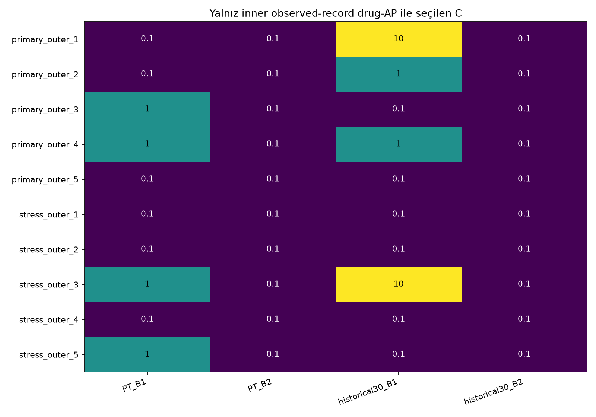
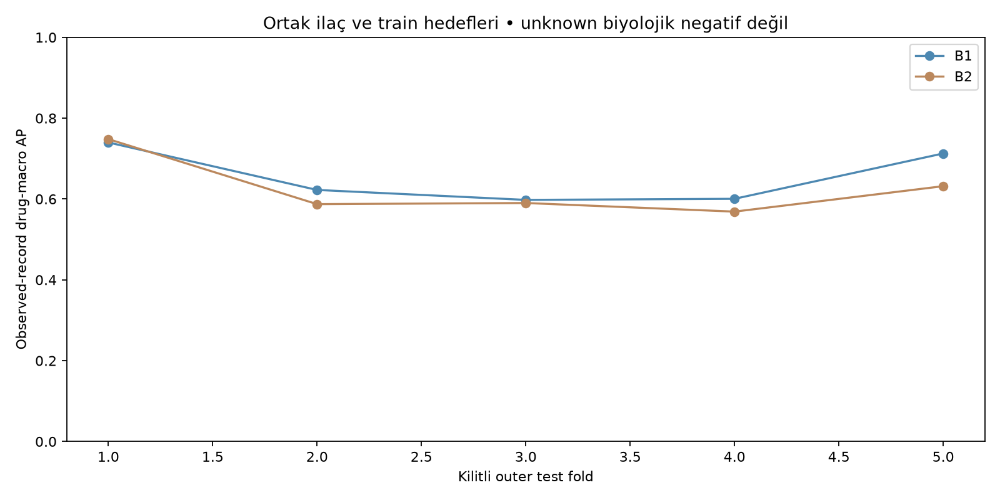
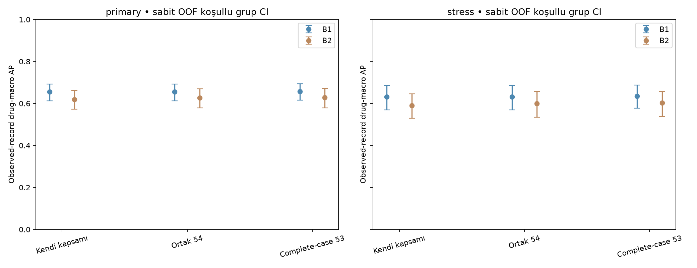
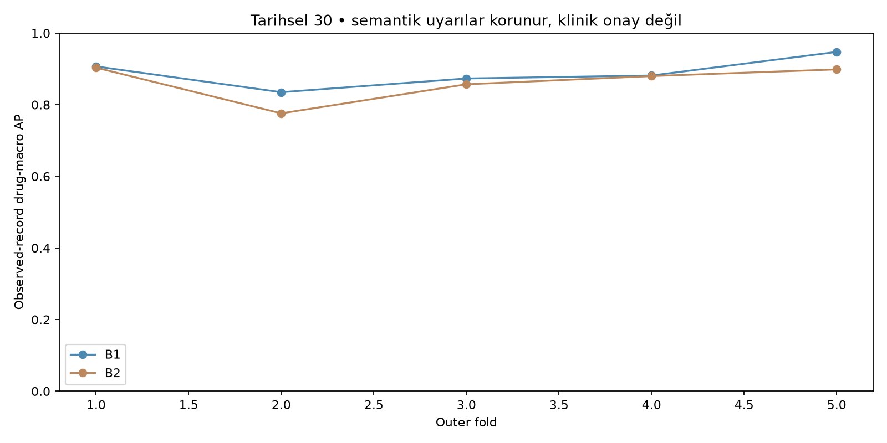
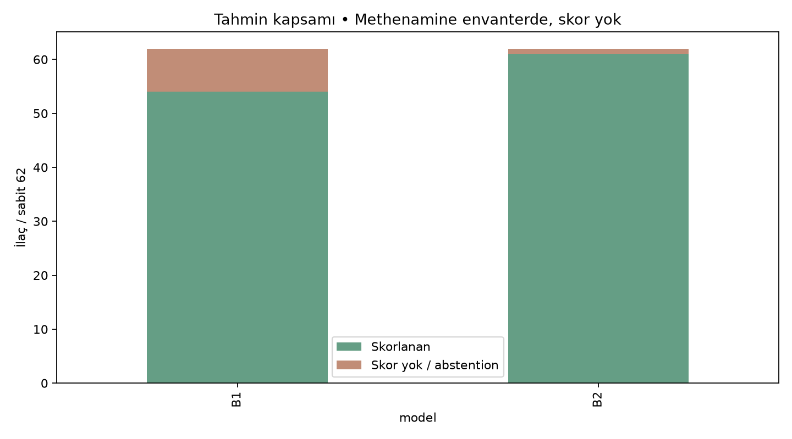
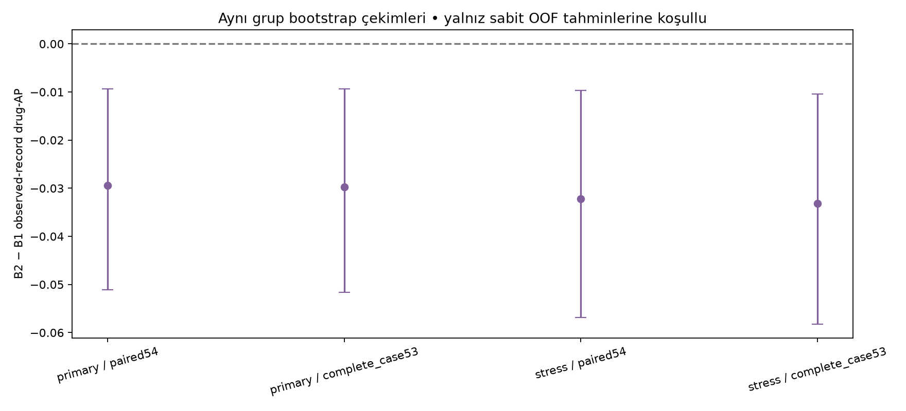

# WP08 — İlk baseline eğitim ve değerlendirme sonuçları

06.11.2026 — **Onaylı ilk B1/B2 L2-LR deneyleri tamamlandı; kullanıcı sonuç onayı bekleniyor. WP09'a geçilmedi.** Bu ek, protokol/hazırlık raporlarını değiştirmez. Yol haritasındaki tüm ek varyantların tamamlandığı iddia edilmez; ATC, RF/MLP, PPI ve context bu ilk eğitime eklenmedi.

## Ana bulgu

Connectivity kilitli dış 5 / iç 3 nested CV'de ortak **54 ilaç ve ortak train hedefleri** üzerinde PT drug-macro **observed-label AP**: B1 **0,6556** (%95 koşullu grup CI 0,6131–0,6920), B2 **0,6262** (0,5792–0,6701). Paired B2−B1 **−0,0294** (−0,0511–−0,0093). Bu ilk protokolde protein rol özetleri ana sıralama ölçüsünü artırmadı. Sonuca göre C/sözlük/seed/özellikler değiştirilmedi.

**Bunlar klinik bireysel yan etki riskleri değildir.** `s=1` kaynakta gözlenen ilişki, `s=0` kayıt yokluğudur. Unknown doğrulanmış biyolojik negatif sayılmaz. Binary observed-record proxy eğitimi kullanıcı tarafından bu anlamıyla onaylandı; gerçek negatif, klinik özgüllük veya kalibrasyon doğrulaması yapılmadı.

## Sabit girdiler ve önceki çıktıların bütünlüğü

Önceki **483 proje dosyası** ve hazırlık dosyalarının tümü hash ile aynı kaldı. Eski WP00–WP07, önceki WP08 rapor/notebook/testleri, v1 split/eligibility/dönüşüm/sözlük/feature/graf dosyaları korunmuştur. Hazırlık dosyasındaki geçmiş `training_authorized=False` kaydı ezilmedi; yeni kullanıcı onayı ayrı `user_authorization.json` ile belgelendi. `run_status.md` güncel kayıt olarak manifest dışındadır.

Kilitli v1 split tanımı SHA-256: `9872adf0168ad3ab377994fc346dc3eb553338e68109b9b1cf27ec966ef4bd65`. Üyelik CSV/hash'leri değişmedi. Seed **20261106**, tek ana ve tek önceden tanımlı stres protokolü. Gerçek train/validation/test ve yapısal grup listeleri hazırlıktaki dosyalardır; kopyası yeniden seçilmedi.

Ham XML/SIDER/STRING yeniden taranmadı; yeni veri/API/paket kurulumu yok. Kaynak sürümleri önceki provenanstan gelir: DrugBank XML 5.1 / 2026-01-04 export, SIDER 4.1. Bu eğitimde STRING/PPI kullanılmadı. Eğitim yalnız kayıtlı prepared input ve kaynak pozitif tablolarıyla yapıldı. WP07 `.pt` veya eski V6 model kodu kullanılmadı.

## Öğrenme görevi, modeller ve fit sınırı

B1 6 alan (5 clean kimya+maske), B2 234 alan (5 kimya+4 rol×56 dizi özeti+5 maske). Target/enzyme/transporter/carrier ayrı; ID/PT/kategori/sıklık/kalite_skoru/STRING skoru model girdisi değil. Maskeli nötr blok, eksik kaynak değeri gerçek sıfır olmuş gibi yorumlanmaz. Kaynak sekiz QC ve protein eksikliği korunur; 62 ilaç envanterde kalır.

PT başına onaylı L2 lojistik regresyon: liblinear, l1_ratio=0, class_weight=None, tol=1e-8, max_iter=10000, seed=20261106; intercept scaling=1. Liblinear'ın sentetik intercept parametresi de düzenlileştirmeye tabidir. Sabit seçenekler eğitimden önce run_config'e kaydedildi. Sklearn 1.9.0, NumPy 2.4.6, SciPy 1.17.1; CPU threadpool 1. Gerçek learned preprocessing yeniden fit edilmedi; her context'in v1 dönüşümü aynen kullanıldı.

Her model yalnız kendi train ID'leri∩input eligibility satırlarına fit edildi. Protein dönüşümü yalnız train-linked benzersiz accession, kimya dönüşümü yalnız QC-onaylı train ilaçlarıyla daha önce hazırlanmıştı. Test ilacı query olarak yalnız etiketsiz inputunu verir; train grafı/dönüşüm kaynaklarına girmez. Train-only graf bundle'ı hash ile doğrulandı; LR baselineları onun PPI/mesaj geçişini kullandığını iddia etmez, rol özetleri hazırlanmış kaynaktan gelir.

## İç seçim: değişen PT kapsamı nasıl karşılaştırıldı?

Her inner train'de kendi 5 pozitif kullanılabilir ilaç / 2 bağımsız grup sözlüğü kullanılır. Üç inner foldun sözlükleri değişebilir; dış test sözlük/parametre seçiminde görülmez. **Aynı inner fold içindeki bütün C adayları aynı validation ilaçları ve C'den bağımsız hedef kapsamıyla** skorlanır; başarılı fit sınıflarının C'ler arası kesişimi kullanılır. Fit başarısızlığı olsaydı bu dışlamalar kayıtlı olacaktı; gözlenen hata/yakınsama sorunu yoktur. Tek proxy sonucu nedeniyle fit edilemeyen sınıflarda olasılık fallback'i yoktur.

C={0.1,1,10}, aynı inner fold kapsamı bütün adaylara ortaktır. NA fold-drug AP sıfır yapılmaz; bütün C'lerde geçerli ortak foldların **eşit fold ağırlıklı ortalaması** alınır. Bu, üç foldun aynı sabit hedef görevini ölçtüğü iddiası değildir; train destek kuralına koşullu folda özgü sıralama görevlerinin önceden tanımlı seçim özetidir. Coverage signature her C satırında saklandı. Eşitlik toleransı 1e-12; küçük C. Bütün seçimlerde üç inner fold da geçerliydi.

| outer_fold | family | model | selected_C | valid_inner_folds |
|---|---|---|---|---|
| 1 | PT | B1 | 0.1000 | 3 |
| 1 | PT | B2 | 0.1000 | 3 |
| 1 | historical30 | B1 | 10.0000 | 3 |
| 1 | historical30 | B2 | 0.1000 | 3 |
| 2 | PT | B1 | 0.1000 | 3 |
| 2 | PT | B2 | 0.1000 | 3 |
| 2 | historical30 | B1 | 1.0000 | 3 |
| 2 | historical30 | B2 | 0.1000 | 3 |
| 3 | PT | B1 | 1.0000 | 3 |
| 3 | PT | B2 | 0.1000 | 3 |
| 3 | historical30 | B1 | 0.1000 | 3 |
| 3 | historical30 | B2 | 0.1000 | 3 |
| 4 | PT | B1 | 1.0000 | 3 |
| 4 | PT | B2 | 0.1000 | 3 |
| 4 | historical30 | B1 | 1.0000 | 3 |
| 4 | historical30 | B2 | 0.1000 | 3 |
| 5 | PT | B1 | 0.1000 | 3 |
| 5 | PT | B2 | 0.1000 | 3 |
| 5 | historical30 | B1 | 0.1000 | 3 |
| 5 | historical30 | B2 | 0.1000 | 3 |

**Yorum:** B2 ana PT'de beş foldun tamamında C=0,1; B1 0,1/0,1/1/1/0,1 seçti. C aralığı sonuçtan sonra genişletilmedi. Stres protokolünün seçimleri ayrı tablodadır; daha iyi protokol seçmek için outer sonuçlar kullanılmadı. `selection_complete_before_outer_scoring.json`, C seçim dosyasının outer scoring öncesi hash'ini saklar; değerlendirme sonrasında da aynıdır.

## Outer modeller ve başarısız/uygulanamayan fitler

360 inner aday + 40 outer son model koleksiyonu = **400 parametre bundle'ı**. Fit izi **47031 aday tek-hedef fit durumu** içerir: **40611 inner + 6133 outer = 46744** başarılı classifier; **279 inner + 8 outer** tek proxy sonuç nedeniyle eğitilmedi. Bunlar benzersiz ilaç/etiket sayıları değildir; aynı hedef farklı fold/C/modelde tekrar yer alır. Yakınsama veya fit hatası gözlenmedi. Tam 62 üzerinde ayrıca deployment modeli eğitilmedi.

| context | family | model | class_id | observed_train_positive | train_unknown_NOT_verified_negative | status |
|---|---|---|---|---|---|---|
| primary_o03_final | PT | B1 | C0027497 | 43 | 0 | NA_single_proxy_outcome |
| primary_o03_final | PT | B2 | C0027497 | 50 | 0 | NA_single_proxy_outcome |
| primary_o03_final | historical30 | B1 | Mide bulantısı | 43 | 0 | NA_single_proxy_outcome |
| primary_o03_final | historical30 | B2 | Mide bulantısı | 50 | 0 | NA_single_proxy_outcome |
| stress_o05_final | PT | B1 | C0027497 | 43 | 0 | NA_single_proxy_outcome |
| stress_o05_final | PT | B2 | C0027497 | 49 | 0 | NA_single_proxy_outcome |
| stress_o05_final | historical30 | B1 | Mide bulantısı | 43 | 0 | NA_single_proxy_outcome |
| stress_o05_final | historical30 | B2 | Mide bulantısı | 49 | 0 | NA_single_proxy_outcome |

Örnek: C0027497 / tarihsel Mide bulantısı bazı outer train'lerde bütün kullanılabilir ilaçlarda kayıtlıdır; unknown örneği yoktur. Bu hedeflerde classifier fit edilmedi; “herkeste risk 1” veya train önselinden tahmin üretilmedi. Hedefin NA durumu saklandı.

**Yorum:** Ortak kapsamda fold farkları gerçek test ilaçları, label yoğunluğu ve train'den türeyen hedef kapsamlarını yansıtır. İyi foldlar seçilip kötüleri atılmadı. Foldlar birbirinden bağımsız beş tekrar gibi t-test/CI için kullanılmadı; training setleri örtüşür.

## Ana protokol, ortak kapsam: bütün ölçümler

| model | metric | estimate | CI95_low | CI95_high | valid_bootstrap_replicates |
|---|---|---|---|---|---|
| B1 | drug_macro_AP | 0.6556 | 0.6131 | 0.6920 | 1000 |
| B1 | micro_AP | 0.5422 | 0.4827 | 0.6118 | 1000 |
| B1 | class_macro_AP | 0.3152 | 0.2997 | 0.3947 | 1000 |
| B1 | micro_AUROC | 0.7269 | 0.6921 | 0.7652 | 1000 |
| B1 | class_macro_AUROC | 0.4814 | 0.4283 | 0.5330 | 1000 |
| B2 | drug_macro_AP | 0.6262 | 0.5792 | 0.6701 | 1000 |
| B2 | micro_AP | 0.5323 | 0.4755 | 0.5953 | 1000 |
| B2 | class_macro_AP | 0.3489 | 0.3334 | 0.4326 | 1000 |
| B2 | micro_AUROC | 0.7145 | 0.6767 | 0.7545 | 1000 |
| B2 | class_macro_AUROC | 0.5431 | 0.4999 | 0.5897 | 1000 |

AP burada **average precision**: her skor eşiğindeki precision, recall artışıyla ağırlıklandırılır; trapez PR-AUC değildir. Drug-macro AP her ilaçta bilinen kayıtların PT adaylarına göre sıralamasını, micro AP bütün skorlanan OOF çiftlerini, class-macro AP/AUROC her hedefin skorlanabildiği ilaçlardaki kaydı ayırt etmeyi özetler. Unknown yalnız onaylı proxy referansıdır, gerçek negatif değil.

**Metrikler aynı bilimsel soruyu vurgulamıyor:** Ortak kapsamda B1 class-macro AUROC **0,4814** (CI 0,4283–0,5330), B2 **0,5431** (0,4999–0,5897). B2'nin sınıf bazlı bazı ikincil değerleri daha yüksekken birincil drug-macro AP'si daha düşüktür. Yüksek drug-AP, her PT için yeni ilaç ayırt etme gücü veya klinik güvenilirlik kanıtı değildir; sık etiketlerin sıralanması katkıda bulunabilir. Bu onaylı ilk deneyde B0/sıklık önseli baseline eklenmedi; dolayısıyla onun aşıldığı da iddia edilmez.

## Kendi kapsamı, paired54 ve complete-case53

| protocol | scope | model | estimate | CI95_low | CI95_high |
|---|---|---|---|---|---|
| primary | own | B1 | 0.6556 | 0.6131 | 0.6920 |
| primary | own | B2 | 0.6184 | 0.5724 | 0.6614 |
| primary | paired54 | B1 | 0.6556 | 0.6131 | 0.6920 |
| primary | paired54 | B2 | 0.6262 | 0.5792 | 0.6701 |
| primary | complete_case53 | B1 | 0.6578 | 0.6154 | 0.6944 |
| primary | complete_case53 | B2 | 0.6280 | 0.5794 | 0.6712 |
| stress | own | B1 | 0.6319 | 0.5700 | 0.6863 |
| stress | own | B2 | 0.5899 | 0.5303 | 0.6467 |
| stress | paired54 | B1 | 0.6319 | 0.5700 | 0.6863 |
| stress | paired54 | B2 | 0.5997 | 0.5341 | 0.6577 |
| stress | complete_case53 | B1 | 0.6356 | 0.5769 | 0.6868 |
| stress | complete_case53 | B2 | 0.6024 | 0.5374 | 0.6579 |

**Yorum:** Kendi kapsamlarında B1 54, B2 61 ilaç skorlar; own değerler doğrudan eşleştirilmiş karşılaştırma değildir. `paired54` aynı 54 input-uygun ilaç ve aynı outer-train'de gerçekten fit edilmiş ortak hedeflere göre maske uygular; yalnız testteki outcome'a göre hedef seçmez. Bir modelde fit edilemeyen sınıf paired kapsamdan iki tarafta birlikte çıkar. `complete_case53`, aynı eğitilmiş modellerin aynı ana splitlerdeki test alt kümesi duyarlılığıdır; 53 üzerinde yeniden eğitilmiş complete-case deneyi olarak sunulmaz.

| scope | model | scored_drugs | drug_AP_evaluable | scored_pairs | observed_positive_scored | unknown_scored_NOT_verified_negative | out_of_scored_vocab_positive | class_AP_AUROC_evaluable | class_metric_NA |
|---|---|---|---|---|---|---|---|---|---|
| own | B1 | 54 | 54 | 13964 | 3820 | 10144 | 1685 | 256 | 50 |
| own | B2 | 61 | 61 | 18004 | 4576 | 13428 | 1829 | 293 | 57 |
| paired54 | B1 | 54 | 54 | 13964 | 3820 | 10144 | 1685 | 256 | 50 |
| paired54 | B2 | 54 | 54 | 13964 | 3820 | 10144 | 1685 | 256 | 50 |
| complete_case53 | B1 | 53 | 53 | 13694 | 3730 | 9964 | 1617 | 256 | 50 |
| complete_case53 | B2 | 53 | 53 | 13694 | 3730 | 9964 | 1617 | 256 | 50 |

Ana paired54'te **13964** skorlanmış OOF çiftinin **3820**'si gözlenen pozitif, **10144**'ü unknown'dır. Bu ilaçların kaynak PT pozitifleri 5505; **1685** pozitif bu folda özgü skorlanan hedef kapsamının dışında kalmıştır. Bunlar negatifleştirilmedi veya yok sayılan başarılar gibi sayılmadı; coverage raporlandı. Pooled ortak union 306 CUI'de skor var; 256 sınıfta iki proxy outcome ile class metriği hesaplanabilir, 50'si NA.

Farklı outer foldlarda farklı train sözlükleri olduğundan pooled micro/class özetleri **ragged OOF kapsamına koşulludur**. Seçilmemiş/fit edilememiş drug–PT çifti tabloya 0 skor/negatif olarak eklenmez. Bu özet sabit 1061 PT'nin tümünde başarım iddiası değildir; fold kapsamı ve positive/unknown sayıları ayrı sunulur.

## Tarihsel 30: ayrı, semantik uyarılı karşılaştırma

| protocol | model | estimate | CI95_low | CI95_high |
|---|---|---|---|---|
| primary | B1 | 0.8892 | 0.8552 | 0.9188 |
| primary | B2 | 0.8627 | 0.8206 | 0.8985 |
| stress | B1 | 0.8552 | 0.7837 | 0.9086 |
| stress | B2 | 0.8424 | 0.7863 | 0.8921 |

**Yorum:** Ana ortak kapsam drug-AP B1 0,8892, B2 0,8627; bu yoğun/seçilmiş farklı etiket uzayıdır. PT'ye göre yüksek sayı daha iyi yöntem veya klinik kategori geçerliliği kanıtı değildir. Renal impairment→Nefrotoksisite daraltması, Loss of consciousness/Syncope birleşmesi ve diğer önceki uyarılar korunur. Yeni kategori merge/drop yapılmadı.

Sulfanilamide tarihsel 30 içinde pozitif taşımadığı için skoru olsa da drug-AP NA'dır. Ana own kapsamda tarihsel drug-AP hesaplanabilir ilaç sayısı B1 53, B2 60; paired54'te 53, complete-case53'te 52'dir. AP'nin destek yokken üretilen yapay sıfırı kullanılmadı. Bütün class/drug NA nedenleri CSV'dedir.

## Abstention ve değişmeyen modaliteler

**Yorum:** 62 ID korunur. Methenamine iki modelde de `ABSTAIN_no_input` ve hiç skor satırı yoktur. B1 sekiz kimya inceleme molekülünde skor vermez; B2 protein dalıyla yedi ek ilaçta skor verebilir. Tobramycin kimya dalıyla kalır. Ortak 54 ile complete-case 53 farklıdır: Tobramycin protein olmadan iki modelin input kapsamına dahildir. Bu input kapsam artışı, B2'nin aynı kapsamdaki performans artışı değildir. Önceki sekiz QC ve iki protein eksiği değiştirilmedi.

## Grup düzeyinde belirsizlik ve eşleştirilmiş fark

1000 percentile bootstrap; seed=20261106+9000+protokol_indeksi. Ana protokolde **61 connectivity grubu**, streste **40 yapı grubu** birlikte örneklenir; Levofloxacin/Ofloxacin aynı çoğaltma ağırlığını taşır. Paired farklar B1/B2 için aynı grup çekimleriyle hesaplanır. İlaç–PT çiftleri veya beş fold bağımsız birim gibi bootstrap edilmedi. Valid replika eşiği 800 olarak eğitimden önce kaydedildi; bu çalışmadaki aggregate aralıkların hepsi 1000 geçerli replika üretti.

| protocol | scope | B2_minus_B1 | CI95_low | CI95_high | valid_bootstrap_replicates |
|---|---|---|---|---|---|
| primary | paired54 | -0.0294 | -0.0511 | -0.0093 | 1000 |
| primary | complete_case53 | -0.0298 | -0.0516 | -0.0093 | 1000 |
| stress | paired54 | -0.0322 | -0.0569 | -0.0096 | 1000 |
| stress | complete_case53 | -0.0332 | -0.0582 | -0.0104 | 1000 |

**Yorum:** Ana ve stres PT paired drug-AP farkları bu sabit deneyde B2 aleyhinedir. Aralıklar **sabit OOF tahminlerine koşullu örnekleme belirsizliğidir**; bütün model/inner seçim sürecini bootstrap içinde yeniden eğitmedik. Training setlerinin örtüşmesinden ve önceki keşiften gelen tüm belirsizliği kapsamaz; bağımsız dış doğrulama veya genel nedensel üstünlük çıkarımı değildir. Class-macro bootstrap'ta destek kaybolan sınıflar o replikada NA kalır; sınıf kapsamı değişebildiğinden aralıkların yorumu ayrıca sınırlıdır.

Seyrek per-class veya tek outer-fold düzeyinde ayrı CI üretilmedi; `CI_status`/`CI_NA_reason` bunun nedenini yazar. Aggregate metriklerde CI NA oluşmadı; metrik değerinin hesaplanamadığı drug/class'larda destek nedeni saklandı. Tam tekrar eğitim belirsizliği bu ilk çalışmanın raporlanmış sınırıdır.

## Model uyumu, test ve tekrar üretim

**28/28 test geçti; 7,943 saniye.** Testler: önceki/hazırlık/model SHA'ları; gerçek frozen split; inner-only C'nin bağımsız tekrar hesabı ve tie/NA kuralı; 400 bundle'da exact train fit IDs/dönüşüm kaynağı; heldout query/label/value mutasyonunda model ve C değişmezliği; gerçek tek-hedef tekrar fit'inin aynı parametreyi vermesi; kayıtlı parametrelerden skor yeniden üretimi; abstention/62 ID; kaynağa tam proxy label eşitliği; ağırlıklı ve bağlı skor AP/AUROC'nin sklearn ile karşılaştırması; structural group bootstrap; paired scope eşitliği; coverage/NA/sürüm/no-extra-variant ve notebook figürleri. Testlerde sadece küçük kontrollü yeniden fit'ler yapıldı; ana eğitimin seçimini değiştirmedi ve model artefaktlarını ezmedi.

[Notebook](../notebooks/WP08_baseline_results.ipynb) **8 çalıştırılmış kod hücresi, 6 gömülü PNG** ve gerçek sonuç tabloları içerir; stderr/hata yok. Altı PNG görsel olarak incelendi. [İnteraktif ilaç-AP HTML](figures/WP08/baseline_v1/per_drug_proxy_AP_interactive.html) çevrimdışıdır; canlı tarayıcı etkileşimi test edilmedi.

Her bundle'da seed/C/sürüm, sklearn sürümü, fit drug IDs, train preprocessing accession/drug kaynakları, özellik sırası, declared/fitted target sözlüğü, gerçek split hash'i ve parametre hash'i bulunur. 800 parametre+metadata dosyası manifestle korunur (yaklaşık 69,5 MB). Parametreler NumPy NPZ/JSON'dur; eski pickle/PyG model kopyası değil. [Model kartı](WP08_BASELINE_MODEL_CARD.md) bilimsel kullanım sınırını açıklar.

| Çıktı | İşlev |
|---|---|
| models/WP08_baseline_v1/*.npz, *.json | Inner aday ve outer final katsayı/intercept, tam fit/seçim/provenans izi |
| selected_C.csv, inner_selection_metrics.csv | Inner-only seçim, her C'nin aynı kapsam hash'i, NA/valid fold sayısı |
| selection_complete_before_outer_scoring.json | Dış test scoring öncesi seçim commit/hash'i |
| oof_predictions.csv, prediction_status_all62.csv | Gerçek OOF proxy skorları/record s ve 62 ilaç için abstention durumu |
| outer_fold_metrics.csv, oof_metrics_with_group_CI.csv | Fold ve koşullu OOF beş metrik/CI |
| paired_B2_minus_B1_group_CI.csv | Aynı drug/target ve grup çekimleriyle paired fark |
| evaluation_coverage.csv, per_drug_metrics.csv, per_class_metrics.csv | Pozitif/unknown/sözlük dışı/NA ve kapsam paydaları |
| class_fit_trace.csv, fit_status_summary.csv | Başarılı/uygulanamayan bütün aday fit'ler |
| model_fit_provenance.csv, fold_train_validation_test_scope.csv | Fit drug/protein kaynak ve train/validation/test kapsamı |
| bootstrap_design.csv, run_config.json | Önceden sabit yöntem, seed/rep/unit/CI sınırı |
| user_authorization.json, environment.json | Yeni kullanıcı onayı ve sürüm/ortam kaydı |
| preparation_input_manifest.json, prior_outputs_hashes.json, model_artifact_manifest.json | Hazırlığın ve eski çıktıların korunması, modellerin hash'i |
| test_results.txt, artifact_validation.json | 28 test ve yürütülmüş notebook/görsel kontrolü |

QA `reports/qa/WP08/baseline_v1/`, görseller `reports/figures/WP08/baseline_v1/` altındadır. Kod modülleri `wp08_baseline_train.py`, `wp08_baseline_metrics.py`, `wp08_baseline_evaluate.py`, `wp08_baseline_audit.py`, `wp08_baseline_notebook.py`, `wp08_baseline_report.py`; test `tests/test_wp08_baseline.py`.

Ana training producer `training_complete.json` varsa yeniden fit'i reddeder; sonuç görüldükten sonra aynı sürümü yeniden ayarlamaya karşı korumadır. Sadece sonuç görüntülemek için notebook üreticisi yeterlidir. Değerlendirme yeniden hesaplanabilir, hiçbir model refit etmez. Tekrar doğrulamada `python -m unittest discover -s tests -p test_wp08_baseline.py -v` çıktısı QA'ya kaydedilip rapor yenilenir. Yeni deney ancak gerekçeli/onaylı ayrı sürümle yapılmalıdır.

## Resmi yöntem kaynakları

[Sklearn LogisticRegression](https://scikit-learn.org/stable/modules/generated/sklearn.linear_model.LogisticRegression.html), [average precision](https://scikit-learn.org/stable/modules/generated/sklearn.metrics.average_precision_score.html) ve [AUROC](https://scikit-learn.org/stable/modules/generated/sklearn.metrics.roc_auc_score.html) API tanımları doğrulandı. Ağırlıklı bootstrap hesaplarının bağlı skor davranışı da mevcut sklearn ile test edildi. Harici biyolojik kaynak eklenmedi.

**İlk WP08 baseline sonuçları tamamlandı. Onaysız varyantlara veya WP09'a geçilmedi; sonuç onayı bekleniyor.**
