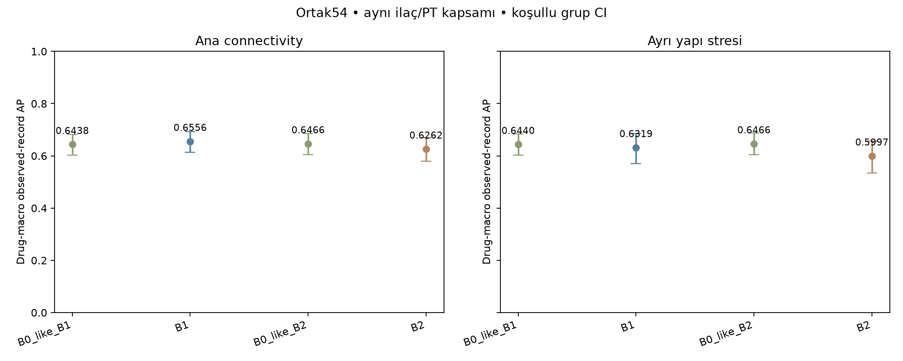
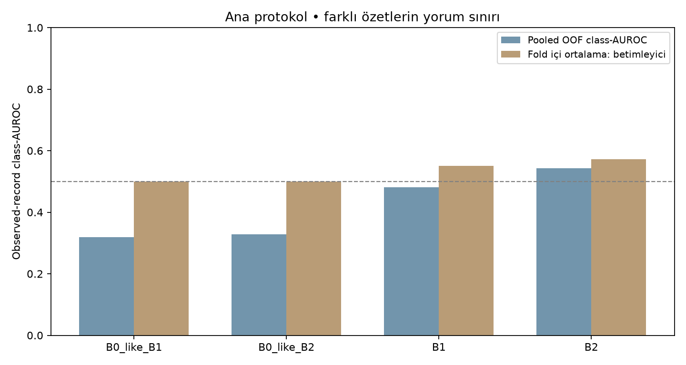
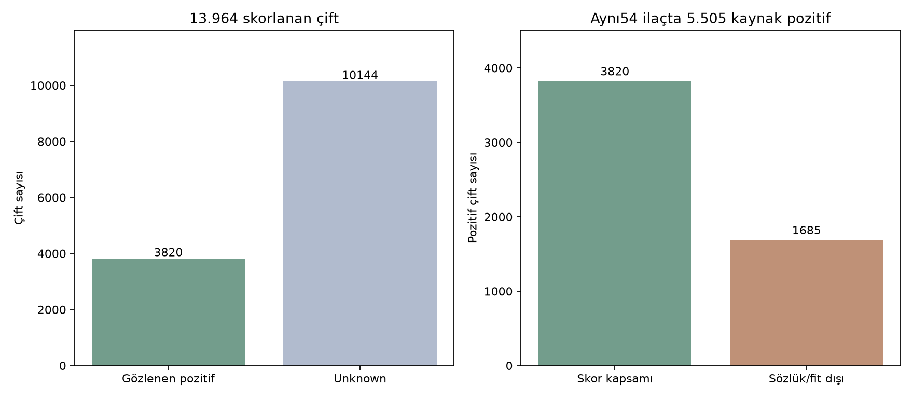

# WP08 — İlk deney fazının bilimsel kapanışı

06.11.2026. **Kullanıcı kapsam kararı: ilk deney fazı B0/B1/B2 ile tamamlandı ve kapatıldı. WP09 uygulaması/eğitimi için onay bekleniyor.**

## 1. Kapsam kararı ve değişmeyen sonuç

Kullanıcı B0_frequency_reference_v1 sonuçlarını kabul etti. Ana ortak kapsamda B0_like_B1 **0,6438**, B1 **0,6556**, B0_like_B2 **0,6466**, B2 **0,6262** drug-macro observed-record AP değerleri korunur. B1−B0 farkı küçüktür ve koşullu CI sıfırı içerir. B2, birincil drug-macro AP'de B0 ve B1'e üstünlük göstermedi.

Bu ilk deney fazının kapanışı, ROADMAP'teki bütün olası model varyantlarının uygulanmış olduğu anlamına gelmez. **ATC, Random Forest, kimya MLP ve protein-mean MLP yapılmadı; kullanıcı kararıyla ilk faz kapsamı dışında ertelendi.** ROADMAP_V7.md ve önceki raporlar değiştirilmedi. Yeni model araması, özellik/seed/split/hiperparametre ayarı yapılmadı. Önceki raporlardaki açık/onay bekliyor kayıtları ilgili tarihsel aşamaya aittir; güncel karar bu rapor ve run_status.md'dir.

| task | status | explanation |
| --- | --- | --- |
| B0 train-frequency reference | COMPLETED_ACCEPTED | Sonuç sonrası keşifsel; sabit v1 skorları |
| B1 5 kimya + maske L2-LR | COMPLETED_ACCEPTED | Mevcut seçilmiş C ve sonuçlar aynen |
| B2 kimya + 4 rol protein özeti + maskeler L2-LR | COMPLETED_ACCEPTED | 61 input kapsamı; ortak54 drug-AP üstünlüğü yok |
| Drug-disjoint split / train-only dönüşüm / train PT sözlüğü | COMPLETED_ACCEPTED | v1 kilidi; outer5/inner3 ve ayrı stres |
| AP/AUROC, NA, coverage, koşullu grup bootstrap ve sızıntı testleri | COMPLETED_ACCEPTED | Gerçek-negatif/klinik doğrulama değildir |
| ATC varyantı | DEFERRED_OUTSIDE_PHASE1 | ROADMAPta korunur; yapılmadı, tamamlandı sayılmaz |
| Random Forest | DEFERRED_OUTSIDE_PHASE1 | ROADMAPta korunur; sonuç sonrası arama yapılmadı |
| Kimya MLP | DEFERRED_OUTSIDE_PHASE1 | ROADMAPta korunur; yapılmadı |
| Protein-mean MLP | DEFERRED_OUTSIDE_PHASE1 | B2 LR bunun yerine geçmiş sayılmaz; yapılmadı |
| Gerçek PU loss / kaynak seçim önseli modeli | NOT_IMPLEMENTED_NOT_CLAIMED | Mevcut çalışma observed-record proxy; ek yöntem ayrı kapsam kararı |
| Tarihsel V6 metriklerinin doğrulanması | NOT_CLAIMED | Farklı kohort ve etiket uzayı; yeniden doğrulandı denemez |
| WP09 encoder/forward/ablation | PLAN_ONLY_AWAITING_AUTHORIZATION | Model, eğitim ve ablation sonucu yok |

## 2. B0/B1/B2 hangi kapsamda karşılaştırıldı?

62 ilaç envanterde kalır. B1 kimya girdisiyle 54, B2 maskeli kimya ve dört protein rolüyle 61 ilacı skorlar. B0 kişiselleştirilmemiş kayıt sıklığı referansıdır ve biyolojik girdi istemeden 62 ilaca verilebilir. Methenamine B0 nüfus referansında yer alabilir; B1/B2'nin girdisiz abstention kararı değişmez. B0 ile bu boşluk doldurulmuş model tahmini üretilmedi.

Birincil paired54 analizinde aynı dış fold, aynı test ilaç ID'leri ve aynı skorlanabilir PT anahtarları kullanıldı. B0_like_B1 yalnız B1-eligible train ilaçlarından; B0_like_B2 yalnız B2-eligible train ilaçlarından sıklık hesaplar. Bunlar aynı skor formülüne sahip fakat farklı train paydalı iki sabit referanstır. B0_all_train bütün train ilaçlarını kullanır ve ayrı duyarlılık referansıdır; iyi sonuç veren payda seçilmedi. Own kapsamları veya B0_all62 sonucu ortak54 karşılaştırmasıyla karıştırılmaz.

Hedef sözlükleri her ilgili train'de ≥5 pozitif kullanılabilir ilaç/≥2 bağımsız grup kuralıyla kilitlenmiştir. Inner train sözlüğü kendi kaynağındandır. Tek proxy sonuçlu train PT'sinde classifier/fallback yok; NA korunur. Complete-case53, aynı fit edilmiş modellerin değerlendirme alt kümesidir; yeni eğitim veya ana kohort değildir.

| protocol | model | estimate | CI95_low | CI95_high |
| --- | --- | --- | --- | --- |
| primary | B1 | 0.6556 | 0.6131 | 0.6920 |
| primary | B2 | 0.6262 | 0.5792 | 0.6701 |
| primary | B0_all_train | 0.6465 | 0.6040 | 0.6852 |
| primary | B0_like_B1 | 0.6438 | 0.6021 | 0.6820 |
| primary | B0_like_B2 | 0.6466 | 0.6044 | 0.6853 |
| stress | B1 | 0.6319 | 0.5700 | 0.6863 |
| stress | B2 | 0.5997 | 0.5341 | 0.6577 |
| stress | B0_all_train | 0.6472 | 0.6050 | 0.6874 |
| stress | B0_like_B1 | 0.6440 | 0.6029 | 0.6844 |
| stress | B0_like_B2 | 0.6466 | 0.6045 | 0.6871 |

| protocol | first | reference | first_minus_reference | CI95_low | CI95_high |
| --- | --- | --- | --- | --- | --- |
| primary | B1 | B0_like_B1 | 0.0119 | -0.0021 | 0.0274 |
| primary | B2 | B0_like_B2 | -0.0204 | -0.0438 | 0.0032 |
| primary | B2 | B1 | -0.0294 | -0.0511 | -0.0093 |
| stress | B1 | B0_like_B1 | -0.0121 | -0.0412 | 0.0111 |
| stress | B2 | B0_like_B2 | -0.0469 | -0.0769 | -0.0176 |
| stress | B2 | B1 | -0.0322 | -0.0569 | -0.0096 |

**Görsel yorumu:** Her protokolde aynı54 ilaç/PT anahtarları kullanılır. Hata çubukları koşullu grup CI'dır; iki aralığın görsel örtüşmesi yerine üstteki eşleştirilmiş fark tablosu yorumlanmalıdır. Bu grafik tezde nüfus sıklığı referansını aşan ek değerin sınırını gösterir.

## 3. B1'in ek başarısı ve B2'nin geniş kapsamı

Ana ortak54'te B1−B0_like_B1 **+0,0119**, %95 koşullu grup CI **−0,0021–+0,0274**. Bu veri/ölçü altında B1'in sıklık referansı üzerinde ek başarısı henüz belirgin değildir. Eşdeğerlik veya hiç biyolojik sinyal bulunmadığı kanıtlanmış değildir. B0 AP'sinin B1'e yakın olması, sık PT kayıtlarının güçlü bir sıralama referansı olduğunu gösterir; B1 AP'sinin yüzde kaçının frekansla nedensel olarak açıklandığı hesaplanamaz.

B2−B0_like_B2 **−0,0204** (−0,0438–+0,0032), B2−B1 **−0,0294** (−0,0511–−0,0093). B2'nin protein dalıyla yedi ek ilaçta skor üretebilmesi **kapsam kazancıdır**; aynı ilaç/PT kümesinde yüksek AP garantisi değildir. Stres B2−eşleşen B0 **−0,0469** (−0,0769–−0,0176); düşük sonuç korundu.

Olası açıklamalar şunlardır; bu kapanış bunları ayırt eden yeni bir deney yapmadı:

- 62 ilaç gibi küçük bir evrende B2'nin 234 giriş alanı, B1'in 6 alanına göre daha fazla kestirim belirsizliği/regularizasyon gereksinimi taşıyabilir. Bu, eğitim başarısızlığı teşhisi veya C'nin yeniden aranması gerekçesi olarak kullanılmadı.
- Rol bazlı protein ortalaması proteinler arası farkları ve komşuluk biyolojisini kaybedebilir. B2 gerçek PPI mesaj geçişi içermez; sonuç PPI/GiG katkısını sınamaz.
- Farklı organizmalardan target/enzyme/transporter/carrier ilişkileri, insan yan etki kayıt sıralamasıyla farklı bağlantılar taşıyabilir. Eksik modaliteler ve DrugBank ilişki kapsamı da farklı bilgi taşır. Bu olasılıklar kesin neden diye sunulamaz.
- Unknown değerlerin biyolojik negatif olmadığı ve kayıt sıklığı/raporlama mekanizmasının hedefte yer aldığı proxy görevde, biyolojik ek bilgi aynı ilaç içindeki PT sıralamasını iyileştirmeyebilir. Drug-AP ile sınıf bazlı ayrım farklı hedeflerdir.

Protein özelliklerinin biyolojik olarak değersiz olduğu, yeni ağın daha iyi olacağı veya daha geniş input kapsamının klinik fayda verdiği çıkarılamaz.

## 4. Pooled class-AUROC ve fold içi class-AUROC

Drug-macro AP, her ilaç içinde PT sıralamasını; class-AUROC, her PT için ilaç sıralamasını özetler. B2'nin ana pooled class-AUROC'unun B1'e göre yüksek olması bu farklı sıralama yönünü ifade eder; birincil drug-AP kaybını ortadan kaldırmaz.

| model | estimate | descriptive_mean_of_5_fold_class_AUROC |
| --- | --- | --- |
| B1 | 0.4814 | 0.5513 |
| B2 | 0.5431 | 0.5716 |
| B0_all_train | 0.3289 | 0.5000 |
| B0_like_B1 | 0.3188 | 0.5000 |
| B0_like_B2 | 0.3281 | 0.5000 |

**Görsel yorumu:** Aynı skorların iki farklı özeti gösterilir. Fold içi ortalama bir tanıdır; pooled metrik yerine daha iyi görünen sonucu seçmek için kullanılmaz. Tez açısından farklı fold skor ölçeklerinin yorum sınırını görünür kılar.

B0 aynı fold/PT için tüm test ilaçlarına eşit skor verir: pozitif ve unknown birlikteyse fold içi AUROC **0,5**. Farklı foldlarda train frekansı farklı olduğundan pooled OOF sınıf sıralamasında B0 yaklaşık 0,32 görünebilir. Tamamlayıcı train/test frekansları, değişen sözlük ve fold skor ölçekleri pooled ölçüyü etkiler. Bu, test etiketinden skor üretimi değildir; B0'ın ters biyolojik tahmin yaptığı da söylenemez. Benzer nedenle pooled B1/B2 AUROC'u tek bir ortak model/skor ölçeğindeki klinik ayrım gücü diye yorumlanmaz.

Fold içi class-AUROC ortalamaları ana protokolde B1 **0,5513**, B2 **0,5716**; stres protokolünde B1 **0,5722**, B2 **0,5625**. Bunlar sonradan eklenen **betimleyici tanılardır**; foldlar bağımsız tekrar değildir, ortalamalara t-CI/süperiorite testi uygulanmadı. Kilitli metrikler değiştirilmedi veya daha iyi görünen özet seçilmedi.

## 5. 1.685 kapsam dışı pozitif ve 1.061 PT sınırı

Küçük kaynak QA tablosundan yeniden doğrulanan evren **62 ilaç, 1.061 kaynak PT CUI, 6.416 benzersiz gözlenen pozitif çifttir**. Bu 1.061 PT'nin tamamı her train'in destek kuralını sağlamaz.

| scope | scored_drugs | observed_positive_scored | unknown_scored_NOT_verified_negative | out_of_scored_vocab_positive |
| --- | --- | --- | --- | --- |
| own_B1 | 54 | 3820 | 10144 | 1685 |
| own_B2 | 61 | 4576 | 13428 | 1829 |
| paired54 | 54 | 3820 | 10144 | 1685 |
| complete_case53 | 53 | 3730 | 9964 | 1617 |
| B0_all62_reference_ONLY | 62 | 4596 | 13738 | 1820 |

Ana ortak54'te skorlanan **13.964** çiftin **3.820**'si pozitif, **10.144**'ü unknown'dır. Aynı 54 ilaçtaki **5.505** kaynak pozitifin **1.685**'i folda özgü skorlanan sözlük/fit kapsamı dışındadır. Bu 1.685 bütün62'de eksik pozitif sayısı, otomatik yanlış negatif veya gerçek negatif sayısı değildir. Kapsam dışındaki hedeflere skor üretilmedi; tam uzay recall/AP hesaplanmış gibi davranılamaz. **1.061 PT uzayının tamamında performans iddiasında bulunulamaz.**

Ortak54'ün pooled union'unda skorlanan 306 CUI vardır; class metriği 256'da hesaplanabilir, 50'de NA'dır. Bir PT'nin başka foldda yer alması o test ilacında skorlandığı anlamına gelmez. NA/unknown/abstention ve sözlük dışı pozitifler sıfır başarıya dönüştürülmedi. Tarihsel30 semantik uyarılı farklı etiket uzayıdır; yüksek AP'si PT veya klinik kategori doğruluğunun kanıtı değildir.

**Görsel yorumu:** Soldaki payda skorlanan bütün çiftler, sağdaki payda aynı54 ilaçtaki kaynak pozitiflerdir. Farklı paydalar birleştirilmez. Sağdaki kapsam kaybı tam1.061 PT performansı iddiasının neden mümkün olmadığını açıklar.

## 6. Bilimsel iddia sınırları

**Unknown çiftler gerçek negatif değildir.** Binary observed-record proxy model, kaynakta kaydı gözlenen ilişkileri etiketsiz çiftlere göre sıralar. Klinik bireysel yan etki olasılığı, hasta güvenliği doğrulaması, nedensellik, gerçek biyolojik yokluk, özgüllük veya kalibrasyon gösterilmedi. Hasta/olay/payda bilgisiyle bağımsız klinik doğrulama yapılmadı.

**B0 sonuç sonrası keşifsel ektir:** B1/B2 sonuçları görüldükten sonra kararlaştırıldı; B0 formülü ve train nüfus politikası B0 hesabından önce kaydedilmiş olsa da ilk deneyin sonuç-kör önkayıtlı referansı olmaz. Sonraki aynı-split WP09 analizleri de baseline sonuçları görülmüş olduğu için keşifsel kalır.

CI'lar 1.000 eşleştirilmiş yapısal grup bootstrap çekiminden gelir (ana61/stres40 grup). Grup üyeleri birlikte, modeller aynı çekimle değerlendirilir; ilaç–PT çiftleri veya beş fold bağımsız gözlem gibi sayılmaz. Bunlar **sabit OOF skor/frekanslara koşullu CI**'lardır; nested CV yeniden eğitimi, model araması, kaynak yanlılığı ve bağımsız dış kohort belirsizliğini bütünüyle kapsamaz. Genel istatistiksel üstünlük veya bağımsız dış doğrulama kanıtı değildir. Sonuçları gördükten sonra B1/B2'yi yeniden ayarlamadık.

## 7. Yeniden çalıştırılan testler ve veri bütünlüğü

| suite | tests | unittest_seconds | passed |
| --- | --- | --- | --- |
| test_wp08.py | 28 | 15.2660 | True |
| test_wp08_prepare.py | 28 | 14.3870 | True |
| test_wp08_baseline.py | 28 | 7.1880 | True |
| test_wp08_b0.py | 19 | 4.7800 | True |

**Mevcut 103/103 WP08 testi geçti.** Protokol28, hazırlık28, LR28, B0 19. Önceki test logları ezilmedi; yeni loglar bu kapanış dizinindedir. Mevcut baseline unit testleri RAM'de küçük sentetik fit/heldout mutasyonu ve tek sabit bileşen tekrar üretim kontrolü içerir; yeni deney eğitimi, hiperparametre araması veya model/skor dosyasına yazma yapılmadı. Ek **8/8 kapanış sözleşmesi/notebook testi** geçti (6.424 saniye); encoder testi değildir.

Protokol/hazırlık importunda mevcut `torch.jit.script` deprecation uyarısı görüldü; test hatası değildir ve logda korundu. Kapanış için paket/kod sürümü değiştirilmedi.

Yeni snapshot **1369 kabul edilmiş dosya** için içerik eşitliğini doğruladı: model bundle'ları, skorlar, tüm önceki QA/notebook/raporlar, kaynak eşlemeleri, QC ve ROADMAP dahil. Ayrıca dokuz tarihsel girdi/koruma/model manifesti tekrar doğrulandı. Modeller **WP08-observed-record-L2LR-v1**, B0 **B0_frequency_reference_v1**; 400 NPZ +400 JSON bileşen modeli korundu. Hedefler, seçilmiş C ve seed **20261106** aynı kaldı. Tam hash listeleri `accepted_artifacts_sha256.json`, `integrity_audit.json` ve WP09 sözleşmesindedir.

Altı benzersiz büyük ham kaynak için yalnız stat kontrolü yapıldı; erişim/boyut/mtime eşitliği: **True**. Ham içerik yeniden taranmadı/hash alınmadı; bu metadata kontrolü yeni bir tam içerik doğrulaması olarak sunulmaz. Yeniden hesaplanan bütün sayılar mevcut küçük QA çıktılarından gelir. Dış kaynak, API, paket kurulumu veya veri indirme yok.

## 8. WP09 öncesi karşılaştırma sözleşmesi ve topoloji

[WP09 taslak karşılaştırma sözleşmesi](../docs/plan/WP09_COMPARISON_CONTRACT_DRAFT.md) aynı frozen split/hash, proxy, train-only PT ilkesi, train-only dönüşüm, mevcut input/QC/abstention ve paired ilaç–PT kapsamını bağlar. B0/B1/B2 sabit salt okunur referanstır. Outer test ile seçim yapılmaz. Yeni model yalnız onaydan sonra ayrı sürümde kurulabilir; WP07 inceleme grafı veya yerinde değiştirilmiş WP08 grafı kullanılamaz.

Plan: paylaşılan 56 özellikli protein projection + gerçek komşu mesajı + dört ayrı rol readout + maskeli kimya. Aynı mimaride PPI yok / gerçek insan PPI / degree-preserving karıştırılmış PPI zorunlu karşılaştırmadır. Forward'a edge_index argümanı eklemek yeterli değildir: ayırt edici fixture'da kenar/komşu değişimi, trace/gradient, no-PPI, query izolasyonu, taxID, split ve null uygunluğu testleri geçmelidir. **Bu WP09 testleri henüz uygulanmadı veya geçmiş sayılmadı.**

Mevcut küçük WP06 kenar tablosundan, model/graf nesnesi üretmeden yalnız train-linked protein alt kümesi için plan ön kontrolü yapıldı. Aşağıdaki min/max, iki protokolün ilgili bütün inner/outer bağlamları üzerindedir:

| protocol | threshold | minimum_train_human_nodes | maximum_train_human_nodes | minimum_PPI_pairs | maximum_PPI_pairs | maximum_isolates |
| --- | --- | --- | --- | --- | --- | --- |
| primary | 400 | 37 | 59 | 225 | 559 | 2 |
| primary | 700 | 37 | 59 | 70 | 178 | 11 |
| primary | 900 | 37 | 59 | 20 | 78 | 26 |
| stress | 400 | 35 | 61 | 254 | 564 | 2 |
| stress | 700 | 35 | 61 | 90 | 176 | 12 |
| stress | 900 | 35 | 61 | 32 | 76 | 28 |

Bu sayılar full63 insan PPI sayısının her foldta geçerli olmadığını gösterir. Kenar varlığı tahmin katkısı veya topolojik yeterlilik garantisi değildir; WP09 başında gerçek mesaj alma kapsamı yeniden değerlendirilmelidir. 400/700/900 henüz seçilmiş nihai eşik değildir. K12/MG1655 koşullu23 PPI insan ağına katılmaz; özellik eksik80 context yoktur; PPI'sız proteinlerin self/dizi modalitesi korunur.

Eşik, protein evreni/query politikası, kapasite, loss/optimizer/epoch/early-stop, inner karşılaştırılabilirlik, init seed ve karıştırma başarısı/tekrar kuralları **uygulama öncesi kullanıcı onay kapısında** kalır. Onaylanan WP08 ilk faz kapanışı bu seçeneklerin otomatik onayı değildir.

## 9. Kapanış çıktıları ve sonraki durma noktası

- `notebooks/WP08_final_conclusions.ipynb`: mevcut sonuçlardan çalıştırılmış kapanış tabloları ve üç açıklamalı grafik; yeni model yok.
- `reports/figures/WP08/final_closure_v1/`: AP/CI, pooled–fold AUROC ve pozitif/unknown/kapsam dışı dağılımı. Önceki görseller değiştirilmedi.
- `reports/qa/WP08/final_closure_v1/`: kabul edilen sonuçlardan türetilen tablolar, görev durumları, yeni test logları, bütünlük hash'leri ve WP09 plan sözleşmesi/topoloji ön kontrolü.
- Bu rapor bilimsel kapanış ve ertelenenleri; `run_status.md` güncel onay durumunu gösterir. Eski aşama raporları tarihsel kayıt olarak aynen tutulur.

**WP08 ilk deney fazı B0/B1/B2 ile kapatıldı. ROADMAP varyantları silinmedi veya tamamlanmış gösterilmedi; ilk faz dışında ertelendi. WP09 modeli/eğitimi başlatılmadı. WP09 uygulaması için kullanıcı onayı bekleniyor.**
