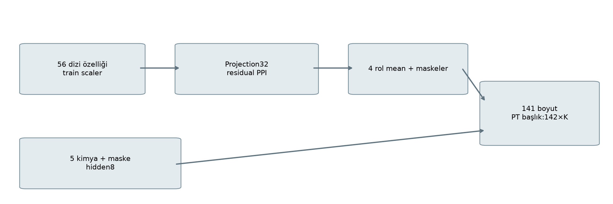
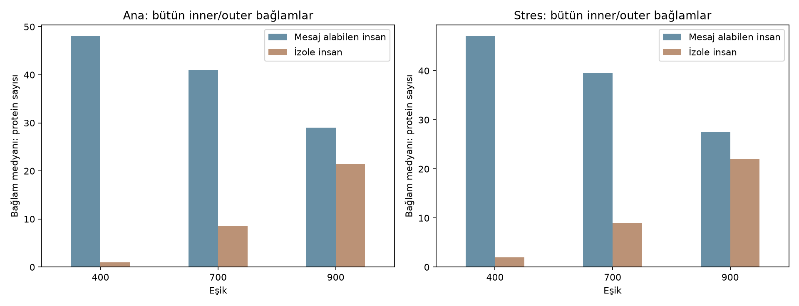
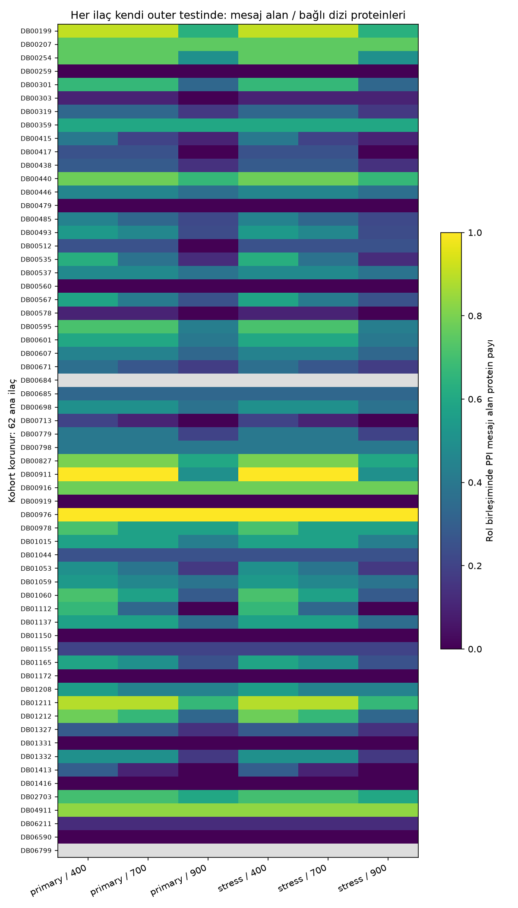
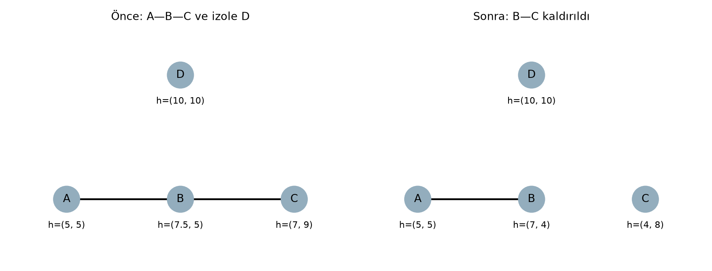
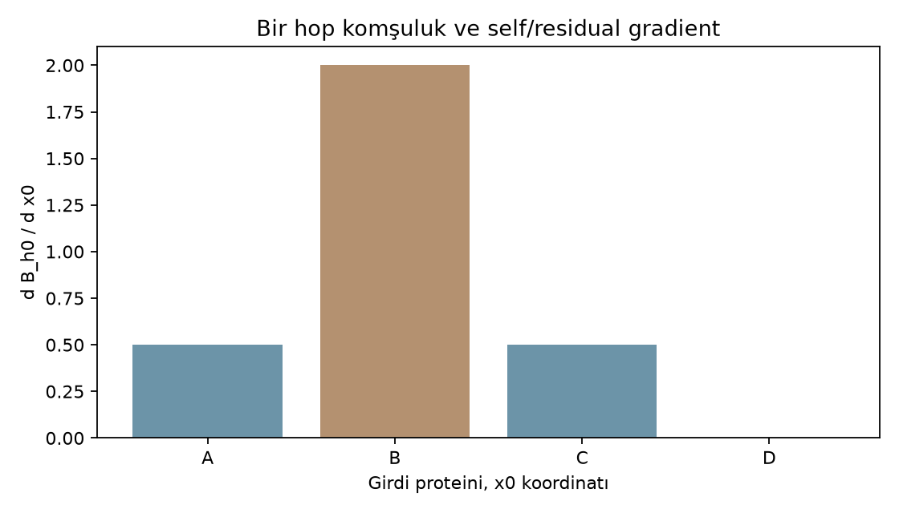
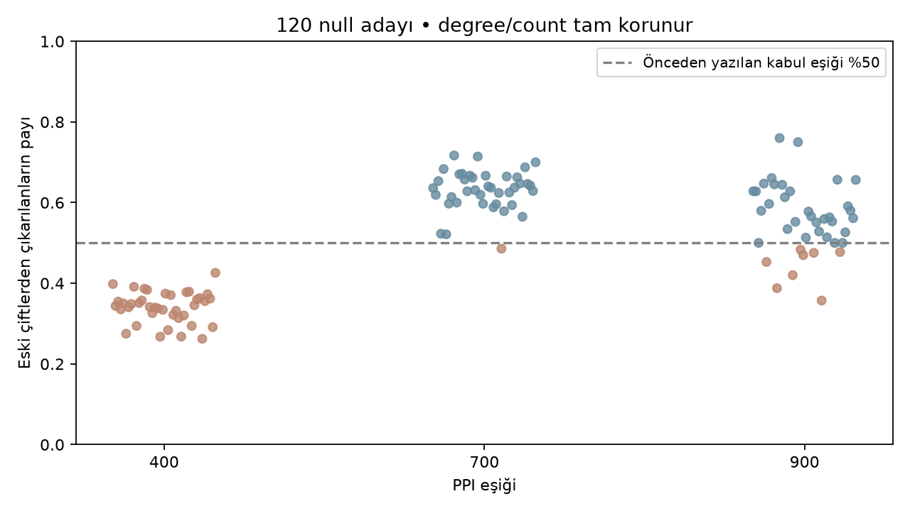
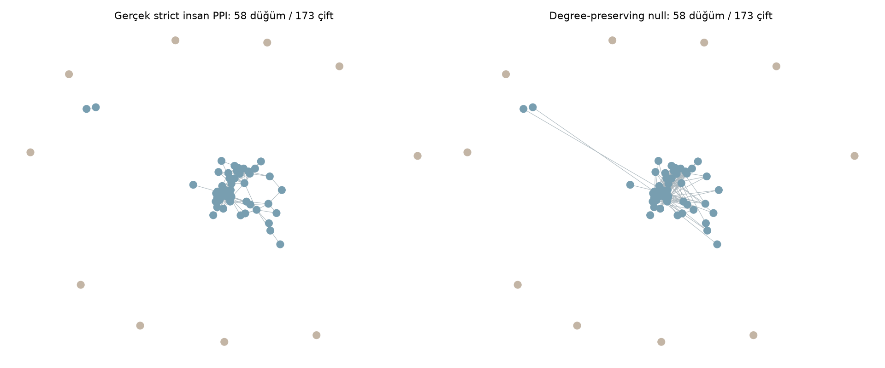

# WP09 — PPI tasarımı, gerçek fold girdileri ve encoder doğrulaması

06.11.2026. **DESIGN_AND_ENCODER_VALIDATION_COMPLETE; AWAITING_SEPARATE_TRAINING_APPROVAL.** Kullanıcı WP08 ilk faz kapanışını kabul etti; bu WP09 aşamasında yalnız tasarım/girdi/encoder doğrulaması yetkilendirildi. GNN fit, optimizer adımı, gerçek PT skoru, AP/AUROC veya ablation performans sonucu üretilmedi.

## 1. Öğrenilen kavram ve kurulan mimari

Protein özelliklerini bağımsız MLP'den geçirmek PPI kullanmak değildir. Yeni modül, önce56 dizi özelliğini32 boyutlu paylaşılan projection'a taşır; ardından **tek residual mean-message katmanı** gerçek PPI edge_index komşularını işler. Dört DrugBank rolü ayrı mean readout alır; maskeli5 kimya özelliği8 boyutlu dalda işlenir. Temsil141 boyut; head hariç3920 parametre, ileride train K PT başlığı142K ek parametre. Gerçek veri probe'unda head yoktur. G_noPPI/G_realPPI/G_shuffledPPI aynı modüllerdir; noPPI gerçekten komşu kenarlarını kaldırır, shuffled açık null kenarları olmadan çağrılamaz.

`z_i=ReLU(Px_i)`, `h_i=z_i+ReLU(Sz_i+M·mean(z_j, j∈N(i)))`. Boş komşulukta mean0; message bias yok. İzole ve insan PPI kapsamı dışındaki dizi proteinleri self/residual yoldadır. Bu encoder, atom grafı/moleküler GNN veya eğitilmiş GiG modeli değildir. Aynı toplam parametre sayısı, noPPI'da kullanılmayan mesaj yolunu aktif hale getirmez; PPI etkisi ileride aynı mimarinin ablation'ıyla sınanacaktır.

**Yorum:** Kaynak dizi/protein komşuluğu, dört rol ve kimya dalları farklı bilgi taşır. Az sayıda train ilaçta bu kapasitenin bile overfit riski vardır; projection/katman boyutları başarı garantisi değildir.

## 2. Kaynaklar, koruma ve gerçek fold hazırlığı

AGENTS, aktif ROADMAP, WP05–WP08 raporları, WP08_FINAL_CONCLUSIONS ve önceki WP09 taslağı okundu. Eski raporlardaki bekleyen kararlar tarihsel aşamalardır; son kullanıcı onayı yalnız bugünkü kapsamı açar. DrugBank5.1/export2026-01-04, STRINGv12.0, mevcut PubChem/RDKit QC ve SIDER4.1 kaynak zinciri korunur. Analiz yalnız mevcut küçük proje QA'sını okur; ham büyük kaynak taraması, API/indirme/kurulum yoktur.

**1395 önceki dosya** (önceki WP09 taslağı/ön kontrolü dahil) SHA-256 ile korundu. WP08 modelleri/splitleri/C/seed/skorları/QA,62 ID,1061 kaynak PT,6416 kaynak pozitif, sekiz molekül QC ve Tobramycin/Methenamine protein eksiği değiştirilmedi. B0/B1/B2 yeniden fit edilmedi. Kapanış manifestleri bu aşamada koruma ile doğrulandı; eski111 test yeniden çalışmış sayılmıyor.

Ana connectivity ve ayrı scaffold OR≥0,8 stres protokollerinin her birinde5 dış ve3 iç fold vardır: toplam40 fit bağlamı. **80 yeni NPZ** train/query paketi mevcut kaynak tablolardan kuruldu. WP07 inceleme `.pt` veya WP08 `.pt` yüklenmedi/dönüştürülmedi. Ölçekler yeniden fit edilmedi; WP08'in context'e özgü train-only kaynak mean/scale değerleri aynen kullanıldı. Protein evreni yalnız train-linked, dizi özellikli accession'dır; query ilaçları ve PT hedefleri train grafında yoktur.

Tam anahtar/shape/missingness kuralları [tasarım veri sözleşmesinde](../docs/plan/WP09_DESIGN_DATA_CONTRACT_v1.md) tanımlıdır. Her rol,mask/edge uyuşması, finite56/5 alan ve integer indeks sınırı test edilir. ID/taxID yalnız kimlik/provenans, numeric input değildir. PT sayısı,kategori,raporlama sıklığı,kalite_skoru ve STRING skoru protein girdisine girmez.

## 3. Gerçek PPI mesaj kapsamı ve izolasyon

Her eşikte yalnız train evrenindeki aynı-taxID insan düğümleri için induced PPI hesaplandı; diğer dizi proteinleri tutuldu. Aşağıdaki min/max, her protokolün bütün20 inner/outer bağlamları üzerindedir; bağımsız deney veya CI değildir.

| protocol | threshold | human_min | human_max | message_min | message_max | isolates_max | edges_min | edges_max |
| --- | --- | --- | --- | --- | --- | --- | --- | --- |
| primary | 400 | 37 | 59 | 35 | 58 | 2 | 225 | 559 |
| primary | 700 | 37 | 59 | 28 | 48 | 11 | 70 | 178 |
| primary | 900 | 37 | 59 | 15 | 35 | 26 | 20 | 78 |
| stress | 400 | 35 | 61 | 34 | 59 | 2 | 254 | 564 |
| stress | 700 | 35 | 61 | 29 | 49 | 12 | 90 | 176 |
| stress | 900 | 35 | 61 | 20 | 34 | 28 | 32 | 76 |

**Yorum:** Kaynak63 insan proteininden ana bağlamlarda37–59,stres35–61 train evrenine düşer. Mesaj alabilen proteinler400'den900'e azalır; izoleler silinmez. Grafik bağlam medyanını, tablo min/max'ı gösterir. Kaynak full63 topolojisini her fold için varsaymak yanlıştır. Kenar varlığı mesaj-geçişi deneyi için gerekçedir; biyolojik/tahmin faydası kanıtı değildir.

Her protein/bağlam/eşik için `protein_message_scope.csv`, derece0 dahil saklanır. `fold_ppi_topology.csv` insan izolesi yanında bütün dizi proteinlerinin no-PPI sayısını, bileşen/en büyük bileşen/density'yi de taşır. 23 K12/MG1655 koşullu PPI ve80 özelliksiz context hiçbir train/null ağına katılmadı. Koşullu E.coli proteinleri doğrulanmış dizileriyle self yolunda kalabilir; kenarları insan ağına taşınmaz.

## 4. İlaçların PPI erişimi — etiket değerlendirmesi değildir

Her ilaç kendi outer testinde bir kez sayılır. Aynı62 korunur; erişim, bağlı kaynak proteinlerinden en az birinin bu foldta gerçek PPI komşusu olup olmadığıdır.

| protocol | threshold | role | test_drugs | drugs_receiving_PPI | drugs_with_linked_sequence | query_unseen_self_only_relations |
| --- | --- | --- | --- | --- | --- | --- |
| primary | 400 | ALL | 62 | 51 | 60 | 85 |
| primary | 700 | ALL | 62 | 51 | 60 | 85 |
| primary | 900 | ALL | 62 | 44 | 60 | 85 |
| stress | 400 | ALL | 62 | 51 | 60 | 89 |
| stress | 700 | ALL | 62 | 51 | 60 | 89 |
| stress | 900 | ALL | 62 | 46 | 60 | 89 |

Ana700 rol ayrımı:

| protocol | threshold | role | test_drugs | drugs_receiving_PPI | drugs_with_linked_sequence | query_unseen_self_only_relations |
| --- | --- | --- | --- | --- | --- | --- |
| primary | 700 | ALL | 62 | 51 | 60 | 85 |
| primary | 700 | carrier | 62 | 19 | 19 | 3 |
| primary | 700 | enzyme | 62 | 28 | 38 | 21 |
| primary | 700 | target | 62 | 15 | 55 | 51 |
| primary | 700 | transporter | 62 | 43 | 43 | 10 |

**Yorum:** 400/700'de51/62 ilaç rol birleşiminde PPI mesajı alabilir. Ana700 target15,enzyme28,transporter43,carrier19; örtüşen sayılar toplanmaz. İnsan ağının erişimi çoğu ilaçta metabolizma/taşıma rolünden gelir;51 ilacı “doğrulanmış antibakteriyel insan hedefli” diye adlandıramayız. 900 ana44/stres46 erişim bırakır. Bu topoloji erişimi, input-eligible61 veya dizi modalitesi60 ile aynı ölçü değildir. PPI'sız protein/ilaçlar elenmedi; Tahmin performansı hesaplanmadı.

Query yeni accession'ı train protein evreninde değilse train-fitted scaler+paylaşılan self encoder kullanılır, komşu eklenmez. Ana outer testlerin85,stres89 unseen ilişkisi toplamı benzersiz yeni protein sayısı değildir: ALL satırlarında ilaç–accession, rol satırlarında ilaç–rol–accession çiftleri sayılır. Query'ler, cache protein embedding'i veya train grafını değiştirmez. Batchnorm ve query'den proteinlere geri mesaj yoktur.

## 5. Ayırt edici forward ve gradient kanıtı

Gerçek56-girişli modülün ilk iki koordinatında kontrollü sabit ağırlık/özellikler kullanıldı: A—B—C ve izoleD. Önce hA=(5,5),hB=(7.5,5),hC=(7,9),hD=(10,10); B–C kaldırılınca B=(7,4),C=(4,8),A/D aynı kaldı. C_x0'ı+2 değiştirmek bir hop B_h0'ı+1, C self yolunu+4 etkiler; A/D değişmez.

| protein | x0 | x1 | before_h0 | before_h1 | BC_removed_h0 | BC_removed_h1 | C_x0_plus2_h0 | edge_removal_changes_representation |
| --- | --- | --- | --- | --- | --- | --- | --- | --- |
| A | 1.0000 | 2.0000 | 5.0000 | 5.0000 | 5.0000 | 5.0000 | 5.0000 | False |
| B | 3.0000 | 1.0000 | 7.5000 | 5.0000 | 7.0000 | 4.0000 | 8.5000 | True |
| C | 2.0000 | 4.0000 | 7.0000 | 9.0000 | 4.0000 | 8.0000 | 11.0000 | True |
| D | 5.0000 | 5.0000 | 10.0000 | 10.0000 | 10.0000 | 10.0000 | 10.0000 | False |

| output | input_protein | derivative_wrt_x0 | interpretation |
| --- | --- | --- | --- |
| B_h0 | A | 0.5000 | one-hop neighbor |
| B_h0 | B | 2.0000 | self residual |
| B_h0 | C | 0.5000 | one-hop neighbor |
| B_h0 | D | 0.0000 | outside receptive field |

**Yorum:** dB_h0/dC_x0=0,5 ve message ağırlığı gradient normu3,3541'dir. Hook/trace testi message katmanının komşu ortalamalarını gerçekten aldığını doğrular. Eski V6'nın sadece PPI tensoru hazırlayıp forward'da kullanmama hatası bu encoder'da giderildi. Bu, eğitilmiş sistemin üstünlüğü değil kontrollü yazılım kanıtıdır; her rastgele kenarın her ağırlıkta tüm çıktıları değiştirmesi beklenmez. Backward yalnız türev testidir; optimizer adımı yoktur.

## 6. Degree-preserving null: geçerli yapı ve başarısızlık ayrımı

Etiket-kör RNG ile iki kenar yeniden bağlanır; düğüm kümesi, her düğümün derece dizisi ve kenar sayısı tam korunur. Self-loop/duplicate reddedilir; real/shuffled edge hash,seed,deneme/swap sayısı ve değiştirilen çift oranı saklanır. Karıştırma insan fold evreni dışına çıkmaz.

İlk kural null öncesi kaydedildi: kenar başına10 başarılı swap, en fazla200 deneme, orijinal çiftlerden çıkarılan pay≥0,5. 120 adaydan71 kabul,49 NA:

| threshold | scenarios | accepted | changed_min | changed_max |
| --- | --- | --- | --- | --- |
| 400 | 40 | 0 | 0.2622 | 0.4258 |
| 700 | 40 | 39 | 0.4857 | 0.7169 |
| 900 | 40 | 32 | 0.3571 | 0.7600 |

**Yorum:** Derece korunmuş olsa bile aday yeterince değişmemiş olabilir. 400'ün tüm40 adayı NA,700'ün1,900'ün8 adayı NA'dır. Başarısızlar için ilgili null NPZ anahtarı yazılmadı; gerçek kenar fallback'i veya daha iyi seed araması yapılmadı. Negatif sonuca/NA'ya başarı denmedi. Algorithm bütçesinin başarısızlığı matematiksel imkânsızlık kanıtı değildir: complement/degree kapasitesinden hesaplanan gerekli üst sınırlar hiçbirinde%50 değişimi dışlamadı. Uniform null örnekleme veya mixing kanıtı da yoktur.

**Yorum:** Primary outer1/700 aynı58 insan düğümü/173 yönsüz çift; derece korunurken uç bağlantıları değişir. Diğer train dizi düğümleri çizim dışında fakat veri paketinde durur. Aynı koordinatlar karşılaştırma içindir, biyolojik uzaklık değildir. Bu, PPI/no-PPI ablation performansı değildir. Offline HTML'de accession/degree hover vardır; canlı tarayıcı testi yapılmadı.

## 7. Eşik önerisi ve onaysız eğitim konfigürasyonu

Birincil adayım **700**:400 ile aynı outer51/62 ilaç erişimi, daha fazla kabul edilen null (39/40),900'e göre daha az izolasyon. Bu karar yalnız topoloji/null fizibilitesine dayanır; PT etiketi veya performans analize girmedi. Protein düzeyinde400 daha geniştir, bunun bedeli gizlenmedi. 700'ün en iyi predictive eşik olduğu iddia edilmez ve **approved_primary=None** kalır.

İlk kapsam-öncelikli400 taslağı `WP09_training_PROPOSED_v1.json` korunur. Topoloji/null incelemesi sonrası ayrı v2 önerisi ve v1 hash'i yazıldı; sessizce değiştirilmedi.700'de `stress_o02_i02` null oranı0,4857 ile başarısızdır. Bu nedenle eğitimden önce null eksikliği/fallback politikası ayrıca onay gerektirir;49 NA'yı sonradan kabul etmek için kural gevşetilmedi.

AdamW/lr0,001/weight_decay0,001, proxy BCE (class/pos weight yok),max200 epoch,inner AP early-stop patience20/min_delta0,0001 ve outer train epoch'u için geçerli inner epoch medyanı önerilir. Base seed20261106,CPU1thread/deterministik,aynı ablation initial state; model araması yok. Gelecek3 null tekrar politikası öneridir; bugünkü design yalnız1 aday/bağlam/eşik üretir. Tam kararlar [eğitim kapısında](WP09_PRETRAINING_DECISION_GATE.md) ve v2 JSON'dadır. **Bu konfigürasyonla eğitim yapılmadı.**

## 8. Testler, bilimsel sınırlar ve çıktı rehberi

**35/35 test geçti (7.442 saniye).** Kaynak hash/frozen split/56-feature transform;40 train-query kapsamı;120 gerçek PPI eşitliği;QC/eligibility;dört rol;heldout feature/relation mutation;PT/ters ilişki/taxID/context enjeksiyon reddi;analitik forward/gradient/trace;node permütasyonu;query cache/state izolasyonu;unseen self-only;abstention;gerçeknull derece/count/change/status ve geçersizclique;versioned gate sınandı. Öğrenilmemiş gerçek encoder120 senaryoda finite ve cache değişmezliği verdi; gerçek PT head yoktur.

Geliştirme logları da korundu: ilk turda query ilişkisini silen mutation fixture'ı query QC kontrolüne takıldı; train-only builder yolu ayrılarak izolasyon doğrudan sınandı. İkinci turda başka query'nin çıktısında2,8e-16 düzeyinde CPU yuvarlama farkı exact-zero testiyle takıldı; tolerans1e-12 olarak açıklandı ve seed sabitlendi. Biyolojik kaynak/split/QC kuralı gevşetilmedi. Nihai35 geçiş gerçek tekrar çalıştırmadır; önceki başarısız loglar silinmedi.

Henüz trainer yoktur; gelecekte inner-only seçim,heldout label mutation,end-to-end training sızıntısı ve tam performans ablation yeniden sınanmalıdır. Mevcut encoder testi tek başına gelecek trainer'ın doğruluğunu garanti etmez. Unknown gerçek negatif değildir; ileri performans yalnız observed-record proxy olacak. Klinik risk,nedensellik veya hasta güvenliği iddiası yok. Önceki baseline sonuçları görülmüş olduğundan gelecek same-split kıyaslar keşifseldir. WP08 pooled/fold AUROC ayrımı ve1685 kapsam dışı pozitif/tüm1061 PT sınırı korunur.

| Çıktı | İşlev |
| --- | --- |
| notebooks/WP09_PPI_encoder_design.ipynb | 9 çalıştırılmış kod hücresi, gerçek tablolar,7 PNG ve Türkçe yorum |
| reports/qa/WP09/design_v1/folds/ | 40 train+40 ayrı query kaynaklı NPZ; hedef yok |
| fold_ppi_topology.csv,protein_message_scope.csv | 120 senaryo topolojisi ve protein mesaj/izole durumu |
| drug_ppi_coverage.csv,fold_drug_coverage_summary.csv,outer_test_PPI_coverage_all62.csv | İlaç/rol/split bazlı gerçek mesaj kapsamı |
| shuffle_quality.csv,shuffle_structural_limits.csv,shuffled/ | Null kanıtı,49 NA ve71 kabul edilmiş kenar kümesi |
| synthetic_forward_proof.csv,synthetic_gradient_proof.csv,synthetic_message_trace.json | Analitik örnek, gradient ve message trace |
| real_encoder_shape_checks.csv | Eğitimsiz120 senaryoda shape/finite/query cache kontrolü |
| input/prepared/shuffled manifestleri,prior_outputs manifestleri | Kimlik/kaynak/dönüşüm ve önceki sonuç bütünlüğü |
| docs/plan/WP09_DESIGN_DATA_CONTRACT_v1.md | Yeni train/query ABI ve güvenlik sınırı |
| reports/WP09_PRETRAINING_DECISION_GATE.md,configs/WP09_training_PROPOSED_v2.json | Eğitimden önce onaylanacak somut öneriler |
| scripts/wp09_data.py,wp09_encoder.py,wp09_shuffle.py | Tekrar kullanılabilir veri/encoder/null modülleri |
| scripts/wp09_analysis.py,wp09_decisions.py,wp09_notebook.py,wp09_report.py | Topoloji/kanıt/sürümlü öneri/yürütülmüş raporlama |
| tests/test_wp09.py,test_results.txt | 35 otomatik test; yeni data/model eğitim testi değil |

Yeni kaynak üretimini yeniden çalıştırmak design-v1 tamamlandıysa ezmeyi reddeder. Normal tekrar kontrolü: `python -m unittest discover -s tests -p test_wp09.py -v`; görüntüleme için kayıtlı notebook/QA yeterlidir. Paket kurulumu gerekmedi; mevcut NumPy/pandas/torch/NetworkX/Matplotlib/Plotly kullanıldı. Önceki kaynaklar salt okunur kaldı.

**WP09 tasarım, gerçek veri hazırlığı ve encoder doğrulaması tamamlandı. Gerçek GNN eğitimi ve performans karşılaştırması için ayrı kullanıcı onayı bekleniyor. Sonraki pakete geçilmedi.**
