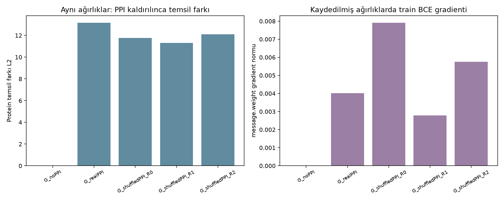
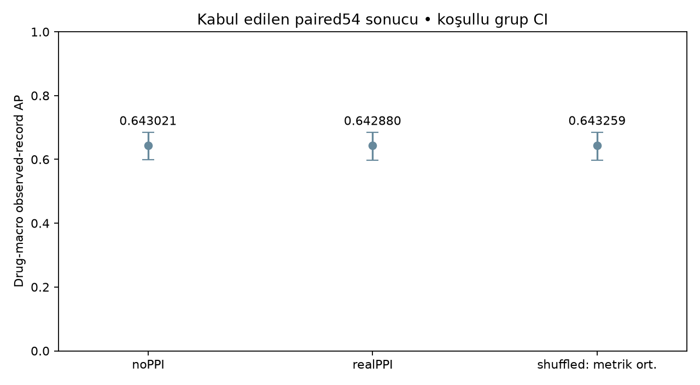

# WP09 — Kullanıcı onaylı sonuçların nihai kapanışı

06.11.2026. **WP09_CLOSED_ACCEPTED_BY_USER.** Kullanıcı protein-PPI GNN ve ablation sonuçlarını araştırma kapsamında kabul etti. Bu ek son denetimdir;önceki model,skor,seed,hiperparametre,eşik,split,PT sözlüğü veQC kararları değiştirilmedi. WP10 yalnız aşağıdaki ayrı tasarım/uygulanabilirlik çalışmasıdır;model eğitimi için izin yoktur.

## 1. Değişmeyen bilimsel sonuç

Ana paired54 drug-macro observed-record AP: **G_noPPI=0.643021; G_realPPI=0.642880; üç shuffled metriğinin eşit ortalaması=0.643259.** B0/B1/B2 sabit referanslardır. Real−noPPI −0.000142,koşullu%95 CI[−0.003611;+0.003248];real−shuffled_mean −0.000379,CI[−0.002039;+0.001310]. Bunlar eşdeğerlik testi veya genel üstünlük kanıtı değildir.

| Ayrı bilimsel soru | Hüküm | Kanıt / sınır |
| --- | --- | --- |
| PPI gerçekten hesaplanıp öğrenildi mi? | Teknik olarak gösterildi | Gerçek eğitimde optimizer/gradient/parametre güncellemesi;kayıtlı ağırlıkta kenar ve backward etkisi |
| Gerçek PPI bağlantıları ek birincil sıralama başarısı sağladı mı? | Bu deneyde gösterilemedi | Aynı mimari/kapsam real−noPPI ve real−shuffled farkları;koşulluCI sıfırı içeriyor |
| Protein biyolojisi genel olarak yararsız mı? | Bu sonuç çıkarılamaz | Küçük kohort,insan PPI erişimi,rol-mean,query self-only ve SIDER kayıt mekanizmasıyla sınırlı deney |

**B1–GNN farkı tek başına PPI topoloji etkisi değildir.** B1 beş kimya+maske LR,GNN ise protein/rol temsilleri ve farklı nonlineer kapasite/optimizasyon taşır. Aynı mimarideki PPI aç/kapat ve karıştırılmış-topoloji karşılaştırmaları topoloji sorusuna daha doğrudan yaklaşır. Stres B2 kazancı noPPI'da da görüldüğünden PPI'ye atfedilemez. Olası sınırlamalar neden olarak ayrıştırılmış veya kanıtlanmış değildir.

## 2. Son kapanış kontrolleri

| Kontrol | Sonuç |
| --- | --- |
| 190 NPZ +190 metadata SHA-256 | PASS;380 dosya frozen model manifestiyle aynı |
| Sayısal state hash'i | 190/190 NPZ'den dtype/shape/byte sırasıyla yeniden hesaplandı;metadata ve fit kaydıyla aynı |
| Önceki tüm proje artefaktları | 2347 dosya içerik hash'i aynı;eski test logu dahil |
| Gerçek trainer testleri yeniden | **24/24 PASS;22.927 saniye**;yeni log ayrı |
| NPZ→OOF skor yeniden üretimi | Primary outer1 bütün5 model;max mutlak fark1.11e-16 |
| Drug/fold/PT karşılaştırma anahtarları | Bütün5 model ana/stres aynı;frozen baseline eşleşmesi trainer testinde geçti |
| Kayıtlı ağırlıkta forward/backward | 5 probe;PPI etkisi/gradient real ve3null'da>0,noPPI'da0;optimizer0,state aynı |
| Ek kapanış/tasarım testleri | 12/12 PASS;4.422 saniye |

Yeni log [trainer_tests_rerun.txt](qa/WP09/final_closure_v1/trainer_tests_rerun.txt),özgün `training_v1/test_results.txt` yerine geçmez ve onu ezmez. Yeniden çalıştırılan özgün testler kontrollü RAM tekrar-fit/mutasyon denemelerini içerir;üretim190 modeline yazmaz,hiperparametre aramaz. Kapanış probe'u yalnız kaydedilmiş modeli yükler ve train-only BCE.backward çağırır;optimizer kurulmaz. Ortam aynı kütüphanelerdir;farklı sürümlerde bit düzeyinde genel garanti yoktur.

| context | model | pairs | max_absolute_error | NPZ_restored |
| --- | --- | --- | --- | --- |
| primary_o01_final | G_noPPI | 3120 | 1.110223e-16 | True |
| primary_o01_final | G_realPPI | 3120 | 1.110223e-16 | True |
| primary_o01_final | G_shuffledPPI_R0 | 3120 | 1.110223e-16 | True |
| primary_o01_final | G_shuffledPPI_R1 | 3120 | 1.110223e-16 | True |
| primary_o01_final | G_shuffledPPI_R2 | 3120 | 1.110223e-16 | True |

**Yorum:** Sıralama ve değerler floating-point/CSV toleransında yeniden üretildi. Bu yeni OOF tahmini kaydetme veya test sonucuyla seçim yapma değildir.

| model | same_weights_PPI_removed_protein_L2 | trained_message_weight_gradient_norm | optimizer_steps_this_check | state_unchanged |
| --- | --- | --- | --- | --- |
| G_noPPI | 0 | 0 | 0 | True |
| G_realPPI | 13.162168 | 0.0040160404 | 0 | True |
| G_shuffledPPI_R0 | 11.759402 | 0.0079102358 | 0 | True |
| G_shuffledPPI_R1 | 11.306178 | 0.0027832745 | 0 | True |
| G_shuffledPPI_R2 | 12.112257 | 0.0057535311 | 0 | True |

**Yorum:** G_realPPI'nin **aynı** kaydedilmiş ağırlıklarıyla komşuluğu kaldırmak protein temsillerindeL2=13.1622 fark yaratır. Train BCE message.weight gradient normu0.00401604. NoPPI'nin her ikisi0. Teknik kullanım/öğrenme kanıtı performans katkısı kanıtından ayrıdır;yalnız AdamW weight-decay kaynaklı ağırlık değişimi PPI kanıtı sayılmaz.

**Yorum:** Grafik önceki frozen metrikleri gösterir;yeniden model seçilmedi. CI sabitOOF ve yapısal grup bootstrap'ına koşulludur;bağımsız dış doğrulama veya full-retraining belirsizliği değildir. Önceki sonuçlar görüldüğü için kıyas keşifseldir.

## 3. Kapsam,abstention ve NA

| protocol | scope | scored_drugs | scored_pairs | observed_positive_scored | unknown_NOT_verified_negative | out_of_scored_vocab_positive | class_AUROC_NA |
| --- | --- | --- | --- | --- | --- | --- | --- |
| primary | paired54 | 54 | 13964 | 3820 | 10144 | 1685 | 50 |
| primary | own61 | 61 | 18004 | 4576 | 13428 | 1829 | 57 |
| stress | paired54 | 54 | 13890 | 3751 | 10139 | 1754 | 50 |
| stress | own61 | 61 | 17970 | 4569 | 13401 | 1836 | 51 |

**1685**,primary paired54 ilaçlarındaki5505 kaynak pozitifin skorlanabilir sözlük/fit kapsamı dışında kalan kısmıdır;bütün62'nin veya1061 PT evreninin hata sayısı değildir. Primary paired54'te3820 gözlenen pozitif ve10144 unknown vardır. Her model/protokol61 ilaç skorlar;Methenamine girdisiz abstention olarak kalır. Tobramycin'in protein eksiği korunur. Envanter **62 ilaç/1061 kaynakPT/6416 pozitif** olarak aynıdır.

Üç başarısız null NA kaldı;primary_o02_i01 ve stress_o02_i02 ortak inner seçiminden bütün5 varyant için çıkarıldı:10 iş çalıştırılmadı. Seed/bütçe/değişim eşiği değiştirilmedi. 25 context/PT single-proxy oluşumu,sınıf metriği NA ve sözlük dışı pozitifler sıfır başarı/gerçek negatif sayılmadı. Shuffled özet üç ayrı modelin metrik ortalamasıdır;skor ensemble veya best-replica değildir.

**Unknown gerçek biyolojik negatif değildir.** Sigmoidler SIDER kaynak kayıtlarını sıralama skorudur;klinik yan etki olasılığı,özgüllük,kalibrasyon,nedensellik veya hasta güvenliği doğrulaması değildir. Mevcut encoder protein-PPI GNN+skaler kimyadır;atom–bağ GNN veya tam moleküler GiG değildir.

## 4. Dosyalar ve kapanış

- `reports/qa/WP09/final_closure_v1/`:önceki2347 dosyanın manifesti,yeni24 test logu,190state/metadata ve5outer skor/gradient/kapsam kanıtları. Önceki QA salt okunur kaldı.
- `notebooks/WP09_final_closure.ipynb`:5 çalıştırılmış kod hücresi;gerçek tablolar,2 PNG ve Türkçe yorumlar.
- `reports/figures/WP09/final_closure_v1/`:PPI teknik kanıtı ve frozenAP grafikleri.
- `tests/test_wp09_closure_wp10_design.py`:12 yeni kapanış/tasarım sözleşmesi testi.
- [WP10 tasarım önerisi](WP10_DESIGN_FEASIBILITY.md):aktif ROADMAP kapsamı içinde ayrı hazırlık;model/optimizer yok.

AGENTS,aktif ROADMAP/SOURCE_USAGE_AUDIT,WP09 tasarım/veri/karar/son eğitim kapısı,v3 config,karşılaştırma taslağı,eğitim raporu/model kartı ve ilgiliWP04/WP08 kaynak/QC belgeleri esas alındı. Eski belgelerdeki“onay bekliyor/eğitim yok” kayıtları tarihsel aşamalardır;silinmedi. **WP09 kullanıcı kabulüyle kapandı. WP10 yalnız tasarım önerisinde durur;uygulama/eğitim için yeni onay beklenir.**
