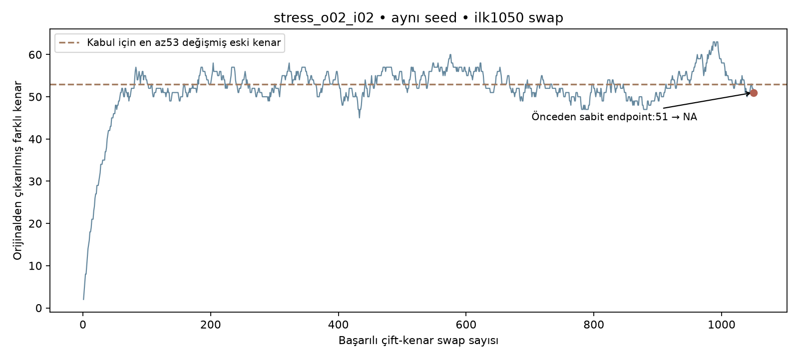
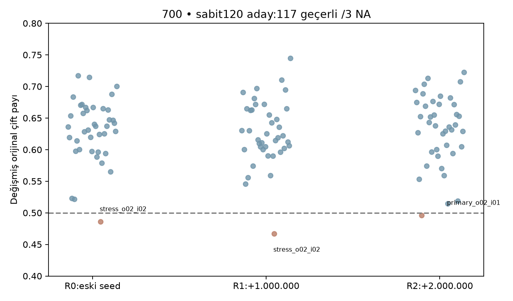
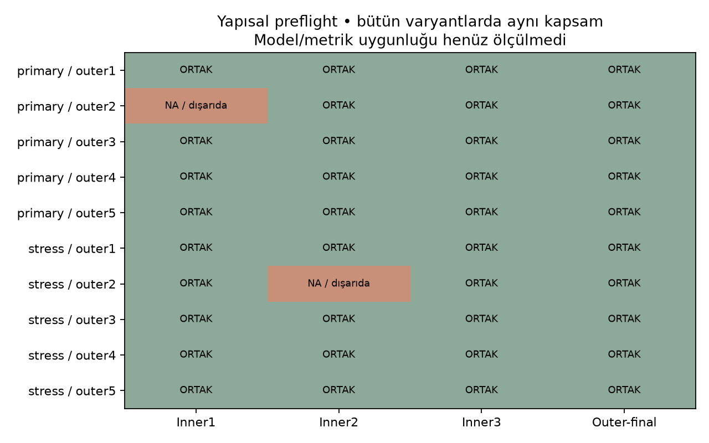
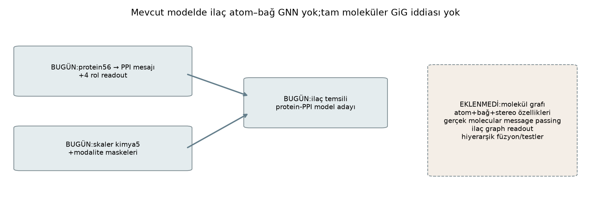

# WP09 — Son eğitim kapısı ve null protokolü v3

06.11.2026. **NULL_POLICY_REVIEW_COMPLETE; AWAITING_EXPLICIT_TRAINING_APPROVAL.** Kullanıcı tasarım/encoder doğrulamasını kabul etti. Bu ek yalnız null analizi, eksik ablation politikası ve son konfigürasyon önerisidir. **Model kurulmadı/fit edilmedi, optimizer çalıştırılmadı, gerçek PT skoru veya performans metriği üretilmedi.**

## 1. Tek öneri ve gerekçesi

**700 eşiği + mevcut degree-preserving generator/bütçe/%50 kuralı + önceden tanımlı üç sabit null + ortak geçerli inner kesişiminde minimum2 fold** öneriyorum. Başarısızlıklar NA kalır. Bu v3, daha iyi endpoint/seed seçen bir generator değildir; v2'de açık kalan tekrar ve karşılaştırılabilirlik sözleşmesini tamamlar. 700 topoloji/null uygulanabilirliği önerisi olarak kalır, sonuç optimizasyonu yapılmadı. Eğitim onayı halen kapalıdır.

Üç sabit tekrarda **117/120** aday geçerli;3 NA iki inner bağlamdadır. İki inner bağlamı bütün varyantlar için ortak kapsamdan çıkarınca **10/10 outer-final bağlam topolojik olarak hazırlanabilir**, her outer için≥2 ortak inner kalır. Bu, gelecekteki model fit'inin veya AP'nin tanımlı/başarılı olacağını garanti etmez. Metrik/fit NA kontrolleri daha sonra aynı ortak-kapsam kuralıyla uygulanacaktır.

## 2. stress_o02_i02 neden %50'yi sağlayamadı?

Eski seed **20274406**, kaynak train protein evreni84,pozitif dereceli PPI düğümü29,105 yönsüz kenar. Eski endpoint hash'i ve bütün40 r0 adayının seed/status/hash'i bire bir yeniden üretildi. Eşik için≥**53** eski kenarın değişmesi gerekir; eski finalde51 değişti,54 kaldı:51/105=**0,485714**.

**Bütçe tükenmedi.** 1050 başarılı swap tamamlandı;3801 denemenin637'si ortak uç,2114'ü mevcut/yinelenen yeni çift nedeniyle reddedildi. Kullanılabilecek maksimum21000 denemenin çoğu kullanılmadı. Başarılı swap sayısı, farklı kalan eski kenar sayısı değildir: yürüyüşte eski çiftler çıkarılıp daha sonra tekrar gelebilir. İlk1050 swap içinde63 eski çiftin değiştiği durum gözlendi; son endpoint51'e döndü. Dolayısıyla bu graf için %50'nin matematiksel olarak imkânsız olduğu da söylenemez.

İlk endpoint'e kadar kümülatif822 orijinal-kenar çıkarma ve771 geri ekleme olayı vardır; fark51. Bunlar benzersiz çift sayıları değildir. Derece heterojenliği ve invalid öneriler yürüyüşün verimliliğini etkileyebilir; bu tek trajektori bir mixing zamanı veya olasılık dağılımı tahmini vermez.

**Yorum:** Ara noktada≥%50'ye ulaşılması, ilk başarılı noktayı geriye dönük seçme hakkı vermez. Üretim protokolü10E son durumudur; başarısız endpoint NA olarak korunur.

## 3. Daha büyük bütçe veya yeni generator gerekli mi?

Aynı RNG akışında yalnız tanısal, önceden yazılan10E/50E/100E kontrol noktaları incelendi:

| swaps_per_edge | attempts | removed_original_edges | changed_fraction | passes_change_rule |
| --- | --- | --- | --- | --- |
| 10 | 3801 | 51 | 0.4857 | False |
| 50 | 18905 | 53 | 0.5048 | True |
| 100 | 38025 | 56 | 0.5333 | True |

50E ve100E bu özel yürüyüşte geçerli endpoint verdi. **Bunlar eski başarısız null'un yerine kullanılmadı** ve bütün null'lar için daha iyi mixing/başarı garantisi çıkarılmadı. Daha çok swapın değişim oranını monoton artırmadığı ilk10E içinde zaten görülüyor. Tek başarısız seed'i uzatıp başarılı durumu seçmek yerine sabit bütçe ve açık NA protokolü korunmalıdır.

Yeni, daha yüksek bütçeli bir generator şu an gerekli görünmüyor: aynı generator'un önceden tanımlı üç tekrarını ve ortak minimum2 kuralını uygulayan preflight bütün outer bağlamlarda yapısal olarak kullanılabilir çıktı verdi. Bu karar daha iyi model skoru üretme arayışı değildir. Gelecekte mixing/temsil amaçlı algoritma değişimi istenirse yeni sürüm ve bütün evrende sonuç-kör tanı gerekir; bu v3'te uygulanmadı.

Double-edge swap dereceleri korur, fakat bağlantılılığı zorunlu olarak korumaz. Null'da bileşenlerin değişmesi bu protokolde izinlidir; isolate dereceleri sabittir. [NetworkX yöntem belgesi](https://networkx.org/documentation/stable/reference/algorithms/generated/networkx.algorithms.swap.double_edge_swap.html). Null için graf uzayı ve örnekleme yaklaşımı açık tanımlanmalıdır; burada etiketli, basit, yönsüz, aynı-human-node, sabit-degree uzayı vardır. [Fosdick ve ark.](https://arxiv.org/abs/1608.00607). Sonlu swap sayısı yakınsama veya uniform örnekleme kanıtı değildir; bu çalışma uniform configuration-model testi iddia etmez. [Dutta ve ark.](https://arxiv.org/abs/2105.12120). Bunlar yalnız yöntem kaynaklarıdır; biyolojik veri indirilmedi.

## 4. Üç tekrar ve açık başarısızlıklar

Üretim kuralı değişmedi:10E başarılı swap,max200E deneme,değişmiş eski çift oranı≥0,5. R0 bütün40 bağlamda eski adayla aynıdır. R1/R2 seed'leri v2'de zaten önerilen +1.000.000×r formülüdür; yeni başarılı seed araması yapılmadı. Her tekrar özgün gerçek grafla başlar; başarısız R0 yerine başarılı R1 konmaz.

| context | replicate | seed | changed_fraction | status |
| --- | --- | --- | --- | --- |
| primary_o02_i01 | 2 | 22272306 | 0.4957 | NA_shuffle_insufficient |
| stress_o02_i02 | 0 | 20274406 | 0.4857 | NA_shuffle_insufficient |
| stress_o02_i02 | 1 | 21274406 | 0.4667 | NA_shuffle_insufficient |

**Yorum:** 117/120, yeni generator'un39/40'a üstünlüğü değil; üç kat daha çok önceden tanımlı adayın kapsamıdır. Üç NA görünür tutulur,başarısızlar için NPZ yazılmaz. Üç tekrarı tamamı geçerli38 context vardır. Başarısız contextlerdeki3 başarılı null da primary ortak seçim kapsamına alınmaz; `valid_nulls_excluded_by_shared_scope.csv` bu ek kapsam kaybını saklar. Geçerli117 null'un114'ü primary planında kullanılabilir.

## 5. Inner karşılaştırılabilirlik: seçenekler ve önerilen kural

| seçenek | etki | karar_ve_sınır |
| --- | --- | --- |
| Yalnız başarısız deneyi NA; her varyant kendi inner foldlarını kullanır | Real/noPPI üç, shuffled iki fold kullanabilir | Birincil kıyas için önerilmez: seçim/epoch bilgi kapsamı farklılaşır |
| Ortak inner kesişim + minimum3 | Üçü de bütün inner foldları gerektirir | Bu preflightta primary outer2 ve stress outer2 ana kıyas NA olur; daha fazla kapsam kaybı |
| Ortak inner kesişim + minimum2 | Bir null bile başarısızsa ilgili fold bütün varyantlarda dışlanır | ÖNERİLEN:10 outer topolojik olarak hazır; iki outerda2,diğerlerinde3 inner; gelecekte metrik NA ayrı kontrol |
| Gerçek/noPPI kenarıyla null doldurma | PPI yapısı yanlış etiketlenir | YASAK; ablation sorusu değişir |
| Başarılı seed/ilk başarılı ara nokta seçme | Sonradan seçilmiş koşullu grafik dağılımı | Önerilmez; eski başarısızlık korunur, seed/stop kuralı değiştirilmez |
| Herkese daha büyük sabit bütçeli yeni generator | Ayrı sürüm ve tüm-null QA gerektirir | Şimdilik gerekli değil: mevcut sabit üç tekrar+ortak minimum2 planı uygulanabilir; mixing/başarı garantisi vermez |

Önerilen yapısal ortak inner kapsamı **eğitimden önce** kaydedildi:

| protocol | outer_fold | common_valid_inner_folds | common_valid_inner_count | outer_all_three_nulls_valid | topology_preflight_status |
| --- | --- | --- | --- | --- | --- |
| primary | 1 | 1,2,3 | 3 | True | READY_FOR_FUTURE_INNER_EVALUATION |
| primary | 2 | 2,3 | 2 | True | READY_FOR_FUTURE_INNER_EVALUATION |
| primary | 3 | 1,2,3 | 3 | True | READY_FOR_FUTURE_INNER_EVALUATION |
| primary | 4 | 1,2,3 | 3 | True | READY_FOR_FUTURE_INNER_EVALUATION |
| primary | 5 | 1,2,3 | 3 | True | READY_FOR_FUTURE_INNER_EVALUATION |
| stress | 1 | 1,2,3 | 3 | True | READY_FOR_FUTURE_INNER_EVALUATION |
| stress | 2 | 1,3 | 2 | True | READY_FOR_FUTURE_INNER_EVALUATION |
| stress | 3 | 1,2,3 | 3 | True | READY_FOR_FUTURE_INNER_EVALUATION |
| stress | 4 | 1,2,3 | 3 | True | READY_FOR_FUTURE_INNER_EVALUATION |
| stress | 5 | 1,2,3 | 3 | True | READY_FOR_FUTURE_INNER_EVALUATION |

**Yorum:** Primary outer2'de inner1 bütün modeller için dışarıda,inner2/3 ortak kalır. Stress outer2'de inner2 bütün modeller için dışarıda,inner1/3 kalır. Diğer8 outer3 inner kullanır. Bu, train/validation/test üyeliklerini değiştirmez; iki iç validation fırsatı birincil epoch/seçim özetine alınmaz. Dış son fit yine aynı tam outer-train uygun ilaçlarıyla yapılır.

Eğitim sonrasında tanımsız/nonfinite metrik veya başarısız fit varsa aynı kesişim genişletilir: G_noPPI,G_realPPI ve3 G_shuffled fit'inin hepsi için tanımlı olan inner foldlar kullanılır. **Düşük AP fold çıkarma nedeni değildir.** Aynı foldda bütün modeller aynı drug/PT maskesiyle değerlendirilir; inner foldlar arası hedef sözlüğü farkı kapsamıyla kaydedilir. Minimum2'nin altına düşülürse outer primary karşılaştırmanın tamamı NA_selection_insufficient olur;fallback önsel veya yeni seed yoktur. Herhangi outer-final null başarısızsa outer primary triad NA_null_outer olur; bugün böyle bir durum yoktur.

Minimum3 alternatifi bu preflightta iki outer karşılaştırmayı NA yapardı. Minimum2 daha fazla outer kapsamını korur,ancak iki folddan epoch seçimi daha az validation bilgisine dayanır; belirsizlik/stabilite sınırı raporlanmalıdır. Model başına farklı available-fold ortalaması kullanmak bilgi kapsamını karıştırır ve primary kıyas olarak önerilmez. Kısmi sonuçlar ileride tam5-fold veya bütün62 ilaç başarısı diye sunulamaz; bütün ID'ler ve NA nedenleri durum tablosunda tutulur.

## 6. Tek nihai önerilen konfigürasyon tablosu

Bu tablo `configs/WP09_training_PROPOSED_v3.json` ile aynı öneriyi açıklar. “Nihai öneri” eğitim izni anlamına gelmez;training_enabled=False ve approved_primary=None kalır.

| alan | nihai_önerilen_değer | sınır |
| --- | --- | --- |
| Durum / tek öneri | WP09-training-PROPOSED-v3; training_enabled=False | Ayrı kullanıcı eğitim onayı bekler |
| Birincil PPI eşiği | 700; onaylı değer henüz None | Topoloji/null fizibilitesi önerisi; predictive sonuç seçimi değil |
| Diğer eşikler | 400/900 ilk primary eğitim isteğinin dışında ertelendi | Eski girdileri/senaryoları silinmedi |
| Mimari | Protein56→32,tek residual mean PPI;kimya5→8;4 ayrı rol mean+maskeler | Head hariç3920;temsil141;lineer head142×K;atom–bağ GNN yok |
| Varyantlar | G_noPPI,G_realPPI,G_shuffledPPI×3 sabit null | Aynı yapı/başlangıç parametreleri/context ID/PT/girdi kapsamı |
| Kohort / uygunluk | 62 envanter;frozen B2 input-eligible61 | Methenamine abstention;Tobramycin kimya;QC kararları aynı |
| Protein evreni | Yalnız train-linked doğrulanmış dizi;aynı-taxID insan induced PPI | K12 koşullu23 kenar/context80 yok;komşusuz dizi self yolunda |
| Hedef / scaler | Mevcut train B2 sözlüğü+ortak train-fittable maskesi;5pozitif/2grup ilkesi | Kaynak1061 PT yeniden seçilmez;dönüşümler mevcut train-only kaynaklardan |
| Loss | BCEWithLogitsLoss;valid PT ortalaması/eligible drug,sonra drug ortalaması | Unknown0 yalnız kayıt proxy;class_weight/pos_weight yok;single-proxy train PT NA |
| Optimizer / learning rate | AdamW;lr0.001;weight_decay0.001 | Kurulmadı/çalıştırılmadı;grid araması yok |
| Epoch / early stopping | Max200;inner drug-macro observed-record AP;patience20;min_delta0.0001 | İyileşme >min_delta;tie erken epoch;best epoch restore |
| Outer final epoch | floor(common-valid inner best epoch medyanı+0.5),her varyant/replica için | Outer testle early-stop yok;en az2 ortak inner |
| Split / model init seed | Frozen dış5/iç3 ana+stres;base20261106 | Init=base+10000*protocol_index+100*outer+inner;primary0/stress1;variant/replica aynı init |
| Hesap ortamı | CPU1thread;deterministic algorithms;dropout0,batchnorm yok | Sürümler arası bit düzeyi garanti yok;seed araması yok |
| Null algoritması / bütçe | Eski degree-preserving çift kenar swap;10×E başarılıswap,max200×E deneme | Eski v1/v2 algoritması değişmedi;self-loop/duplicate yok;degree/count tam aynı |
| Null tekrar / seed | 3 sabit tekrar:r0,r1,r2 | Seed=20261106+10000+100*sorted_context_index+700+1000000*r;r0 eski seed |
| Null kabulü | Tam swap bütçesi+değişmiş eski çift oranı≥0.5 | İlk eşik geçişinde durma,retry,best replica ve düşük sınır yok;uniform mixing iddiası yok |
| Ortak inner kapsam | Üç nullun hepsi geçerli ve bütün5 fit için metrik finite/tanımlı foldların kesişimi | Geçersiz inner bütün varyantlarda dışarıda;düşük skor dışlama nedeni değildir |
| Minimum inner / NA | En az2 ortak inner;altında tüm outer primary triad NA_selection_insufficient | İlaçlar/split üyelikleri silinmez;proxy/fallback skor üretilmez |
| Outer null başarısızlığı | Herhangi outer-final null eksikse tüm outer primary triad NA_null_outer | Real/noPPI ile doldurma yok;eksik dış kapsam raporlanır |
| Shuffled sonuç özeti | Her replica metriği+3 metriğin eşit ortalaması ve eşleştirilmiş farklar | PT skorlarını ensemble ortalaması yapma/best replica seçme yok;üçü bağımsız klinik örnek değil |
| Baseline karşılaştırma | B0/B1/B2 sabit;aynı drug/fold/PT keys;paired54 ana,own61 ayrı | Yeni NA paydaları açıklanır;baseline retuning yok |
| Belirsizlik / iddia | Gelecekte aynı grup çekimleriyle koşullu paired bootstrap | Observed-record proxy;unknown gerçek negatif değil;klinikrisk/nedensellik/dış doğrulama yok |

G_shuffled için her replica ayrı aynı mimarili modeldir; primary özet üç **metriğin** eşit ortalaması ve her replica sonucudur. PT skorlarını ortalayan yeni ensemble kurulmaz. Real/noPPI referansları aynı başlangıç ağırlığıyla karşılaştırılır. Koşullu bootstrap ileride aynı ilaç/yapısal grup çekimlerini bütün replica/model skorlarına birlikte uygulamalıdır; null tekrarı üç bağımsız klinik örnek gibi sayılmaz. Bu metrik/CI hesapları bugün yapılmadı.

## 7. Eğitim onayından sonra uygulanacak sıra

1. Onay kaydını ayrı çalışma manifestine yaz;v1/v2/v3 öneri dosyalarını,split/ID/sözlük/QA hash'lerini doğrula. Threshold700/null/missingness sözleşmesi sonuç görmeden dondurulmuş kalır.
2. Önceden üretilen null QA ve ortak-fold maskesini yükle. Başarısız contextleri bütün modellerde aynı primary seçim kapsamı dışında tut;NPZ eksikliğini gerçek/noPPI kenarına dönüştürme.
3. Her outer için ortak geçerli inner bağlamlarda G_noPPI,G_realPPI ve3 G_shuffled fit'ini aynı train ID/scaler/target/maske/init ile yürüt. Yalnız inner validation AP early-stop için kullanılır. AP/missingness tanımı frozen observed-record proxy'dir.
4. Tanımlı ortak inner sayısını tekrar kontrol et;≥2 ise her variant/replica'nın best epoch medyanını .5 yukarı yuvarla. Daha azsa outer primary NA;modeli/test kapsamını sonradan kurtarma araması yapma.
5. Aynı outer-train üzerinde aynı context'e özgü başlık ve girdilerle son modelleri fit et;epoch sayısı inner'dan gelir. Query'leri readout yoluyla değerlendir;train grafı/embeddingleri query ile değişmez. Outer test early-stop veya hiperparametre seçimine girmez.
6. Aynı frozen drug/fold/PT kapsamındaki metrikleri,her null replica'sını,ortak farkları ve koşullu grup CI'ı raporla. Own61/paired54 ve NA/sözlük dışı pozitifler ayrı kalır. B0/B1/B2 sabit skorları yeniden ayarlanmaz;başarısız/düşük sonuçlar saklanır.

`training_sequence_PREVIEW_ONLY.csv` **190 koşullu gelecekteki fit işi** içerir:140 inner,50 outer-final. Her contextte5 fit aynı ID/hedef hash'i ve init seed'i taşır. **Bu işler çalıştırılmadı.** `training_preview_sources.json` tam train-fit/graph/validation/test kimliklerini ve orijinal train hedef listelerini saklar. Null başarısızlığı olan iki contextteki10 inner fit primary planda yoktur;kimlikler/splitler yeniden atanmaz. Topolojik olarak hazır olmak,ilerideki model/metrik NA'sını kaldırmaz.

## 8. Modelin doğru adı ve moleküler Graph-in-Graph sınırı

Mevcut yapı **protein-PPI mesaj geçişli, dört rol readout ve skaler kimya dallı multimodal model adayıdır**. İlaç atom–bağ grafı veya molecular GNN encoder'ı yoktur;tam moleküler Graph-in-Graph diye sunulmamalıdır.

**Yorum:** Tam moleküler GiG iddiası için ileride QC-doğrulanmış SMILES'tan her ilaç için atom/bağ özellikleri ve stereokimya içeren molekül grafı,bu iç graflarda gerçek mesaj geçiren moleküler encoder,ilaç başına graph readout,protein-PPI encoder/rol katmanıyla tanımlı hiyerarşik füzyon ve bu yolların forward/gradient/ablation testleri gerekir. Atom/PPI katkıları aynı drug-disjoint/stres protokolünde ayrı sınanmalıdır. Bu bileşenler WP10 ve sonraki onaylı işlerin konusudur;bu aşamada kodlanmadı veya eğitilmedi. Mevcut sekiz molekül QC ve eksik modalite politikalarıyla zorla atom grafı doldurulamaz.

## 9. QA, koruma ve durma noktası

**18/18 yeni null-kapısı testi geçti (3.839 saniye).** Eski40 R0 endpoint'inin bire bir üretimi,105-kenar aritmetiği,reintroductions,117 geçerli null'da derece/sayım/loop/duplicate/hash,3 NA dosyasının yokluğu,seeds,ortak-fold ve minimum2/outer-NA kusur enjeksiyonları,190 preview işinin aynı ID/PT/init kapsamı ve model/optimizer çalıştırılmaması doğrulandı. Önceki35 encoder testi değiştirilmedi;bu görevde yeniden çalışmış sayılmıyor.

**1567 önceki dosya** SHA-256 ile korundu. B0/B1/B2,62 ilaç,1061 PT,6416 kaynak pozitif ilişki,splitler,v1/v2 config/seed/null sonuçları ve bütün QC kararları aynı kaldı. Bu koruma mevcut QA içerik hash'idir;ham büyük kaynaklar yeniden taranmadı. Null tanısında etiket veya model performansı kullanılmadı. Planlama yalnız önceden kilitli train hedef metadata'sına başvurur;etiket matrisi veya PT sıklığı üretmez. Paket/biolojik veri indirme yapılmadı;yalnız yöntem belgeleri web'den okundu.

Yeni çıktılar: bu rapor;v3 JSON;çalıştırılmış `notebooks/WP09_null_policy_review.ipynb`;4 açıklamalı PNG;`reports/qa/WP09/null_gate_v3/` altında replay/preflight/ortak kapsam/preview/test/hash dosyaları. Görsellerin görevi endpoint dalgalanması,null QA,ortak kapsam ve mimari sınırlarını öğretmektir. Gerçek model/PT skoru görseli yoktur.

Unknown gerçek negatif değildir. Gelecekteki sonuçlar klinik risk,nedensellik veya hasta güvenliği kanıtı değildir. Önceki baseline sonuçları görüldüğü için aynı-split kıyas keşifsel kalır. Tüm1061 PT uzayında başarı veya bağımsız dış doğrulama iddiası kurulamaz.

**Tek öneri v3'tür:700 + aynı generator ve sabit3 null + bütün modellerde ortak inner kesişim/minimum2 + açık NA. Model eğitimi yapılmadı. Kullanıcı onayı bekleniyor.**
