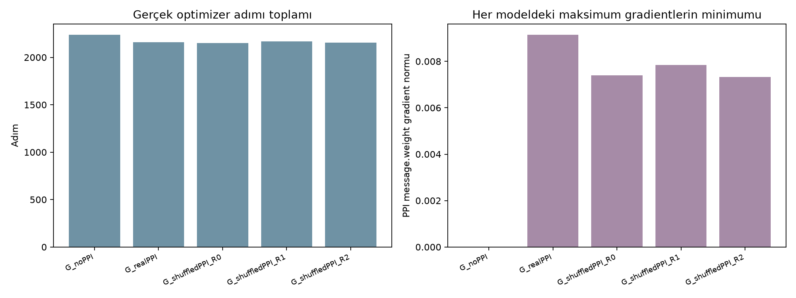
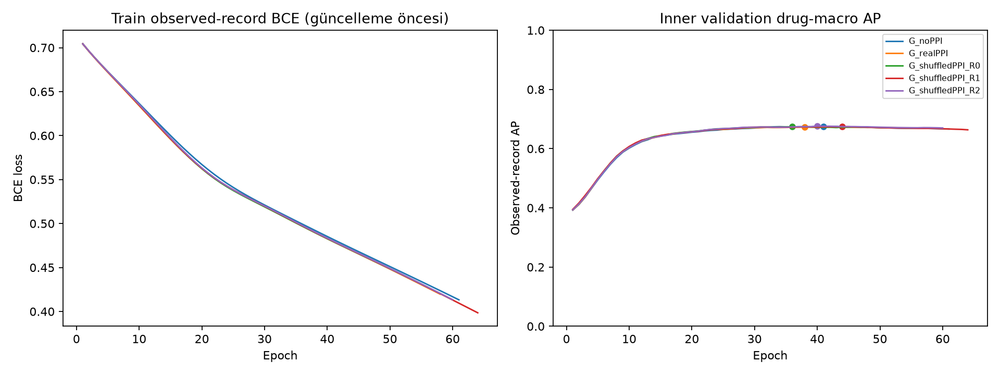
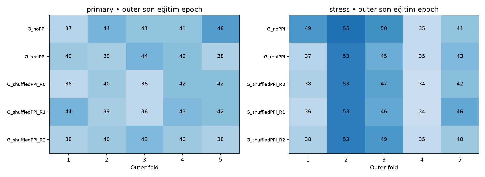
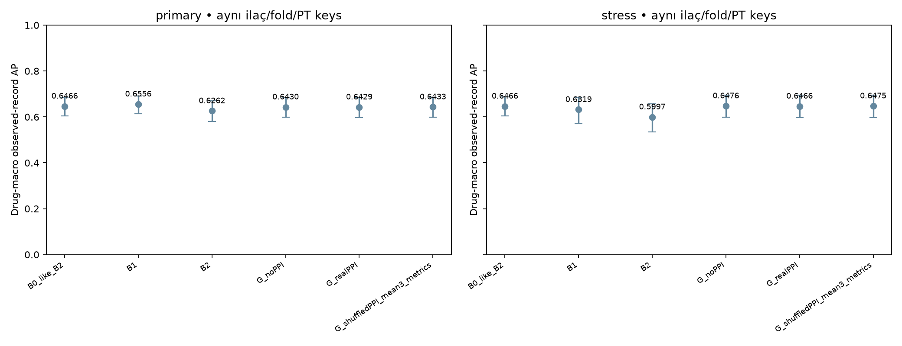
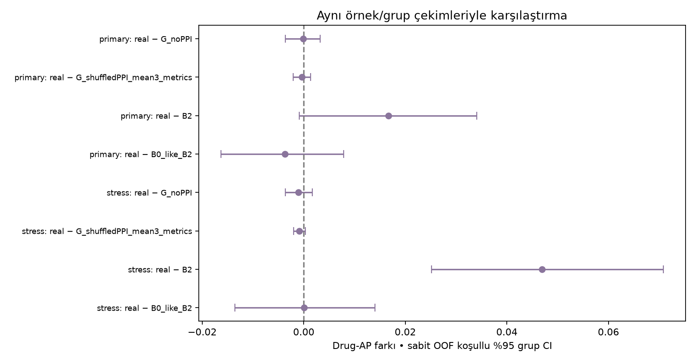
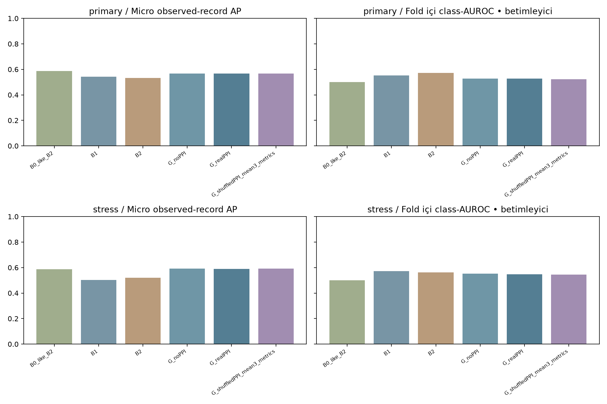
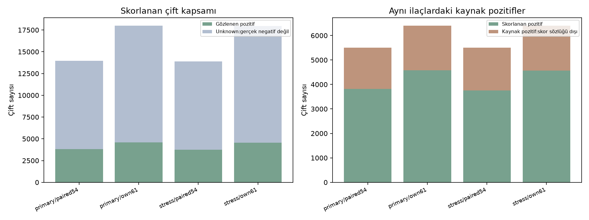
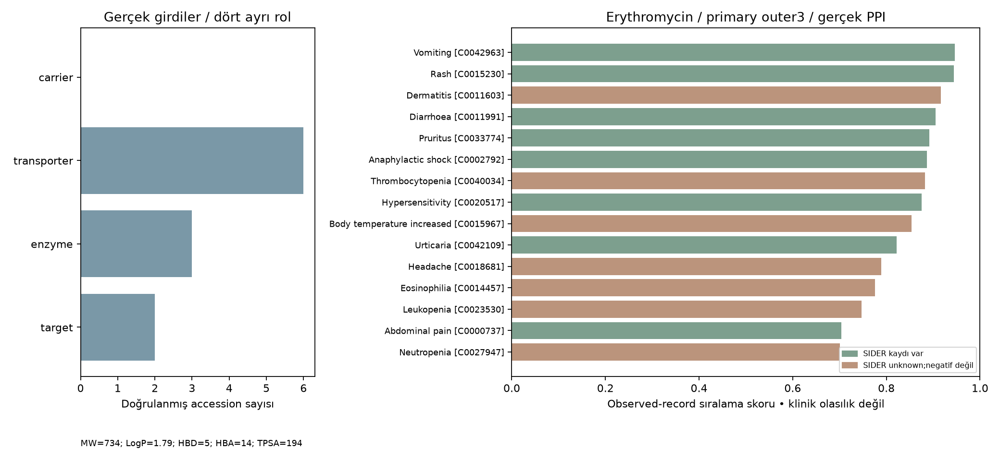

# WP09 — Gerçek protein-PPI eğitimi ve ablation sonuçları

06.11.2026. **WP09_TRAINING_AND_EVALUATION_COMPLETE; AWAITING_USER_RESULTS_REVIEW.** Kullanıcı frozen v3 kapsamında eğitimi açıkça onayladı. WP10 başlamadı. Sürüm: **WP09-protein-PPI-observed-record-v3-training-v1**. Bu modelde atom–bağ GNN yoktur;tam moleküler Graph-in-Graph tamamlandı iddiası yoktur.

## 1. Ana sonuç

**Gerçek PPI mesaj geçişi çalıştı ve öğrenildi;bu deneyde birincil drug-macro observed-record AP'ye ek katkı gösterilmedi.** Ana paired54'te G_noPPI **0,6430**,G_realPPI **0,6429**,üç shuffled metriğinin eşit ortalaması **0,6433**. Real−noPPI **−0,000142**,koşullu%95 CI **−0,003611–+0,003248**;real−shuffled_mean **−0,000379** (−0,002039–+0,001310). Stres farkları da sıfırı içerir.

B1 **0,6556**,B2 **0,6262**,B0_like_B2 **0,6466** ana ortak AP değerleri değişmedi. G_realPPI−B1 **−0,012762** (−0,031658–+0,004782),G_realPPI−B0_like_B2 **−0,003724** (−0,016303–+0,007884);bu kaynak/ölçüde bu referanslara karşı belirgin ek başarı gösterilemiyor. Eşdeğerlik veya bütün protein biyolojisinin yararsızlığı kanıtlanmış değildir.

Streste real−B2 **+0,046908** (0,025161–0,070822) iken noPPI−B2 **+0,047929** (0,026299–0,070056). Nonlineer encoder/öğrenme yapısı B2 LR'den farklıdır;bu fark **PPI topolojisinin etkisi diye sunulamaz**. Streste gerçekPPI ile B0_like_B2 neredeyse aynı AP verir. Düşük,benzer veya karşılaştırma aleyhine sonuçlar gizlenmedi;sonuçtan sonra model/eşik/null/seed/hyperparametre değişmedi.

## 2. Onay,protokol ve korunan kaynaklar

AGENTS,aktif ROADMAP,WP09 tasarım/karar raporları ve v3 sözleşmesi esas alındı. Kullanıcının yeni eğitim onayı ayrı `run_config.json` içine kaydedildi. Eski `WP09_training_PROPOSED_v3.json` training_enabled=False taşıyan tarihsel öneri olarak aynen korunur;yeni wrapper açık kullanıcı onayını ve700 eşiğini kaydeder. Teknik onay engeli varmış gibi yeniden izin istenmedi.

**1711 önceki dosya** içerik SHA-256 ile aynı kaldı:WP00–WP08 ve WP09 tasarım/null verileri,kod/test/notebook/QA,seed20261106,split üyelikleri,target sözlükleri,62 ilaç,1061 kaynakPT,6416 kaynak pozitif veQC kararları. B0/B1/B2 ağırlıkları/skorları/C değerleri yeniden fit edilmedi. Ham büyük XML/STRING/SIDER tekrar taranmadı;PUG API/yeni biyolojik kaynak/paket kurulumu yok.

Kaynak zinciri mevcut küçük QA'dır:DrugBank5.1/export2026-01-04→WP05 accession/56özellik/4rol;STRINGv12.0→aynı-taxID insan induced PPI;WP04 clean5kimya/QC;SIDER4.1→WP03 kesin62 kaynakPT kayıtları;WP08→train-only scaler/target/eligibility/frozen nested split. Kaynak ID'leri sadece join/provenanstır,öğrenme özelliği değildir. `kalite_skoru`,PT sayıları,kategoriler,raporlama sıklığı veya STRING skoru düğüm girdisi yapılmadı.

## 3. Gerçek eğitim ve model ağırlıkları

**190/190 fit OK**:140 inner model+50 outer-final model. Toplam **10867 gerçek AdamW adımı**;190 NPZ state_dict+190 JSON metadata ayrı model dizininde. NumPy state arşivi `allow_pickle=False` ile okunur;tek tüm62 üzerinde deployment fit'i yapılmadı. Her dosya model sürümü,seed,init/selected state hash'i,PT vefit-ID listeleri,graph/null hash'i,epoch/gradient/proxy desteği ve kaynağı korur.

56→32 paylaşılan protein projection,tek residual mean PPI,5→8kimya,dört ayrı masked mean rol,5maskeden141 boyut ve train-fittable PT lineer başlığı kullanıldı. Head hariç3920 parametre;K hedefte142×K başlık parametresi. G_noPPI gerçekten boş komşu mesajı kullanır;G_realPPI gerçek700 insan kenarlarını,G_shuffledPPI ayrıR0/R1/R2 kenarlarını işler. Bütün5 fit aynıcontextte aynı başlangıç ağırlığı/ID/target/girdi kapsamına sahiptir.

Full-batch observed-record proxy **BCEWithLogitsLoss**,class/pos weight yok;AdamW lr0,001/weight_decay0,001;float32/CPU1thread/deterministik algoritmalar. Eksik dal standart nötr+maskedir,biyolojik sıfır değildir;özelliksiz80 context eklenmedi. 23 K12/MG1655 koşullu PPI insan ağına alınmadı;PPI'sız doğrulanmış diziler self/residual yolunda kaldı. Kimya QC sekiz ilaç ve Tobramycin/Methenamine protein eksiği değişmedi.

| model | fits | optimizer_steps | minimum_selected_weight_L2_change | minimum_max_message_gradient | maximum_message_gradient |
| --- | --- | --- | --- | --- | --- |
| G_noPPI | 38 | 2239 | 4.1907 | 0.0000 | 0.0000 |
| G_realPPI | 38 | 2158 | 3.6889 | 0.0091 | 0.0185 |
| G_shuffledPPI_R0 | 38 | 2149 | 3.8628 | 0.0074 | 0.0193 |
| G_shuffledPPI_R1 | 38 | 2168 | 3.9658 | 0.0078 | 0.0174 |
| G_shuffledPPI_R2 | 38 | 2153 | 3.8541 | 0.0073 | 0.0171 |

**Yorum:** Her gerçek/shuffled fitte PPI message.weight'e sıfır olmayan gradient ulaştı. NoPPI mesaj girdisi/gradienti0'dır. NoPPI'da kullanılmayan message ağırlığının weight-decay ile kayması komşuluk kullanımı kanıtı değildir. Ağırlık güncellemesi,gerçekgradient ve trained-forward edge kaldırma testleri birlikte raporlandı. Böylece eskiV6'nın“PPI tensoru var ama forward'da kullanılmıyor” hatası giderildi;performans faydası ayrıca ablation'la sorgulandı ve gösterilemedi.

## 4. Nested CV,epoch seçimi ve açık kalan NA'lar

Ana connectivity dış5/iç3 ve ayrı scaffold OR≥0,8 stres üyelikleri aynı kaldı. Üç nullun tümü geçersiz olmayan ortak inner bağlamlar kullanıldı:primary outer2 inner2/3,stress outer2 inner1/3,diğer8 outer inner1/2/3. Null nedeni ile dışlanan iki contextte **10 inner fit çalıştırılmadı**;`excluded_inner_jobs.csv` bütün varyantları açıkça gösterir. Üç başarısız null NA kaldı,bütçe/seed/%50 kuralı değişmedi veya başka kenarla doldurulmadı.

Inner max200 epoch,patience20,min_delta0,0001. İlk finite AP checkpoint'i ve daha sonra>min_delta iyileşme seçildi;tie erken epoch. Eğitim sonunda selected checkpoint restore edildi. Her variant/replica için ortak geçerli inner best epoch medyanı .5 yukarı yuvarlanarak outer-final epoch sayısı belirlendi;outer test early stopping'e girmedi.

| protocol | outer_fold | G_noPPI | G_realPPI | G_shuffledPPI_R0 | G_shuffledPPI_R1 | G_shuffledPPI_R2 |
| --- | --- | --- | --- | --- | --- | --- |
| primary | 1 | 37 | 40 | 36 | 44 | 38 |
| primary | 2 | 44 | 39 | 40 | 39 | 40 |
| primary | 3 | 41 | 44 | 36 | 36 | 43 |
| primary | 4 | 41 | 42 | 42 | 43 | 40 |
| primary | 5 | 48 | 38 | 42 | 42 | 38 |
| stress | 1 | 49 | 37 | 38 | 36 | 38 |
| stress | 2 | 55 | 53 | 53 | 53 | 53 |
| stress | 3 | 50 | 45 | 47 | 46 | 49 |
| stress | 4 | 35 | 35 | 34 | 34 | 35 |
| stress | 5 | 41 | 43 | 42 | 46 | 40 |

**Yorum:** İlk sıralı inner contextin beş eğrisi gösterilir;tam190 history dosyası saklıdır. Train BCE güncelleme öncesi,validation AP/loss güncelleme sonrası ölçülür. AP'ye göre seçilen epoch son optimizer epoch'u olmak zorunda değildir. Tüm outer epochları34–55 aralığındadır;sonuçtan sonra uzatılmadı.

**Yorum:** Aynı kapsam,aynı epoch sayısı zorunluluğu değildir;her modelin kendi inner early-stop bilgisi,aynı ortak foldlar üzerinden önceden onaylanan medyan kuralına girer. Bütün10 outer bağlamda beş final fit OK'dir;ek numeric-fit veya validation-metric NA oluşmadı. Gelecek hatalarda ortak-fold≥2/outer-triad NA kuralı gerçek trainer'da sürer;kusur enjeksiyon testleri bunu sınırlar.

## 5. Hedefler ve sızıntı sınırı

Her fit mevcut train B2 sözlüğü ve train-fittable maskesini kullandı. ≥5 pozitif kullanılabilir ilaç/≥2 grup ilkesi önceden kilitli kaldı;hiçbir hedef global test sıklığıyla seçilmedi.40 context sözlük oluşumunda **25** single-proxy kayıt vardır;başlık dışında tutuldu,fallback olasılığı yoktur. Bu sayı benzersiz PT/ilaç veya başarısız GNN sayısı değildir. Aktif38contextte her beş modelin başlığı aynıdır. Kaynak1061 PT'nin tamamı her foldda hedef değildir.

Train grafında yalnız train ilaçları ve train-linked sequence proteinler vardır;heldout ilaç/ileri-ters ilişkisi,SE/PT hedef kenarı veya WP07 inceleme grafı yoktur. Dönüşüm mean/scale ve fit-ID kaynakları WP08'den aynen kullanıldı;yeniden scaler fit edilmedi. Query readout train protein cache'ini/model state'ini değiştiremez. Train evreni dışındaki query accession'ı aynı train-scaler/shared self encoder ile PPI'sız işlenir;query'den train'e geri mesaj/batchnorm yoktur.

Küçük kaynak etiket deposu okunur,ancak gerçek fit API'si yalnız exact train vevalidation ID sözlüklerini kabul eder. Inner çağrıdan outer test query'leri ve test-only unseen feature satırları çıkarılır. Bütün seçimler ve outer ağırlıklar tamamlanıp hash'le commit edildikten sonra `score` ayrı aşamada outer outcome'larını değerlendirmede kullanır. Outer label/value mutation testinde gerçek trainer'ın checkpoint/validation AP ve parametreleri değişmedi.

## 6. Eşleştirilmiş birincil sonuçlar

Aşağıdaki paired54 aynı **drug/fold/PT** anahtarlarıdır;iki protokolde de eski frozen karşılaştırma anahtarlarının hiçbiri kaybolmadı. Shuffled mean satırı üç metriğin eşit ortalamasıdır;OOF'ta ensemble score satırı yoktur.

| protocol | model | estimate | CI95_low | CI95_high |
| --- | --- | --- | --- | --- |
| primary | B2 | 0.6262 | 0.5792 | 0.6701 |
| primary | B1 | 0.6556 | 0.6131 | 0.6920 |
| primary | B0_all_train | 0.6465 | 0.6040 | 0.6852 |
| primary | B0_like_B2 | 0.6466 | 0.6044 | 0.6853 |
| primary | B0_like_B1 | 0.6438 | 0.6021 | 0.6820 |
| primary | G_noPPI | 0.6430 | 0.5985 | 0.6841 |
| primary | G_realPPI | 0.6429 | 0.5978 | 0.6849 |
| primary | G_shuffledPPI_R0 | 0.6422 | 0.5975 | 0.6839 |
| primary | G_shuffledPPI_R1 | 0.6443 | 0.5985 | 0.6858 |
| primary | G_shuffledPPI_R2 | 0.6433 | 0.5982 | 0.6852 |
| primary | G_shuffledPPI_mean3_metrics | 0.6433 | 0.5979 | 0.6850 |
| stress | B2 | 0.5997 | 0.5341 | 0.6577 |
| stress | B1 | 0.6319 | 0.5700 | 0.6863 |
| stress | B0_all_train | 0.6472 | 0.6050 | 0.6874 |
| stress | B0_like_B2 | 0.6466 | 0.6045 | 0.6871 |
| stress | B0_like_B1 | 0.6440 | 0.6029 | 0.6844 |
| stress | G_noPPI | 0.6476 | 0.5982 | 0.6953 |
| stress | G_realPPI | 0.6466 | 0.5964 | 0.6944 |
| stress | G_shuffledPPI_R0 | 0.6471 | 0.5965 | 0.6953 |
| stress | G_shuffledPPI_R1 | 0.6474 | 0.5961 | 0.6952 |
| stress | G_shuffledPPI_R2 | 0.6479 | 0.5971 | 0.6962 |
| stress | G_shuffledPPI_mean3_metrics | 0.6475 | 0.5966 | 0.6958 |

**Yorum:** Ana B1 point değeri daha yüksek;real−B1 CI sıfırı içerdiğinden bu deneyden genel istatistiksel üstünlük/başarısızlık çıkarılmaz. Frekans referansı güçlü kalır. Ağların kendi aralarındaki çok küçük farklar ek PPI faydasını desteklemiyor. Düşük/benzer sonuçları daha iyi göstermek için etiket,örnek,epoch/seed veya eşik yeniden seçilmedi.

| protocol | first | reference | first_minus_reference | CI95_low | CI95_high |
| --- | --- | --- | --- | --- | --- |
| primary | G_realPPI | G_noPPI | -0.0001 | -0.0036 | 0.0032 |
| primary | G_realPPI | G_shuffledPPI_mean3_metrics | -0.0004 | -0.0020 | 0.0013 |
| primary | G_noPPI | B2 | 0.0168 | -0.0017 | 0.0342 |
| primary | G_realPPI | B2 | 0.0166 | -0.0009 | 0.0341 |
| primary | G_realPPI | B0_like_B2 | -0.0037 | -0.0163 | 0.0079 |
| primary | G_shuffledPPI_mean3_metrics | B2 | 0.0170 | -0.0016 | 0.0350 |
| primary | G_noPPI | B0_like_B2 | -0.0036 | -0.0142 | 0.0069 |
| primary | G_realPPI | B1 | -0.0128 | -0.0317 | 0.0048 |
| primary | G_noPPI | B1 | -0.0126 | -0.0311 | 0.0034 |
| stress | G_realPPI | G_noPPI | -0.0010 | -0.0037 | 0.0017 |
| stress | G_realPPI | G_shuffledPPI_mean3_metrics | -0.0008 | -0.0020 | 0.0003 |
| stress | G_noPPI | B2 | 0.0479 | 0.0263 | 0.0701 |
| stress | G_realPPI | B2 | 0.0469 | 0.0252 | 0.0708 |
| stress | G_realPPI | B0_like_B2 | 0.0000 | -0.0136 | 0.0140 |
| stress | G_shuffledPPI_mean3_metrics | B2 | 0.0478 | 0.0264 | 0.0710 |
| stress | G_noPPI | B0_like_B2 | 0.0011 | -0.0117 | 0.0146 |
| stress | G_realPPI | B1 | 0.0147 | -0.0085 | 0.0424 |
| stress | G_noPPI | B1 | 0.0158 | -0.0065 | 0.0419 |

**Yorum:** Real−noPPI ve real−shuffled_mean doğrudan topoloji katkısını sorgular;real−B2 kapasite/öğrenme/temsil farklarını da taşır. Stres B2 kazancını PPI kazancı diye sunmamak için noPPI ve shuffled karşılaştırmaları aynı tabloda tutulur. Bu farklılıklar biyolojik mekanizmanın nedensel ölçüsü değildir.

## 7. Own61 ve ikincil metrikler

| protocol | model | estimate | CI95_low | CI95_high |
| --- | --- | --- | --- | --- |
| primary | B2 | 0.6184 | 0.5724 | 0.6614 |
| primary | B0_all_train | 0.6425 | 0.6050 | 0.6794 |
| primary | B0_like_B2 | 0.6427 | 0.6054 | 0.6793 |
| primary | G_noPPI | 0.6388 | 0.5986 | 0.6761 |
| primary | G_realPPI | 0.6383 | 0.5981 | 0.6763 |
| primary | G_shuffledPPI_R0 | 0.6375 | 0.5968 | 0.6755 |
| primary | G_shuffledPPI_R1 | 0.6397 | 0.5984 | 0.6783 |
| primary | G_shuffledPPI_R2 | 0.6389 | 0.5980 | 0.6772 |
| primary | G_shuffledPPI_mean3_metrics | 0.6387 | 0.5977 | 0.6771 |
| stress | B2 | 0.5899 | 0.5303 | 0.6467 |
| stress | B0_all_train | 0.6399 | 0.5975 | 0.6773 |
| stress | B0_like_B2 | 0.6393 | 0.5965 | 0.6767 |
| stress | G_noPPI | 0.6382 | 0.5903 | 0.6820 |
| stress | G_realPPI | 0.6370 | 0.5886 | 0.6805 |
| stress | G_shuffledPPI_R0 | 0.6377 | 0.5890 | 0.6812 |
| stress | G_shuffledPPI_R1 | 0.6382 | 0.5898 | 0.6817 |
| stress | G_shuffledPPI_R2 | 0.6386 | 0.5905 | 0.6825 |
| stress | G_shuffledPPI_mean3_metrics | 0.6381 | 0.5895 | 0.6819 |

Own61 B2-eligible kaynak kapsamıdır;B1 kendi54 input kapsamıyla burada eksik skorları yok sayılarak yarıştırılmaz. Ana birincil kıyas paired54'tür. 53 complete-case bu aşamada yeni eğitilmiş kohort yapılmadı;62 envanterden ilaç silinmedi.

| protocol | model | metric | estimate |
| --- | --- | --- | --- |
| primary | B2 | micro_AP | 0.5323 |
| primary | B2 | within_fold_class_macro_AUROC | 0.5716 |
| primary | B1 | micro_AP | 0.5422 |
| primary | B1 | within_fold_class_macro_AUROC | 0.5513 |
| primary | B0_like_B2 | micro_AP | 0.5867 |
| primary | B0_like_B2 | within_fold_class_macro_AUROC | 0.5000 |
| primary | G_noPPI | micro_AP | 0.5662 |
| primary | G_noPPI | within_fold_class_macro_AUROC | 0.5284 |
| primary | G_realPPI | micro_AP | 0.5678 |
| primary | G_realPPI | within_fold_class_macro_AUROC | 0.5270 |
| primary | G_shuffledPPI_mean3_metrics | micro_AP | 0.5679 |
| primary | G_shuffledPPI_mean3_metrics | within_fold_class_macro_AUROC | 0.5221 |
| stress | B2 | micro_AP | 0.5202 |
| stress | B2 | within_fold_class_macro_AUROC | 0.5625 |
| stress | B1 | micro_AP | 0.5036 |
| stress | B1 | within_fold_class_macro_AUROC | 0.5722 |
| stress | B0_like_B2 | micro_AP | 0.5863 |
| stress | B0_like_B2 | within_fold_class_macro_AUROC | 0.5000 |
| stress | G_noPPI | micro_AP | 0.5907 |
| stress | G_noPPI | within_fold_class_macro_AUROC | 0.5531 |
| stress | G_realPPI | micro_AP | 0.5903 |
| stress | G_realPPI | within_fold_class_macro_AUROC | 0.5468 |
| stress | G_shuffledPPI_mean3_metrics | micro_AP | 0.5916 |
| stress | G_shuffledPPI_mean3_metrics | within_fold_class_macro_AUROC | 0.5461 |

**Yorum:** Primary real microAP0,5678/fold içi classAUROC0,5270;stres0,5903/0,5468. Drug-AP ilaç içi PT sıralaması,microAP pooled çift sıralaması,classAUROC aynı PT'de ilaç sıralamasıdır. Fold içi classAUROC yalnız tanımlı fold-macro değerlerin eşit ortalaması,betimleyici secondary metriktir;foldlar bağımsız tekrar gibi CI'a sokulmadı. Pooled classAUROC `metrics_with_group_CI.csv` içinde **diagnostic only** olarak saklıdır;skor ölçeği/folda özgü sözlük ve B0 frekans etkisi nedeniyle klinik ayrım gücü veya primary başarı diye yorumlanmaz. B0 fold içinde sınıf skoru sabit olduğundan tanımlı AUROC0,5'tir.

## 8. Pozitif/unknown,sınıf kapsamı ve abstention

| protocol | scope | scored_drugs | scored_pairs | observed_positive_scored | unknown_NOT_verified_negative | source_positive_for_scored_drugs | out_of_scored_vocab_positive | scored_class_union | class_AUROC_evaluable | class_AUROC_NA |
| --- | --- | --- | --- | --- | --- | --- | --- | --- | --- | --- |
| primary | paired54 | 54 | 13964 | 3820 | 10144 | 5505 | 1685 | 306 | 256 | 50 |
| primary | own61 | 61 | 18004 | 4576 | 13428 | 6405 | 1829 | 350 | 293 | 57 |
| stress | paired54 | 54 | 13890 | 3751 | 10139 | 5505 | 1754 | 307 | 257 | 50 |
| stress | own61 | 61 | 17970 | 4569 | 13401 | 6405 | 1836 | 351 | 300 | 51 |

**Yorum:** Her model61/62 ilaçta skorlar,Methenamine için ABSTAIN_no_input bırakır. Primary paired54:13964 çift=3820 gözlenen pozitif+10144 unknown. Aynı ilaçlardaki5505 kaynak pozitifin **1685**'i skor sözlüğü/fit kapsamı dışındadır;bu bütün62 için eksik/yanlış-negatif sayısı değildir.306 CUI pooled union'da skorlanır;class metriği256'da tanımlı,50'de NA. Source1061 PT uzayının tamamında performans iddiası kurulamaz. Kaynakta görünmeyen çift gerçek biyolojik negatif değildir;NA/sözlük dışı/abstention sıfır başarıya çevrilmedi.

## 9. Gerçek girdi ve yan etki kayıt sıralaması örneği

Örnek sonuçlardan önce run_config'te alfabetik ilk primary paired54 ID olarak sabitlendi:**DB00199 Erythromycin**. Gerçek model işi **primary_o03_final_G_realPPI**;ilaç primary outer3 test query'sidir,train'e girmedi. Kaynak temiz kimya:MW733,937/LogP1,7856/HBD5/HBA14/TPSA193,91;target2/enzyme3/transporter6/carrier0 doğrulanmış accession. Bunlar girdidir,importance/SHAP sonucu değildir.

| rank | class_id | PT_name | observed_record_s | score_observed_record_proxy |
| --- | --- | --- | --- | --- |
| 1 | C0042963 | Vomiting | 1 | 0.9466 |
| 2 | C0015230 | Rash | 1 | 0.9439 |
| 3 | C0011603 | Dermatitis | 0 | 0.9162 |
| 4 | C0011991 | Diarrhoea | 1 | 0.9049 |
| 5 | C0033774 | Pruritus | 1 | 0.8915 |
| 6 | C0002792 | Anaphylactic shock | 1 | 0.8870 |
| 7 | C0040034 | Thrombocytopenia | 0 | 0.8823 |
| 8 | C0020517 | Hypersensitivity | 1 | 0.8751 |
| 9 | C0015967 | Body temperature increased | 0 | 0.8540 |
| 10 | C0042109 | Urticaria | 1 | 0.8221 |
| 11 | C0018681 | Headache | 0 | 0.7891 |
| 12 | C0014457 | Eosinophilia | 0 | 0.7755 |

**Yorum:** Yeşil kaynak kaydı var,kahverengiunknown;değerlendirme rengi encoder girdisi değildir. Örneğin yüksek skorluunknown PT gerçek yanlış pozitif veya kesin klinik yan etki diye etiketlenemez. Sigmoid bu modelde **uncalibrated observed-record ranking score**'dur,hasta yan etki olasılığı değildir. Örnek bir ilaç önerisi,prospektüs doğrulaması,nedensel açıklama veya hasta güvenliği sonucu içermez. SHAP/Ollama/atom grafı başlatılmadı.

## 10. Belirsizlik,model başarısının sınırı ve yapılmayanlar

1000 percentile **eşleştirilmiş yapısal grup bootstrap**;ana61 connectivity/stres40 grup,bütün üyeler birlikte ve bütün modeller aynı çekimlerle. Seed20261106+9000+protocol_index eski baseline ile aynı. AP average precision'dır,trapez PR-AUC değildir. Drug-AP/microAP/microAUROC CI üretilir;sınıf metrikleri destek/NA ve betimleyici fold özetiyle ayrıca verilir. Üç null modeli için her aynı çekimde üç metriğin eşit ortalaması alınır;replicalar bağımsız hasta/ilaç örneği sayılmaz.

CI **sabit OOF modellerine ve üç sabit null'a koşulludur**;nested CV yeniden fit'i,initialization varyansı,global null örnekleme dağılımı,veri kaynağı yanlılığı veya dış kohort belirsizliğini kapsamaz. Tek önceden sabit model-init seed politikası kullanıldı. Birlikte raporlanan birçok karşılaştırma keşifseldir;genel istatistiksel üstünlük veya bağımsız dış doğrulama kanıtı değildir.

PPI faydasının gösterilememesinin olası nedenleri küçük örneklem,az/seyrek PT desteği,insan PPI erişiminin çoğunlukla taşıma/metabolizma rolleri olması,query unseen proteinlerin self yolu,rol-mean bilgi kaybı ve SIDER kayıt sürecinin etiket mekanizması olabilir. Bunlar ayrıştırılmış nedenler değildir;veriye bakarak yeni “daha iyi” hiperparametre/eşik deneyi yapılmadı. Protein/PPI biyolojisinin genel yararsızlığı sonucuna gidilmez.

Bu bir **protein-PPI GNN + skaler kimya + rol readout** modelidir. Molekül iç atom/bağ GNN,Graph-in-Graph'in moleküler alt graf bileşeni veya tam moleküler GiG uygulanmadı. Gerçek biyolojik negatif/olay-payda/hasta verisi yoktur;klinik risk,kalibrasyon,özgüllük,nedensellik veya hasta güvenliği doğrulaması yapılamaz. WP10/SHAP/LLM veya yeni veri kaynağı başlatılmadı.

## 11. Testler,tekrar üretim ve artefakt rehberi

**24/24 gerçek trainer testi geçti (17.025 saniye).** Gerçek optimizer/gradient/weight update,aynı init/ID/PT,inner-only epoch seçimi,frozen target/proxy,NPZ'den skor,aynı outer fit'in tekrar üretimi,gerçektrainer'da outer label/value mutation,query train-state izolasyonu,trained PPI/noPPI forward,null sabitliği/NA,kusurlu fitte NA/tek-outcome reddi,bağımsız sklearn AP,mikro/grup bootstrap,kapsam ve frozen B0/B1/B2 değerleri test edildi. Testler küçük kontrollü RAM yeniden fit'leri yapar;model dosyalarını/protokolü değiştirmez. Bütün ana190 fit teknik olarak tamamlandı;teknik başarısızlık veya düşük sonuç nedeniyle tekrar araması yapılmadı.

Tam tekrar üretim aynı çevrede toleranslı olarak sınandı;farklı kütüphane/CPU sürümlerinde bit düzeyi garanti yoktur. Gerçek model ve seçilmiş checkpoint hash'leri korunur;ana producer `training_complete.json`/scoring tamamlandıysa yeni fit/score üstüne yazmayı reddeder. Aynı sürümle sonuç sonrası yeniden ayarlama yapılmaz.

| Çıktı | İşlev |
| --- | --- |
| models/WP09_PPI_v3_training_v1/ | 190 eğitilmiş NPZ +190 sürümlü metadata;inner/outer/null ayrımı |
| reports/qa/WP09/training_v1/run_config.json | Açık kullanıcı eğitim onayı ve sonuç öncesi runtime/evaluation sözleşmesi |
| model_fit_summary.csv,history/ | Tüm epoch/loss/validationAP/gradient/optimizer izi |
| selections/,selection_complete_before_test_scoring.json | Inner-only epoch kararları ve test scoring öncesi commit |
| outer_training_and_evaluation.csv | Fold epoch/trainloss/testAP ve kapsamı birleştiren kayıt |
| oof_predictions.csv,prediction_status_all62.csv | Gerçek61 ilaç OOF skorları ve62-ID abstention/NA durumları |
| metrics_with_group_CI.csv,paired_differences_group_CI.csv | Paired54/own61 gerçek/net-frekans kıyasları ve koşullu CI |
| per_drug_metrics.csv,per_class_metrics.csv,outer_fold_metrics.csv | İlaç/sınıf/fold destek ve NA durumları |
| target_trainability_audit.csv,feature_fit_provenance.csv | Train-only PT ve dönüşüm fit-ID kaynak izi |
| comparison_keys.csv,excluded_comparison_keys.csv,evaluation_coverage.csv | Aynı drug/fold/PT anahtarları ve kapsam/unknown/sözlük dışı pozitifler |
| excluded_inner_jobs.csv | Başarısıznull nedeniyle bütün varyantlarda çalıştırılmayan10 inner fit |
| example_drug_inputs.json,example_drug_PT_ranking.csv | Önceden seçilmiş Erythromycin girdileri ve gerçekOOF sıralaması |
| model/input/prior manifestleri,test_results.txt,artifact_validation.json | Hash/provenans,test ve notebook/görsel kapanış kanıtı |
| notebooks/WP09_training_results.ipynb | 10 yürütülmüş kod hücresi,8PNG ve Türkçe bilimsel yorum |
| reports/figures/WP09/training_v1/ | Loss/epoch/baseline/ablation/coverage/gradient/örnek PNG ve offline interaktif ilaçAP HTML |
| scripts/wp09_train.py,wp09_train_evaluate.py,wp09_train_summary.py | Modüler gerçektrainer,ayrı scoring,değerlendirme/provenans |
| tests/test_wp09_training.py | Gerçek trainer sınırları ve bağımsız metrik doğrulamaları |

Notebook yalnız kayıtlı QA okur;fit çalıştırmaz. Normal yeniden kontrol:`python -m unittest discover -s tests -p test_wp09_training.py -v`;çıktıyı önceki logu ezmeden yeni doğrulama kaydına yaz. Ağırlıkları değerlendirmek için source/graph/config hash'leriyle restore API'si kullanılır;eski producer'ları çalıştırmak gerekmez.

**WP09 gerçek eğitim ve karşılaştırmalı değerlendirme tamamlandı. PPI kullanımı teknik olarak doğrulandı;bu deneyde ek primary drug-AP faydası gösterilmedi. Sonuç incelemesi için kullanıcı onayı bekleniyor;WP10'a geçilmedi.**
