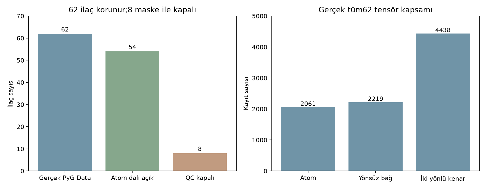
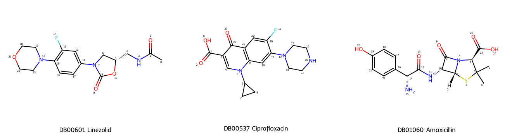
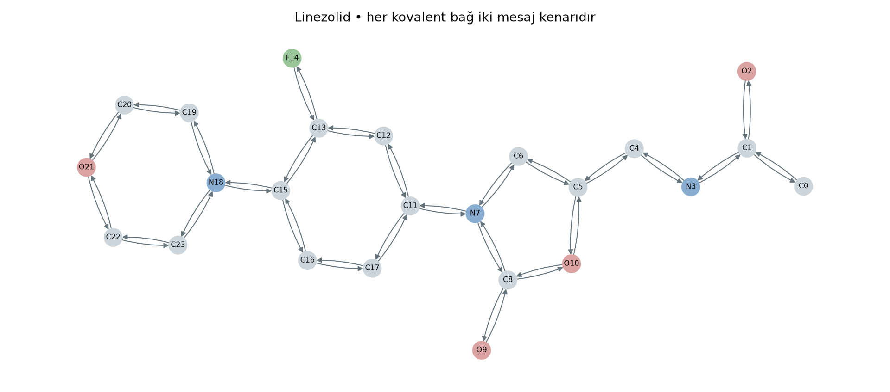
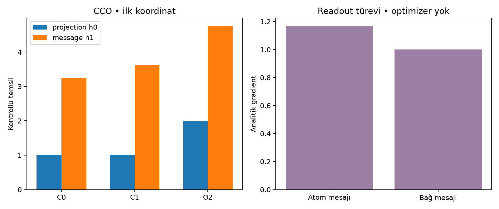
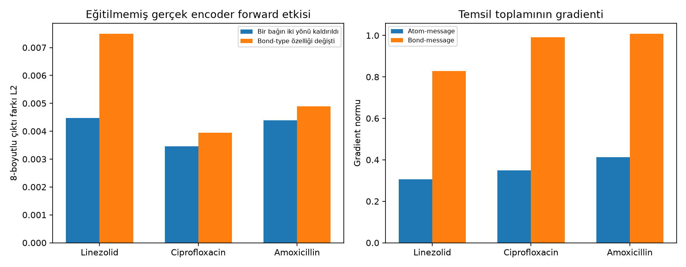
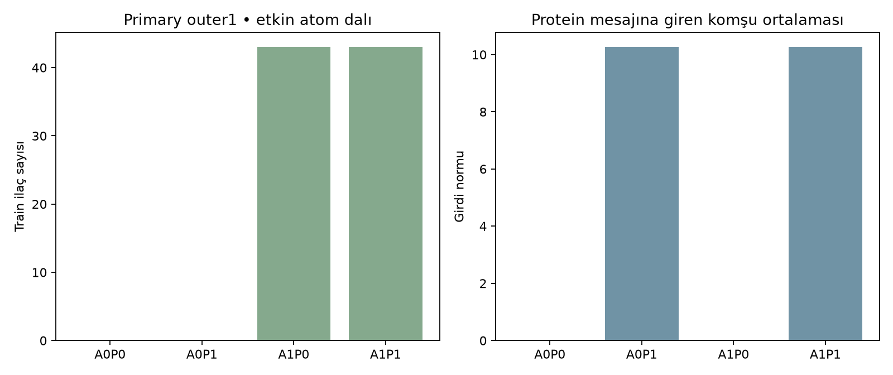

# WP10 — Moleküler graf ve encoder uygulaması

06.11.2026. **Teknik doğrulama tamamlandı. Gerçek dört kollu eğitim için ayrı kullanıcı onayı bekleniyor.** Bu aşamada optimizer çalıştırılmadı, gerçek PT kaybı veya outer PT skoru hesaplanmadı. WP11'e geçilmedi.

## 1. Uygulanan yapı

- **62 gerçek PyG Data**, 54 açık atom maskesi ve 8 QC bekletmesi doğrulandı. Envanterden ilaç silinmedi.
- Atom özellikleri44, bağ özellikleri14, hidden16, tek bond-aware residual mean katmanı, molekül başına mean readout ve8 boyutlu temsil uygulandı.
- Mevcut WP09 protein/kimya temsili141'e maskeli molekül8 ve atom maskesi1 eklenerek150 boyutlu füzyon kuruldu. A0P0/A0P1/A1P0/A1P1 aynı mimarinin anahtarlarıdır.
- **28/28 test geçti; 10.556 saniye.** Ayrıca40 frozen bağlamda dört varyant için160 etiketsiz train/query forward denetimi yapıldı. Gerçek veride PT başlığı kurulmadı.

## 2. Gerçek kaynak ve QC

WP04'te DrugBank XML'den çıkarılmış ChemAxon SMILES, CID köprüsü ve tam InChIKey kullanıldı. DrugBank version5.1/export2026-01-04; RDKit2026.09.1, PyG2.8.0 ve torch2.13.0 mevcut ortamda doğrulandı. Yeni biyolojik kaynak, API çağrısı veya paket kurulumu yoktur. Canlı PubChem yapısı bağımsız olarak yeniden doğrulandı denmiyor.

62 kaydın kimliği, atom/bağ/bileşen sayısı önceki WP04 ile aynı: **2061 atom, 2219 bağ, 4438 yönlü kenar**. Her Data için PyG validate ve ek şema/yön testleri geçti. Kaynak atomları, bağları ve fragmentleri korunur; stereo tamamlama, nötralizasyon veya tautomer düzenleme yapılmaz.

| id | name | atoms | bonds | components | review_flags |
| --- | --- | --- | --- | --- | --- |
| DB00578 | Carbenicillin | 27 | 29 | 1 | unspecified_atom_stereo |
| DB00798 | Gentamicin | 105 | 111 | 3 | multiple_components/unspecified_atom_stereo |
| DB00978 | Lomefloxacin | 25 | 27 | 1 | unspecified_atom_stereo |
| DB01044 | Gatifloxacin | 27 | 30 | 1 | unspecified_atom_stereo |
| DB01150 | Cefprozil | 29 | 31 | 1 | unspecified_double_bond_stereo |
| DB01155 | Gemifloxacin | 28 | 31 | 1 | unspecified_atom_stereo |
| DB01165 | Ofloxacin | 26 | 29 | 1 | unspecified_atom_stereo |
| DB06799 | Methenamine | 10 | 12 | 1 | unspecified_atom_stereo |

Gentamicin'in105 atomı ve3 bileşeni korunur; en büyük fragment seçilmez. Methenamine'in algoritma farkı bayrağı ve girdisiz eligible=False durumu aynı kalır. Tobramycin protein özelliği olmadan kimya ve uygun atom yolunda kalabilir. Sekiz QC kaydı atom dalında maskelenir; mevcut protein/kimya yolları korunur. Teknik parse başarısı tam biyolojik doğruluk kanıtı değildir.

**Yorum:**62 teknik graf ve54 açık atom dalı farklı kapsam ölçüleridir. Sekiz kayıt yanlış yapı ilan edilmedi; inceleme gerekçeleri korundu.

## 3. Özellik sözleşmesi

| Bölüm | Kodlama |
| --- | --- |
| Atom44 | Element10, total degree8, formal charge6, total H6, hybridization6, aromatic1, ring1, CIP5, isotope flag1 |
| Bağ14 | Bond type5, stereo7, conjugated1, ring1 |
| PyG Data | x float32[N,44]; edge_index int64[2,2B]; edge_attr float32[2B,14]; explicit num_nodes=N |
| Ayrı metadata | DrugBank ID, CID, kaynak SMILES/hash, QC, ham chiralTag/BondStereo/BondDir ve stereo referans atomları |

Kategoriler sabittir; OTHER desteklenir. ID, PT, raporlama sıklığı ve kalite_skoru özellik değildir. Data.y veya ek kimlik/etiket alanı reddedilir. Total degree ve total H, RDKit GetTotalDegree/GetTotalNumHs tanımlarıdır; yük, H ve aromatiklik ayrı ayrı test edildi.

Belirtilmemiş potansiyel atom stereosu UNASSIGNED_POTENTIAL olarak kodlanır. Belirtilmemiş potansiyel çift bağ feature token'ı STEREOANY'dır; ham BondStereo aynen metadata'da kalır. Bu, R/S veya E/Z tahmini değildir. Gerçek2061 atomda1743 NONE,187 R,120 S ve11 unassigned;2219 bağda2205 NONE,12 Z,1 E ve1 ANY vardır. İzotop/radikal örnekleri yalnız sentetik testtir, kohorta eklenmedi.

Her kovalent bağ iki mesaj yönüne açılır. Invariant bağ özellikleri iki yönde aynı ve hizalıdır; ham UP/DOWN işareti ters mesaja körlemesine taşınmaz. Atom indeksleri yalnız referanstır.

**Yorum:**Linezolid, Ciprofloxacin ve Amoxicillin kaynak yapıları atom indeksleriyle gösterilir.2D koordinatlar model girdisi değildir; bu bir klinik karşılaştırma değildir.

**Yorum:**Linezolid24 atom/26 bağ/52 yönlü kenardır. Oklar mesaj yönüdür, nedensellik yönü değildir. Çizgi biçimi burada bağ derecesini kodlamaz; bu bilgi edge_attr içindedir.

## 4. Forward ve gradient kanıtları

`h0=ReLU(Px)`; `m_ji=ReLU(U h0_j+V e_ji)`; `h1=h0+ReLU(S h0+mean_j m_ji)`; `mol=ReLU(Linear16→8(mean_i h1_i))`. Boş komşuluk ortalaması0'dır. Tek katman1-hop mesaj taşır;3D etkileşim veya uzun menzilli mekanizma çözümü iddia edilmez.

Kontrollü CCO örneğinde h0=[1,1,2], h1=[3.25,3.625,4.75], readout3.875. Bağ kaldırma3.166667, bond-type perturbasyonu4.875 verir. Atom-message türevi7/6, bağ-message türevi1; analitik beklenti1e-12 toleransında doğrulandı. Bunlar elle belirlenmiş kanıt ağırlıklarıdır; optimizer yoktur.

**Yorum:**Komşuluk ve bağ özelliğinin forward içinde gerçekten kullanıldığı gösterilir. Gradient hesabı parametre güncellemesi veya öğrenme değildir.

| id | name | edge_removed_output_L2 | bond_type_perturbed_output_L2 | atom_message_gradient_norm | bond_message_gradient_norm | optimizer_steps |
| --- | --- | --- | --- | --- | --- | --- |
| DB00601 | Linezolid | 0.0044793662 | 0.0074990719 | 0.30695823 | 0.82868209 | 0 |
| DB00537 | Ciprofloxacin | 0.0034609068 | 0.0039400016 | 0.34921852 | 0.99111107 | 0 |
| DB01060 | Amoxicillin | 0.0043946428 | 0.0048944956 | 0.41275544 | 1.0087034 | 0 |

**Yorum:**Üç gerçek molekülde kenar/bond-type değişimi çıktıyı etkiler; atom ve bağ mesaj parametrelerine gradient ulaşır. Bunlar feature düzeyinde yazılım probe'larıdır; kimyasal olarak geçerli alternatif ilaç veya biyolojik açıklama değildir. Ağırlıklar değişmedi.

62 kaynak molekülün atomları yeniden sıralanıp özellikleri yeniden çıkarıldı. Float64 readout farkı en fazla **2.08e-16**, önceden belirlenen tolerans1e-12 altındadır. Batch'e başka molekül eklemek ilgili readout'u değiştirmez.

## 5. Entegrasyon ve izolasyon

WP09 RoleMaskedPPI kodu ve sabit modelleri değişmedi. Yeni iskelet başlangıçtan kurulur; eski ağırlıklardan warm-start yapılmaz. A0'da molekül8+maske1 bloğu0; P0'da protein komşu mesajı0, self yolu korunur. Gerçek veri forward'unda head=None olduğundan PT skoru yoktur.

| variant | train_drugs | query_drugs | train_active_atom_mask | query_active_atom_mask | train_PPI_neighbor_input_norm |
| --- | --- | --- | --- | --- | --- |
| A0P0 | 49 | 13 | 0 | 0 | 0 |
| A0P1 | 49 | 13 | 0 | 0 | 10.261417 |
| A1P0 | 49 | 13 | 43 | 11 | 0 |
| A1P1 | 49 | 13 | 43 | 11 | 10.261417 |

**Yorum:**Primary outer1'de49 train/13 query aynı kalır; A1'de43/11 atom maskesi açıktır. Komşu girdi normu bir teknik büyüklüktür, performans değildir.160 forward denetimi bütün frozen bağlamları kapsar; daha önce null nedeniyle çıkarılan iki inner bağlamı gelecek eğitim kapsamına geri almaz.

load_context/validate_context_bundles frozen train/validation/test üyeliklerini kontrol eder. Generic encoder kendisi fold seçmez; gerçek kullanımda doğrulanmış context API'si gerekir. Yanlış molekül sırası, heldout/PT enjeksiyonu ve QC maskesi açma girişimi reddedilir. Protein cache'i graph/model hash'ine bağlıdır. Bir query'nin değişmesi başka query'yi, train cache'ini veya model durumunu değiştirmez.

Gerçek PT deposu okunmadı. Gelecekteki trainer için train-only PT loss, scaler, inner seçim ve heldout mutasyon testleri ayrıca gerekir; bugünkü encoder testi henüz yazılmamış trainer'ı doğrulamış sayılmaz.

## 7. Kapasite ve tekrar üretim

Molekül dalı **1592**, başlıksız protein/kimya+molekül toplamı **5512** parametredir. Opsiyonel sentetik K başlığı ile5512+151K sayımı test edildi; K=3/158/326 yalnız şekil sayımıdır. Küçük ilaç sayısı ve bağımlı PT'ler nedeniyle aşırı öğrenme riski sürer.

Seed20261106 ve context formülü korunur. Dört anahtar aynı context başlangıcını paylaşır. UNTRAINED_initial_state.npz/json yalnız başlıksız başlangıç durumudur; eğitilmiş yan etki modeli değildir. State hash: `a78ade023c3315ada0b7bf69bb70ad2894387aae7d2ac23155089a16dd490684`. Graph NPZ'leri allow_pickle=False ile gerçek Data'ya yeniden kurulur; tensor dtype/shape/byte hash'i tekrar üretim için, dosya hash'i provenans için kullanılır. Sürümler arası genel bit düzeyi garanti yoktur.

## 8. Testler ve çıktılar

**28/28 test, 10.556 saniye**; nihai log test_results_context_guard.txt. Önceki geliştirme logları korunur; başarısız test turu yoktur. Negatif şekil ve context enjeksiyon kontrolleri eklenince testler tekrar çalıştırıldı. Sentetik kimyadan sonra gerçek WP04 molekülleri kullanıldı.

**2384 önceki artefakt** aynı hash ile korundu. WP09/B0/B1/B2 modelleri, skorlar, splitler, hedefler, seed ve bütün QC kararları değişmedi. Run_status'a yalnız güncel durum eklendi.

| Çıktı | İşlev |
| --- | --- |
| scripts/wp10_molecular_graph.py | Sabit şema, gerçek Data, registry, güvenli cache ve yeniden kurulum |
| scripts/wp10_molecular_encoder.py | Bond-aware katman, readout, dört anahtar, füzyon ve cache/context sınırı |
| reports/qa/WP10/encoder_v1/ |62 graph NPZ, kaynak/stereo registry, tüm62 QA, permutation/gradient,160 forward ve hash kayıtları |
| configs/WP10_encoder_IMPLEMENTED_v1.json | Uygulama kaydı; training_enabled=False; tarihsel öneri değişmedi |
| notebooks/WP10_molecular_encoder.ipynb |9 çalıştırılmış kod hücresi, gerçek tablolar,6 açıklamalı PNG |
| tests/test_wp10_encoder.py |28 teknik test; optimizer veya PT eğitimi yok |
| docs/plan/WP10_MOLECULAR_DATA_CONTRACT_v1.md | Data, metadata, maske ve entegrasyon sınırı |
| reports/WP10_ENCODER_TRAINING_GATE.md | Gerçek dört kollu eğitim için ayrı onay kapısı |

Salt okunur tekrar kontrolü: `python -m unittest discover -s tests -p test_wp10_encoder.py -v`; eski logu ezmeden yeni dosyaya yaz. Tamamlanmış encoder v1 artefaktlarının üstüne yazılması engellenir.

**Teknik encoder doğrulamasında duruldu.** Atom/PPI performansı ölçülmedi; tam moleküler GiG araştırması tamamlandı denmez. WP09'un ek PPI katkısı gösterilemediği sonucu aynıdır. Unknown gerçek biyolojik negatif değildir; klinik risk, nedensellik veya hasta güvenliği iddiası yoktur. Gerçek dört kollu eğitim için kullanıcı onayı bekleniyor.
