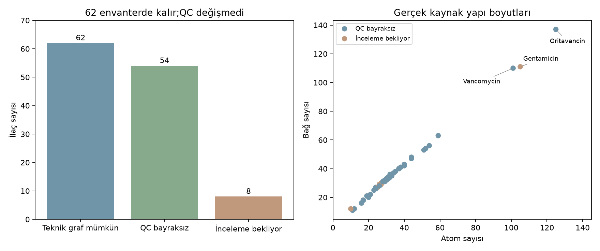
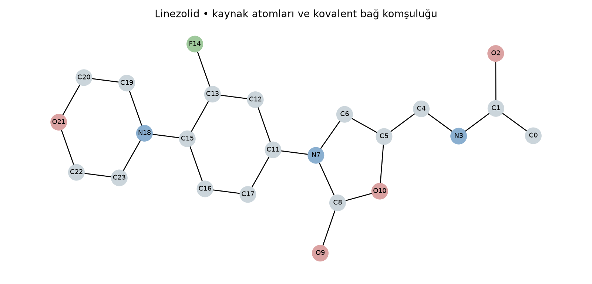
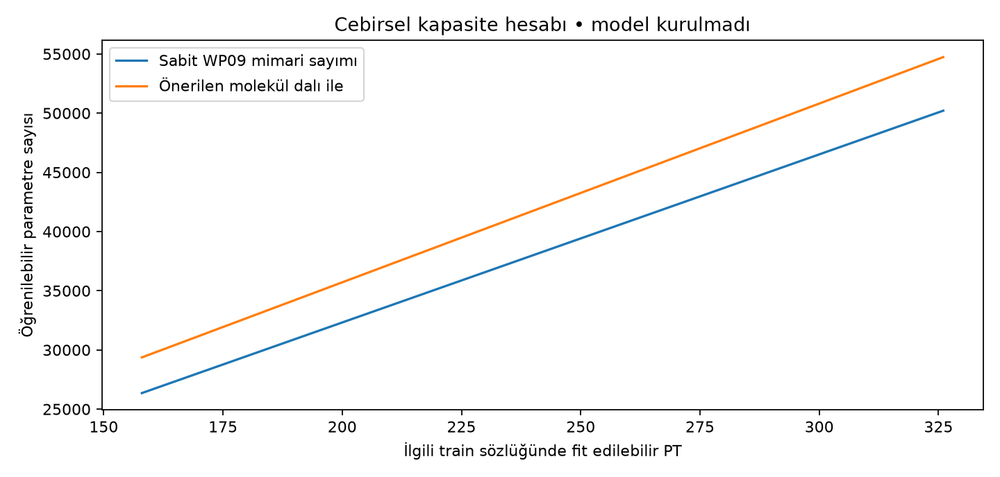

# WP10 — Kısa tasarım,uygulanabilirlik ve karar önerisi

06.11.2026. **DESIGN_FEASIBILITY_COMPLETE; AWAITING_USER_DESIGN_APPROVAL.** WP09 kullanıcı onayıyla kapatıldı. Bu aşamada moleküler model,PyG Data/eğitim tensörü,optimizer veya PT tahmini oluşturulmadı. Model eğitimi için yetki yoktur.

## 1. Yol haritasına uyum ve gerçek kaynak

Aktif `ROADMAP_V7.md` WP10'u **SMILES→atom/bond graf,RDKit→PyG Data,readout,küçük Molecular GNN,validasyon/scaffold ve kademeli karşılaştırma** olarak tanımlar;veri küçükse deney ertelenebilir. Yeni iş paketi icat edilmedi. Bu kullanıcı isteği yalnız tasarım/uygulanabilirlik kapısını açar.

Kaynak **WP04'te yerel DrugBank XML'den çıkarılmış SMILES**;PubChem CID köprüsü yerel kimlik bağıdır. Yol haritasındaki“mevcut PubChem SMILES” ifadesi,eldeki62 yapının canlı PubChem servisiyle bağımsız yapı doğrulaması yapıldığı anlamına gelmez. Bu kaynak farkı açık tutulur;yeniAPI/indirme yapılmadı. Aynı RDKit2026.09.1 ve salt okunur küçükWP04 tabloları kullanıldı. Mevcut `.deps/pyg` **2.8.0** import edildi;varsayılan yolda görünmemesi yokluğu değildir,yeni kurulum yapılmadı. Başvurulan çevrimiçi PyG latest belgesi2.9.0'dır;ileride uygulama önce kurulu2.8.0 API'siyle test edilmelidir.

## 2. Uygulanabilirlik ve sekiz QC kararı

62/62 SMILES yeniden parse/sanitize edildi;tam kaynak InChIKey,CID köprüsü ve önceki atom/bağ sayıları aynı. **2061 atom/2219 bağ**,ilaç başına10–125 atom;teknik atom-graf dönüşümü62/62 mümkündür. Bellekte küçük adjacency denetimi yapıldı;PyG üretim nesnesi/tensörü yazılmadı.

**Öneri:atom dalı için54 bayraksız yapı;sekiz QC kaydı mevcut maskeli kimya/protein yollarıyla kalsın.** Bu yeni nihai uygunluk kararı değildir,onay bekler.62 envanter,eski61 girdi uygunluğu veMethenamine abstention değişmez. Atom dalı bu ilk öneride ilaç sayısını artırdığını iddia etmez.

| id | name | review_flags | atoms | components |
| --- | --- | --- | --- | --- |
| DB00578 | Carbenicillin | unspecified_atom_stereo | 27 | 1 |
| DB00798 | Gentamicin | multiple_components/unspecified_atom_stereo | 105 | 3 |
| DB00978 | Lomefloxacin | unspecified_atom_stereo | 25 | 1 |
| DB01044 | Gatifloxacin | unspecified_atom_stereo | 27 | 1 |
| DB01150 | Cefprozil | unspecified_double_bond_stereo | 29 | 1 |
| DB01155 | Gemifloxacin | unspecified_atom_stereo | 28 | 1 |
| DB01165 | Ofloxacin | unspecified_atom_stereo | 26 | 1 |
| DB06799 | Methenamine | unspecified_atom_stereo | 10 | 1 |

Gentamicin üç organik bileşenin kaynak temsilidir;en büyük fragment veya tahmini karışım oranı seçilmez. Belirtilmemiş atom/çiftbağ stereo tamamlanmaz,rasemat varsayılmaz. Methenamine'in yeni/eski stereo algılayıcı farkı gerçek kayıp stereomer/yapı hatası sayılmaz. Hiçbir atom/bağ silinmez,nötralizasyon/tautomer/ana-fragment dönüşümü yapılmaz.54 kabul edilse bile kaynak kimliği “biyolojik doğruluk tamamen kanıtlandı” anlamına gelmez.

**Yorum:**62 teknik parse ile54 QC uygunluğu farklıdır. Büyük molekül daha fazla bağımsız eğitim ilacı sağlamaz;kimyasal bileşenler yeni ilaç diye çoğaltılmaz. İzotop belirtilmiş atom ve radikal sayısı bu62'de0'dır;gelecekte böyle bir kayıt ayrı QC gerektirir.

## 3. Önerilen atom/bağ veri sözleşmesi

| Bölüm | Sabit öneri | Koruma |
| --- | --- | --- |
| Atom x | 44 boyut:element10,total_degree8,charge6,totalH6,hybrid6,aromatic1,ring1,CIP5,isotope_flag1 | Kategoriler config'te sabit;OTHER;testten sözlük/normalizasyon öğrenme yok |
| Bağ edge_attr | 14 boyut:bond_type5,stereo7,conjugated1,ring1 | Her kovalent bağ iki yön;sütun/özellik hizası test edilir |
| PyG sınırı | x float32[N,44];edge_index int64[2,2B];edge_attr float32[2B,14];num_nodes=N | Self-loop/cross-molecule edge yok;izole atom sayısı explicit |
| Stereo | CIP R/S,UNASSIGNED_POTENTIAL,NONE,OTHER;bond stereo none/any/Z/E/cis/trans/OTHER | Ham chiralTag,stereo atomları,bond direction metadata korunur;çıkarılamayan stereo tahmin edilmez |
| Kimlik / hedef | drugID,CID,kaynakSMILES/hash ayrı metadata;y yok | ID,PT sayısı,sıklık,kalite_skoru,ATC veetiket girdi değildir |
| Batched readout | Her ilaç kendi atom altgrafı;batch sınırları explicit | Query molekülü train protein/cache'ini veya diğer ilaçları değiştiremez |

Ardışık atom indeksleri veya ham @/@@ yönleri doğrudan invariant sayısal özellik değildir;atom renumbering sonrası stereo/CIP ve readout tutarlılığı test edilmelidir. Aromatik atom ve aromatik bağ ayrı alanlardır. [RDKit Book](https://www.rdkit.org/docs/RDKit_Book.html). PyG'nin x/edge_index/edge_attr şekilleri veexplicit num_nodes yaklaşımı önerinin temelidir. [PyG Data](https://pytorch-geometric.readthedocs.io/en/latest/generated/torch_geometric.data.Data.html).

**Yorum:**Linezolid'in gerçek kovalent komşuluğu çizilir;bu çizim bond-order/stereo'nun tamamını görsel olarak kodlamaz. Bunlar sözleşmede edge_attr/metadatadır.2D çizim koordinatları girdi değildir;3D konformer veya moleküler mesaj geçişi henüz çalıştırılmadı.

## 4. Küçük mimari,füzyon ve kapasite

Önerilen tek katman: `h0=ReLU(P_atom x)`;`h1=h0+ReLU(S h0+mean_j ReLU(U h0_j+V e_ji))`;hidden16,boş komşuluk mean0. Bütün atomların mean readout'u→Linear16→8/ReLU→atom maskesi. Mean readout bir PyG seçeneğidir;sum/count duyarlılığı ayrıca onay olmadan eklenmez. [global_mean_pool](https://pytorch-geometric.readthedocs.io/en/latest/generated/torch_geometric.nn.pool.global_mean_pool.html). Bağ koşullu mesaj gereklidir;büyük edge-conditionedNNConv alternatif olup uygulanmadı. [NNConv](https://pytorch-geometric.readthedocs.io/en/latest/generated/torch_geometric.nn.conv.NNConv.html).

İlk öneri **geç füzyon**:mevcut56→32 protein-PPI/4rol+5→8 kimya temsil141'e masked atom8+atom_mask1 ekle→150→trainPT başlığı. Daha karmaşık drug-node/üst-graf mesaj geçişi ek kapasite ve yeni sızıntı testleri gerektirir;şimdilik önerilmez. Atom-only dal daha ucuz keşif alternatifidir;aynı multimodal factorial sorusunun yerine geçmez.

Yeni molekül dalı cebirsel **1592 parametre**;başlığa9K eklenir,toplam **5512+151K**. Mevcut inner/outer K158–326 için **29370–54738** parametre;WP09 sayımı26356–50212. Bunlar model kurulmadan denklemlerden hesaplandı. Train ilaçları az,PT'ler bağımlı ve unknown;başlık baskın kapasitedir. Bir katman sadece yerel çevreyi taşır,3D stereo etkileşim veya biyolojik mekanizma çözümü iddia edilmez.

**Yorum:**1592 parametrelik ek dal bile head boyutu ve küçük kohort nedeniyle risksiz değildir. Sonuçları iyileştirmek için genişlik/katman/seed araması önerilmedi. İleride yeterli örnek/inner destek/kararlı gerçek encoder testi sağlanmazsa ROADMAP gereği eğitim ertelenebilir;başarı vaat edilmez.

## 5. Kontrollü karşılaştırma ve değişmeyecek protokol

Birincil öneri aynı genişletilmiş mimaride **A0P0/A0P1/A1P0/A1P1**:atom mesaj dalı var/yok × PPI komşu mesajı var/yok. A0'da atom blok/maske kapalı,P0'da PPI edge_index boş;diğer girdiler/uygunluk vehead şekli aynı. Her contextte aynı başlangıç/seed veortak geçerli inner kapsamı gerekir. Atom katkısı sabitP durumunda,PPI katkısı sabitA durumunda;etkileşim farkların farkıyla keşifsel incelenebilir.

**EskiWP09 A0 modeli yeni mimarinin kontrollüA0 hücresi yerine geçirilmez:**başlık/kapasite farklıdır. Yeni deney izin alırsa dört hücre birlikte aynı init ilekurulur;eskiWP09,B0/B1/B2 modelleri veOOF skorları değişmez tarihsel referans olarak kalır. R0/R1/R2 eklenmesi ayrı kapsam kararıdır;eklenirse mevcut null hash/seed/v3 NA politikası veüç metrik eşit ortalaması korunur,en iyi tekrar/score ensemble yoktur.

Eski connectivity dış5/iç3 ve ayrı scaffold OR≥0,8 stres üyelik/hash'leri,seed20261106,train-only scaler/PT/fittable sözlükleri ve paired54/own61 anahtarları korunur. Levofloxacin/Ofloxacin ayrılmaz. Yeni atom girdileri label-free statik kaynak olup train kaynaklarını genişletmez;unknown gerçek negatif ilan edilmez. Öğrenilen işlemler yalnız train'de fit edilir;outer test mimari,epoch veya seçime girmez. Önerilen gelecekteki optimizer/early-stop öncekiWP09 politikasının aynısıdır;bugün çalıştırılmadı.

## 6. Uygulamadan önce zorunlu test planı ve karar kapısı

Gelecek uygulamada:atom/bondID ve iki-yön edge_attr hizası;parsing/QC/fragment korunumu;OTHER ve bilinmeyen stereo;atom permütasyonu/readout değişmezliği;ayırt edici gerçek/sentetik örnekte bağ kaldırma/bağ tipinin forward etkisi vegradient;atom kapalı/PPI kapalı davranışı;izole atom;batch izolasyonu;heldout etiket/değer mutasyonu;query→protein cache izolasyonu;train-only fit/target veparametre sayısı testleri zorunludur. **Bu encoder henüz yazılmadığı için bu gelecekteki testler geçmiş sayılmaz.** Mevcut12 kapanış/tasarım testi kaynak/QC/cebirsel sözleşmeyi doğrular.

| karar | öneri | alternatif | onay |
| --- | --- | --- | --- |
| D10-01 Kaynak ve QC | Yerel WP04 SMILES;54 atom-maskesi,8 bekletme;62 envanter/61 mevcut input kapsamı | Sekiz bayrağı ayrı kimlik/stereo/formülasyon incelemesi sonrası yeni sürümle açmak | BEKLİYOR |
| D10-02 Özellikler | 44 atom/14 bağ;stereo unknown ayrı;ham stereo metadata;PyG y yok | Daha geniş kimyasal sözlük/3D;şimdilik önerilmez | BEKLİYOR |
| D10-03 Mimari | Tek bond-aware mean16,readout8,150 fusion;5512+151K parametre | Önce yalnız molekül dalı;tam üst-graf GiG sonraki kapsam kararı | BEKLİYOR |
| D10-04 Kıyas | A0P0/A0P1/A1P0/A1P1 aynı genişletilmiş mimari ve ortak frozen keys | Yalnız bağımsız atom-only keşfi;PPI etkisi için yeterli kontrollü kıyas olmaz | BEKLİYOR |
| D10-05 Null kapsamı | Birincil2x2;null eklenirse mevcutR0/R1/R2 vev3 NA,metrik eşit ortalama | Nullu ilk atom-encoder aşamasından ertelemek;onayla sabitle | BEKLİYOR |
| D10-06 Eğitim ve durma | WP09 optimizer/seed/early-stop politikasını miras al;önce gerçekforward/gradient/split testleri | Veri yetersizse moleküler eğitimi ertele;sonuç-kör gerekçe gerekir | BEKLİYOR |

Girdi/karar sözleşmesi `configs/WP10_design_PROPOSED_v1.json` içinde **training_enabled=False/model_implemented=False** olarak açık kalır. `notebooks/WP10_design_feasibility.ipynb` beş çalıştırılmış hücreyle62 tabloyu,8 bayrağı,gerçek Linezolid grafını,özellik/kapasite veonay seçeneklerini gösterir. `reports/qa/WP10/design_v1/` kaynak hash'lerini,tüm62 yapı auditini,alan dağılımlarını vekarar tablosunu taşır. **Tam moleküler GiG tamamlanmış değildir;bu tasarım uygulanıp gerçek forward/gradient veablation doğrulanmadan bu ad kullanılmaz. Tasarım önerisinde duruldu;uygulama veözellikle eğitim için kullanıcı onayı bekleniyor.**
