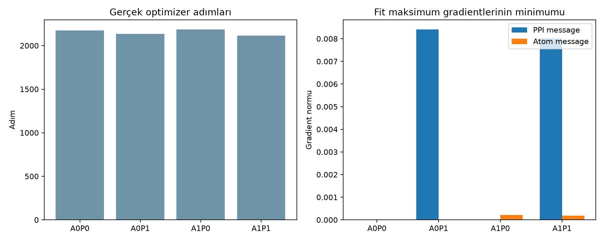
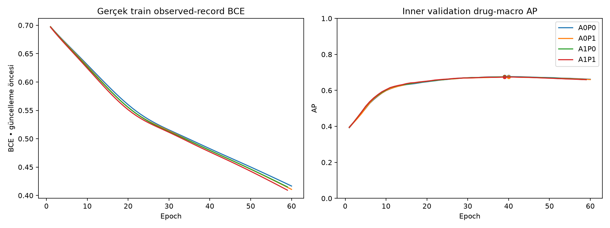
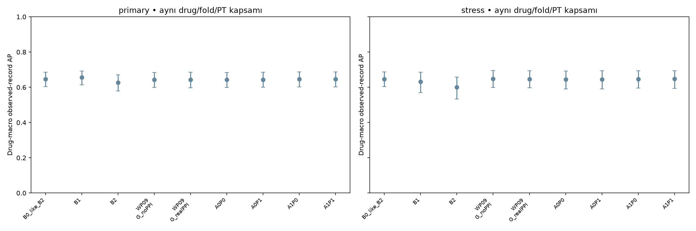
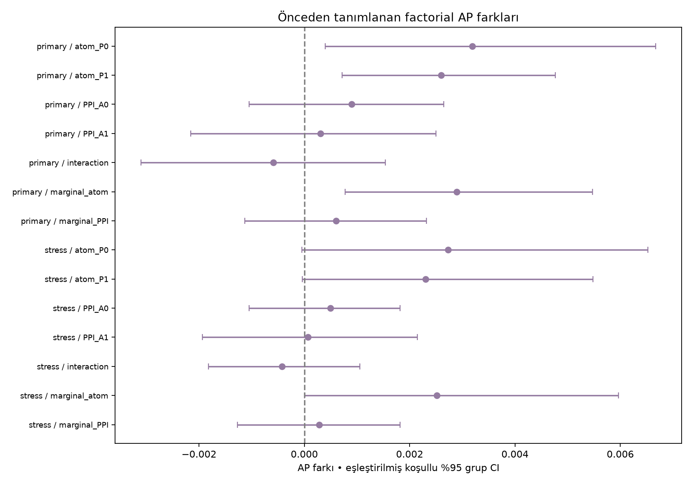
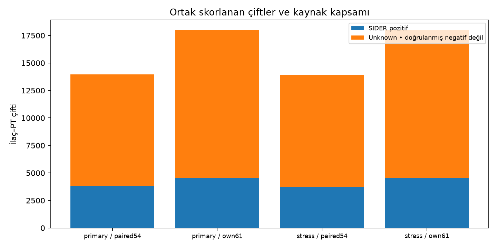
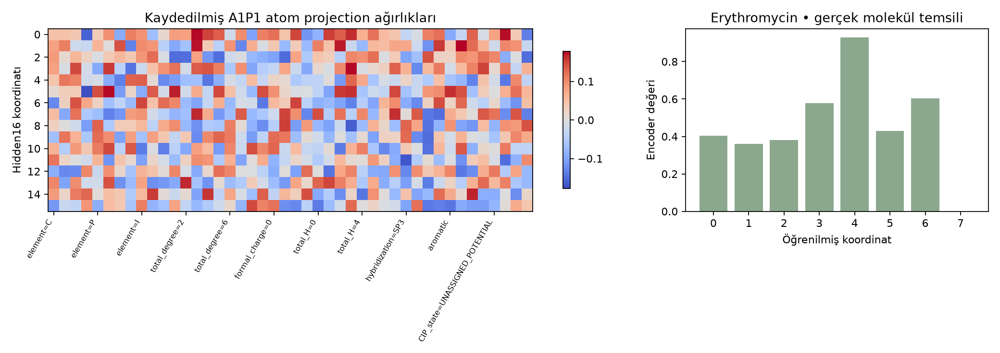
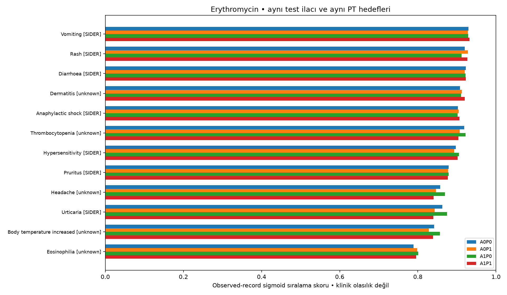

# WP10 — Gerçek dört kollu eğitim ve değerlendirme

07.11.2026. **Eğitim ve değerlendirme tamamlandı; kullanıcı sonuç incelemesi bekleniyor. WP11 başlatılmadı.** Kullanıcının açık onayıyla kabul edilmiş WP10 encoder'ı gerçek PT kayıtları üzerinde eğitildi. Birincil deney yalnız A0P0/A0P1/A1P0/A1P1 içerir; shuffled PPI deneyleri eklenmedi.

## 1. Bilimsel sonuç

Ana paired54 drug-macro observed-record AP: **A0P0=0.642740, A0P1=0.643636, A1P0=0.645930, A1P1=0.646234**. Aynı mimaride atom dalı küçük pozitif farklar verdi: PPI kapalıyken+0.003189 (koşullu%95CI[+0.000398;+0.006675]), PPI açıkken+0.002598 ([+0.000717;+0.004763]). Ana marjinal atom farkı+0.002894 ([+0.000773;+0.005470]).

**Bu küçük, sabit OOF'ye koşullu keşifsel bir kazanımdır; genel üstünlük veya dış doğrulama değildir.** Stres protokolünde koşullu atom farklarının CI'ları sıfırı içerir. Stres marjinal atom farkının alt sınırı yaklaşık+0.000006 olup sıfıra çok yakındır; güçlü bir sağlamlık kanıtı olarak sunulmaz.

Ana marjinal PPI farkı+0.000600 (CI[−0.001133;+0.002316]); etkileşim−0.000591 ([−0.003102;+0.001541]). **Ek PPI katkısı veya atom–PPI sinerjisi gösterilmedi.** Negatif etkileşim nokta tahmini de antagonizma kanıtı değildir. Atom ve PPI'nin forward/gradient içinde gerçekten kullanılması teknik olarak doğrulandı; tahmin katkısı ayrı ölçüldü.

A1P1−B0_like_B2=−0.000370 (CI[−0.011528;+0.010018]); A1P1−B1=−0.009408 ([−0.025901;+0.005600]); A1P1−WP09_realPPI=+0.003355 ([−0.002902;+0.010505]). Bu referanslara karşı belirgin ek üstünlük gösterilmedi. B2 karşısındaki ana+0.019995 farkının CI'ı pozitiftir; ancak mimari, nonlineer öğrenme ve kapasite de değiştiğinden bu toplam fark yalnız atom veya PPI topolojisine atfedilemez.

## 2. Onay, koruma ve değişmeyen kaynaklar

AGENTS, aktif ROADMAP, WP10 teknik raporu, veri sözleşmesi ve eğitim kapısı esas alındı. Yeni yol haritası oluşturulmadı. Tarihsel öneri/uygulama config'leri değişmedi; yeni eğitim onayı ve sonuç öncesi kararlar `training_v1/run_config.json` içine yazıldı. `code_contract_before_fit.json` kodu, job üyeliklerini ve sözleşmeyi üretim fitlerinden önce dondurdu.

**2487 önceki dosya** içerik hash'iyle korundu: B0/B1/B2 veWP09 modelleri/skorları, eski notebook/rapor/testler, splitler, hedef sözlükleri, seed veQC kararları değişmedi. Yeni biyolojik kaynak, API, paket kurulumu veya büyük ham dosya taraması yoktur. Yerel DrugBank XML kaynaklı WP04 SMILES/CID köprüsü, RDKit2026.09.1/PyG2.8.0, temiz56 protein özelliği, dört rol ve strict insan STRING700 kullanıldı. K12/MG1655 koşullu ağ ve80 özelliksiz context eklenmedi.

Envanter **62 ilaç/1061 kaynak PT/6416 pozitif ilişki** olarak korundu. Atom dalı54 QC uygun yapıda açık, sekiz inceleme kaydında maskeli kapalıdır. Gentamicin fragmentleri ve belirtilmemiş stereokimya korunur. Methenamine girdisiz abstention; Tobramycin protein eksiğiyle mevcut kimya/atom yollarında kalır. ID/PT sıklığı/kalite_skoru veya hedeflerden türetilmiş skorlar girdi değildir.

## 3. Gerçek eğitim ve optimizer kanıtı

**152/152 fit OK:112 inner+40 outer model, toplam8611 gerçek optimizer adımı.**152 sayısal NPZ ve152 metadata JSON ayrı sürümde saklandı; bütün62 üzerinde ayrıca deployment fit'i yapılmadı. Dört kol aynı contextte aynı başlangıç ağırlıkları, hedefler, uygun ilaçlar ve150 boyutlu mimariyi kullanır.

Protein56→32 tek residual mean-PPI; kimya5→8; dört ayrı rol readout; atom44/bağ14, hidden16 tek bond-aware residual mean, molekül mean→8 ve atom maskesi. Başlıksız5512, K PT ile5512+151K parametre. A0 atom bloğu/maskesi0; P0 protein komşu mesajı0. A0 molekül parametreleri gradient almaz ve değişmez. P0'da kullanılmayan sıfır-gradientli mesaj ağırlığının AdamW decay ile kayması komşuluk kullanımı kanıtı sayılmaz.

| model | fits | optimizer_steps | min_weight_change | min_max_PPI_gradient | min_max_atom_gradient | min_max_bond_gradient |
| --- | --- | --- | --- | --- | --- | --- |
| A0P0 | 38 | 2174 | 4.12352836 | 0.00000000 | 0.00000000 | 0.00000000 |
| A0P1 | 38 | 2134 | 3.79521224 | 0.00841110 | 0.00000000 | 0.00000000 |
| A1P0 | 38 | 2186 | 3.89693330 | 0.00000000 | 0.00020752 | 0.00075696 |
| A1P1 | 38 | 2117 | 3.59790533 | 0.00801992 | 0.00018692 | 0.00070522 |

**Yorum:**Aktif dallara gerçek eğitimde gradient ulaştı, seçilmiş ağırlıklar değişti. Bu teknik öğrenme kanıtıdır; biyolojik nedensellik veya performans üstünlüğü değildir.

Full-batch observed-record proxy BCEWithLogitsLoss, class/pos weight yok; AdamW lr0.001/weight_decay0.001; CPU1 thread, float32 ve deterministik algoritmalar kullanıldı. Sabit girdiler bir kez doğrulanarak aynı kabul edilmiş katman hesabı yürütüldü; bu yol dört kolda referans encoder ile **çıktı ve gradient bakımından bire bir eşit** olarak test edildi. Encoder veya hiperparametre değiştirilmedi.

## 4. Nested CV ve test sınırı

Ana connectivity dış5/iç3 ve ayrı scaffold/≥0.8 stres üyelik/hash'leri aynı kaldı. Eski ortak inner politikası korundu: primary outer2 inner2/3; stress outer2 inner1/3; diğer outerlarda üç inner. Önceden dışlanan iki bağlam dört model için8 iş olarak ayrı tabloda durur. Bu turda yeni null denenmedi veya başarılı fold araması yapılmadı.

Inner max200/patience20/min_delta0.0001; ilk finite AP checkpoint'i ve daha sonra>min_delta iyileşme seçildi, eşitlikte erken epoch korundu. Her kolun outer epoch'u aynı ortak inner kümesindeki kendi best-epoch medyanından .5 yukarı belirlendi. Outer son eğitimleri37–51 epoch'tur.

| protocol | outer_fold | A0P0 | A0P1 | A1P0 | A1P1 |
| --- | --- | --- | --- | --- | --- |
| primary | 1 | 40 | 40 | 39 | 39 |
| primary | 2 | 39 | 39 | 44 | 39 |
| primary | 3 | 40 | 42 | 38 | 43 |
| primary | 4 | 43 | 41 | 45 | 41 |
| primary | 5 | 39 | 43 | 43 | 41 |
| stress | 1 | 43 | 42 | 40 | 39 |
| stress | 2 | 51 | 47 | 48 | 48 |
| stress | 3 | 47 | 44 | 48 | 43 |
| stress | 4 | 40 | 38 | 39 | 39 |
| stress | 5 | 39 | 37 | 37 | 39 |

**Yorum:**Grafik ilk sıralı inner bağlamın dört gerçek eğrisidir; bütün152 history dosyası saklıdır. Train loss güncelleme öncesi, validation ölçüleri güncelleme sonrası kaydedilir. Outer test hiçbir seçim veya early-stop kararında kullanılmadı.

Mevcut B2 train-only sözlük/fittable maskeleri aynen kullanıldı; en az5 pozitif kullanılabilir ilaç ve2 bağımsız grup desteği test edildi. Train'de tek proxy sonucu olan25 context/PT olayı başlık dışında/NA kaldı; fallback yoktur. Bu25 benzersiz PT sayısı değildir. Dönüşümler eski train-only istatistiklerdir; yeni scaler fit edilmedi.

Gerçek fit API'si yalnız exact train/validation etiket sözlüklerini kabul eder. Validation girdisi outer test ilaçları ve test-only unseen proteinlerden arındırılır; moleküller de yalnız istenen train/validation ID'lerinden alınır. Kaynak label tablosunun bellekte okunması heldout etiketlerin trainer'a geçmesi anlamına gelmez; gerçek mutasyon testinde outer etiket/kimya/molekül değerleri değiştirildiğinde checkpoint ve parametreler aynı kaldı.

Tüm inner seçimleri ve outer ağırlıklar hash ile kaydedildikten sonra ayrı score aşaması143896 OOF çift skoru üretti. Query train protein cache'ini veya model durumunu değiştiremez. WP07 inceleme grafı yüklenmedi. Fit/validation başarısızlığı olsaydı ortak finite/evaluable kesişim/min2 ve bütün outer dört-kol NA politikası uygulanacaktı; **bu çalışmada ek teknik fit başarısızlığı olmadı**. Düşük skorlar elenmedi.

## 5. Aynı kapsamda birincil sonuçlar

| protocol | model | estimate | CI95_low | CI95_high |
| --- | --- | --- | --- | --- |
| primary | B2 | 0.626239 | 0.579200 | 0.670094 |
| primary | B1 | 0.655642 | 0.613111 | 0.692041 |
| primary | B0_all_train | 0.646507 | 0.603990 | 0.685192 |
| primary | B0_like_B2 | 0.646604 | 0.604371 | 0.685339 |
| primary | B0_like_B1 | 0.643787 | 0.602130 | 0.681983 |
| primary | WP09_G_noPPI | 0.643021 | 0.598498 | 0.684101 |
| primary | WP09_G_realPPI | 0.642880 | 0.597754 | 0.684922 |
| primary | A0P0 | 0.642740 | 0.599338 | 0.684775 |
| primary | A0P1 | 0.643636 | 0.600493 | 0.685583 |
| primary | A1P0 | 0.645930 | 0.602034 | 0.686449 |
| primary | A1P1 | 0.646234 | 0.602210 | 0.687649 |
| stress | B2 | 0.599696 | 0.534057 | 0.657665 |
| stress | B1 | 0.631871 | 0.570003 | 0.686266 |
| stress | B0_all_train | 0.647157 | 0.604955 | 0.687391 |
| stress | B0_like_B2 | 0.646561 | 0.604518 | 0.687085 |
| stress | B0_like_B1 | 0.643993 | 0.602932 | 0.684432 |
| stress | WP09_G_noPPI | 0.647625 | 0.598204 | 0.695293 |
| stress | WP09_G_realPPI | 0.646605 | 0.596392 | 0.694412 |
| stress | A0P0 | 0.644339 | 0.589875 | 0.692480 |
| stress | A0P1 | 0.644836 | 0.590380 | 0.693689 |
| stress | A1P0 | 0.647070 | 0.595567 | 0.693796 |
| stress | A1P1 | 0.647141 | 0.594519 | 0.694628 |

**Yorum:**B0/B1/B2 veWP09 sabit skorları aynı anahtarlarda yeniden değerlendirilir; hiçbir referans yeniden fit edilmedi. Eski141 boyutlu WP09, yeni150 boyutlu A0 kontrol hücresinin yerine geçirilmedi. Aynı mimarili dört kol katkı sorusunu ayırır; modellerin test sonuçlarına göre yeni ayarı yapılmadı.

## 6. Önceden tanımlı factorial kontrastlar

| protocol | contrast | estimate | CI95_low | CI95_high |
| --- | --- | --- | --- | --- |
| primary | atom_P0 | 0.003189 | 0.000398 | 0.006675 |
| primary | atom_P1 | 0.002598 | 0.000717 | 0.004763 |
| primary | PPI_A0 | 0.000896 | -0.001048 | 0.002651 |
| primary | PPI_A1 | 0.000305 | -0.002156 | 0.002497 |
| primary | interaction | -0.000591 | -0.003102 | 0.001541 |
| primary | marginal_atom | 0.002894 | 0.000773 | 0.005470 |
| primary | marginal_PPI | 0.000600 | -0.001133 | 0.002316 |
| stress | atom_P0 | 0.002730 | -0.000045 | 0.006525 |
| stress | atom_P1 | 0.002305 | -0.000043 | 0.005478 |
| stress | PPI_A0 | 0.000497 | -0.001052 | 0.001818 |
| stress | PPI_A1 | 0.000072 | -0.001939 | 0.002143 |
| stress | interaction | -0.000425 | -0.001821 | 0.001052 |
| stress | marginal_atom | 0.002518 | 0.000006 | 0.005964 |
| stress | marginal_PPI | 0.000284 | -0.001273 | 0.001816 |

**Yorum:**atom_P0=A1P0−A0P0; atom_P1=A1P1−A0P1; PPI_A0=A0P1−A0P0; PPI_A1=A1P1−A1P0. Etkileşim bu atom farklarının farkıdır. Marjinal atom/PPI farkları iki koşullu farkın eşit ortalamasıdır, skor ensemble'i değildir. Ana atom farkları küçüktür ve bu koşullu analizde pozitiftir; stresin koşullu atom aralıkları sıfırı içerir. PPI ve etkileşim için tutarlı ek katkı gösterilmedi. Bu kontrastlar biyolojik nedensel etkiler değildir.

1000 eşleştirilmiş yapısal grup bootstrap tekrarı bütün modeller için aynı çekimleri kullanır; Levofloxacin/Ofloxacin aynı grupta örneklenir. Seed20261106+9000+protocol_index korundu. CI sabit OOF modellerine ve tek init seed politikasına koşulludur; yeniden eğitim, seed/örneklem varyansı, kaynak kayıt yanlılığı veya dış kohort belirsizliğini kapsamaz. Çoklu keşifsel karşılaştırmalar genel istatistiksel üstünlük veya bağımsız dış doğrulama olarak sunulmaz. Sıfırı içeren aralık eşdeğerlik kanıtı değildir.

## 7. Own61, bilinmeyenler ve kapsam sınırı

| protocol | scope | model | estimate | CI95_low | CI95_high |
| --- | --- | --- | --- | --- | --- |
| primary | own61 | A0P0 | 0.638836 | 0.599562 | 0.677321 |
| primary | own61 | A0P1 | 0.639746 | 0.599827 | 0.679235 |
| primary | own61 | A1P0 | 0.642380 | 0.604101 | 0.679735 |
| primary | own61 | A1P1 | 0.642273 | 0.603033 | 0.680280 |
| stress | own61 | A0P0 | 0.636989 | 0.585405 | 0.682037 |
| stress | own61 | A0P1 | 0.637416 | 0.585291 | 0.682897 |
| stress | own61 | A1P0 | 0.639436 | 0.590668 | 0.683342 |
| stress | own61 | A1P1 | 0.639416 | 0.589624 | 0.683446 |

| protocol | scope | scored_drugs | scored_pairs | observed_positive_scored | unknown_NOT_verified_negative | out_of_scored_vocab_positive | class_AUROC_NA |
| --- | --- | --- | --- | --- | --- | --- | --- |
| primary | paired54 | 54 | 13964 | 3820 | 10144 | 1685 | 50 |
| primary | own61 | 61 | 18004 | 4576 | 13428 | 1829 | 57 |
| stress | paired54 | 54 | 13890 | 3751 | 10139 | 1754 | 50 |
| stress | own61 | 61 | 17970 | 4569 | 13401 | 1836 | 51 |

**Yorum:**Her model61 ilaç skorlar;62 envanter korunur ve Methenamine abstain kalır. Ana paired54'te13964 çift=3820 kaynak pozitif+10144 unknown. Aynı ilaçlardaki5505 kaynak pozitifin **1685**'i hedef/fit kapsamı dışındadır;bu bütün62'nin yanlış-negatif sayısı değildir. Tüm1061 PT uzayında başarı iddiası yoktur.50 pooled class-AUROC NA ayrıca raporlanır. Complete-case53 yeni eğitim kohortu olarak kullanılmadı.

Micro AP ve fold içi class-AUROC ayrı tablolarda yer alır. AP average precision'dır, trapez PR-AUC değildir. Pooled class-AUROC yalnız diagnostic olarak işaretlendi; fold içi sınıf-AUROC tanımlı fold özetlerinin betimleyici ortalamasıdır ve bağımsız-fold CI üretilmedi. Unknown çiftler gerçek biyolojik negatif değildir; kalibrasyon/özgüllük/klinik risk iddiası yoktur.

## 8. Gerçek model ve örnek ilaç çıktısı

Örnek sonuçlardan önce belirlenen alfabetik ilk primary paired54 ID'dir: **DB00199 Erythromycin**, primary outer3 test query. Dört modelin aynı PT sözlüğündeki gerçek OOF skorları `example_drug_PT_ranking.csv` içinde saklıdır. Kaynak kimya MW733.937,LogP1.7856,HBD5,HBA14,TPSA193.91; target2/enzyme3/transporter6/carrier0 ve QC açık molekül girdisi kullanıldı.

**Yorum:**Projection matrisi ve8 boyutlu molekül temsili primary_o03_final_A1P1 NPZ'sinden gelir; temsili veri değildir. Bu koordinatlar önem/SHAP/nedensel açıklama değildir. WP11 yapılmadı.

**Yorum:**Hedefler A1P1'in gerçek ilk12 PT sırasından seçilerek aynı PT'lerde dört modelin kaydedilmiş skorları gösterilir. Notebook her modelin kendi ilk10'unu da verir. Unknown yüksek skor gerçek yanlış pozitif veya klinik yan etki ilan edilmez. Bu tedavi önerisi, hasta riski hesabı veya klinik doğrulama değildir.

## 9. Doğrulama ve dosyalar

**19/19 trainer testi geçti;17.812 saniye.** Bunlar13 üretim fit/OOF/factorial testi ve6 preflight testidir. Gerçek optimizer/gradient/ağırlık güncellemesi, train-only PT ve grup desteği, heldout label/value mutation, encoder eşitliği, aynı init/ID, epoch commit, kayıtlı NPZ'den referans encoder ile skor üretimi, aynı outer fit'in tam tekrar üretimi, query/cache izolasyonu, bağımsız sklearn AP, aynı karşılaştırma anahtarları ve factorial aritmetiği doğrulandı. Kontrollü RAM test fitleri üretim modeline yazmaz veya hiperparametre aramaz.

| Çıktı | İşlev |
| --- | --- |
| models/WP10_factorial_training_v1/ |152 eğitilmiş NPZ+152 metadata;seed/PT/ID/epoch/hash ve kaynak izi |
| reports/qa/WP10/training_v1/run_config.json | Açık eğitim onayı ve sonuç öncesi yöntem/kontrast/CI kararları |
| training_jobs_frozen.csv,code_contract_before_fit.json |152 iş ve kaynak/kod sözleşmesinin sonuç öncesi hash'i |
| model_fit_summary.csv,history/,selections/ | Her fitin epoch/loss/AP/gradient/optimizer ve seçim izi |
| outer_training_and_evaluation.csv | Fold bazlı epoch/loss/test metrikleri ve kapsam |
| oof_predictions.csv,prediction_status_all62.csv | Gerçek skorlar,61 kapsam ve62-ID abstention/NA durumu |
| metrics_with_group_CI.csv,factorial_contrasts_group_CI.csv,paired_reference_differences.csv | Aynı kapsamda metrikler,atom/PPI/etkileşim ve sabit referans farkları |
| comparison_keys.csv,evaluation_coverage.csv,per_class_metrics.csv | Exact anahtarlar,unknown/kapsam dışı/sınıf NA ve destekler |
| feature_fit_provenance.csv,fold_train_validation_test_scope.csv | Train-only dönüşüm,hedef ve graf/molekül ID kaynağı |
| example_drug_inputs.json,example_drug_PT_ranking.csv | Gerçek test query girdisi ve dört model sıralaması |
| notebooks/WP10_factorial_training.ipynb |9 çalıştırılmış kod hücresi,7 gerçek PNG ve Türkçe bilimsel yorum |
| tests_actual_trainer.txt,artifact_validation.json,manifestler | Testler,hash/kaynak/model/notebook kapanış kanıtı |

## 10. Kapanış sınırı

Bu, **molekül atom–bağ encoder'ı ve protein-PPI/rol dalını geç füzyonla birleştiren GNN** deneyidir. Bütün tez veya tüm olası Graph-in-Graph mimarileri tamamlandı denmez. Atom dalının küçük koşullu kazanımı daha güçlü frekans/kimya referanslarına genel üstünlük sağlamadı; ek PPI veya sinerji gösterilmedi. Kaynak kayıtları sıralandı; klinik yan etki olasılığı,nedensellik veya hasta güvenliği doğrulaması yapılmadı.

**WP10 eğitim ve değerlendirmesi tamamlandı;sonuçlar kullanıcı incelemesine sunulur. WP11'e geçilmedi.**
