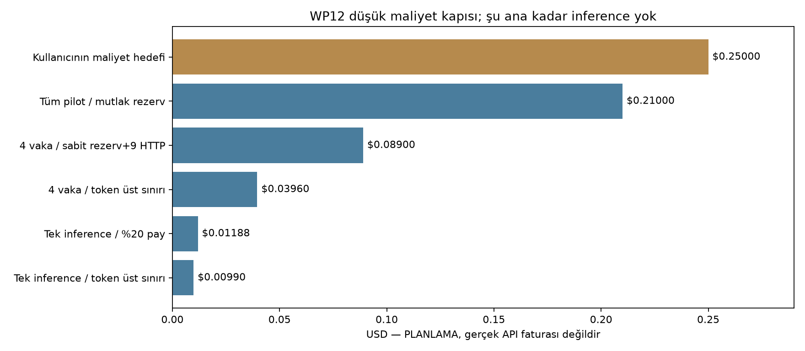

# WP12 — OpenAI API kaynaklı açıklama pilotu: çevrimdışı hazırlık

08.11.2026 — **Hazırlık tamamlandı; gerçek API deneyi NOT_RUN. İlk istek kullanıcı onayını bekliyor.** Model erişimi, hesap bakiyesi ve gerçek API şema kabulü henüz hesap üzerinden sorgulanmadı.

Kullanıcı, yerel Gemma denemeleri ve Qwen'in donanım engelinden sonra ayrı bir bulut pilotunu açıkça yetkilendirdi. Aktif ROADMAP'in WP12 satırı yerel küçük LLM tanımlar; bu yeni sağlayıcı kullanıcının açık kapsam kararıyla ayrı bir WP12 ekidir. Yol haritası, eski yöntem veya kabul edilmiş sonuçlar geriye dönük değiştirilmedi.

## Tamamlanan işler ve gerçek kanıt

| Kontrol | Gerçek durum |
|---|---|
| API client, kaynak adaptörü, bütçe ve anahtar koruması | Hazır |
| Yeni offline regresyon testleri | **35/35 PASS**; test transport'unda socket açılması yasak |
| Windows PowerShell parser | **5.1.26100.9711 /0 sözdizimi hatası** |
| Yürütücüde policy/client SHA-256 eşliği | PASS |
| Anahtar kullanılabilirliği | **VAR**; yalnız boolean, gerçek değer kaydedilmedi |
| `.env*` ignore davranışı | Geçici Git deposunda PASS; gerçek kök şu anda Git deposu değil |
| Kimlik doğrulamalı API çağrısı / inference | **0 /0** |
| Hesaba özgü model erişimi | PENDING; ilk kullanıcı yürütmesindeki model GET ile denetlenecek |
| Sunucunun adaptör şemasını kabul etmesi | PENDING; offline JSON Schema doğruluğu sunucu kabulüyle aynı değildir |
| OpenAI gerçek Türkçe/kaynak sadakati/usage/maliyet | NOT_RUN; sonuç icat edilmedi |
| İnsan semantik onayı / otomatik yayın | PENDING / KAPALI |

Testler tam alıntı ve hash'leri, DB00199/quote/sayfa hizasını, V2↔API aday semantiğini, token/maliyet sınırlarını, cached/muhakeme muhasebesini, timeout/HTTP hata/redaksiyonunu, atomik tek-deneme ve10 çağrı sınırlarını, sahte anahtar sızıntısını engellemeyi, dotenv/Git gizliliğini, ret/eksik yanıt/yanlış model ayrımını ve fiyat eskimesini kapsar. Testteki sentetik API yanıtları yalnız teknik fixture'dır; gerçek bulut deneyi olarak raporlanmamıştır. Yeni kütüphane kurulmadı; mevcut python-dotenv/jsonschema ve standart HTTP istemcisi kullanıldı.

## S01 için dışarı gönderilecek gerçek veri

Soru ve kabul kriteri dondurulmuş19 senaryodan aynen alınır. İki özgün Erythromycin alıntısı toplam537 karakterdir:

| Amaç | Fiziksel sayfa | Metin aralığı [başlangıç,bitiş) | Quote-ID |
|---|---:|---|---|
| Ürün/etkin madde kimliği |1|[1028,1281)|`quote:d6a07837c21263d02077b2e692bb266a46f2ffa230d53d5ebc10988738fe6bbe`|
| Formülasyon |6|[987,1271)|`quote:e9288119add1a9a49d1b3353510b966b508729035697e4afe9519f4af95aaeb5`|

Tam alıntılar `reports/qa/WP12/openai_api_pilot_v1/outbound_disclosure_S01.json` ve çalıştırılmış notebook'ta gösterilir. Kısa alıntılar kesilmez; kaynak metinleri model yanıtına göre değiştirilemez. Tam PDF, yerel dosya yolu, proje/model klasörü, PT sözlüğü, SHAP veya GNN skoru gönderilmeyecek. Ana DrugBank kimliği DB00199 ürün/tuz/doz eşdeğerliği olarak sunulmayacak. Token sayımı ve inference aynı seçilmiş alıntıları sağlayıcıya iki ayrı endpoint'te iletir.

## Model, şema ve açıklama sınırları

Resmî belgeler `gpt-5.4-mini` için Responses/Structured Outputs desteğini ve `gpt-5.4-mini-2026-03-17` snapshot'ını doğruluyor. Gerçek hesabın bu modele erişimi henüz kontrol edilmedi; key değeri veya bakiye çıktısı alınmadı. [Resmî model belgesi](https://developers.openai.com/api/docs/models/gpt-5.4-mini).

Onaylı V2 S01 şeması ayrı API adapter v1'de kök `result` nesnesi, tipli enum ve nested anyOf ile ifade edildi. Asıl V2 doğrulayıcı da korunarak çalışır. S01'in okunabilir iki kaynağı varken IMAGE_TEXT_UNAVAILABLE reddi meşru sayılmaz. API-native refusal ayrı başarısız/ret kaydıdır. Desteklenen alt küme ve dönüşüm gerekçesi [adaptör sözleşmesinde](../docs/plan/WP12_OPENAI_API_ADAPTER_v1.md) yer alır; [resmî Structured Outputs belgesi](https://developers.openai.com/api/docs/guides/structured-outputs) esas alındı.

Türkçe sistem yönergesi açıklaştırıldı; `language=tr` tek başına başarı değildir. Kayıtlı sınırlı dil taraması insan değerlendirmesinin yerine geçmez. JSON Schema, uygulama/ID ilişkileri, gerçek Türkçe, kaynak sadakati, yanlış ret/eksik bilgi ve insan incelemesi ayrı kaydedilir. Yapısal geçiş olsa bile açıklama otomatik onaylanmaz. `reported_in_PDF` ve `predicted_by_GNN` ayrı tutulur; ikincisi NOT_REQUESTED/null kalır.

## Bütçe ve durdurma mekanizması

Resmî standart fiyatlar /1M token: input **$0,75**, cached input **$0,075**, output **$4,50**. Bunlar konfigürasyonda doğrulama zamanı ve24 saat geçerlilikle tutulur. [Resmî fiyat/model sayfası](https://developers.openai.com/api/docs/models/gpt-5.4-mini).

- Giriş üst sınırı6000; önce sunucuda tam istek/şema sayılır. Fazlaysa inference gönderilmez ve metin kısaltılmaz. [Token sayım API'si](https://developers.openai.com/api/reference/resources/responses/subresources/input_tokens/methods/count).
- `max_output_tokens=1200`, reasoning effort `none`. Çıkış sınırı görünür ve varsa muhakeme tokenlarını birlikte kapsar; usage'taki reasoning toplam output'a ikinci kez eklenmez. [Responses çıktı/usage sözleşmesi](https://developers.openai.com/api/reference/resources/responses/methods/create).
- Bir inference için en kötü tam-fiyat token hesabı **$0,0099**, %20 payla **$0,01188**. Sabit rezerv **$0,02/inference +$0,001/HTTP**. En fazla10 inference ve ayrıca en fazla10 toplam HTTP ile rezerv **$0,21**, operasyonel tavan **$0,24**, hedef **<$0,25**.
- Metadata/token sayım ücretinin sıfır olduğu varsayılmadı; ek HTTP rezervi gerçek ücret iddiası değildir. Vergi veya raporlanmayan fatura farkları token tahmininin dışındadır. Yaklaşık$5 bakiye kullanıcı beyanıdır.
- Gerçek token maliyeti `((input−cached)×0,75 +cached×0,075 +output_total×4,50)/1M`. Usage/cached alanı eksikse UNKNOWN; sıfıra doldurma yoktur. Başlatılmış ama tamamlanması/maliyeti bilinmeyen inference kalıcı billing-stop oluşturur.
- Yalnız S01 yürütücüsü hazırdır. Proje-geneli atomik tek-attempt slotu hatada da tüketilir; otomatik retry veya en iyi yanıt seçimi yoktur. Başarısız çıktılar saklanır. Fiyat süresi dolarsa veya herhangi bir kaynak/yöntem hash'i değişirse ağ başlamadan durur.

Sonuç öncesi dört-vaka aday planı S01/S04/S07/S17'dir. Olası1 model GET +4 sayım +4 inference =9 HTTP; token üst hesabı$0,0396, %20 payla$0,04752; sabit rezerv$0,089. Bunlar **planlama** değerleridir, gerçek API faturası veya model başarısı değildir. Diğer üç vakanın yürütümü S01'in kullanıcı incelemesinden önce yetkili değildir.



Grafik küçük token bütçesinin kullanıcı hedefi içindeki yerini gösterir; model kalitesi hakkında sonuç vermez. Gerçek yanıt/iddia–PDF karşılaştırma görselleri ilk API yanıtı olmadan oluşturulmadı.

## Gizlilik ve önceki sonuçların korunması

`.env` Git'e eklenmedi; `.env`, `.env.*`, `.env*` ve özel anahtar desenleri ignore kapsamındadır. Anahtar ortam değişkeni önceliğiyle, yoksa `.env` içindeki yalnız OPENAI_API_KEY alanından yüklenir. Değeri, uzunluğu, prefix'i veya hash'i kaydedilmez. Gerçek gizli dosyalar envanter/hash manifestlerine dahil edilmez. Authorization header kaydedilmez. Kimlik hataları anahtarı yansıtabileceğinden HTTP hata gövdesi yerine güvenli durum/kod tutulur; normal model yanıtı ham haliyle korunur.

Önceki3709 kamusal dosya başlangıç hash'leri alındı; gizli dosyalar kapsam dışıdır. Önceki deney/kaynak/QA dosyaları korunur. Yalnız kullanıcının istediği `.gitignore` ek kuralları ve tarihçesi bayt olarak korunan `run_status.md` güncellemesi izinli değişikliktir. Ayrıntılı yeniden denetim `public_preservation.json` içindedir. Gemma V1/V2 FAIL, Qwen NOT_RUN; B0/B1/B2, GNN, SHAP ve PPI sonuçları aynıdır.

## Kullanıcı onayı sonrası tek komut

**Bu komut bu hazırlıkta çalıştırılmadı. İlk gerçek API isteği için önce kullanıcı onayı gerekir.** Normal kullanıcı PowerShell'inde, `.env` hazırken:

```powershell
& "C:\Users\emrey\Downloads\Graph-Tez-V7_SADELESTIRILMIS_CODEX\Graph-Tez-V7\scripts\WP12_OpenAI_UserSingleCase_v1.ps1" -RunFirstCase
```

`-RunFirstCase` olmadan yalnız çevrimdışı var/yok durumu gösterilir; API çağrılmaz. Yürütücü AppContainer'da durur; ağ kısıtlaması aşılmaz. Fiyat kaydının geçerlilik zamanı `configs/WP12_OPENAI_API_PILOT_v1.json` içindedir; eskirse tekrar denemek yerine resmî fiyat kaydı yenilenmelidir.

Onaylı tek yürütme model erişimini ve tam giriş tokenını denetler; yalnız bu iki kapı geçerse bir S01 inference gönderir. Çıktı `reports/qa/WP12/openai_api_user_runs_v1/` altında oluşur. İlk gerçek sonuç klasörü incelenmeden başka senaryo yoktur. Eğitim, model indirme,19×3, otomatik yayın ve WP13 yapılmadı.

Üretilenler: adaptör sözleşmesi; modüler güvenlik/adaptör/client; ayrı maliyet konfigürasyonu; tek-vaka PowerShell yürütücüsü;35 test ve log; kaynak paylaşım JSON'u; korunmuş yerel/NOT_RUN bulut karşılaştırma CSV/JSON'u; planlama PNG'si; `notebooks/WP12_OpenAI_API_offline_preparation.ipynb`; QA hash manifesti ve güncel durum kaydı. Gerçek bulut sonuçları bir sonraki, kullanıcı onaylı aşamaya aittir.
