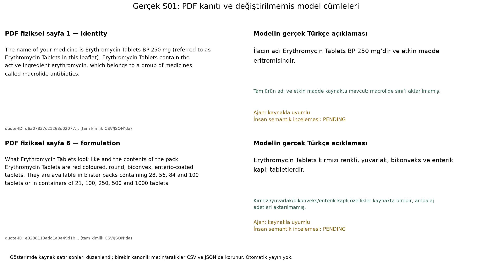
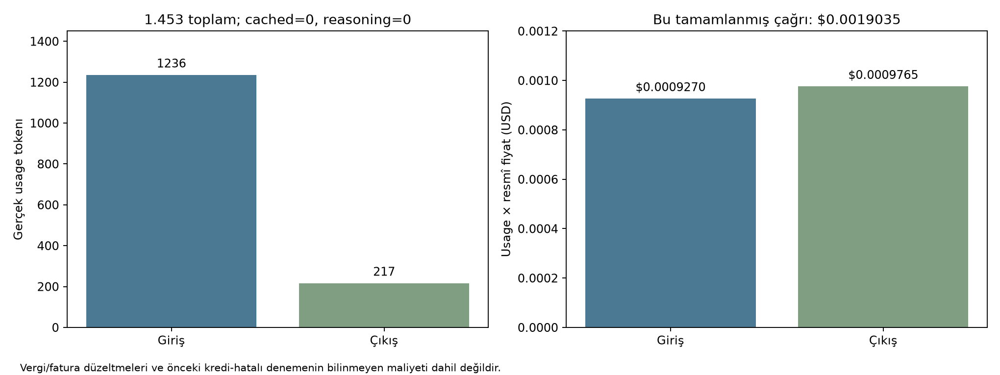
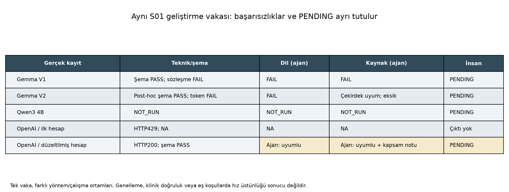

# WP12 — Gerçek S01 OpenAI yanıtının bağımsız incelemesi

08.11.2026. Run: `20261108_164416_6fd67845f94e4074818e71b22470cf22`.

**Sonuç:** Teknik olarak completed; iki Türkçe açıklama Codex ajanının kaynak okumasında destekleniyor. **İnsan semantik onayı PENDING, otomatik yayın kapalıdır.** Eski model, prompt, kaynak, kabul kriteri veya şema değiştirilmedi; yeni inference yapılmadı.

## Gerçek model yanıtı

Aşağıdaki iki cümle çıktının `explanation_tr` değerleriyle aynıdır; yazım/ürün adı/Unicode apostrofu düzeltilmedi:

> İlacın adı Erythromycin Tablets BP 250 mg’dir ve etkin madde eritromisindir.

> Erythromycin Tablets kırmızı renkli, yuvarlak, bikonveks ve enterik kaplı tabletlerdir.

Tam model JSON mesajı:

```json
{"result":{"schema_version":"WP12-local-llm-candidate-v2","status":"candidate","refusal_code":null,"items":[{"explanation_tr":"İlacın adı Erythromycin Tablets BP 250 mg’dir ve etkin madde eritromisindir.","source_scope":"product_identity","statement_kind":"identity","evidence_ids":["quote:d6a07837c21263d02077b2e692bb266a46f2ffa230d53d5ebc10988738fe6bbe"]},{"explanation_tr":"Erythromycin Tablets kırmızı renkli, yuvarlak, bikonveks ve enterik kaplı tabletlerdir.","source_scope":"product_identity","statement_kind":"formulation","evidence_ids":["quote:e9288119add1a9a49d1b3353510b966b508729035697e4afe9519f4af95aaeb5"]}],"language":"tr"}}
```

Tam HTTP cevabı özgün run klasöründeki `inference_response_raw.json` içinde kalır. Yeni `exact_model_message.txt` yalnız bu gövdeden birebir alınan çıktı mesajıdır; raw referans/hash dosyası kaynak dosyasını gösterir. CSV/JSON kopyalarıyla metin round-trip eşliği ayrıca kontrol edildi.

## Teknik, uygulama ve semantik sonuçların ayrılması

| Boyut | Sonuç |
|---|---|
| Model | `gpt-5.4-mini-2026-03-17` |
| HTTP / completion |200 / completed; error=null; incomplete_details=null|
| Request-ID |`req_9287c40c42ee49169f4b1f217a813aff`|
| Response-ID |`resp_0794078cf83d6b36016af07cb6360887d28b4a53fb9a616a1e`|
| JSON Schema |API adapter v1 ve özgün S01 V2 denetiminde PASS|
| Uygulama/source-ID |PASS; iki ayrı identity/formulation item, doğru birincil quote-ID|
| Türkçe |Ajan: gerçek Türkçe; ürün adı kaynak yazımıyla korunmuş|
| Kaynak sadakati |Ajan: dönen iki item kaynakça destekleniyor; kapsam notları aşağıda|
| Ret / yeni olgu |Ret yok; dönen iki item'da desteklenmeyen yeni iddia gözlenmedi|
| İnsan kararı |PENDING; ajan değerlendirmesi insan/klinik doğrulama yerine geçmez|
| Tekrar kararlılığı |Değerlendirilemez: yalnız bir completed API yanıtı var|
| RAM/VRAM |Bu API koşusunda toplanmadı; NOT_COLLECTED|

## PDF kaynak sadakati

Kullanıcı PDF'si `data/user_pdfs/pil.502.pdf`, SHA-256 `1b8182521f1314c595451e14a881caa930ba8a5df3c99d468e50429d0e61533e`, 6 fiziksel sayfa. Kaydedilmiş çıkarıcıyla aynı PyMuPDF sürümü `2.1` ve aynı sort/flags tanımıyla yalnız ilgili1/6sayfalar salt okunur kontrol edildi. Tam sayfa metni, aralık ve alıntı hash'leri eşleşiyor. Tam iki sayfanın PNG'leri görsel olarak incelendi; PDF değiştirilmedi. Hash ve kullanıcı provenansı yayıncı doğruluğu/güncel klinik etiket garantisi değildir.

| Item | Birincil kaynak | Ajan okuması ve sınır |
|---|---|---|
| Ürün adı / etkin madde |Fiziksel1; [1028,1281)|Erythromycin Tablets BP250mg ürün adı ve eritromisin etkin maddesi açıkça mevcut.250mg ürün adı bağlamında aktarılmış; tedavi dozu önerilmemiş. Makrolid sınıfı özetlenmemiş.|
| Formülasyon/görünüm |Fiziksel6; [987,1271)|Red coloured/round/biconvex/enteric-coated tablet özellikleri doğru aktarılmış. Ambalaj adetleri özetlenmemiş.|

Bu iki eksiltme kaynakla çelişen bir iddia değildir; dondurulmuş kısa S01 ölçütü bütün alıntının tam çevirisini zorunlu kılmıyor. Ancak çıktı bütün prospektüsün veya kaynak paragrafının eksiksiz özeti olarak sunulamaz. Seçilen iki alıntının qualifier alanı boş; sıklık, risk, istisna veya ana DrugBank DB00199 ile ürün/tuz/formülasyon eşdeğerliği eklenmemiş. Doğru bir kaynak-ID tek başına semantik destek kanıtı sayılmadı; iki cümle ayrıca okunup kaynakla karşılaştırıldı.

Tam kanonik alıntılar, quote-ID'ler, sayfa/aralıklar ve özgün model cümleleri `source_claim_comparison.csv` ve `agent_item_source_review.json` içinde yan yanadır. Görsel yalnız gösterim için kaynak satır sonlarını düzenler; kanonik metni değiştirmez.



`reported_in_PDF` trusted wrapper'da kaynaklı aday olarak kalır. `predicted_by_GNN={status: NOT_REQUESTED_IN_WP12, artifact_ref: null}`; model skoru, SHAP, Δz, yeni MedDRA/yan etki etiketi üretilmedi. Bu işlem SIDER/model girdisi veya eğitim etiketi oluşturmaz.

## Gerçek usage, süre ve maliyet

| Alan | Değer |
|---|---:|
| Önkontrol / gerçek giriş tokenı |1236 /1236|
| Cached input |0|
| Toplam output |217|
| Output içindeki reasoning |0|
| Toplam usage |1453|
| Üretim HTTP süresi |3,953 s|
| Giriş token maliyeti |$0.000927|
| Çıkış token maliyeti |$0.0009765|
| Bu completed çağrı token maliyeti |**$0.0019035**|

Hesap raw usage'tan bağımsız Decimal aritmetiğiyle yeniden yapıldı:1236×$0,75/1M +0×$0,075/1M +217×$4,50/1M =$0,0019035. Cached ve reasoning0 gerçekten response alanlarında; bilinmeyenleri0'a doldurma yoktur. Muhakeme output toplamına ikinci kez eklenmedi.217 çıktı tokenı yalnız Türkçe cümleleri değil tüm JSON/source-ID metnini kapsar. İstenen ve dönen service_tier default, tools boş. [Resmî fiyat/model kaynağı](https://developers.openai.com/api/docs/models/gpt-5.4-mini).

Bu rakam vergi/diğer fatura düzeltmeleri hariç token fiyat hesabıdır; fatura/bakiye API'si sorgulanmadı. İlk kredi-hatalı isteğin usage'ı yok, maliyeti UNKNOWN kalır; tüm pilotun gerçek ücretini$0,0019035 diye sunamayız. Eski/yeni toplam6HTTP ve2inference rezervi$0,046; eski$0,023 rezerv silinmedi.10toplamHTTP/10inference, $0,24 operasyonel tavan ve<$0,25 hedef korunuyor. Rezerv ücret değildir.



HTTP3,953s ağ/servis toplamıdır. Gemma'nın server_total_duration ölçümü farklıdır; bu iki değer üzerinden donanım/model hız üstünlüğü iddia edilmez. Tek yanıtla gecikme dağılımı veya kararlılık ölçülmedi.

## Bütün gerçek deneylerin karşılaştırılması

GemmaV1:orijinal FAIL; şema teknik PASS olsa da yanlış ret/İngilizce/ID-amaç hatası. GemmaV2:orijinal TOKEN_COUNT_ALIGNMENT_FAILED; ayrı post-hoc şema/ID PASS, iki İngilizce cümle ve yönerge eksiklikleri aynı. Qwen3 4B:NOT_RUN. İlk OpenAI hesabı:HTTP429 kredi engeli, model kalitesi değerlendirilemez. Yeni OpenAI hesabı:HTTP200, şema/uygulama PASS, iki Türkçe cümle ajan okumasında destekli, insanPENDING.



Bu karşılaştırma aynı S01'in önceki yöntem geliştirmesinden sonra yapılmıştır. Aynı senaryoda bir başarı, bağımsız genelleme, klinik doğruluk veya üstünlük kanıtı değildir. JSON+CSV bütün başarısız/NOT_RUN satırlarını ve özgün mesajları korur; eksik ücret veya çıktı0'a çevrilmez. Doxycycline sınıf/BUN istisnası, Erythromycin bilinmeyen sıklık ve yasak kaynak-dışı görevler bu çıktıyla test edilmiş sayılmaz.

## QA ve durma kararı

20 run dosyasının kayıtlı hash'i/21dosyalık envanter doğrulandı; önceki hesapla request bayt hash'i de aynı. İki sayfada yeni okuma/slice/hash kontrolleri; kaynak-ID/scope/purpose; raw→JSON; train/model/PDF katmanı ayrımı; usage/Decimal/caps; tek üretim/3HTTP; iki-scope bütçesi ve insan kapısı olmak üzere12 yeni test PASS. Eski çalışma kayıtları, başarısızlıklar, manifestler ve kaynak PDF korunur. Ayrı kanıt manifesti ve status tarihçesi yazılır; anahtar/.env okunmadı veya hash'lenmedi. Herhangi bir inference, eğitim veya yöntem araması yapılmadı.

**Öneri:** İlk S01 için ajan teknik/kaynak incelemesi olumlu; iki gerçek cümleyi kullanıcının semantik olarak değerlendirmesine sun. İnsan onayı olmadan yayın veya diğer senaryolara geçiş yoktur. Mevcut10toplamHTTP kuralında yalnız4HTTP kapasitesi kaldığından önceki dört-vaka planının tamamı artık aynı şekilde çalıştırılamaz. Sonraki değerlendirmede S07 sınıf/BUN ve S04 bilinmeyen sıklık kritik farklı kanıtlardır; yeni yürütme/ek istek politikası ancak kullanıcı onayıyla hazırlanır. Bu tur19×3 veya WP13'e geçilmedi.
