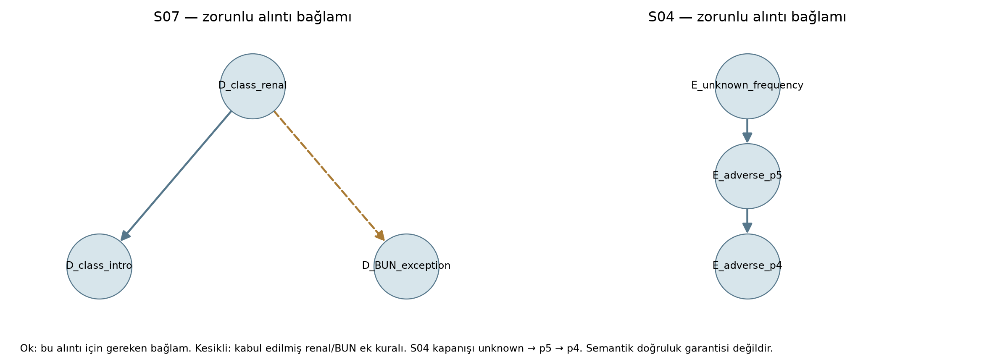
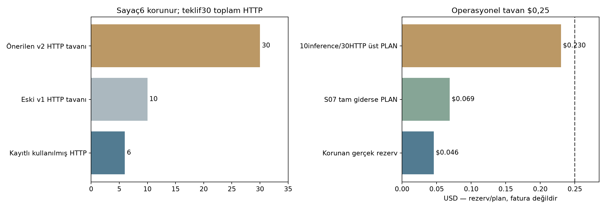

# WP12 — S07 tek-deneme hazırlığı ve bütçe v2 önerisi

08.11.2026. **S07 NOT_RUN, S04 LOCKED_NOT_RUN; hiçbir yeni API isteği yapılmadı.**

## S01 insan beyanı

Kullanıcı iki S01 cümlesinin kaynakla uyumuna ilişkin olumlu insan beyanı verdi. Bu ifade tam run/raw-response hash'ine bağlı ayrı beyan alındısına yazıldı. Mevcut model `human_review=PENDING`, `human_review_pending.json`, eski QA ve manifestler değiştirilmedi. Kimliği işletim sistemi adından çıkarılmadı. Formal olay için kullanıcı tarafından adlandırılmış proje inceleyici kimliği/rolü, yetki kaydı, inceleme zamanı, açık karar ve iki item/quote kapsamı gerekir. Teknik saf doğrulayıcı yazma/yayınlama yapmaz. Template ve registry henüz aktif değildir; bu tur formal APPROVED olayı yoktur. Süreç `docs/plan/WP12_HUMAN_DECISION_CONTROL_v1.md` içinde açıklanmıştır. S07 hazırlığının yetkisi ayrıca bu turdaki açık kullanıcı isteğidir.

## Kaynak profilleri ve kapsam

| Senaryo | Gerçek kaynak | Alıntı / karakter | Yeni çalışma |
|---|---|---:|---|
| S07 |Doxycycline, fiziksel7 sınıf/renal +fiziksel4 BUN istisnası, DB00254|3 /380|Tek deneme yürütücüsü hazır; NOT_RUN|
| S04 |Erythromycin, fiziksel4/5 ve bilinmeyen sıklık, DB00199|3 /3803|Şema/bağlam hazır; yürütme kilitli|

3803 sayısı örtüşen sayfa5 ve alt-alıntıyı içerir; benzersiz PDF karakteri değildir. Soru, kabul kriteri, quote-ID, sayfa/aralık, kaynak metni, scope/purpose/qualifier aynen korunur. Yeni kaynak veya kanıt eklenmez. Ham iki PDF hash'i ve kabul edilmiş kaynak bundle/anotasyon hash'leri doğrulanır; büyük diğer kaynaklar yeniden taranmaz.

S07 renal item; sınıf girişini ve iki cümlelik D_BUN_exception'ı birlikte cite etmelidir. Tetracycline sınıf anlatımı doğrudan doxycycline olayı olarak sunulmamalı; apparently dose related, may cause, studies to date indicate ve impaired renal function koşulları anlamca korunmalıdır. İstisna evrensel güvenlik veya kesin pozitif/negatif etiketi değildir.

S04 bilinmeyen sıklık; p5 devamı üzerinden p4 bağlamını da taşımalıdır. Not known/frequency cannot be estimated ifadesi risk yüzdesi/yaygınlık veya kesin yoklukla değiştirilemez. Bağlam alıntıları kesilmez; kaynak nitelemeleri özet sırasında sessizce silinmemelidir. `semantic_review_plan.json` dosyaları bu kaynak türlerine özgü gerçek inceleme sorularını içerir; henüz model sonucu değildir.



Grafik, seçilmiş gerçek alıntıların kaynak-bağlam bağımlılıklarını gösterir. Kesikli kenar önceki kabul edilmiş renal/BUN bağlam kuralıdır. Bu yapı semantik başarıyı garanti etmez; model ilişkiyi yanlış aktarabilir.

## Model, şema ve yöntem sürümü

gpt-5.4-mini aynı kalır; reasoning none, input6000/output1200,90s timeout, store=false, truncation disabled, tools boş, otomatik retry/Batch yok. Yeni model/LLM indirme/eğitim yoktur. S01'e özgü iki sabit cümle testi kullanılmaz. Yeni genel system ve ayrı S07/S04 yönergeleri, bu senaryoların çıktıları görülmeden sürümlendi. S07 istisna item'ında kaynak iki cümlesini korumak için iki kısa Türkçe cümleye izin verilir; eski S01 prompt veya yanıtı değiştirilmez.

Root object/result nested anyOf, candidate/refused dalları, required alanlar ve additionalProperties=false ile Structured Outputs alt kümesi kullanılır. Candidate tam3item; refused boş items ister. Her birincil kaynağa ait scope/kind, izinli ID ve gereken bağlam uzunluğu şemada sınırlandırılır. Birincil ID sırası, tekrar, üç farklı birincil kapsamı ve geçişli bağımlılıklar ayrıca uygulamada test edilir. Sunucunun bu yeni şemayı kabulü ilk gerçek çağrıya kadar PENDING'dir; offline geçiş API kabulü sayılmaz. [Resmî Structured Outputs](https://developers.openai.com/api/docs/guides/structured-outputs).

Tam okunur/izinli bağlam varken modelin NO_SOURCE/IMAGE_TEXT_UNAVAILABLE vb. reddi kaydedilir, fakat uygulama başarısı olmaz. Host eksik kaynak/bütçe/context için inference öncesi durur; native API refusal ayrı tutulur. JSON veya doğru ID tek başına semantik başarı değildir. Testlerde doğruID ile bilerek yanlış BUN/olasılık cümlesi teknik kapıyı geçebilir; semantic_success null, ajan/insan PENDING kalır. Bu bir genel semantik classifier değildir. Gerçek yanıt geldikten sonra her iddia kaynakla ayrıca okunacaktır.

## Bütçe v2 — eski sayaçlar taşınır

| Kural | V1 | V2 teklif |
|---|---:|---:|
| Toplam HTTP üst sınırı |10|30|
| Mevcut kullanılmış HTTP |6|6, sıfırlanmaz|
| Toplam inference rezervi/denemesi |en fazla10|en fazla10, ek10 değil|
| Mevcut inference rezervi |2|2, sıfırlanmaz|
| Operasyonel rezerv tavanı |$0,24|$0,25, güncel kullanıcı sınırı|
| Her inference / HTTP rezervi |$0,02 /$0,001|aynı|
| En yüksek sabit plan |$0,21|10×0,02 +30×0,001 =$0,23|

30HTTP, her olası inference için model GET +tam input-count POST +üretim POST olmak üzere3çağrı üzerinden hesaplandı. Önkontrol hataları aynı sınırı tüketir;10tamamlanmış cevap garanti edilmez. Şu an rezerv$0,046'dır. S07 tam3çağrı ilerlerse9HTTP/3inference rezervi=$0,069 olur. Eski bilinmeyen429 maliyeti sıfıra veya iade varsayımına çevrilmez. İlk6HTTP ve eski stop/slotlar değişmez; v2 ayrı ledger kullanır ve bütün ledger'ları birlikte sayar.



Bu görsel gerçek mevcut sayaçları ve açıkça PLAN olarak etiketli sınırları gösterir; yeni deney sonucu veya fatura değildir. Resmî fiyatlar input$0,75/cached$0,075/output$4,50/milyon olarak tekrar kontrol edildi.6000+1200 üst token maliyeti$0,0099; %20 payla$0,01188. Her HTTP öncesi finansal rezerv/hash, her inference öncesi tam sunucu token/maliyet kapısı vardır. Count endpoint'e de aynı seçilmiş üç alıntı iletilir. Sığmayan metin kesilmez, CONTEXT_BUDGET kaydıyla durur. Usage cached/output/reasoning alanları korunur; reasoning çift sayılmaz. Usage bilinmiyorsa stop/UNKNOWN, otomatik tekrar yoktur. Vergi/fatura/bakiye API'si sorgulanmaz. [Resmî model/fiyat](https://developers.openai.com/api/docs/models/gpt-5.4-mini).

V2 ayrı24saat fiyat kaydı kullanır; eski V1 fiyat kaydı veya zamanı güncellenmez. V2 teklifini kabul eden kullanıcı komutu yalnız S07 bir-deneme yetkisini kullanır; kalan8inference kapasitesi otomatik çalışma yetkisi değildir. Ayrıntı `docs/plan/WP12_OPENAI_SMALL_PILOT_BUDGET_v2.md` içindedir.

## QA ve gizlilik

28 yeni offline test PASS. Kaynak metni/scope/closure, iki cümlelik istisna, p4 geçişli bağlam, şema alt kümesi, ret/boş-items ilişkisi, doğruID-yanlış-anlam sınırı, eski6/2 bütçenin taşınması,30/10 sınırları, tek-S07/tekrar blokajı, context/timeout/HTTP hatası, dotenv-only key ve insan kaydının ayrı kalması test edildi. Test fixture'ları TEST_ONLY olarak işaretlidir ve gerçek sonuç CSV'sine konmaz. PowerShell5.1 parse/hash kanıtı QA'dadır. Eski152 kamusal dosya ve33 değişmez giriş hash'i doğrulanır; hamrun/başarısızlık/model/önceki QA dosyaları değiştirilmez. Kaynak prospektüsler,44alıntı ve19senaryo aynı kalır.

Anahtar yalnız kök .env OPENAI_API_KEY alanından okunur; süreçte kalmış eski key kullanılmaz. Kullanılabilirlik yalnız VAR/YOK, değer/prefix/hash/header kaydı yoktur. Gizli dosyalar envanter/hash manifestine alınmaz. HTTP hata gövdeleri key yansıtmasına karşı güvenli kod alanlarıyla kaydedilir; başarılı/beklenmeyen model yanıtları ham olarak korunur.

## Kullanıcının tek S07 komutu

Bu tur yürütücü çalıştırılmadı. Bütçe v2 teklifini yalnız bu tek deneme için kabul ederek normal kullanıcı PowerShell'inde:

```powershell
& "C:\Users\emrey\Downloads\Graph-Tez-V7_SADELESTIRILMIS_CODEX\Graph-Tez-V7\scripts\WP12_OpenAI_S07_SingleCase_v2.ps1" -AcceptBudgetV2 -RunS07
```

Yeni çıktı `reports/qa/WP12/openai_S07_user_runs_v2/` altında oluşur. AppContainer'da gerçek çağrı engellenir; kısıt aşma yoktur. Yürütücü S04 bayrağı kabul etmez. İlk S07 yanıtı sonrası status/Evidence_directory kullanıcı tarafından paylaşılınca gerçek PDF sadakati, Türkçe, istisna/qualifier, usage/maliyet ayrı incelenecektir. Şema geçişi semantik başarı veya otomatik yayın olmaz. Bu tur S04,19×3, yeni eğitim veya WP13 başlamaz.
