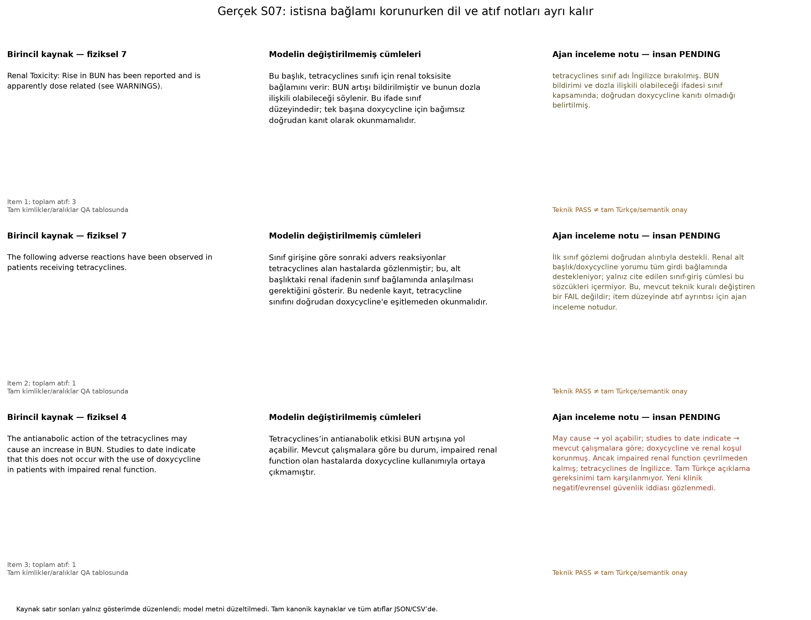
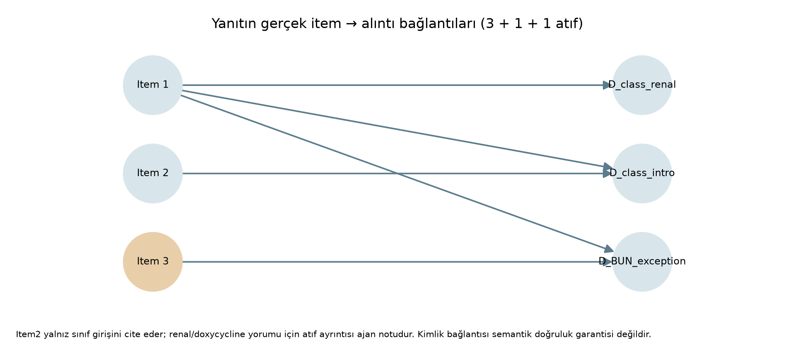
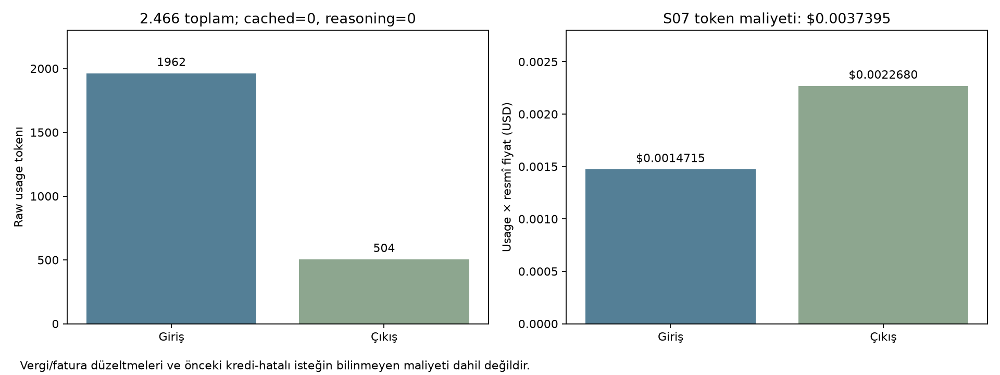

# WP12 — Gerçek S07 Doxycycline/BUN açıklaması: bağımsız inceleme

08.11.2026 · Run `20261108_173049_106b5d49c4f64383ad0b59cd7fd50e0e`.

**Sonuç:** HTTP200/completed, JSON Schema ve kaynak-uygulama kontrolleri PASS. Sınıf bağlamı ve istisnanın iki cümlesinin çekirdek anlamı ajan okumasında korunmuş. Ancak **tam Türkçe kalite geçişi verilmedi**: kritik renal koşul “impaired renal function” İngilizce bırakılmış. İkinci item için atıf ayrıntısı notu var. İnsan kararı PENDING; otomatik yayın veya S04 yürütümü yoktur. Teknik PASS geri yazılmadı, kalite notları ayrı kayıttır.

## Modelin gerçek cümleleri — değiştirilmeden

> Bu başlık, tetracyclines sınıfı için renal toksisite bağlamını verir: BUN artışı bildirilmiştir ve bunun dozla ilişkili olabileceği söylenir. Bu ifade sınıf düzeyindedir; tek başına doxycycline için bağımsız doğrudan kanıt olarak okunmamalıdır.

> Sınıf girişine göre sonraki advers reaksiyonlar tetracyclines alan hastalarda gözlenmiştir; bu, alt başlıktaki renal ifadenin sınıf bağlamında anlaşılması gerektiğini gösterir. Bu nedenle kayıt, tetracycline sınıfını doğrudan doxycycline'e eşitlemeden okunmalıdır.

> Tetracyclines’in antianabolik etkisi BUN artışına yol açabilir. Mevcut çalışmalara göre bu durum, impaired renal function olan hastalarda doxycycline kullanımıyla ortaya çıkmamıştır.

Tam model mesajı:

```json
{"result":{"schema_version":"WP12-local-llm-candidate-v2","status":"candidate","refusal_code":null,"language":"tr","items":[{"explanation_tr":"Bu başlık, tetracyclines sınıfı için renal toksisite bağlamını verir: BUN artışı bildirilmiştir ve bunun dozla ilişkili olabileceği söylenir. Bu ifade sınıf düzeyindedir; tek başına doxycycline için bağımsız doğrudan kanıt olarak okunmamalıdır.","source_scope":"class_level","statement_kind":"adverse_context","evidence_ids":["quote:9882fd3b194817596c0e2b90da5ab49b7b708ce9db09fe072566f2948593d787","quote:22b5ff9fea323f22799d18e7da6093aa6c7238b3f20a56f9c5cabade582f5f48","quote:4206e7f12339a5412d16025026794c02964045f0df666b3c4b8ea3f06ca2495b"]},{"explanation_tr":"Sınıf girişine göre sonraki advers reaksiyonlar tetracyclines alan hastalarda gözlenmiştir; bu, alt başlıktaki renal ifadenin sınıf bağlamında anlaşılması gerektiğini gösterir. Bu nedenle kayıt, tetracycline sınıfını doğrudan doxycycline'e eşitlemeden okunmalıdır.","source_scope":"class_level","statement_kind":"scope_anchor","evidence_ids":["quote:22b5ff9fea323f22799d18e7da6093aa6c7238b3f20a56f9c5cabade582f5f48"]},{"explanation_tr":"Tetracyclines’in antianabolik etkisi BUN artışına yol açabilir. Mevcut çalışmalara göre bu durum, impaired renal function olan hastalarda doxycycline kullanımıyla ortaya çıkmamıştır.","source_scope":"class_statement_with_doxycycline_exception","statement_kind":"warning","evidence_ids":["quote:4206e7f12339a5412d16025026794c02964045f0df666b3c4b8ea3f06ca2495b"]}]}}
```

Özgün HTTP cevabı `inference_response_raw.json` dosyasında kalır. Yeni `exact_model_message.txt` birebir mesaj metnidir. CSV round-trip ile cümle/alıntı/atıf eşliği kontrol edildi. İngilizce terim düzeltilip modelin başarısı gibi gösterilmedi.

## Teknik sonuç ve kaynak kimliği

| Alan | Gerçek değer |
|---|---|
| Model |gpt-5.4-mini-2026-03-17|
| HTTP / completion |200 / completed; error ve incomplete_details null|
| Request-ID |req_f009fc73d6dc4ff1ada8a9d8c27fe707|
| Response-ID |resp_0b22c14d7bf39fb0016af0879e0e2087d2a3e649496c51bf15|
| JSON / uygulama |PASS /PASS; birincil sıra, scope/kind,3ayrı kaynak ve bağımlılık kapanışı doğru|
| Kaynak |Kullanıcı PDF'si050641Orig1s032lbl.pdf, DB00254;3frozen alıntı/380karakter|
| PDF SHA-256 |237080fbda2eb353f322921302401bcc98d6a8e54dece1f8e9d11c886dfddcd5|
| PDF sayfa sayısı |11|
| İnsan kararı |PENDING|

PyMuPDF'nin kabul edilmiş çıkarıcı tanımıyla fiziksel4/7tam sayfa metinleri yeniden salt okunur kontrol edildi. Tam sayfa metni, üç karakter dilimi ve alıntı hash'leri frozen bundle ile aynı. Sayfa PNG'leri görsel incelendi. Yeni alıntı oluşturulmadı ve girdi genişletilmedi. Belgenin kendi “latest approved” uyarısı/güncellik sınırı korunur; hash eşliği düzenleyici veya klinik doğruluk onayı değildir.

## Ajan kaynak/dil incelemesi

| Item | Kaynak okuması | Kalite/atıf notu |
|---|---|---|
|1 renal/BUN|Sınıf kapsamı ve dozla ilişkili olabileceği nitelemesi korunmuş. Doğrudan doxycycline kanıtı olarak alınmaması belirtilmiş.|tetracyclines sözcüğü İngilizce; üç kaynağa atıf var.|
|2 sınıf girişi|İlk gözlem cümlesi sınıf girişinden desteklenir; devam eden yorum tüm girdi bağlamıyla uyumlu okunabilir.|Yalnız sınıf girişine atıf var; literal alıntı renal/doxycycline sözcüklerini içermez. Bu item düzeyinde atıf ayrıntısı notudur.|
|3 istisna|May cause → yol açabilir; studies to date indicate → Mevcut çalışmalara göre; doxycycline ve renal işlev koşulu mevcut. İki kaynak cümlesi birlikte aktarılmış.|“impaired renal function” çevrilmemiş. Ajanın Türkçe açıklama notu “böbrek işlevi bozulmuş”tur; bu not LLM metnine eklenmemiştir.|

İstisnanın kapsamı var diye Türkçe gereksinimi otomatik geçmiş sayılmaz. “Mevcut çalışmalara göre” ifadesi sınırlı çalışma bağlamını koruyor; tüm insanlar/gelecek koşullar için evrensel güvenlik veya yeni bir klinik negatif etiketi gözlenmedi. Bunun insan semantik incelemesiyle değerlendirilmesi gerekir. BUN'a yeni açılım veya yeni yan etki/skor/MedDRA hedefi eklenmemiştir.

Atıf notu, kaynak seti genelinde desteklenebilen yorumla item'ın literal atfının ayrımını gösterir. Bu gözlem yeni bir zorunlu-kenar veya şema kuralı olarak geriye dönük eklenmedi; frozen kriter ve teknik PASS değiştirilmedi. Yeni çalışma ancak bu bulgular ayrı değerlendirilerek tasarlanabilir; bu tur yöntem düzeltmesi veya tekrar yoktur. Eski basit dil tarayıcısı da sonuç sonrası terim listesiyle değiştirilmedi.





Şekildeki5kenar yalnız gerçek response evidence_ids alanıdır:3+1+1. Biyolojik etkileşim, öğrenilmiş önem veya nedensellik değildir. Kaynak kimlikleri doğru olsa bile cümle anlamı ve okunabilirlik ayrıca değerlendirilir. Ajan notları bu tek run/raw hash'ine bağlıdır; S01 sabit cümle testi veya genel otomatik semantik classifier kullanılmadı.

## Usage, maliyet ve bütçe

| Alan | Değer |
|---|---:|
| Tam sunucu önkontrol / gerçek input |1962 /1962|
| Cached input |0|
| Output toplam |504|
| Output içindeki reasoning |0|
| Toplam token |2466|
| HTTP üretim süresi |4,813 s|
| Input token maliyeti |$0.0014715|
| Output token maliyeti |$0.002268|
| S07 usage-token maliyeti |**$0.0037395**|
| S01+S07 bilinen completed token maliyeti |$0.0056430|
| Global rezerv |9HTTP/3inference; $0,069|

Bağımsız Decimal hesabı:1962×$0,75/1M +504×$4,50/1M =$0,0037395. Cached ve reasoning0 raw alanlarda mevcuttur; çift sayılmadı.504token bütün JSON/ID/cümle çıktısını kapsar. [Resmî standart fiyatlar](https://developers.openai.com/api/docs/models/gpt-5.4-mini). Vergiler/fatura düzeltmeleri ve ilk429 isteğinin UNKNOWN usage maliyeti hariçtir; pilotun kesin toplam faturasını bilinen completed alt toplamla eşitlemiyoruz. Bakiye veya hesap API'si okunmadı.



Bütçe v2 komut kabulü kayıtta mevcut; eski6HTTP/2rezerv silinmeden3HTTP/1inference eklenmiş.30HTTP/10inference ve$0,25 operasyonel sınır korunur. Eski stop/rezervler ve yeniS07tek-attempt kilidi durur. Kalan kapasite yeni çalışma yetkisi değildir. RAM/VRAM telemetrisi toplanmadı; hız/kararlılık için tek ölçümden genelleme yapılmadı.

## QA, geçmiş kayıtlar ve durma noktası

19 kayıtlı run hash'i, dosya envanteri, raw→JSON, exact prompt/source/schema hash'leri, frozen source-ID/bağımlılıklar, PDF sayfaları, bağımsız usage/maliyet, sayaç/tek-deneme ve insan kapıları doğrulandı.14 yeni ağsız gerçek-kayıt testi PASS. Önceki28 hazırlık testi/QA dosyaları ezilmedi. Özgün model yanıtı, GemmaV1/V2 başarısızlıkları, QwenNOT_RUN, ilkHTTP429, S01 başarı kaydı ve S01 olumlu kullanıcı beyanı aynen korundu. Resmî S01 insanPENDING değiştirilmedi.

JSON/CSV karşılaştırma S01 ile S07'nin farklı senaryolar olduğunu gösterir; eş görevde model üstünlüğü veya klinik güvenlilik benchmark'ı değildir. Başarısız/NOT_RUN alanlar sıfır başarı/ücretle doldurulmadı. `reported_in_PDF` aday olarak kalır, `predicted_by_GNN` NOT_REQUESTED/null; model eğitimi veya veri etiketine yazım yapılmadı.

**Öneri:** S07'nin tam Türkçelik ve item2 atıf notları için kullanıcı/insan kararını bekle. Mevcut yanıtı sessizce düzeltme veya bu vakayı tekrar çalıştırma. S04 hâlâ LOCKED_NOT_RUN; otomatik ilerleme,19×3, yayın, model araması/eğitimi ve WP13 kapalıdır. Anahtar/.env okunmadı veya hash'lenmedi; bu incelemede yeni API isteği0.
