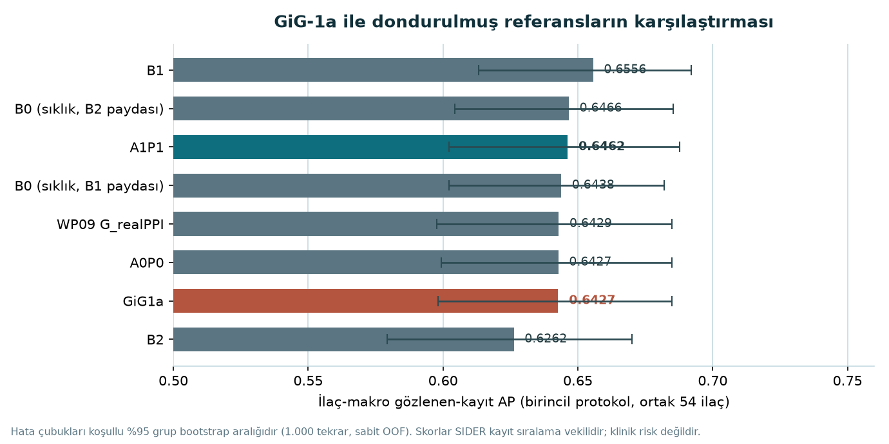
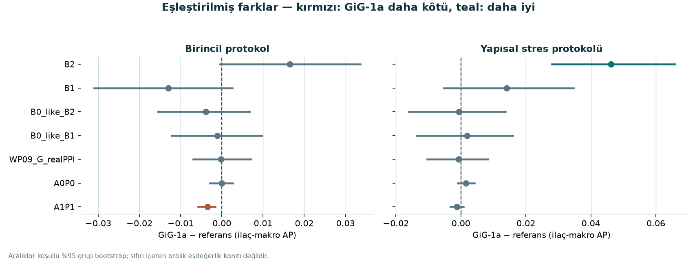

# WP14 — GiG-1a deney sonuçları

> 14.11.2026 · Protokol sonuçlardan **önce** kilitlendi
> (`reports/qa/WP14/gig1_v1/run_config.json`). A1P1, B0, B1, B2 ve WP09
> modelleri yeniden eğitilmedi; dondurulmuş OOF skorları aynen kullanıldı.
> Bütünlük manifestleri deney sonrası da aynı: **1567 / 1711 / 2487**.

---

## 1. Karar

> ## Ek katkı gösterilemedi — **A1P1 ana araştırma mimarisi olarak korunur**

Önceden kilitlenmiş kabul kriteri:

> `GiG1a − A1P1` farkının koşullu %95 grup bootstrap GA'sı tamamen sıfırın
> üzerinde olmalı **ve** stres protokolünde nokta tahmini negatif olmamalı.

| Koşul | Sonuç |
|---|---|
| Birincil fark | **−0,003536** |
| Birincil %95 GA | **[−0,005802; −0,001563]** |
| GA tamamen sıfırın üzerinde mi? | **Hayır** — tamamen sıfırın **altında** |
| Stres farkı | **−0,001204** |
| Stres nokta tahmini negatif değil mi? | **Hayır**, negatif |
| **Kabul** | **Edilmedi** |

Sonuç yalnızca "fark gösterilemedi" değildir: GiG-1a, birincil protokolde
A1P1'den **güvenilir biçimde bir miktar daha kötüdür**.

---

## 2. Ne çalıştırıldı?

| Aşama | Sonuç |
|---|---|
| Sentetik kapı | **8/8 PASS** · ilaç→protein mesajı analitik olarak doğrulandı (max fark **8,3×10⁻¹⁷**) |
| Protokol kilidi | 38 bağlam (28 iç + 10 dış), encoder SHA-256 ile donduruldu |
| Eğitim | **38/38 iş OK**, 2.032 optimizer adımı, 10/10 dış kat tamam |
| Dış epoch seçimi | birincil 33–38, stres 34–47 (yalnız iç katlardan) |
| Dondurulmuş skorlama | **35.974** çift |
| Karşılaştırma kapsamı | **0 eksik anahtar** — dört kapsamda da tam eşleşme |

Karşılaştırma anahtarları WP10'un dondurulmuş `comparison_keys.csv`
dosyasından alındı; yeni kapsam tanımlanmadı.

| Kapsam | Anahtar | GiG-1a eksiği |
|---|---:|---:|
| primary / paired54 | 13.964 | **0** |
| primary / own61 | 18.004 | **0** |
| stress / paired54 | 13.890 | **0** |
| stress / own61 | 17.970 | **0** |

---

## 3. Birincil sonuç (primary · paired54 · ilaç-makro AP)

| Model | AP | %95 GA |
|---|---:|---|
| B1 | **0,655642** | [0,6131; 0,6920] |
| B0_like_B2 | 0,646604 | [0,6044; 0,6853] |
| **A1P1** | **0,646234** | [0,6022; 0,6876] |
| B0_like_B1 | 0,643787 | [0,6021; 0,6820] |
| WP09 G_realPPI | 0,642880 | [0,5978; 0,6849] |
| A0P0 | 0,642740 | [0,5993; 0,6848] |
| **GiG-1a** | **0,642699** | [0,5982; 0,6848] |
| B2 | 0,626239 | [0,5792; 0,6701] |

### Eşleştirilmiş farklar

| Referans | Birincil | Stres |
|---|---|---|
| **A1P1** | **−0,003536** [−0,005802; **−0,001563**] | −0,001204 [−0,003267; +0,000799] |
| A0P0 | −0,000041 [−0,002873; +0,002669] | +0,001598 [−0,000993; +0,004233] |
| WP09 G_realPPI | −0,000181 [−0,006900; +0,007030] | −0,000668 [−0,010388; +0,008326] |
| B0_like_B1 | −0,001088 [−0,012213; +0,009807] | +0,001944 [−0,013661; +0,015934] |
| B1 | −0,012943 [−0,030956; +0,002554] | +0,014066 [−0,005208; +0,034713] |
| B2 | +0,016460 [−0,000454; +0,033587] | **+0,046241** [+0,027985; +0,065741] |

### En dikkat çekici bulgu

> **GiG-1a ≈ A0P0** (fark −0,000041, GA [−0,0029; +0,0027]).

A0P0, atom dalı ve PPI'nin **ikisinin de kapalı** olduğu koldur. İlaç →
protein mesajı eklendiğinde A1P1'in atom dalından gelen ölçülmüş kazancı
(WP10: marjinal atom **+0,002894**) pratikte ortadan kalkmıştır. Kaybedilen
miktar (−0,003536) bu kazançla aynı mertebededir.

Bu bir **eşzamanlılık gözlemidir**; nedensel mekanizma bu deneyle
ayrıştırılmış değildir.

---

## 4. Her metrik kötüleşmedi — dürüst ayrıntı

| Metrik (primary, paired54) | GiG-1a | A1P1 | Fark |
|---|---:|---:|---:|
| İlaç-makro AP (**birincil**) | 0,642699 | 0,646234 | **−0,003536** |
| Micro AP | **0,574911** | 0,572040 | +0,002871 |
| Micro AUROC | **0,729083** | 0,727243 | +0,001840 |

Kötüleşme **ilaç başına sıralamaya** özgüdür; havuzlanmış global
sıralamada GiG-1a bir miktar daha iyidir. Birincil ölçüt önceden
ilaç-makro AP olarak kilitlendiği için karar değişmez, ancak bu ayrıntı
gizlenmemelidir.

---

## 5. Neden? — Önceden kaydedilmiş dejenerasyon kontrolü

Protokolün §7.3(5) maddesi, hub proteinlerde mesajın neredeyse sabit
çıkması hâlinde bunun sonuçla birlikte raporlanmasını şart koşuyordu.
Beş birincil dış modelde ölçüldü (`degeneracy_check.csv`):

| Ölçüm | Değer | Yorum |
|---|---:|---|
| Mesaj normu / taban normu | **0,380** | Mesaj, protein gömmesinin ~%38'i kadar **büyük** bir müdahale |
| Mesajın merkezden yayılımı / merkez normu | **0,290** | Mesaj proteinler arasında büyük ölçüde **sabit** |
| Hub proteinlerde mesaj normu (derece ≥ 10) | 1,082 | Hub ile |
| Düşük dereceli proteinlerde (derece 1–2) | 1,150 | düşük derece **neredeyse aynı** |

**Okunuşu:** İlaç → protein mesajı, protein temsillerine *büyük ama büyük
ölçüde ayırt edici olmayan* bir bileşen ekliyor. Yani her proteini benzer
yönde kaydırıyor; hub ile spesifik proteini ayırt etmiyor. Bu, fizibilite
raporunda öngörülen **oversmoothing** desenidir ve ölçülmüş AP kaybıyla
tutarlıdır.

Bir düzeltme: fizibilite raporunda "proteinlerin %59'u hiç 2-adım yolu
taşımaz" denmişti; bu 62 ilaçlık **tüm kohort** için doğrudur. Kat içi
eğitim graflarında ise bağlantısız protein **sıfırdır** (125/121/133/119/123
proteinin tamamı en az bir ilaca bağlı). Dolayısıyla sonuç, yolun
yokluğundan değil, **yolun ayırt edici olmamasından** kaynaklanıyor.

---

## 5b. Sonucu yeniden çerçeveleyen tanı — iki sıralama yönü

GiG-1a'nın birincil ölçütte kaybetmesi ama micro AP/AUROC'ta kazanması,
hangi **yönde** ölçtüğümüzü sorgulatmıştır. İki ölçüt aynı matrisi farklı
eksende okur:

- **drug_macro_AP (birincil):** sabit bir ilaç için PT'leri sırala
- **class_macro_AP:** sabit bir PT için ilaçları sırala

Dondurulmuş sonuçlardan (primary · paired54):

| Model | class_macro_AP | drug_macro_AP |
|---|---:|---:|
| B2 | **0,3489** | 0,6262 |
| **GiG-1a** | **0,3205** | 0,6427 |
| WP09 G_realPPI | 0,3190 | 0,6429 |
| A1P1 | 0,3173 | 0,6462 |
| A0P0 | 0,3165 | 0,6427 |
| B1 | 0,3152 | 0,6556 |
| B0_like_B2 (sıklık) | **0,2382** | 0,6466 |
| B0_like_B1 (sıklık) | 0,2389 | 0,6438 |

**Okunuşu:**

1. **Sınıf yönünde öğrenilmiş modellerin tamamı sıklık referansını açık
   farkla geçer** (~0,32 karşı ~0,238; bağıl olarak yaklaşık +%33). Yani
   modeller ilaca özgü gerçek bir sinyal öğreniyor.
2. **İlaç yönünde (birincil ölçüt) hiçbiri sıklığı anlamlı biçimde
   geçemez.** Bir ilacın PT sıralaması, PT'lerin kayıt yaygınlığı
   tarafından baskılanır; sıklık referansı bunu zaten yakalar.
3. **GiG-1a bu iki yön arasında yer değiştirmiştir:** sınıf yönünde
   A1P1'in üzerine çıkmış (0,3205 > 0,3173), ilaç yönünde altına
   düşmüştür (0,6427 < 0,6462).

Sınıf başına gözlenen pozitif sayısına göre bakıldığında A1P1, sıklık
referansını **her** yoğunluk bandında geçer — en seyrek sınıflarda bile
(tek pozitifli 59 sınıf: 0,0751 karşı 0,0310). 306 sınıfın 278'inde
A1P1 daha iyidir. Dolayısıyla başlığın seyrek sınıflarda aşırı öğrendiği
yönündeki hipotez bu veriyle **desteklenmemektedir**.

> **Sonuç:** Bu kohortta darboğaz ne kodlayıcı zenginliği ne de başlık
> kapasitesidir; birincil ölçütün **yönüdür**. Mimari değişiklikleri
> gerçek bir sinyali yönler arasında taşımakta, fakat ilaç içi sıralamada
> yaygınlık etkisini aşamamaktadır.

`class_macro_AP` WP10 tarafından **"pooled diagnostic only; bağımsız
fold CI yok"** olarak etiketlenmiştir; burada güven aralığı verilmemiştir.
Yorum, on bir modelin tamamında tutarlı olan nokta tahmini farkına
dayanır ve kalibre edilmiş bir üstünlük iddiası değildir.

---

## 6. Güvenlik ve izolasyon denetimi

| Kontrol | Sonuç |
|---|---|
| Yan etki kenarı encoder'da | **Yok** — mesajlar yalnız kimya/molekül/maske taşır |
| Test etiketleri encoder'da | **Yok** |
| İlaç→protein mesajı kaynağı | Yalnız eğitim grafı; sorgu ilacı önbelleğe **yazmaz** |
| Önbellek izolasyonu | Sentetik kapı 06 ile doğrulandı |
| Epoch seçimi | Yalnız iç kat doğrulaması; dış test skoru kullanılmadı |
| Seçim → skorlama sırası | `selection_complete_before_test_scoring.json` hash'leri doğrulandı |
| Yeni yol gerçekten öğrenildi mi? | **Evet** — 38/38 fitte `W_dp` gradyan normu > 0 **ve** ağırlık L2 değişimi > 0 |
| Dondurulmuş modeller | Yeniden eğitilmedi; manifestler sabit (1567/1711/2487) |

`W_dp`'nin sıfırlandığı durumda modelin A1P1 ile bit düzeyinde aynı
protein gömmesi ürettiği sentetik kapı 05'te doğrulandı — yani kol,
A1P1'in kontrollü bir genişletmesidir.

---

## 7. Maliyet

| | Değer |
|---|---:|
| Ek parametre | **+1.728** |
| Toplam parametre aralığı | 31.098 – 56.466 |
| Optimizer adımı | 2.032 |
| Fit sayısı | 38 |

---

## 8. Tez için ne söylüyor?

1. **EMT1'in "iç ve dış graf arasında bilgi aktarımı" fikri bu veri
   kümesinde sınandı ve ek katkı sağlamadı.** Artık tezde "denenmedi"
   boşluğu yoktur; ölçülmüş bir sonuç vardır.
2. Bu, WP09 (PPI: `−0,000142`) ve WP10 (atom: `+0,002894`) ile birlikte
   **tutarlı bir örüntüyü** tamamlar: 54–62 ilaçlık bu kohortta temsil
   zenginleştirmenin getirisi sistematik olarak sıfır civarındadır ve
   kapasite artışı zarar verebilmektedir.
3. **B1 (0,6556) hâlâ en yüksek AP'ye sahip modeldir.** Tezde "ana graf
   araştırma mimarisi" (A1P1) ile "en yüksek değerlendirme metriğine sahip
   model" (B1) ayrı kavramlar olarak raporlanmaya devam etmelidir.
4. Negatif sonuç gizlenmemeli; yöntemin doğru uygulandığının kanıtı olan
   sentetik kapı, gradyan kanıtı ve dejenerasyon ölçümü ile birlikte
   sunulmalıdır.

---

## 9. Üretilen dosyalar

| Dosya | İçerik |
|---|---|
| `scripts/wp14_gig1_encoder.py` | GiG-1a modeli |
| `scripts/wp14_gig1_gate.py` | Sentetik kapı (8 kontrol) |
| `scripts/wp14_gig1_train.py` | Kilit, eğitim, dondurulmuş skorlama |
| `scripts/wp14_gig1_evaluate.py` | Eşleştirilmiş karşılaştırma ve kabul kararı |
| `scripts/wp14_gig1_degeneracy.py` | Dejenerasyon kontrolü |
| `scripts/wp14_gig1_figures.py` | Sonuç görselleri |
| `reports/qa/WP14/gig1_gate_v1/` | Sentetik kapı kaydı |
| `reports/qa/WP14/gig1_v1/` | Protokol, fitler, OOF skorlar, metrikler, karar |
| `models/WP14_gig1_v1/` | 38 model ağırlığı ve meta verisi |
| `reports/figures/WP14/04,05` | AP karşılaştırması ve farklar |

**Ana model değiştirilmemiştir.** A1P1 korunur; bu karar için ayrıca
kullanıcı onayı gerekmemiştir çünkü kriter karşılanmamıştır.
