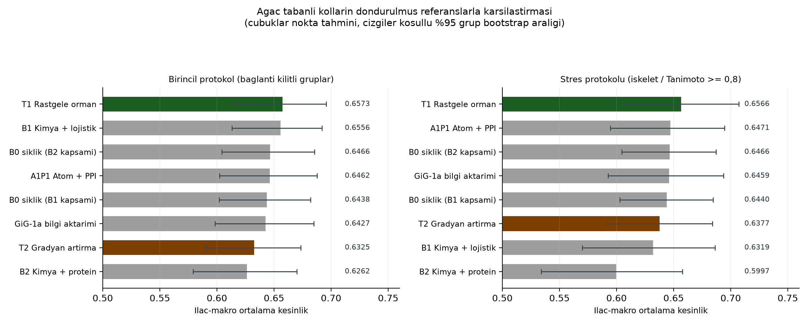
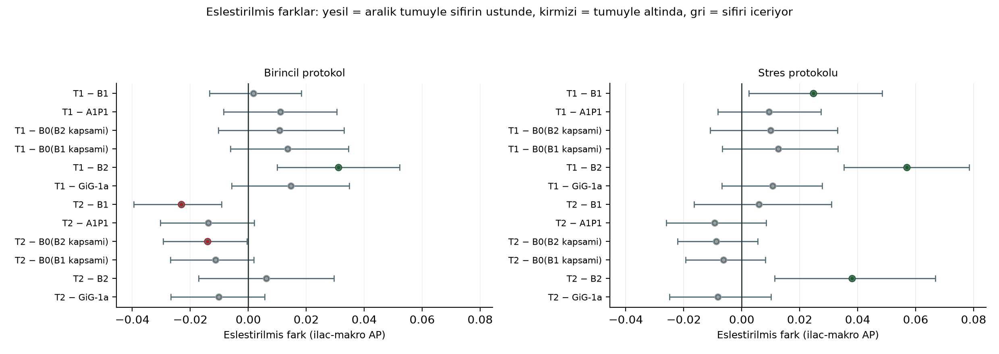
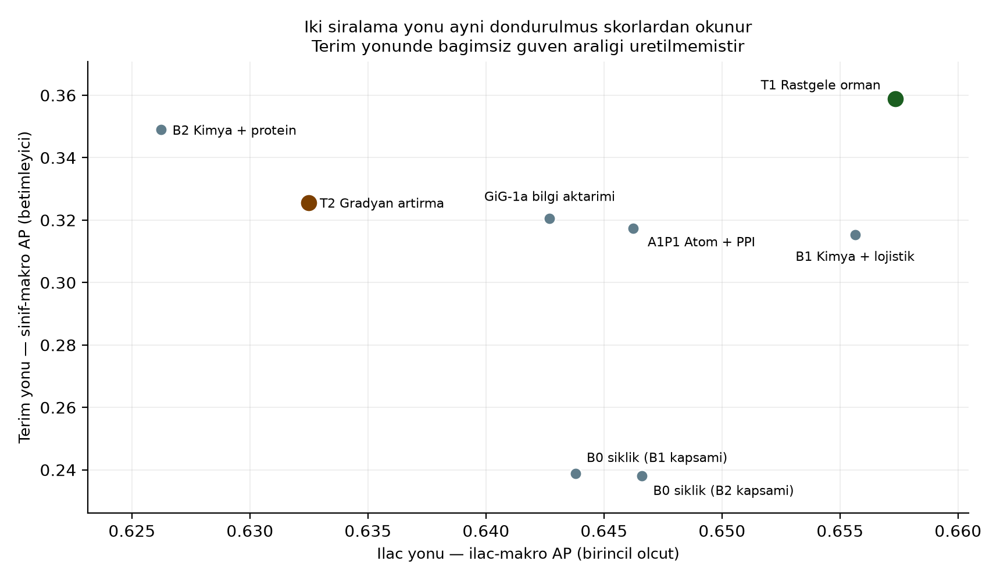

# WP15 — Ağaç tabanlı karşılaştırma modellerinin sonuçları

> 15.11.2026 · Deney **tamamlandı ve donduruldu**.
> Önceki hiçbir model yeniden eğitilmedi; bütünlük manifestleri sabit
> (1567 / 1711 / 2487, 55 kapı testi geçti).
> Protokol kaydı: `reports/qa/WP15/tree_v1/run_config.json`

---

## 1. Araştırma sorusu

Birincil ölçütte en yüksek nokta tahminine sahip model, beş fizikokimyasal
tanımlayıcı üzerinde kurulu **doğrusal** bir lojistik regresyondur (B1).
Buradan şu soru doğar: kimyasal tanımlayıcılar ile gözlenen kayıt arasındaki
ilişki, doğrusal bir modelin yakalayamayacağı **eksen hizalı etkileşimler**
içeriyor mu? Bu soru, modeli büyütmeyi değil, **aynı bilgiyi farklı bir
fonksiyon sınıfıyla** okumayı gerektirir.

Bu nedenle deneyin tasarımında tek bir şey değişir: **kestirici**.

| Sabit tutulan | Değer |
|---|---|
| Özellik kümesi | B1 ile birebir aynı — `chem__MW`, `chem__LogP`, `chem__HBD`, `chem__HBA`, `chem__TPSA`, `mask__chemistry` |
| Bölmeler | Dondurulmuş `nested_partitions_v1.csv`; 5 dış × 3 iç kat, ilaç-ayrık |
| Uygunluk | `prediction_eligibility.csv :: model=B1` — 54 ilaç |
| Hedef sözlüğü | `train_vocabularies.json`, yalnız eğitim bölmesinden |
| Etiket | WP03 `drug_pt_positives.csv` (tutucu tanım) |
| Çok etiketlilik | Her PT için bağımsız ikili sınıflandırıcı |
| Tohum | 20261106 |

İki kol: **T1 = Rastgele orman** (300 ağaç), **T2 = Histogram tabanlı
gradyan artırma** (100 yineleme, öğrenme oranı 0,1). Hiperparametre ızgarası
sonuçlar görülmeden kilitlenmiştir (`grid_frozen_before_results: true`);
seçim **yalnız iç kat** ortalamasına göre yapılır.

---

## 2. Eğitimden önce kapatılan iki kapı

Her ikisi de **hiçbir eğitim çalıştırılmadan önce** bulunmuş, düzeltilmiş ve
kilitli konfigürasyona gerekçesiyle yazılmıştır. Sonuç görülüp sonradan ayar
değiştirilmemiştir.

**(a) Gradyan artırmada erken durdurma çöküyordu.** İlk kilitte
`early_stopping=True` idi. Duman testinde, 29 ilaçlık bir eğitim bölmesinde
seyrek hedefler için kütüphanenin dahili tabakalı doğrulama bölmesi tek üyeli
sınıf nedeniyle hata verdi. `early_stopping=False`, `max_iter=100` olarak
değiştirildi; düzenlileştirme `max_depth` üzerinden iç katta seçilir.

**(b) Rastgele ormanda paralellik determinizmi bozuyordu.** Süreyi kısaltmak
için `n_jobs=-1` denendi. Aynı `random_state` ile `n_jobs=1` ve `n_jobs=-1`
**birebir aynı olasılıkları üretmedi**; determinizm kapısı başarısız oldu.
Bu, yalnız hızı etkileyen bir ayar olmadığı için `n_jobs=1`'e dönüldü.
Toplam iç seçim süresi 8.578 saniyeye çıktı. Kayıttaki gerekçe:
*"Tekrar üretilebilirlik hızdan öncedir."*

---

## 3. Seçilen hiperparametreler

Seçim yalnız iç kat ortalamasıyla yapıldı; hiçbir dış kat skoru seçimde
kullanılmadı (`outer_test_used: False`, 20 kol-kat kaydının tamamında).

| Kol | Seçilen yapılandırma | Kaç kat (20 üzerinden) |
|---|---|---:|
| T1 Rastgele orman | `max_depth=3, min_samples_leaf=3` | 7 |
| T1 Rastgele orman | `max_depth=None, min_samples_leaf=3` | 2 |
| T1 Rastgele orman | `max_depth=3, min_samples_leaf=1` | 1 |
| T2 Gradyan artırma | `max_depth=2` | 10 |

İki kolda da **en sığ adaylar** seçilmiştir. Bu, 29–43 ilaçlık eğitim
bölmelerinde derinliğin karşılığının olmadığını gösterir ve ağaç kolunun
elde ettiği farkın ezberden değil, sığ eksen hizalı bölünmelerden geldiğini
destekler.

İç seçim 180 aday-kat değerlendirmesi, 8.578 s. Dondurulmuş dış skorlama
55.708 çift; skorlama sırasında yeniden eğitim yok
(`model_refit_during_scoring: false`).

---

## 4. Birincil ölçüt — ilaç yönü

Birincil ölçüt: **ortak 54 ilaçta ilaç-makro gözlenen-kayıt ortalama
kesinliği**, birincil protokol. Aralıklar, dondurulmuş WP10 karşılaştırma
anahtarları ve aynı tohumla üretilmiş 1.000 yinelemeli koşullu grup
bootstrap'ıdır.



**Çizelge 1 — Birincil protokol, paired54, ilaç-makro AP**

| Model | Tahmin | %95 GA |
|---|---:|---|
| **T1 Rastgele orman** | **0,657339** | [0,6155; 0,6958] |
| B1 Kimya + lojistik | 0,655642 | [0,6131; 0,6920] |
| B0 sıklık (B2 kapsamı) | 0,646604 | [0,6044; 0,6853] |
| A1P1 Atom + PPI | 0,646234 | [0,6022; 0,6876] |
| B0 sıklık (B1 kapsamı) | 0,643787 | [0,6021; 0,6820] |
| GiG-1a bilgi aktarımı | 0,642699 | [0,5982; 0,6848] |
| T2 Gradyan artırma | 0,632483 | [0,5904; 0,6734] |
| B2 Kimya + protein | 0,626239 | [0,5792; 0,6701] |

### 4.1 Kabul ölçütünün uygulanması

Önceden kaydedilmiş ölçüt: *"Yeni model otomatik olarak ana model olmaz.
Ayırt edilebilirlik için farkın koşullu %95 grup bootstrap aralığının sıfırı
içermemesi aranır."* Önceden belirlenmiş tek sınama **T1 − B1**, birincil
protokol, ilaç-makro AP'dir.

| Karşılaştırma | Fark | %95 GA | Ayırt edilebilir mi? |
|---|---:|---|---|
| **T1 − B1** | **+0,001697** | **[−0,013428; +0,018248]** | **Hayır** |
| T1 − A1P1 | +0,011105 | [−0,008565; +0,030573] | Hayır |
| T1 − B0 (B2 kapsamı) | +0,010735 | [−0,010266; +0,033010] | Hayır |
| T1 − GiG-1a | +0,014640 | [−0,005805; +0,034814] | Hayır |
| **T1 − B2** | **+0,031100** | **[+0,010025; +0,052217]** | **Evet** |
| **T2 − B1** | **−0,023159** | **[−0,039580; −0,009189]** | **Evet (daha kötü)** |
| T2 − A1P1 | −0,013751 | [−0,030343; +0,002082] | Hayır |
| **T2 − B0 (B2 kapsamı)** | **−0,014121** | **[−0,029409; −0,000422]** | **Evet (daha kötü)** |

**Karar: T1 ana model olmaz.** Nokta tahmini B1'in üzerinde olsa da fark
belirsizlik aralığı içindedir; bu veri ve bu ölçüt altında iki model ayırt
edilemez. "Rastgele orman lojistik regresyonu geçti" denemez.

**T2 için karar nettir:** gradyan artırma, B1'den **ayırt edilebilir biçimde
daha kötüdür** ve öğrenme içermeyen sıklık referansının da altındadır. Altı
özellik ve küçük eğitim bölmeleriyle ardışık artırma, bu kurulumda zarar
vermektedir.

---

## 5. Stres protokolünde beklenmeyen bulgu

Stres protokolü (iskelet **veya** Tanimoto ≥ 0,8 ile gruplama) bu çalışmanın
başında **önceden kaydedilmiştir**; sonuçlar görüldükten sonra tanımlanmış
bir analiz değildir.



**Çizelge 2 — Stres protokolü, paired54, ilaç-makro AP**

| Model | Birincil | Stres | Değişim |
|---|---:|---:|---:|
| **T1 Rastgele orman** | 0,657339 | **0,656584** | **−0,0008** |
| A1P1 Atom + PPI | 0,646234 | 0,647141 | +0,0009 |
| B0 sıklık (B2 kapsamı) | 0,646604 | 0,646561 | −0,0000 |
| GiG-1a | 0,642699 | 0,645937 | +0,0032 |
| T2 Gradyan artırma | 0,632483 | 0,637737 | +0,0053 |
| **B1 Kimya + lojistik** | 0,655642 | **0,631871** | **−0,0238** |
| B2 Kimya + protein | 0,626239 | 0,599696 | −0,0265 |

Stres protokolünde **T1 − B1 = +0,024713**, %95 GA
**[+0,002413; +0,048397]** — aralık tümüyle sıfırın üstündedir.

Bulgunun kaynağı çizelgede görülür: kimyasal olarak ayrık bölmelere
geçildiğinde **B1 düşer (−0,0238), T1 düşmez (−0,0008)**. Doğrusal model,
eğitim ilaçlarına kimyasal olarak benzeyen test ilaçlarından yararlanıyordu;
bu destek kaldırıldığında başarımı geriler. Sığ ağaç topluluğu aynı
koşuldan etkilenmemiştir.

**Bu bulgu kabul kararını değiştirmez.** Kabul ölçütü birincil protokolde
tanımlıdır ve orada fark ayırt edilemezdir. Stres sonucunun ikincil ve
yorumlayıcı okunmasının üç nedeni vardır:

1. Önceden kaydedilen tek sınama T1 − B1'in **birincil** protokoldeki
   halidir; stres protokolü ikincil kayıttır.
2. Bu raporda 2 kol × 6 referans × 3 ölçüt × 2 protokol üzerinden çok sayıda
   karşılaştırma yapılmıştır ve **çokluk düzeltmesi uygulanmamıştır**.
   Önceden belirlenmiş tek sınama dışındaki her sonuç **keşifseldir**.
3. Stres protokolünde grup sayısı azalır; aralıklar genişler.

Doğru ifade: *sığ ağaç topluluğu, kimyasal olarak ayrık bölmelerde doğrusal
kimya modelinin kaybettiği başarımı korumuştur; bu, sınanmaya değer bir
hipotezdir, kanıtlanmış bir üstünlük değildir.*

---

## 6. Terim yönü



**Çizelge 3 — Aynı dondurulmuş skorların iki yönde okunması (birincil
protokol, paired54)**

| Model | Terim yönü (sınıf-makro AP) | İlaç yönü (ilaç-makro AP) |
|---|---:|---:|
| **T1 Rastgele orman** | **0,3588** | 0,6573 |
| B2 Kimya + protein | 0,3489 | 0,6262 |
| T2 Gradyan artırma | 0,3255 | 0,6325 |
| GiG-1a | 0,3205 | 0,6427 |
| A1P1 Atom + PPI | 0,3173 | 0,6462 |
| B1 Kimya + lojistik | 0,3152 | 0,6556 |
| B0 sıklık | 0,2382–0,2389 | 0,6438–0,6466 |

T1, terim yönünde **bütün modellerin üstünde**dir (stres protokolünde de:
0,3678). Daha önce kaydedilen iki yön ayrımı burada da geçerlidir: öğrenme
içeren modeller terim yönünde sıklık referansını belirgin biçimde aşar,
ilaç yönünde aşamaz.

**Önemli kısıt:** sınıf-makro ortalama kesinlik bu çalışmada **havuzlanmış
betimleyici** bir ölçüttür; bağımsız kat yapısı bulunmadığı için güven
aralığı üretilmemiştir (`CI_NA_reason: descriptive class metric;no
independent-fold CI`). Bu nedenle terim yönündeki sıralamaya dayanarak
ayırt edilebilirlik iddia edilemez.

---

## 7. Kapsam kısıtı

Ağaç kolları B1'in uygunluk tanımını kullandığı için yalnız **54 ilaçlık
ortak kapsamda** (`paired54`) karşılaştırılabilir. Daha geniş `own61`
kapsamında dondurulmuş anahtarların 4.040'ı ağaç kollarında
bulunmamaktadır; değerlendirme betiği bu kapsamı **sessizce doldurmak
yerine atlamıştır**:

```
UYARI primary/own61: agac kollari anahtarlari kapsamiyor; atlandi
UYARI stress/own61: agac kollari anahtarlari kapsamiyor; atlandi
```

Kapsam kaydı: `reports/qa/WP15/tree_v1/comparison_coverage.csv`.

---

## 8. Üretilen dosyalar

| Dosya | İçerik |
|---|---|
| `scripts/wp15_tree_models.py` | Protokol kilidi, iç seçim, dondurulmuş dış skorlama |
| `scripts/wp15_tree_evaluate.py` | Eşleştirilmiş karşılaştırma, bootstrap, kabul kararı |
| `scripts/wp15_tree_figures.py` | Üç sonuç şekli |
| `reports/qa/WP15/tree_v1/run_config.json` | Kilitli protokol, iki kapı kaydı |
| `reports/qa/WP15/tree_v1/selected_candidates.csv` | 20 kol-kat seçimi, iç kat ortalamaları |
| `reports/qa/WP15/tree_v1/oof_predictions.csv` | 55.708 dondurulmuş skor |
| `reports/qa/WP15/tree_v1/metrics_with_group_CI.csv` | Beş ölçüt, iki protokol |
| `reports/qa/WP15/tree_v1/paired_differences.csv` | Eşleştirilmiş farklar ve aralıklar |
| `reports/qa/WP15/tree_v1/acceptance_verdict.json` | Kabul ölçütünün uygulanması |
| `reports/figures/WP15/01–03` | Şekiller |

---

## 9. Bilimsel kısıtlar

- Skorlar **gözlenen SIDER kaydı sıralama vekilidir**; klinik risk değildir.
- Kayıt bulunmaması **doğrulanmış biyolojik negatif değildir**; bilinmeyen
  çiftler negatif olarak etiketlenmemiştir.
- Test ilaçlarının yan etki etiketleri hiçbir aşamada girdiye verilmemiştir
  (`test_labels_in_training: false`).
- Önceden belirlenmiş tek sınama dışındaki karşılaştırmalar keşifseldir ve
  çokluk düzeltmesi içermez.

---

## 10. Sonuç

| Soru | Yanıt |
|---|---|
| Doğrusal olmayan bir kestirici birincil ölçütte ayırt edilebilir fark sağlıyor mu? | **Hayır.** T1 − B1 = +0,0017, aralık sıfırı içeriyor |
| Gradyan artırma işe yarıyor mu? | **Hayır.** B1'den ayırt edilebilir biçimde daha kötü (−0,0232) |
| T1 ana model olacak mı? | **Hayır.** Kabul ölçütü karşılanmadı |
| Deneyin kazandırdığı nedir? | Doğrusal kimya modelinin başarımının bir bölümünün **kimyasal benzerliğe dayandığı**; sığ ağaç topluluğunun bu desteği gerektirmediği. Ayrıca raporda eksik olan **doğrusal olmayan referans** artık mevcut |

Bu deney, ana planın `ÇIKTI 3` başlığında önerilen ve kullanıcı tarafından
onaylanan sınırlı ek deneydir. **İŞ PAKETİ TAMAMLANDI.**
